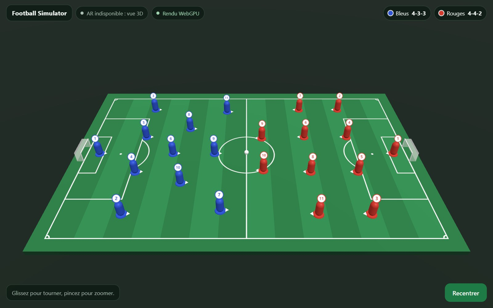
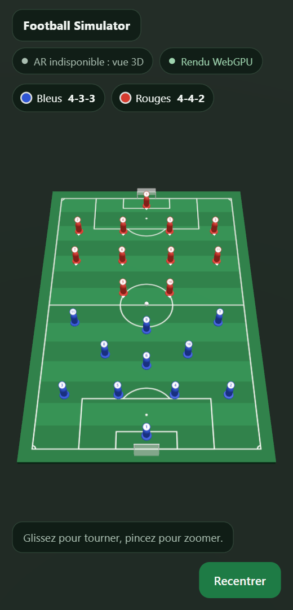
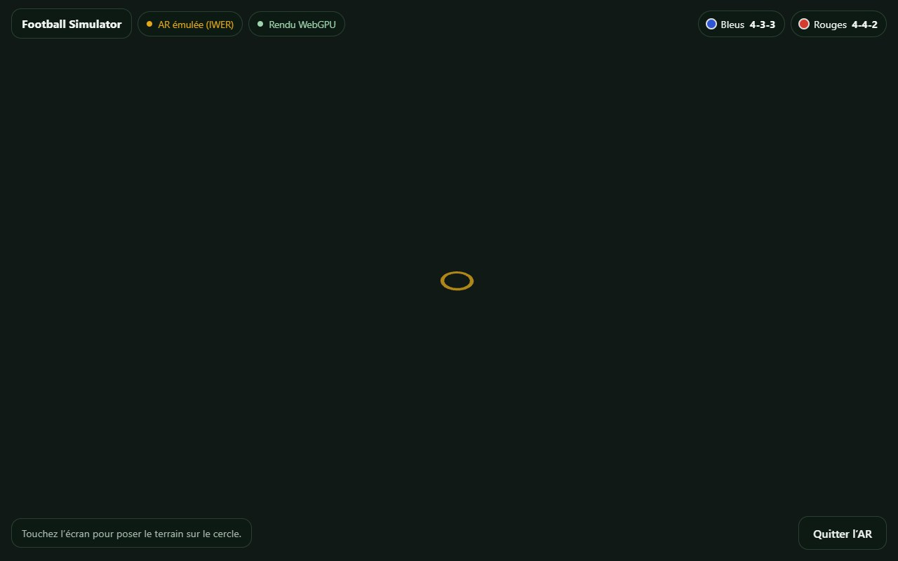
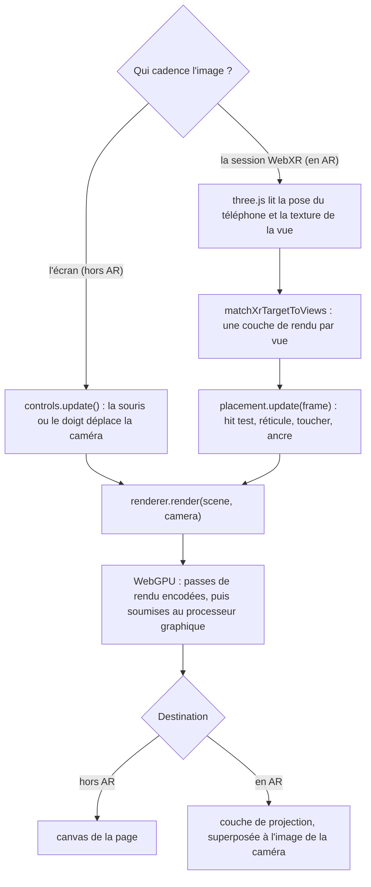
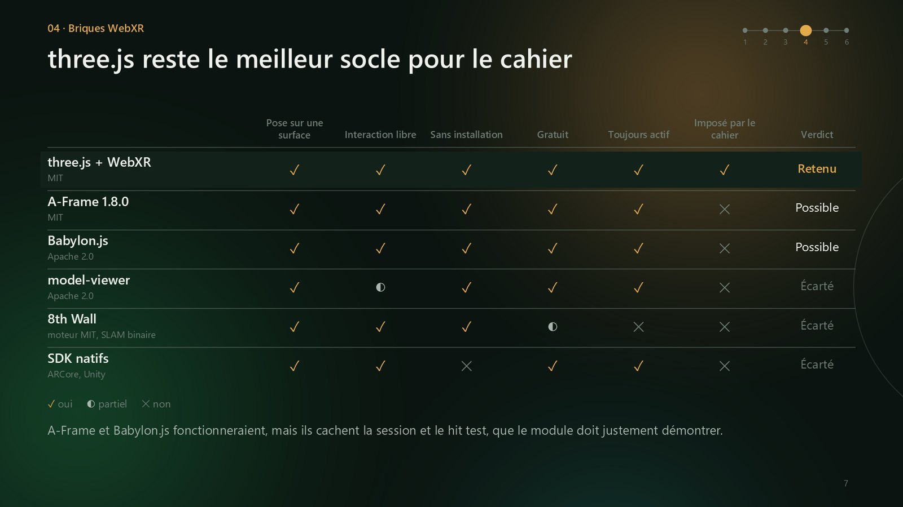
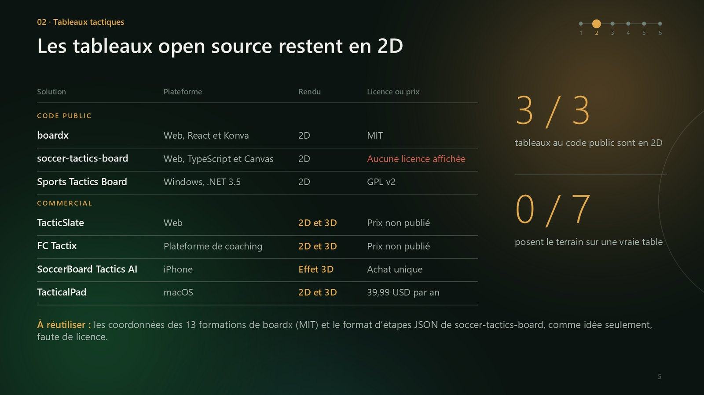

<p align="center">
  
</p>

<p align="center">
  <b>Tableau tactique de football en réalité augmentée, ouvert depuis un simple lien.</b><br>
  Application web progressive · WebXR · WebGPU · three.js r187 · SUP'COM, module Réalité Étendue, 2026–2027<br>
  <a href="https://bilelkhlif.github.io/footballsimulator/"><b>Ouvrir l'application</b></a> (en AR avec Chrome sur Android)
</p>

---

## En bref

- **Le besoin.** Les entraîneurs amateurs expliquent la tactique sur un tableau blanc : une vue de dessus en 2D, des déplacements difficiles à montrer, aucun partage à distance.
- **Notre réponse.** Une PWA qui pose un mini-terrain 3D de 60 × 39 cm sur une vraie table, à travers la caméra d'un smartphone Android, depuis une URL ou un QR code.
- **Où nous en sommes.** Les sprints 1 à 3 sont faits :
  - terrain et 22 joueurs en 3D, formations ;
  - session AR immersive ;
  - terrain posé sur la table par hit test, réticule et toucher, puis ancré ;
  - rendu **WebGPU sans repli WebGL** ;
  - application installable, utilisable hors-ligne.
- **Testé.** Le sprint 2 a été testé le 12 novembre 2026 sur deux téléphones Android, un iPhone 15 et un PC. Le sprint 3 est testé sur PC (93 tests automatisés) ; son test sur téléphone est à faire.

## Aperçu

<table>
  <tr>
    <td width="72%"></td>
    <td width="28%"></td>
  </tr>
  <tr>
    <td align="center"><sub>Vue 3D hors AR sur ordinateur, rendue en WebGPU : rotation, zoom et recentrage</sub></td>
    <td align="center"><sub>Sur mobile, cadrage en portrait</sub></td>
  </tr>
</table>

<table>
  <tr>
    <td width="50%"></td>
    <td width="50%"></td>
  </tr>
  <tr>
    <td align="center"><sub>Sprint 3, session AR émulée sur PC : le réticule sur la table détectée</sub></td>
    <td align="center"><sub>Un toucher pose le terrain sur la table et l'ancre. Sur un téléphone, l'image de la caméra remplace le fond sombre.</sub></td>
  </tr>
</table>

## Avancement

| Sprint | Contenu | État |
| --- | --- | --- |
| S1 | Dépôt, structure PWA, scène three.js : terrain et joueurs visibles hors AR | Livré |
| S2 | Session `immersive-ar`, espace de référence `local-floor` | Fait : AR testée sur deux téléphones Android, vue 3D sur iPhone et PC |
| S3 | Hit testing, réticule, pose du terrain par un tap, ancre ; rendu WebGPU sans repli WebGL ; PWA complétée | Fait et testé sur PC ; test sur téléphone à faire |
| S4 | Changement de formation (Strategy), deux équipes, ballon, boutons HTML | À faire |
| S5 | Sélection et déplacement des joueurs (raycasting), flèches, annulation (Command) | À faire |
| S6 | Service Worker finalisé, optimisation mobile, tests, vidéo ; bonus : animation | À faire |

Les comptes rendus sont dans [docs/sprint-1.md](docs/sprint-1.md), [docs/sprint-2.md](docs/sprint-2.md) et [docs/sprint-3.md](docs/sprint-3.md). Le code est expliqué fichier par fichier, avec les questions probables du jury, dans [docs/guide-du-code.md](docs/guide-du-code.md) et dans les comptes rendus des sprints 2 et 3.

## Rendu WebGPU

L'application dessine sa scène avec **WebGPU**, l'API graphique moderne du web, par three.js r187. **Il n'y a aucun repli sur WebGL.**

- `WebGPURenderer` de three.js bascule tout seul sur WebGL 2 quand WebGPU manque. Notre moteur de rendu (`src/webgpu.js`) est construit sans cette bascule : la classe de base `Renderer`, le seul backend `WebGPUBackend`, et `getFallback: null`.
- Sans WebGPU, un message remplace le terrain : « Football Simulator a besoin de WebGPU… ». Le badge du rendu passe à « WebGPU indisponible ».
- Les matériaux de la scène sont traduits en WGSL, le langage de shaders de WebGPU. Le réticule de l'AR est écrit en TSL : il pulse grâce à un calcul fait sur le processeur graphique.
- En AR, la session est rendue en WebGPU elle aussi, par la liaison WebXR/WebGPU (`XRGPUBinding`). Chrome la propose encore derrière un réglage. Sur Android : `chrome://flags/#webxr-webgpu-binding` → « Enabled ». Sans ce réglage, l'application l'explique et propose de copier l'adresse.
- Preuves automatiques : un test vérifie qu'aucun contexte WebGL n'est créé, un autre retire WebGPU et vérifie le message.

| Où | Vue 3D | AR |
| --- | --- | --- |
| Chrome sur Android | WebGPU (Android 12 ou plus) | WebGPU, avec le réglage `webxr-webgpu-binding` |
| Chrome ou Edge sur ordinateur | WebGPU | Émulée, avec `?iwer` |
| Safari sur iPhone | WebGPU avec iOS 26 ; message avant | Pas de WebXR sur iPhone |

Le détail est dans [docs/sprint-3.md](docs/sprint-3.md#3-rendu-webgpu-sans-repli-webgl), avec l'état de la liaison WebXR/WebGPU dans les navigateurs et ses sources.

## La boucle de rendu

Chaque image affichée sort d'une même fonction, la **boucle de rendu** (`src/render-loop.js`), que `main.js` confie à three.js par `renderer.setAnimationLoop`. Ce qui change entre la vue 3D et l'AR, c'est **qui la cadence** :

- **Hors AR**, l'écran : three.js l'appelle par `window.requestAnimationFrame`, environ 60 fois par seconde.
- **En AR**, la session WebXR : à l'entrée en AR, three.js arrête sa propre horloge et passe à `XRSession.requestAnimationFrame`. Chaque appel reçoit alors un `XRFrame` : la pose du téléphone, les surfaces détectées et les ancres, valables pendant cet appel seulement.



Le code de la boucle tient en quelques lignes :

```js
export function createRenderLoop({ renderer, scene, camera, controls, getArPlacement }) {
  return (time, frame) => {
    if (renderer.xr.isPresenting) {
      matchXrTargetToViews(renderer);   // une vue sur un téléphone, deux sur un casque
      const placement = getArPlacement(); // pose du terrain de la session en cours
      if (frame && placement) {
        placement.update(frame);         // hit test, réticule, toucher, ancre
      }
    } else {
      controls.update();                 // contrôles d'orbite, hors AR seulement
    }
    renderer.render(scene, camera);      // commandes WebGPU, soumises au processeur graphique
  };
}
```

Une image en AR, pas à pas :

| Étape | Qui | Ce qui se passe |
| --- | --- | --- |
| 1 | Navigateur | La session appelle three.js avec l'image WebXR (`XRFrame`) |
| 2 | three.js | Pose du téléphone (`getViewerPose`), caméra XR, texture WebGPU de la vue (`getViewSubImage`) |
| 3 | `render-loop.js` | La cible de rendu de three.js passe à une couche, car un téléphone n'a qu'une vue (correctif expliqué dans [sprint-3.md](docs/sprint-3.md#5-une-vue-ou-deux--la-cible-de-rendu-xr-de-threejs-r187)) |
| 4 | `ar-surface.js` | Hit test : le réticule suit la surface visée ; après un toucher, le terrain y est posé et une ancre est créée ; ensuite, le terrain suit son ancre |
| 5 | three.js | `renderer.render` : une passe de rendu de la scène et une passe de conversion des couleurs, soumises par `device.queue.submit` |
| 6 | Système | La couche de projection est superposée à l'image de la caméra et affichée |

Deux règles en découlent. Rien de WebXR ne s'utilise hors de la boucle : c'est pourquoi un toucher pose le terrain à l'image suivante. Et les contrôles d'orbite se taisent en AR, sinon ils écraseraient la pose de la caméra : un test le vérifie à chaque `npm test`. Le détail est dans [docs/sprint-3.md](docs/sprint-3.md#6-la-boucle-de-rendu).

## Application installable (PWA)

| Élément | Rôle |
| --- | --- |
| `manifest.json` | Nom, icônes (dont une « maskable » pour Android), affichage sans barre d'adresse, identifiant stable et deux captures pour la fenêtre d'installation |
| `sw.js` | Service Worker : met en cache les 32 fichiers de l'application, pour un lancement hors-ligne après une première visite |
| Bouton « Installer l'application » | Apparaît quand le navigateur propose l'installation ; disparaît une fois l'application installée |
| Avis « Nouvelle version installée » | Propose de recharger quand une nouvelle version du Service Worker prend le relais |
| Badge « Hors-ligne » | S'affiche quand le réseau est coupé |

Le Service Worker utilise deux stratégies :

- **Cache d'abord** pour three.js et les images, qui ne changent pas. La version de three.js est dans le nom de son dossier (`src/vendor/three-r187/`), pour que deux versions ne se mélangent jamais.
- **Réseau d'abord** pour la page et le code. Si le réseau ne répond pas en 3 secondes, le cache répond, et la version récente est téléchargée pour le lancement suivant.

Pour installer l'application :

- **Android** : bouton « Installer l'application », ou menu ⋮ → « Installer l'application » ;
- **ordinateur** : bouton de l'application, ou icône d'installation de la barre d'adresse ;
- **iPhone** : Partager → « Sur l'écran d'accueil ».

## État de l'art

> [!TIP]
> **Aucune solution recensée ne réunit les trois propriétés visées** : un terrain en réalité augmentée posé sur une vraie table, un accès par simple lien web et la gratuité. Le projet occupe un espace libre, et des briques existantes réduisent le risque technique.


### Ce que montre la veille

- **Tableaux tactiques.** Les trois tableaux au code public (boardx, soccer-tactics-board, Sports Tactics Board) sont en 2D. La 3D n'existe que dans des produits commerciaux, et aucun ne pose le terrain sur une vraie table.
- **Recherche.** Dans l'étude XRTactics (2024), 12 joueurs de Division I sur 17 préfèrent l'AR mobile au tableau classique ; les casques sont écartés pour le confort et la praticité.
- **Briques techniques.** three.js est le seul socle qui coche tous nos critères, et son exemple `webxr_ar_hittest` couvre déjà BF1 à BF3.
- **Navigateurs.** WebXR n'est pris en charge que par Chrome Android et Samsung Internet ; Safari sur iOS ne l'a pas.
- **Données.** SkillCorner publie sous licence MIT le suivi de 10 matchs tiré de la vidéo TV, de quoi rejouer une vraie action sur la table (bonus BF9).

<details>
<summary><b>Comparatif des approches techniques</b></summary>
<br>

</details>

<details>
<summary><b>Tableaux tactiques existants</b></summary>
<br>

</details>

### Ce que nous réutilisons

| Brique | Licence | Besoin couvert | Sprint |
| --- | --- | --- | --- |
| IWER 2.7.0, émulateur WebXR (Meta) | MIT | Tests sur PC | S1, intégré |
| Exemple `webxr_ar_hittest` (three.js) | MIT | BF1 à BF3 | S2–S3 |
| Échantillon `hit-test-anchors` (Immersive Web) | MIT | Ancrage du terrain | S3 |
| 13 formations de boardx | MIT | BF4 | S4 |
| Format d'étapes et interpolation `easeInOutQuad` | Idée seulement | BF9 | S6 |
| Extrait de match SkillCorner | MIT | BF9 (bonus) | S6 |

Le rapport complet, rédigé en LaTeX, est dans [docs/etat-de-l-art/etat_de_l_art.pdf](docs/etat-de-l-art/etat_de_l_art.pdf) : 12 pages, 9 tableaux, 3 figures et 29 références, avec sa source dans le même dossier.

## Lancer l'application en local

Les modules JavaScript et le Service Worker exigent un serveur HTTP : ouvrir `index.html` directement depuis le disque ne fonctionne pas. Aucune installation ni compilation n'est nécessaire, three.js est copié dans `src/vendor/three-r187/`.

```bash
npm start                      # avec Node.js 18 ou plus, puis ouvrir http://127.0.0.1:8080
npx serve .                    # ou bien, puis ouvrir http://localhost:3000
python -m http.server 8080     # ou bien, puis ouvrir http://localhost:8080
```

`npm start` ne demande aucun `npm install` : il lance le petit serveur de `tests/serve.mjs`. Sous Windows, si le navigateur refuse les modules avec une erreur de type MIME, utiliser `npm start` ou `npx serve`. Le navigateur doit proposer WebGPU : Chrome ou Edge à jour.

### Tester l'AR sur PC

Ajouter `?iwer` à l'adresse, par exemple `http://127.0.0.1:8080/?iwer`. L'émulateur IWER simule l'appareil, et le badge affiche « AR émulée (IWER) ». Le module `src/dev-xr-emulation.js` lui ajoute ce qu'IWER n'émule pas : la liaison WebXR/WebGPU, et une table virtuelle pour le hit test.

- « Entrer en AR » ouvre une session `immersive-ar` rendue en WebGPU : le réticule doré apparaît sur la table virtuelle.
- Un clic sur la scène simule le toucher : le terrain se pose sur la table et s'ancre. « Déplacer le terrain » le retire, « Quitter l'AR » ramène la vue 3D.
- IWER n'affiche pas d'image de caméra : le fond reste sombre.
- Ajouter aussi `&debug` expose les objets internes dans `window.__footballSimulator`, pour la console : par exemple `xrDevice.quaternion`, pour orienter le téléphone émulé.

### Tester sur un téléphone Android

Il faut un téléphone compatible ARCore, avec les Services Google Play pour la RA, et Chrome à jour. WebXR exige HTTPS.

1. **Activer la liaison WebXR/WebGPU**, encore derrière un réglage de Chrome : ouvrir `chrome://flags/#webxr-webgpu-binding`, choisir « Enabled », puis relancer Chrome.
2. **Ouvrir l'application** :
   - par **GitHub Pages**, à l'adresse `https://bilelkhlif.github.io/footballsimulator/`, publiée depuis `main`. Chaque fusion dans `main` la met à jour en une à deux minutes ;
   - ou par **redirection de port USB** : brancher le téléphone, ouvrir `chrome://inspect/#devices` sur le PC et rediriger le port du serveur local. Sur le téléphone, `http://localhost:<port>` est alors un contexte sécurisé.
3. **Entrer en AR**, viser une table, toucher l'écran quand le cercle doré apparaît.

Le protocole de test complet est dans [docs/sprint-3.md](docs/sprint-3.md#13-test-sur-téléphone).

## Tests

Les vérifications faites sur PC sont automatisées. Prérequis : Node.js 18 ou plus, Google Chrome et un processeur graphique compatible WebGPU (l'application n'a pas de repli WebGL).

```bash
npm install         # une seule fois : installe playwright-core 1.64.1
npm test            # tests unitaires, puis tests de bout en bout
npm run test:unit   # 67 tests unitaires, sans navigateur (doublures de WebXR et WebGPU)
npm run test:e2e    # 26 vérifications dans Chrome, sans interface
```

Les tests de bout en bout couvrent :

- le chargement sans erreur, sur bureau, sur mobile et sous un sous-chemin comme sur GitHub Pages ;
- les trois formations ;
- le rendu WebGPU sans aucun contexte WebGL, et le message quand WebGPU manque ;
- le manifeste, le Service Worker, le rechargement hors-ligne et le lancement sur un réseau très lent ;
- le parcours AR complet avec l'émulateur : session WebGPU, réticule, toucher et pose du terrain, ancre, déplacement, sorties, et messages d'échec.

Résultat le 14 novembre 2026 : 67 tests unitaires et 26 vérifications de bout en bout, tous réussis. Trois erreurs introduites volontairement ont été détectées. Pour utiliser Microsoft Edge : `BROWSER_CHANNEL=msedge npm test` (sous PowerShell : `$env:BROWSER_CHANNEL='msedge'; npm test`). Le détail est dans [docs/sprint-3.md](docs/sprint-3.md#12-tests) et dans le [guide du code](docs/guide-du-code.md#6-tests).

## Arborescence

```text
├── index.html             Page, carte d'import (three.js WebGPU) et interface superposée
├── manifest.json          Manifeste de la PWA
├── sw.js                  Service Worker (cache hors-ligne)
├── package.json           Commandes npm start, npm test, test:unit et test:e2e
├── ATTRIBUTION.md         Origine des ressources et usage de l'IA
├── src/
│   ├── main.js            Point d'entrée : assemble la scène, l'AR et la PWA
│   ├── webgpu.js          Moteur de rendu WebGPU, sans repli WebGL (sprint 3)
│   ├── config.js          Dimensions, échelle, équipes et couleurs
│   ├── scene.js           Moteur de rendu, caméra, lumières, contrôles, pitchGroup
│   ├── pitch.js           Terrain : plateau, gazon, lignes et buts
│   ├── formations.js      Formations 4-4-2, 4-3-3 et 3-5-2 (Strategy)
│   ├── players.js         Fabrique de joueurs (Factory)
│   ├── team.js            Placement d'une équipe selon sa formation
│   ├── ball.js            Ballon
│   ├── xr-support.js      Détection de l'AR et badge d'état
│   ├── xr-session.js      Session AR immersive rendue en WebGPU, reliée à three.js
│   ├── events.js          Émetteur d'événements (Observer)
│   ├── ar-view.js         Passage entre la vue 3D et la vue AR, réticule, pose du terrain
│   ├── ar-surface.js      Hit test, toucher, ancre : le terrain sur la table (sprint 3)
│   ├── ar-placement.js    Calculs de pose du terrain (surface, ou devant l'utilisateur)
│   ├── reticle.js         Réticule de visée, matériau en TSL (sprint 3)
│   ├── render-loop.js     Boucle de rendu, en 3D comme en AR
│   ├── dev-emulator.js    Émulateur IWER, en développement seulement
│   ├── dev-xr-emulation.js  Liaison WebGPU et hit test émulés, avec ?iwer seulement
│   ├── pwa.js             Service Worker, installation, nouvelle version, hors-ligne
│   ├── styles.css         Styles de l'interface
│   └── vendor/three-r187/ three.js r187, build WebGPU (licence MIT)
├── tests/
│   ├── serve.mjs          Serveur local (npm start), aussi utilisé par les tests
│   ├── run-tests.mjs      Tests de bout en bout dans Chrome (npm run test:e2e)
│   └── unit/              Tests unitaires (npm run test:unit) et carte d'import pour Node.js
├── assets/
│   ├── icons/             Icônes de l'application
│   └── screenshots/       Captures du manifeste (fenêtre d'installation)
└── docs/
    ├── guide-du-code.md   Explication du code, fichier par fichier
    ├── architecture.md    Modules, graphe de scène, repère et mise en cache
    ├── sprint-1.md        Compte rendu du sprint 1
    ├── sprint-2.md        Compte rendu du sprint 2 : session AR
    ├── sprint-3.md        Compte rendu du sprint 3 : surface réelle, WebGPU, PWA
    ├── etat-de-l-art/     Rapport d'état de l'art (PDF et source LaTeX)
    └── images/            Captures et illustrations de ce README
```

L'architecture est détaillée dans [docs/architecture.md](docs/architecture.md).

## Règles de développement

Issues du cahier des charges (§7) :

- un commentaire d'en-tête pour chaque fonction JavaScript et chaque bloc HTML ou CSS ;
- des noms explicites : `pitchGroup`, `currentFormation`, `hitTestSource`, `selectedPlayer` ;
- une branche par fonctionnalité, fusionnée dans `main` après relecture ;
- des commits fréquents, et chaque push laisse l'application fonctionnelle ;
- tout nouveau fichier de l'application est ajouté à `APP_SHELL` dans `sw.js`.

## Équipe

| Membre | Responsabilités |
| --- | --- |
| Iyed Rachdi | Session WebXR, hit testing, ancrage du terrain |
| Bilel Khlif | Scène three.js, modélisation du terrain et des joueurs, formations |
| Ghassen Dallekji | Interface HTML, raycasting, PWA, documentation |

Encadrant : Dr. Ing. Mohamed-Bécha Kaâniche.

## Crédits

- [three.js](https://github.com/mrdoob/three.js) r187, licence MIT (`src/vendor/three-r187/LICENSE`).
- [IWER](https://github.com/meta-quest/immersive-web-emulation-runtime) 2.7.0, Meta, licence MIT, chargé depuis jsDelivr en développement seulement.
- [Playwright](https://github.com/microsoft/playwright) (`playwright-core` 1.64.1), Microsoft, licence Apache 2.0, pour les tests seulement.

L'origine de chaque ressource et l'usage de l'IA sont déclarés dans [ATTRIBUTION.md](ATTRIBUTION.md). Aucune licence n'a encore été choisie pour le projet.
