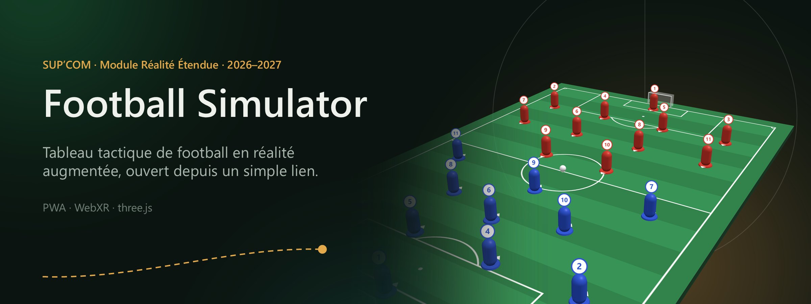
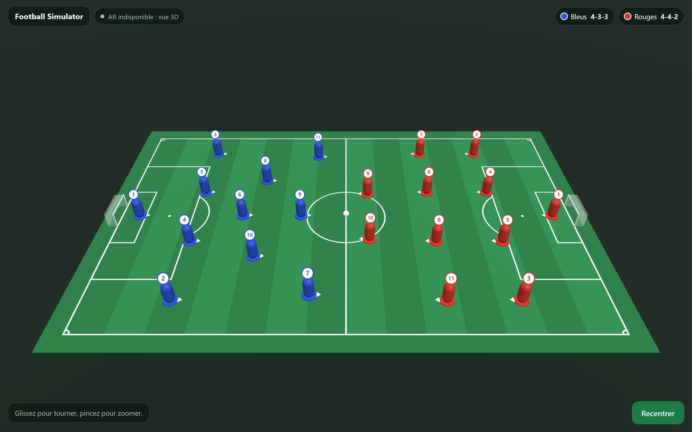
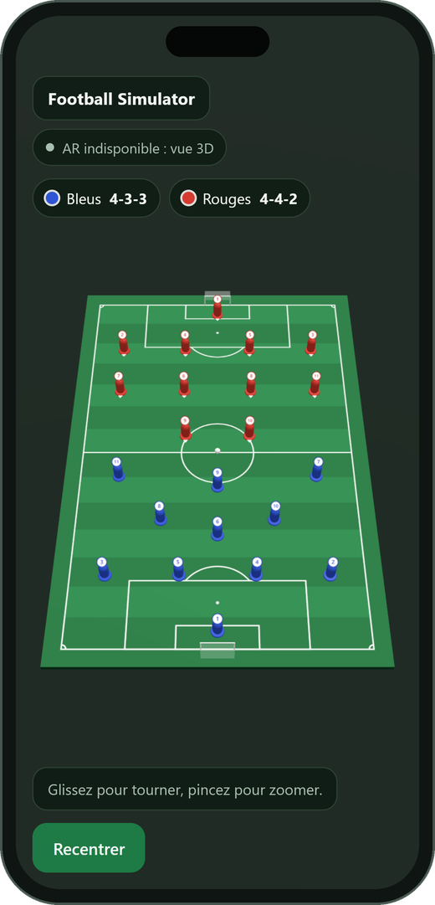
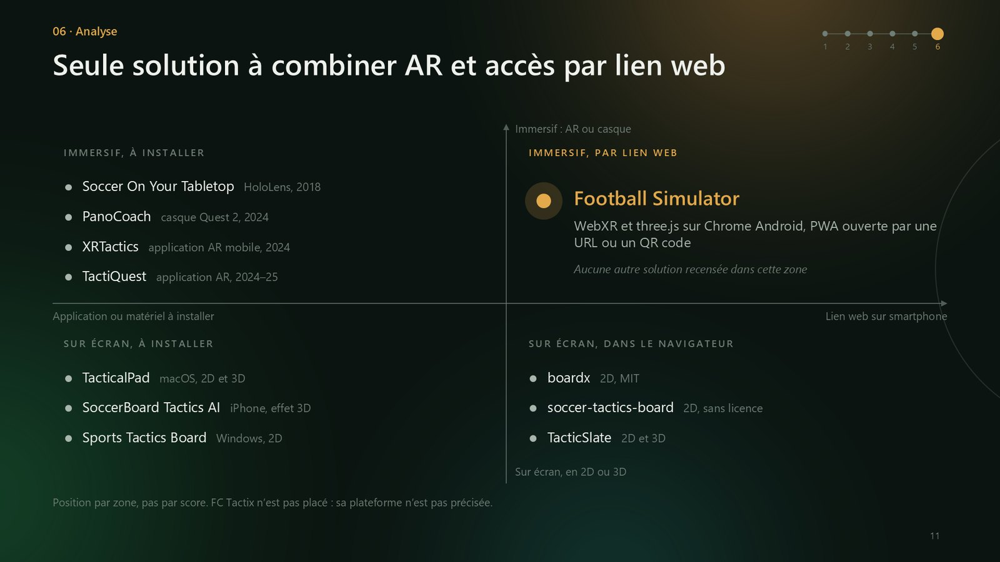
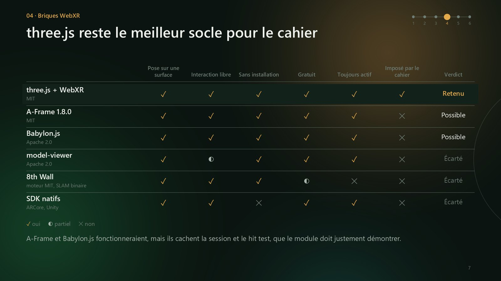
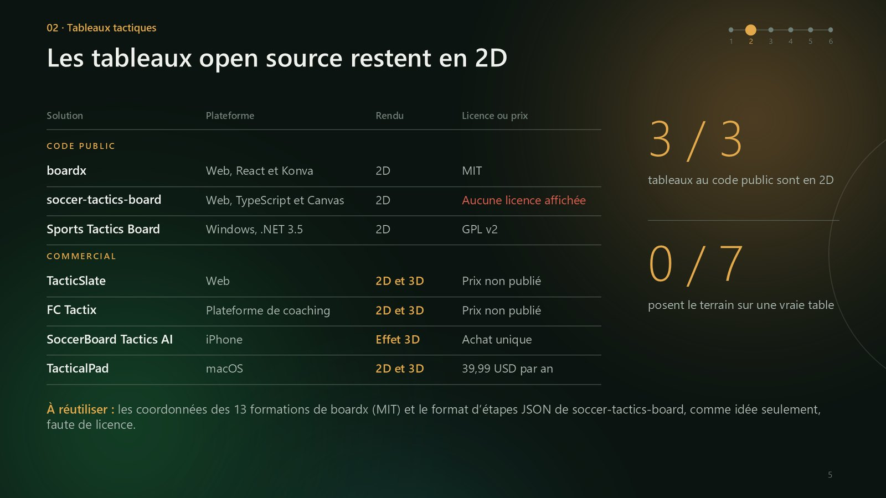

<p align="center">
  
</p>

<p align="center">
  <b>Tableau tactique de football en réalité augmentée, ouvert depuis un simple lien.</b><br>
  Application web progressive · WebXR · three.js r186 · SUP'COM, module Réalité Étendue, 2026–2027
</p>

---

## En bref

- **Le besoin.** Les entraîneurs amateurs expliquent la tactique sur un tableau blanc : une vue de dessus en 2D, des déplacements difficiles à montrer, aucun partage à distance.
- **Notre réponse.** Une PWA qui pose un mini-terrain 3D de 60 × 39 cm sur une vraie table, à travers la caméra d'un smartphone Android, depuis une URL ou un QR code.
- **Où nous en sommes.** Le sprint 1 est livré : terrain et 22 joueurs en 3D hors AR, formations, application installable et utilisable hors-ligne.

## Aperçu

<table>
  <tr>
    <td width="72%"></td>
    <td width="28%"></td>
  </tr>
  <tr>
    <td align="center"><sub>Vue 3D hors AR sur ordinateur : rotation, zoom et recentrage</sub></td>
    <td align="center"><sub>Sur mobile, cadrage en portrait</sub></td>
  </tr>
</table>

## Avancement

| Sprint | Contenu | État |
| --- | --- | --- |
| S1 | Dépôt, structure PWA, scène three.js : terrain et joueurs visibles hors AR | Livré |
| S2 | Session `immersive-ar`, `XRWebGLLayer`, espace de référence `local-floor` | À faire |
| S3 | Hit testing, réticule, pose du terrain par un tap | À faire |
| S4 | Changement de formation (Strategy), deux équipes, ballon, boutons HTML | À faire |
| S5 | Sélection et déplacement des joueurs (raycasting), flèches, annulation (Command) | À faire |
| S6 | Service Worker finalisé, optimisation mobile, tests, vidéo ; bonus : animation | À faire |

Le compte rendu du sprint 1 est dans [docs/sprint-1.md](docs/sprint-1.md). Le code est expliqué fichier par fichier, avec les questions probables du jury, dans [docs/guide-du-code.md](docs/guide-du-code.md).

## État de l'art

> [!TIP]
> **Aucune solution recensée ne réunit les trois propriétés visées** : un terrain en réalité augmentée posé sur une vraie table, un accès par simple lien web et la gratuité. Le projet occupe un espace libre, et des briques existantes réduisent le risque technique.



### Ce que montre la veille

- **Tableaux tactiques.** Les trois tableaux au code public (boardx, soccer-tactics-board, Sports Tactics Board) sont en 2D. La 3D n'existe que dans des produits commerciaux, et aucun ne pose le terrain sur une vraie table.
- **Recherche.** Dans l'étude XRTactics (2024), 12 joueurs de Division I sur 17 préfèrent l'AR mobile au tableau classique ; les casques sont écartés pour le confort et la praticité.
- **Briques techniques.** three.js est le seul socle qui coche tous nos critères, et son exemple `webxr_ar_hittest` couvre déjà BF1 à BF3.
- **Navigateurs.** WebXR n'est pris en charge que par Chrome Android et Samsung Internet ; Safari sur iOS ne l'a pas.
- **Données.** SkillCorner publie sous licence MIT le suivi de 10 matchs tiré de la vidéo TV, de quoi rejouer une vraie action sur la table (bonus BF9).

<details>
<summary><b>Comparatif des approches techniques</b></summary>
<br>

</details>

<details>
<summary><b>Tableaux tactiques existants</b></summary>
<br>

</details>

### Ce que nous réutilisons

| Brique | Licence | Besoin couvert | Sprint |
| --- | --- | --- | --- |
| IWER 2.7.0, émulateur WebXR (Meta) | MIT | Tests sur PC | S1, intégré |
| Exemple `webxr_ar_hittest` (three.js) | MIT | BF1 à BF3 | S2–S3 |
| Échantillon `hit-test-anchors` (Immersive Web) | MIT | Ancrage du terrain | S3 |
| 13 formations de boardx | MIT | BF4 | S4 |
| Format d'étapes et interpolation `easeInOutQuad` | Idée seulement | BF9 | S6 |
| Extrait de match SkillCorner | MIT | BF9 (bonus) | S6 |

Le rapport complet, rédigé en LaTeX, est dans [docs/etat-de-l-art/etat_de_l_art.pdf](docs/etat-de-l-art/etat_de_l_art.pdf) : 12 pages, 9 tableaux, 3 figures et 29 références, avec sa source dans le même dossier.

## Lancer l'application en local

Les modules JavaScript et le Service Worker exigent un serveur HTTP : ouvrir `index.html` directement depuis le disque ne fonctionne pas. Aucune installation ni compilation n'est nécessaire, three.js est copié dans `src/vendor/three/`.

```bash
npm start                      # avec Node.js 18 ou plus, puis ouvrir http://127.0.0.1:8080
npx serve .                    # ou bien, puis ouvrir http://localhost:3000
python -m http.server 8080     # ou bien, puis ouvrir http://localhost:8080
```

`npm start` ne demande aucun `npm install` : il lance le petit serveur de `tests/serve.mjs`. Sous Windows, si le navigateur refuse les modules avec une erreur de type MIME, utiliser `npm start` ou `npx serve`.

### Tester l'AR sur PC

Ajouter `?iwer` à l'adresse, par exemple `http://localhost:3000/?iwer`. L'émulateur IWER simule un casque Meta Quest 3 et le badge affiche « AR émulée (IWER) ».

- Une session `immersive-ar` s'ouvre, avec `local-floor` et les ancres.
- Le hit test demande en plus le module `@iwer/sem`, à décider au sprint 3.
- Le DOM Overlay n'est pas émulé : l'interface HTML se teste dans la vue 3D.

### Tester sur un téléphone Android

WebXR exige HTTPS. Deux possibilités :

1. **GitHub Pages** : Settings → Pages → Deploy from a branch → `main`, dossier `/ (root)`. L'application est alors servie à l'adresse `https://bilelkhlif.github.io/footballsimulator/`.
2. **Redirection de port USB** : brancher le téléphone, ouvrir `chrome://inspect/#devices` sur le PC et rediriger le port du serveur local. Sur le téléphone, `http://localhost:<port>` est alors un contexte sécurisé.

## Tests

Les vérifications du sprint 1 faites sur PC sont automatisées. Prérequis : Node.js 18 ou plus et Google Chrome.

```bash
npm install    # une seule fois : installe playwright-core 1.64.1
npm test       # 11 vérifications dans Chrome, sans interface
```

Elles couvrent le chargement sans erreur (bureau, mobile, sous-chemin comme sur GitHub Pages), les trois formations, le badge d'état de l'AR, le Service Worker et le rechargement hors-ligne, et l'ouverture d'une session `immersive-ar` émulée. Résultat le 9 novembre 2026 : 11 réussies sur 11. Pour utiliser Microsoft Edge : `BROWSER_CHANNEL=msedge npm test` (sous PowerShell : `$env:BROWSER_CHANNEL='msedge'; npm test`). Le détail est dans le [guide du code](docs/guide-du-code.md#6-tests).

## Arborescence

```text
├── index.html           Page, carte d'import et interface superposée
├── manifest.json        Manifeste de la PWA
├── sw.js                Service Worker (cache hors-ligne)
├── package.json         Commandes npm start et npm test
├── ATTRIBUTION.md       Origine des ressources et usage de l'IA
├── src/
│   ├── main.js          Point d'entrée : assemble la scène et l'interface
│   ├── config.js        Dimensions, échelle, équipes et couleurs
│   ├── scene.js         Moteur de rendu, caméra, lumières, contrôles, pitchGroup
│   ├── pitch.js         Terrain : plateau, gazon, lignes et buts
│   ├── formations.js    Formations 4-4-2, 4-3-3 et 3-5-2 (Strategy)
│   ├── players.js       Fabrique de joueurs (Factory)
│   ├── team.js          Placement d'une équipe selon sa formation
│   ├── ball.js          Ballon
│   ├── xr-support.js    Détection de l'AR et badge d'état
│   ├── dev-emulator.js  Émulateur IWER, en développement seulement
│   ├── pwa.js           Enregistrement du Service Worker
│   ├── styles.css       Styles de l'interface
│   └── vendor/three/    three.js r186 (licence MIT)
├── tests/
│   ├── serve.mjs        Serveur local (npm start), aussi utilisé par les tests
│   └── run-tests.mjs    Tests de bout en bout dans Chrome (npm test)
├── assets/icons/        Icônes de l'application
└── docs/
    ├── guide-du-code.md Explication du code, fichier par fichier
    ├── architecture.md  Modules, graphe de scène, repère et mise en cache
    ├── sprint-1.md      Compte rendu du sprint 1
    ├── etat-de-l-art/   Rapport d'état de l'art (PDF et source LaTeX)
    └── images/          Captures et illustrations de ce README
```

L'architecture est détaillée dans [docs/architecture.md](docs/architecture.md).

## Règles de développement

Issues du cahier des charges (§7) :

- un commentaire d'en-tête pour chaque fonction JavaScript et chaque bloc HTML ou CSS ;
- des noms explicites : `pitchGroup`, `currentFormation`, `hitTestSource`, `selectedPlayer` ;
- une branche par fonctionnalité, fusionnée dans `main` après relecture ;
- des commits fréquents, et chaque push laisse l'application fonctionnelle ;
- tout nouveau fichier de l'application est ajouté à `APP_SHELL` dans `sw.js`.

## Équipe

| Membre | Responsabilités |
| --- | --- |
| Iyed Rachdi | Session WebXR, hit testing, ancrage du terrain |
| Bilel Khlif | Scène three.js, modélisation du terrain et des joueurs, formations |
| Ghassen Dallekji | Interface HTML, raycasting, PWA, documentation |

Encadrant : Dr. Ing. Mohamed-Bécha Kaâniche.

## Crédits

- [three.js](https://github.com/mrdoob/three.js) r186, licence MIT (`src/vendor/three/LICENSE`).
- [IWER](https://github.com/meta-quest/immersive-web-emulation-runtime) 2.7.0, Meta, licence MIT, chargé depuis jsDelivr en développement seulement.
- [Playwright](https://github.com/microsoft/playwright) (`playwright-core` 1.64.1), Microsoft, licence Apache 2.0, pour les tests seulement.

L'origine de chaque ressource et l'usage de l'IA sont déclarés dans [ATTRIBUTION.md](ATTRIBUTION.md). Aucune licence n'a encore été choisie pour le projet.
