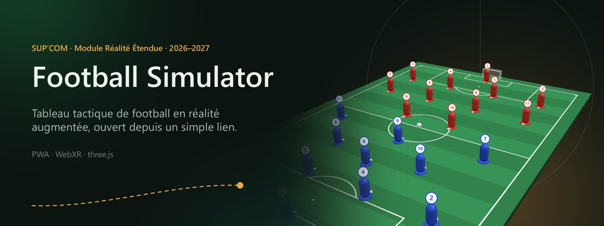
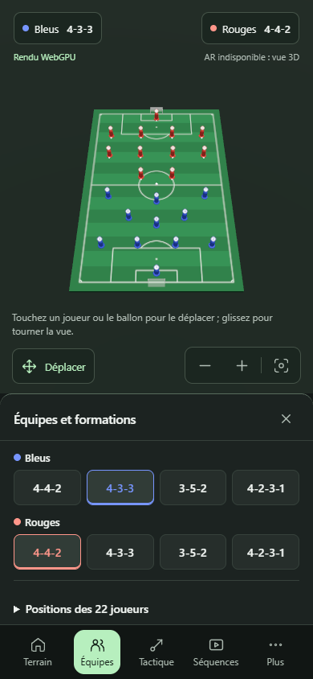
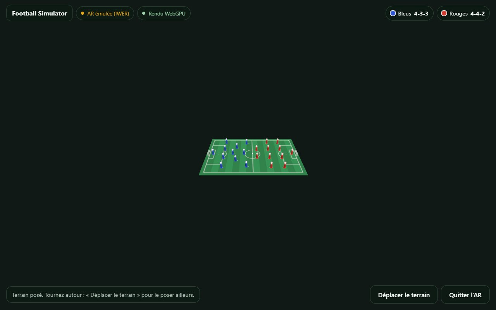
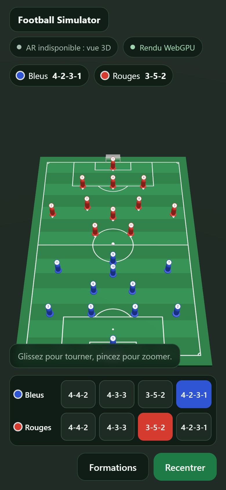
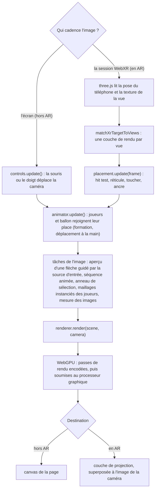
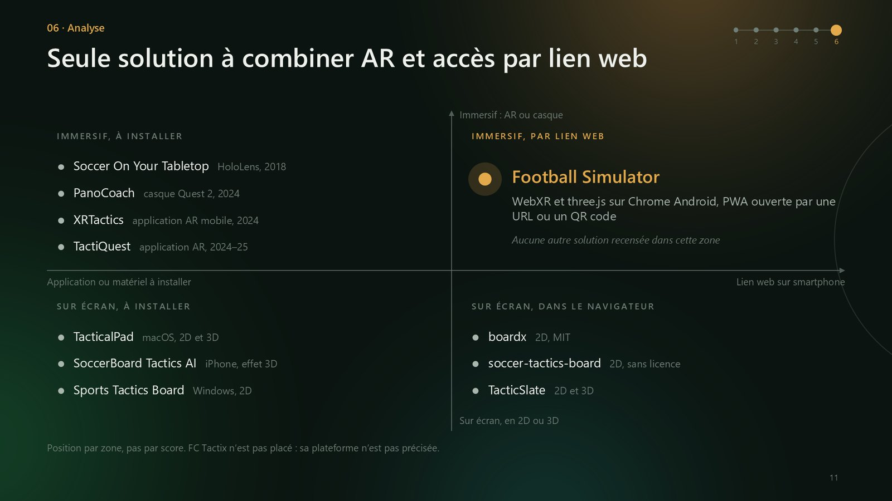

<p align="center">
  
</p>

<p align="center">
  <b>Tableau tactique de football en réalité augmentée, ouvert depuis un simple lien.</b><br>
  Application web progressive · WebXR · WebGPU · three.js r187 · SUP'COM, module Réalité Étendue, 2026–2027<br>
  <a href="https://bilelkhlif.github.io/footballsimulator/"><b>Ouvrir l'application</b></a> (en AR avec Chrome sur Android)
</p>

---

## En deux minutes

**Ce que c'est.** Un tableau tactique de football en réalité augmentée, ouvert depuis un lien : le téléphone
pose un terrain 3D de 60 × 39 cm sur une vraie table, l'entraîneur y place deux équipes, déplace joueurs et
ballon, trace passes et courses, annule, et anime une action pas à pas. Rendu **WebGPU sans repli WebGL**,
**WebXR** (hit test, ancre, DOM Overlay), application installable et utilisable hors-ligne.

**Pour évaluer.** Commencer par le [dossier d'évaluation](docs/dossier-evaluation.md) : ordre de lecture,
preuves, résultats et limites. Puis la [matrice de conformité au cahier des charges](docs/conformite-cahier-des-charges.md),
le [guide de démonstration](docs/guide-demonstration-soutenance.md) et la
[matrice des contributions](docs/matrice-contributions-academiques.md). Pour le code : la
[documentation technique](docs/technique.md), point d'entrée unique avec les améliorations à prévoir.

| Point | État au 25 novembre 2026 |
|---|---|
| Besoins BF1 à BF9 du cahier | Tous implémentés ; AR vérifiée en émulation, et sur téléphone pour des versions antérieures |
| Exigences du cahier (54 tracées) | 44 vérifiées, 8 partielles (mesures sur téléphone), 1 non faite (vidéo), 1 sans objet |
| Tests automatisés | 285 unitaires, 226 vérifications dans Chrome, 144 tests Python : tous réussis |
| Essais sur téléphone de la version actuelle | **À faire par l'équipe** (protocole P0 à P10 de [recette.md](docs/recette.md)) |
| Vidéo de démonstration | **À tourner** ([storyboard](docs/video-demonstration.md)) |

**Nouveautés du 25 novembre.** Interface « verre » originale, thèmes clair, sombre et automatique, sans perte
de fonctionnalité ([captures avant / après](docs/images/glass/)). Visualiseur de match (Bêta) : galerie de
trois vraies vidéos aux droits vérifiés et d'un match synthétique ; calibration stabilisée (déplacements
invraisemblables ramenés de 70,6 % à 11,2 % sur France–Allemagne, de 29,2 % à 5,0 % sur Samsunspor–Altınordu) ;
calibrations fausses détectées par contrôle visuel et masquées plutôt qu'affichées
([explication](docs/stabilisation-homographie.md)).

**Équipe.** Iyed Rachdi, Bilel Khlif, Ghassen Dalleji ; encadrant : Dr. Ing. Mohamed-Bécha Kaâniche. Le code
a été réalisé avec des assistants d'IA (Claude Code, Codex) sur les consignes de Bilel Khlif, qui a relu,
testé sur téléphone et fusionné : tout est déclaré dans [ATTRIBUTION.md](ATTRIBUTION.md).

## En bref

- **Le besoin.** Les entraîneurs amateurs expliquent la tactique sur un tableau blanc : une vue de dessus en 2D, des déplacements difficiles à montrer, aucun partage à distance.
- **Notre réponse.** Une PWA qui pose un mini-terrain 3D de 60 × 39 cm sur une vraie table, à travers la caméra d'un smartphone Android, depuis une URL ou un QR code.
- **Où nous en sommes.** Les six sprints du cahier sont faits :
  - terrain et 22 joueurs en 3D ;
  - session AR immersive ;
  - terrain posé sur la table par hit test, réticule et toucher, puis ancré ;
  - formation de chaque équipe choisie par des boutons (4-4-2, 4-3-3, 3-5-2, 4-2-3-1), les joueurs rejoignant leurs places ;
  - joueurs et ballon sélectionnés puis déplacés par raycasting, à la souris, au doigt et en AR ; flèches de passe et de course ; annuler, rétablir et réinitialiser (patron Command) ;
  - bonus BF9 : une action animée pas à pas, par images clés, avec lecture, pause et vitesse ;
  - rendu **WebGPU sans repli WebGL**, optimisé pour le mobile : joueurs instanciés, 115 → 55 appels de dessin ;
  - application installable, utilisable hors-ligne, mise à jour d'un bloc.
- **Après l'évaluation.** Flèches vérifiées avant toute action : une passe part du ballon, une course d'un joueur, l'arrivée reste entre les lignes ([règles](docs/regles-des-fleches.md)). Interface refondue : outils à icônes, aperçu rouge des actions impossibles, visée au doigt, aide au premier lancement, raccourcis clavier ([ergonomie](docs/ergonomie.md)). Modules JavaScript en `.mjs`, Service Worker en module ([migration](docs/migration-mjs.md)).
- **Espaces de coaching.** Rail sombre compact et sept espaces fonctionnels : Accueil, Équipes et formations, Outils tactiques, Animation et séquences, Réalité augmentée, Plus d'outils, Réglages et aide. Une seule scène, un seul tableau et un seul historique sont conservés entre les espaces. Navigation basse en portrait, panneaux défilants et contrôles de vue persistants. L'[inventaire, l'architecture, les correspondances et les captures avant / après](docs/espaces-coaching.md) détaillent cette évolution.
- **Testé.** 369 tests automatisés sur PC le 24 novembre 2026 : 229 unitaires et 140 de bout en bout, dont le parcours complet d'un entraîneur de la 3D vers l'AR émulée, tous réussis sans cas ignoré ([revue critique, mesures et limites](docs/archives/revue-finale-pr17.md)). Les anciens essais physiques du 12 et du 14 novembre concernent des versions précédentes : AR WebGPU sur TECNO POVA 6 Pro 5G, mode test WebGL sur Galaxy S10e. Cette nouvelle interface n'a pas été testée sur téléphone réel. Restent à mesurer : la stabilité d'une minute, les 9 essais sur 10 et les 30 images par seconde ([recette](docs/recette.md)).

- **Analyse de match intégrée.** Le visualiseur Bêta s'ouvre depuis le rail principal ou Plus d'outils, dans un nouvel onglet : la tactique en cours reste intacte. Sa galerie propose [trois vraies vidéos](docs/visualiseur-demos-reelles.md) de Wikimedia Commons, créditées sous CC BY-SA 4.0, et la démo synthétique de 36 s ; Samsunspor–Altınordu s'ouvre par défaut. Sur France–Allemagne et le Brésil, la calibration automatique est fausse : positions, vitesses et distances y sont masquées. Les deux se lisent sans Python ni calcul IA hébergé. Vos propres vidéos utilisent le serveur local, ses poids vérifiés et votre matériel. Vérification indépendante du matin du 25 novembre : 277 unitaires, 224 contrôles Chrome, 129 tests Python, 50 contrôles de perte GPU et 12 étapes CUDA ; le soir, après l'interface verre et les nouvelles démos : **285 unitaires, 226 contrôles Chrome, 144 tests Python**, tous réussis sans cas ignoré. Les limites de précision, le risque résiduel de PyTorch et les décisions de licence sont détaillés dans le [rapport de livraison](docs/visualiseur-livraison-2026-11-25.md). L'application académique attend toujours l'accord de licence des coauteurs ([LICENSING.md](LICENSING.md)).

## Aperçu

<table>
  <tr>
    <td width="72%"></td>
    <td width="28%"></td>
  </tr>
  <tr>
    <td align="center"><sub>Un espace contextuel, sans créer un second terrain ni un second historique</sub></td>
    <td align="center"><sub>Portrait émulé : cinq destinations et un panneau repliable</sub></td>
  </tr>
</table>

Les captures suivantes datent des sprints, avant les retours de l'évaluation.

<table>
  <tr>
    <td width="72%"></td>
    <td width="28%"></td>
  </tr>
  <tr>
    <td align="center"><sub>Vue 3D hors AR sur ordinateur, rendue en WebGPU : rotation, zoom et recentrage</sub></td>
    <td align="center"><sub>Sur mobile, cadrage en portrait</sub></td>
  </tr>
</table>

<table>
  <tr>
    <td width="50%"></td>
    <td width="50%"></td>
  </tr>
  <tr>
    <td align="center"><sub>Sprint 3, session AR émulée sur PC : le réticule sur la table détectée</sub></td>
    <td align="center"><sub>Un toucher pose le terrain sur la table et l'ancre. Sur un téléphone, l'image de la caméra remplace le fond sombre.</sub></td>
  </tr>
</table>

<table>
  <tr>
    <td width="72%"></td>
    <td width="28%"></td>
  </tr>
  <tr>
    <td align="center"><sub>Sprint 4 : la formation de chaque équipe se choisit par un bouton, ici en AR sur le terrain posé</sub></td>
    <td align="center"><sub>Sur téléphone, une ligne de gros boutons par équipe</sub></td>
  </tr>
</table>

<p align="center">
  <br>
  <sub>Sprint 5 : une passe (flèche dorée), une course (tirets blancs) et le n° 9 sélectionné ; la barre d'outils réunit les modes et l'historique</sub>
</p>

<table>
  <tr>
    <td width="60%"></td>
    <td width="40%"></td>
  </tr>
  <tr>
    <td align="center"><sub>Sprint 6, bonus BF9 : une action en trois images clés, mise en pause au milieu de la première passe</sub></td>
    <td align="center"><sub>En AR, l'action se joue sur le terrain ancré</sub></td>
  </tr>
</table>

## Avancement

| Sprint | Contenu | État |
| --- | --- | --- |
| S1 | Dépôt, structure PWA, scène three.js : terrain et joueurs visibles hors AR | Livré |
| S2 | Session `immersive-ar`, espace de référence `local-floor` | Fait : AR testée sur deux téléphones Android, vue 3D sur iPhone et PC |
| S3 | Hit testing, réticule, pose du terrain par un tap, ancre ; rendu WebGPU sans repli WebGL ; PWA complétée | Fait et testé sur PC ; AR WebGPU testée sur le TECNO POVA 6 Pro 5G |
| S4 | Changement de formation (Strategy), deux équipes, ballon, boutons HTML | Fait et testé sur PC, en 3D et en AR émulée |
| S5 | Sélection et déplacement des joueurs (raycasting), flèches, annulation (Command) | Fait et testé sur PC, en 3D et en AR émulée ; test sur téléphone à faire ([protocole](docs/sprint-5.md#11-protocole-de-validation-sur-téléphone)) |
| S6 | Service Worker finalisé, optimisation mobile, tests finaux, documentation et vidéo ; bonus : animation d'une action | Fait et testé sur PC, en 3D et en AR émulée ; validation sur téléphone à faire ([recette](docs/recette.md)) |

Les comptes rendus sont dans [docs/sprint-1.md](docs/sprint-1.md) à [docs/sprint-6.md](docs/sprint-6.md). Le code est expliqué fichier par fichier, avec les questions probables du jury, dans [docs/guide-du-code.md](docs/guide-du-code.md) et dans les comptes rendus des sprints 2 à 6.

Livrables de fin de projet (cahier §5.2 et §5.4) :

- [rapport final](docs/rapport-final.md) ;
- [matrice de conformité au cahier des charges](docs/conformite.md) ;
- [recette finale](docs/recette.md), avec le protocole à suivre sur téléphone ;
- [manuel utilisateur](docs/manuel-utilisateur.md) ;
- [diagrammes UML](docs/uml.md) : cas d'utilisation, séquence, déploiement, classes ;
- [présentation de soutenance](docs/presentation/) ;
- [storyboard et voix off de la vidéo de démonstration](docs/video-demonstration.md).

## Rendu WebGPU

L'application dessine sa scène avec **WebGPU**, l'API graphique moderne du web, par three.js r187. **Il n'y a aucun repli sur WebGL.**

- `WebGPURenderer` de three.js bascule tout seul sur WebGL 2 quand WebGPU manque. Notre moteur de rendu (`src/webgpu.mjs`) est construit sans cette bascule : la classe de base `Renderer`, le seul backend `WebGPUBackend`, et `getFallback: null`.
- Sans WebGPU, un message remplace le terrain : « Football Simulator a besoin de WebGPU… ». Le badge du rendu passe à « WebGPU indisponible ».
- Les matériaux de la scène sont traduits en WGSL, le langage de shaders de WebGPU. Le réticule de l'AR est écrit en TSL : il pulse grâce à un calcul fait sur le processeur graphique.
- En AR, la session est rendue en WebGPU elle aussi, par la liaison WebXR/WebGPU (`XRGPUBinding`). Chrome la propose encore derrière un réglage. Sur Android : `chrome://flags/#webxr-webgpu-binding` → « Enabled ». Sans ce réglage, l'application l'explique et propose de copier l'adresse.
- Preuves automatiques : un test vérifie qu'aucun contexte WebGL n'est créé, un autre retire WebGPU et vérifie le message.
- **Mode test WebGL (`?webgl` dans l'adresse), réservé aux tests.** Il fait tourner la même scène en WebGL 2, pour tester l'application, AR comprise, sur un téléphone dont le navigateur bloque WebGPU, comme le Galaxy S10e sous Android 9. **Ce n'est pas un repli.** L'application ne passe jamais en WebGL d'elle-même, l'écran d'erreur ne le propose pas, et le badge affiche « Rendu WebGL (mode test) ». Détails dans [docs/sprint-3.md](docs/sprint-3.md#16-mode-test-webgl-webgl-réservé-aux-tests).

| Où | Vue 3D | AR |
| --- | --- | --- |
| Chrome sur Android | WebGPU (Android 12 ou plus) | WebGPU, avec le réglage `webxr-webgpu-binding` |
| Chrome ou Edge sur ordinateur | WebGPU | Émulée, avec `?iwer` |
| Safari sur iPhone | WebGPU avec iOS 26 ; message avant | Pas de WebXR sur iPhone |

Le détail est dans [docs/sprint-3.md](docs/sprint-3.md#3-rendu-webgpu-sans-repli-webgl), avec l'état de la liaison WebXR/WebGPU dans les navigateurs et ses sources.

## La boucle de rendu

Chaque image affichée sort d'une même fonction, la **boucle de rendu** (`src/render-loop.mjs`), que `main.mjs` confie à three.js par `renderer.setAnimationLoop`. Ce qui change entre la vue 3D et l'AR, c'est **qui la cadence** :

- **Hors AR**, l'écran : three.js l'appelle par `window.requestAnimationFrame`, environ 60 fois par seconde.
- **En AR**, la session WebXR : à l'entrée en AR, three.js arrête sa propre horloge et passe à `XRSession.requestAnimationFrame`. Chaque appel reçoit alors un `XRFrame` : la pose du téléphone, les surfaces détectées et les ancres, valables pendant cet appel seulement.



Le code de la boucle tient en quelques lignes :

```js
export function createRenderLoop({ renderer, scene, camera, controls, animator = null, getArPlacement, tasks = [] }) {
  return (time, frame) => {
    for (let index = 0; index < tasks.length; index += 1) {
      tasks[index].beforeFrame?.(time);  // début de l'image : mesure du temps CPU (sprint 6)
    }
    if (renderer.xr.isPresenting) {
      matchXrTargetToViews(renderer);   // une vue sur un téléphone, deux sur un casque
      const placement = getArPlacement(); // pose du terrain de la session en cours
      if (frame && placement) {
        placement.update(frame);         // hit test, réticule, toucher, ancre
      }
    } else {
      controls.update();                 // contrôles d'orbite, hors AR seulement
    }
    animator?.update();                  // joueurs et ballon en route vers leur place
    for (let index = 0; index < tasks.length; index += 1) {
      tasks[index].update(time, frame);  // aperçu de flèche, séquence, anneau, instances des joueurs
    }
    renderer.render(scene, camera);      // commandes WebGPU, soumises au processeur graphique
    for (let index = 0; index < tasks.length; index += 1) {
      tasks[index].afterRender?.(time);  // statistiques de l'image dessinée (mode diagnostic)
    }
  };
}
```

Une image en AR, pas à pas :

| Étape | Qui | Ce qui se passe |
| --- | --- | --- |
| 1 | Navigateur | La session appelle three.js avec l'image WebXR (`XRFrame`) |
| 2 | three.js | Pose du téléphone (`getViewerPose`), caméra XR, texture WebGPU de la vue (`getViewSubImage`) |
| 3 | `render-loop.mjs` | La cible de rendu de three.js passe à une couche, car un téléphone n'a qu'une vue (correctif expliqué dans [sprint-3.md](docs/sprint-3.md#5-une-vue-ou-deux--la-cible-de-rendu-xr-de-threejs-r187)) |
| 4 | `ar-surface.mjs` | Hit test : le réticule suit la surface visée ; après un toucher, le terrain y est posé et une ancre est créée ; ensuite, le terrain suit son ancre |
| 4 bis | `formation-transition.mjs` | Après un changement de formation ou un déplacement à la main, chaque joueur avance d'un pas vers sa nouvelle place, sur le terrain posé |
| 4 ter | `xr-input.mjs`, `tactical-view.mjs` | Pendant le tracé d'une flèche, l'aperçu suit le rayon de la source d'entrée (`targetRaySpace`) ; l'anneau suit le joueur sélectionné |
| 4 quater | `sequence-player.mjs`, `players.mjs` | Pendant la lecture d'une séquence, joueurs et ballon prennent leur place interpolée, selon le temps écoulé ; puis les matrices des joueurs qui ont bougé sont recopiées dans les maillages instanciés (sprint 6) |
| 5 | three.js | `renderer.render` : une passe de rendu de la scène et une passe de conversion des couleurs, soumises par `device.queue.submit` |
| 6 | Système | La couche de projection est superposée à l'image de la caméra et affichée |

Deux règles en découlent. Rien de WebXR ne s'utilise hors de la boucle : c'est pourquoi un toucher pose le terrain à l'image suivante. Seule exception, l'événement `select` d'un toucher porte sa propre image WebXR, valable pendant l'événement : c'est là que le rayon du toucher est lu (sprint 5). Et les contrôles d'orbite se taisent en AR, sinon ils écraseraient la pose de la caméra : un test le vérifie à chaque `npm test`. Le détail est dans [docs/sprint-3.md](docs/sprint-3.md#6-la-boucle-de-rendu) et [docs/sprint-5.md](docs/sprint-5.md#7-intégration-dans-la-boucle-de-rendu).

## Interaction tactique (sprint 5)

La barre d'outils, sous le terrain, réunit trois outils et l'historique :

| Bouton (touche) | Geste | Résultat |
| --- | --- | --- |
| Déplacer (D) | Toucher un joueur ou le ballon, puis une place du plateau | L'objet sélectionné (anneau doré) y glisse ; toucher à nouveau l'objet annule la sélection |
| Passe (P) | Toucher le ballon ou son porteur, puis un partenaire ou un espace libre | Flèche pleine, dorée : le trajet du ballon |
| Course (C) | Toucher un joueur, puis son point d'arrivée | Flèche en tirets, blanche : le déplacement d'un joueur |
| Annuler (Ctrl+Z), Rétablir (Ctrl+Y) | — | Défait ou refait la dernière action, formations comprises |
| Réinitialiser | Deux touchers : « Confirmer ? » | Formations de départ, joueurs à leurs places, ballon au centre, sans flèche ; « Annuler » le rétablit |
| Abandonner (Échap) | — | Abandonne la sélection ou le tracé en cours |

**Règles des flèches.** Elles sont vérifiées avant toute action : une passe part du ballon, de son porteur ou de la fin d'une passe déjà tracée ; une course part d'un joueur ; l'arrivée reste entre les lignes ; ni flèche trop courte, ni doublon, ni passe vers un adversaire du porteur. Un aperçu doré ou blanc devient **rouge** quand le toucher serait refusé, et le bandeau d'aide dit pourquoi. Rien de refusé n'entre dans l'historique. Passes longues, en retrait, centres et courses croisées restent possibles : aucune règle du football n'est inventée ([docs/regles-des-fleches.md](docs/regles-des-fleches.md)).

**Au doigt**, quand une destination est attendue, le doigt posé montre l'aperçu, le glisser le déplace, le relâcher valide ; la vue tourne alors à deux doigts. C'est le même geste qu'en AR ([docs/ergonomie.md](docs/ergonomie.md)).

Un même calcul sert partout. Le toucher devient un **rayon** : depuis la caméra et à travers le point touché hors AR, depuis le `targetRaySpace` de la source d'entrée WebXR en AR. Ce rayon est confronté aux zones de sélection des joueurs, puis au plan du gazon. Le point trouvé est ramené dans le repère du terrain : le résultat ne dépend ni de la place ni de l'orientation de l'ancre. Chaque action est une **commande** annulable (patron Command), et la scène suit le tableau tactique (patron Observer). Une place hors du terrain est refusée, avec un message dans le bandeau d'aide.

**Sauvegarde automatique.** La tactique en cours (formations, places des joueurs et du ballon, flèches, images clés de la séquence) est enregistrée dans le navigateur (IndexedDB) 0,4 s après chaque changement, et aussitôt quand la page passe en arrière-plan, puis rétablie au lancement suivant, avec le message « Tactique précédente rétablie ». Une donnée enregistrée est vérifiée avant d'être rétablie : invalide, elle est ignorée. Le rétablissement n'entre pas dans l'historique, et « Réinitialiser » repart toujours des formations de départ. Sans stockage (navigation privée), l'application fonctionne sans sauvegarde (`src/tactic-storage.mjs`).

**Mode diagnostic** : ajouter `?diagnostics` à l'adresse affiche les images par seconde, la durée d'une image, le temps CPU par image, le moteur de rendu, l'état de la session XR, les appels de dessin, les triangles et la mémoire GPU estimée, aussi en AR. Il sert à vérifier l'objectif du cahier, au moins 30 images par seconde sur un téléphone de milieu de gamme.

Mathématiques, machine à états, patron Command, tests et protocole sur téléphone : [docs/sprint-5.md](docs/sprint-5.md).

## Séquence animée et performance (sprint 6)

**Animer une action (bonus BF9).** Le bouton « Séquence » ouvre un panneau : « Image clé » enregistre la place des 22 joueurs et du ballon ; après quelques déplacements, une autre image clé, et ainsi de suite. « Lecture » fait glisser les joueurs d'une image à l'autre, selon le temps écoulé, dans le repère du terrain : en AR, l'action se joue sur la table. « Pause », « Recommencer », vitesses 0,5×, 1× et 2×. Enregistrer et effacer sont des commandes annulables ; toute action sur le tableau arrête la lecture, et la scène rejoint le tableau. La lecture est une tâche de la boucle de rendu, sans boucle à part.

**Performance mesurée, puis optimisée.** `npm run bench` mesure trois scénarios dans Chrome, processeur ralenti 4 fois pour approcher un téléphone de milieu de gamme, médiane de 3 mesures. Les 22 joueurs sont désormais dessinés par 3 maillages instanciés par équipe (`InstancedMesh`) ; chaque joueur garde son objet, son numéro et sa zone de sélection :

| Scénario (PC, processeur ralenti 4 fois) | Images/s, sprint 5 → 6 | Temps CPU du rendu | Appels de dessin |
| --- | ---: | ---: | ---: |
| Vue 3D au repos | 62,7 → 90,1 | 12,7 → 8,2 ms | 115 → 55 |
| Vue 3D, changements de formation | 46,3 → 76,9 | 18,2 → 9,8 ms | 115 → 55 |
| AR émulée, terrain posé | 47,2 → 62,5 | 13,7 → 9,1 ms | 114 → 54 |

Cette mesure compare deux versions dans les mêmes conditions ; elle ne remplace pas la mesure sur téléphone, à faire avec le mode diagnostic. Méthode, résultats complets, fiabilité de l'AR (cinq entrées et sorties de suite, suivi interrompu puis rétabli) et versions de la PWA : [docs/sprint-6.md](docs/sprint-6.md).

## Visualiseur de match (prototype)

Extension après le projet, en version bêta : entrée « Analyse de match » du rail principal sur ordinateur et tablette, ou carte de l'espace Plus d'outils sur téléphone. [visualizer.html](visualizer.html) analyse une vraie vidéo de match téléversée :

- détection et suivi des joueurs, des gardiens, des arbitres et du ballon ;
- deux équipes ;
- calibration de la caméra et position de chacun sur le terrain.

La vidéo d'origine s'affiche annotée. Le terrain 3D de l'application, en WebGPU, est posé dans la vidéo, synchronisé image par image :

- déplaçable, redimensionnable, orientable et verrouillable ;
- placé seul dans la zone la moins encombrée ;
- avec sélection d'un joueur, traces, flèches de déplacement et vitesse.

L'analyse réutilise des composants libres (Roboflow Sports, Ultralytics, ByteTrack, PySceneDetect, OpenCV). Elle tourne sur un serveur Python local ([analysis/](analysis/README.md)), avec un GPU NVIDIA de préférence. L'application AR n'en dépend pas : elle n'y ajoute qu'un lien, masqué pendant une session AR. Le visualiseur n'est pas dans la coquille hors ligne de l'application.

Deux modes, une seule interface : **Explorer la démo** lit les exports statiques de `demo/` (trois vrais extraits de 26 à 30 s sous CC BY-SA 4.0, analysés sur PC, et un match synthétique de 36 s, sans Python ni serveur d'analyse, compatibles GitHub Pages ; chaque carte de la galerie affiche le verdict du contrôle visuel de sa calibration et ses indicateurs de qualité) ; **Analyser ma vidéo** utilise le serveur local (téléversement, progression, résultats partiels, interruption et reprise).

Pour essayer la démonstration, ouvrez [visualizer.html sur le site publié](https://bilelkhlif.github.io/footballsimulator/visualizer.html) ou sur un serveur statique local : aucun serveur Python n'est nécessaire. Pour analyser vos vidéos, installez le serveur local sur un PC avec GPU NVIDIA ([analysis/README.md](analysis/README.md) : environnement, vérification des modèles, sécurité), lancez `python -m football_analysis serve`, puis ouvrez l'adresse affichée.

- Démonstration, export statique, analyse locale, sécurité et licences de redistribution : [docs/visualiseur-modes.md](docs/visualiseur-modes.md)
- Licences, composants livrés et décisions réservées au propriétaire : [docs/licences-et-distribution.md](docs/licences-et-distribution.md), [THIRD_PARTY_NOTICES.md](THIRD_PARTY_NOTICES.md)
- Qui a fait quoi, avec quelles preuves : [docs/attribution-visualiseur.md](docs/attribution-visualiseur.md)
- Recherche des composants, licences et choix : [docs/opensource-research.md](docs/opensource-research.md)
- Fiabilité des équipes sous soleil et ombre : [recherche et comparaison des variantes](docs/equipes-lumiere-recherche.md)
- Architecture, format des données et validation sur de vraies vidéos : [docs/visualiseur-match.md](docs/visualiseur-match.md)
- Stabilisation de la calibration, contrôle visuel et calibration de référence : [docs/stabilisation-homographie.md](docs/stabilisation-homographie.md)

## Application installable (PWA)

| Élément | Rôle |
| --- | --- |
| `manifest.json` | Nom, icônes (dont une « maskable » pour Android), affichage sans barre d'adresse, identifiant stable et deux captures pour la fenêtre d'installation |
| `sw.mjs` | Service Worker, enregistré en module : met en cache les 55 entrées de l'application (`APP_SHELL`), pour un lancement hors-ligne après une première visite |
| `sw.js` | Script de migration : fait passer une installation antérieure à `sw.mjs` ([docs/migration-mjs.md](docs/migration-mjs.md)) |
| Bouton « Installer l'application » | Apparaît quand le navigateur propose l'installation ; disparaît une fois l'application installée |
| Avis « Nouvelle version installée » | Propose de recharger quand une nouvelle version du Service Worker prend le relais |
| Badge « Hors-ligne » | S'affiche quand le réseau est coupé |

Depuis le sprint 6, la page ne mélange jamais deux versions :

- **Coquille à version de contenu.** `SHELL_VERSION`, dans `sw.mjs`, est une empreinte SHA-256 du contenu des fichiers de l'application, recalculée par `npm run shell-version`. Un fichier modifié change donc `sw.mjs`, et le navigateur installe la nouvelle version.
- **Installation d'un bloc.** Les 55 entrées sont téléchargées ensemble, sans le cache HTTP du navigateur, dans un cache propre à la version : tout ou rien.
- **Cache d'abord** pour ces fichiers : l'application se lance aussitôt, même sur un réseau lent ou coupé, et toujours en une seule version. La nouvelle version s'applique par « Recharger ».
- Les autres requêtes (module de l'émulateur) passent par le réseau d'abord, avec repli sur le cache après 3 secondes.

Un test unitaire vérifie que tout fichier chargé par l'application est dans `APP_SHELL`, et que `SHELL_VERSION` correspond au contenu. Depuis la migration en `.mjs`, `sw.js` reste à son adresse comme script de migration : une application installée avant la migration ne vérifie que cette adresse ; elle passe ainsi à `sw.mjs` sans rester bloquée sur l'ancienne version. Un test de bout en bout rejoue ce passage depuis la version évaluée. Le détail, avec le test qui faisait échouer l'ancien Service Worker : [docs/sprint-6.md](docs/sprint-6.md#6-pwa--une-seule-version-à-la-fois).

Pour installer l'application :

- **Android** : bouton « Installer l'application », ou menu ⋮ → « Installer l'application » ;
- **ordinateur** : bouton de l'application, ou icône d'installation de la barre d'adresse ;
- **iPhone** : Partager → « Sur l'écran d'accueil ».

## État de l'art

> [!TIP]
> **Aucune solution recensée ne réunit les trois propriétés visées** : un terrain en réalité augmentée posé sur une vraie table, un accès par simple lien web et la gratuité. Le projet occupe un espace libre, et des briques existantes réduisent le risque technique.



### Ce que montre la veille

- **Tableaux tactiques.** Les trois tableaux au code public (boardx, soccer-tactics-board, Sports Tactics Board) sont en 2D. La 3D n'existe que dans des produits commerciaux, et aucun ne pose le terrain sur une vraie table.
- **Recherche.** Dans l'étude XRTactics (2024), 12 joueurs de Division I sur 17 préfèrent l'AR mobile au tableau classique ; les casques sont écartés pour le confort et la praticité.
- **Briques techniques.** three.js est le seul socle qui coche tous nos critères, et son exemple `webxr_ar_hittest` couvre déjà BF1 à BF3.
- **Navigateurs.** WebXR n'est pris en charge que par Chrome Android et Samsung Internet ; Safari sur iOS ne l'a pas.
- **Données.** SkillCorner publie sous licence MIT le suivi de 10 matchs tiré de la vidéo TV, de quoi rejouer une vraie action sur la table (bonus BF9).

<details>
<summary><b>Comparatif des approches techniques</b></summary>
<br>

</details>

<details>
<summary><b>Tableaux tactiques existants</b></summary>
<br>

</details>

### Ce que nous réutilisons

| Brique | Licence | Besoin couvert | Sprint |
| --- | --- | --- | --- |
| IWER 2.7.0, émulateur WebXR (Meta) | MIT | Tests sur PC | S1, intégré |
| Exemple `webxr_ar_hittest` (three.js) | MIT | BF1 à BF3 | S2–S3 |
| Échantillon `hit-test-anchors` (Immersive Web) | MIT | Ancrage du terrain | S3 |
| 13 formations de boardx | MIT | BF4 | Envisagées pour S4, finalement non reprises : formations propres au projet |
| Format d'étapes (soccer-tactics-board) et interpolation `easeInOutQuad` (boardx) | Idée seulement | BF9 | S6 : idée des étapes retenue, sous forme d'images clés ; aucun code repris. Interpolation par la courbe `easeInOutCubic` des transitions du sprint 4 |
| Extrait de match SkillCorner | MIT | BF9 (bonus) | Non retenu au S6 : l'action est construite sur le terrain par l'utilisateur ; aucune donnée importée |

Le rapport complet, rédigé en LaTeX, est dans [docs/etat-de-l-art/etat_de_l_art.pdf](docs/etat-de-l-art/etat_de_l_art.pdf) : 12 pages, 9 tableaux, 3 figures et 29 références, avec sa source dans le même dossier.

## Lancer l'application en local

Les modules JavaScript et le Service Worker exigent un serveur HTTP : ouvrir `index.html` directement depuis le disque ne fonctionne pas. Aucune installation ni compilation n'est nécessaire, three.js est copié dans `src/vendor/three-r187/`.

```bash
npm start                      # avec Node.js 18 ou plus, puis ouvrir http://127.0.0.1:8080
npx serve .                    # ou bien, puis ouvrir http://localhost:3000
python -m http.server 8080     # ou bien, puis ouvrir http://localhost:8080
```

`npm start` ne demande aucun `npm install` : il lance le petit serveur de `tests/serve.mjs`. Sous Windows, si le navigateur refuse les modules avec une erreur de type MIME, utiliser `npm start` ou `npx serve`. Le navigateur doit proposer WebGPU : Chrome ou Edge à jour.

### Tester l'AR sur PC

Ajouter `?iwer` à l'adresse, par exemple `http://127.0.0.1:8080/?iwer`. L'émulateur IWER simule l'appareil, et le badge affiche « AR émulée (IWER) ». Le module `src/dev-xr-emulation.mjs` lui ajoute ce qu'IWER n'émule pas : la liaison WebXR/WebGPU, et une table virtuelle pour le hit test.

- « Entrer en AR » ouvre une session `immersive-ar` rendue en WebGPU : le réticule doré apparaît sur la table virtuelle.
- Un clic sur la scène simule le toucher : le terrain se pose sur la table et s'ancre. « Déplacer le terrain » le retire, « Quitter l'AR » ramène la vue 3D.
- IWER n'affiche pas d'image de caméra : le fond reste sombre.
- Ajouter aussi `&debug` expose les objets internes dans `window.__footballSimulator`, pour la console : par exemple `xrDevice.quaternion`, pour orienter le téléphone émulé.

### Tester sur un téléphone Android

Il faut un téléphone compatible ARCore, avec les Services Google Play pour la RA, et Chrome à jour. WebXR exige HTTPS.

1. **Activer la liaison WebXR/WebGPU**, encore derrière un réglage de Chrome : ouvrir `chrome://flags/#webxr-webgpu-binding`, choisir « Enabled », puis relancer Chrome.
2. **Ouvrir l'application** :
   - par **GitHub Pages**, à l'adresse `https://bilelkhlif.github.io/footballsimulator/`, publiée depuis `main`. Chaque fusion dans `main` la met à jour en une à deux minutes ;
   - ou par **redirection de port USB** : brancher le téléphone, ouvrir `chrome://inspect/#devices` sur le PC et rediriger le port du serveur local. Sur le téléphone, `http://localhost:<port>` est alors un contexte sécurisé.
3. **Entrer en AR**, viser une table, toucher l'écran quand le cercle doré apparaît.

Sur un téléphone dont Chrome bloque WebGPU (Android 11 ou plus ancien), l'application affiche un message. Pour tester quand même, ajouter `?webgl` à l'adresse : c'est le mode test WebGL, réservé aux tests, sans le réglage de l'étape 1.

Le protocole de validation finale, avec le tableau des résultats à remplir, est dans [docs/recette.md](docs/recette.md#5-protocole-de-validation-physique) ; le mode d'emploi complet, dans le [manuel utilisateur](docs/manuel-utilisateur.md).

## Dépannage

| Symptôme | Cause probable et solution |
| --- | --- |
| « Football Simulator a besoin de WebGPU » | Navigateur sans WebGPU : ouvrir Chrome ou Edge à jour, sur ordinateur ou sur Android. Safari 26 et Firefox ne sont pas testés. L'application n'a pas de repli WebGL ; le mode test `?webgl` sert seulement aux essais |
| Pas de bouton « Entrer en AR » | L'AR WebXR demande Chrome sur Android, avec les Services Google Play pour la RA, en HTTPS. Si l'application affiche l'aide d'un drapeau de Chrome, l'AR existe mais ne sait pas encore afficher du WebGPU : suivre cette aide. Sur PC, `?iwer` émule l'AR |
| Visualiseur : « Serveur local injoignable » depuis le site publié | Chrome demande l'autorisation « Accès au réseau local » pour joindre `127.0.0.1` : l'accepter. À défaut, ouvrir `http://127.0.0.1:8765/visualizer.html`, servie par le serveur lui-même |
| « Modèles non vérifiés » ou « Poids absent » | Lancer `python -m football_analysis models --download` dans `analysis/`. Si un poids est refusé, le supprimer, puis relancer : une empreinte différente n'est jamais acceptée |
| « PyTorch vulnérable » | Environnement ancien : recréer `.venv` avec la recette de [analysis/README.md](analysis/README.md) (PyTorch 2.14.1) |
| Analyse sur `cpu` alors qu'un GPU NVIDIA est présent | Installer PyTorch depuis l'index `cu126`. `nvidia-smi` doit afficher « CUDA Version » 12.6 ou plus |
| Terrain 3D arrêté, « le processeur graphique a été réinitialisé » | Le pilote du GPU a redémarré, par exemple après l'arrêt brutal d'un calcul CUDA : recharger la page. La vidéo, elle, se recharge seule |
| Port 8765 déjà utilisé | `python -m football_analysis serve --port 8766`, puis indiquer cette adresse dans le visualiseur |

## Déploiement

L'application est un site statique, sans compilation ni dépendance de production. GitHub Pages le publie depuis la branche `main`, à la racine du dépôt (Settings → Pages : « Deploy from a branch », `main`, `/`). Il le sert en HTTPS, exigé par WebXR et par le Service Worker, à l'adresse https://bilelkhlif.github.io/footballsimulator/.

Pour publier une nouvelle version :

1. sur une branche, faire la modification, puis lancer `npm run shell-version` si un fichier de l'application a changé ;
2. lancer `npm test` ;
3. ouvrir une pull request, la relire, puis la fusionner dans `main` ;
4. GitHub Pages republie le site en une à deux minutes (onglet Actions, « pages build and deployment ») ;
5. vérifier le site publié. Il affiche « Rendu WebGPU ». Les appareils qui avaient l'ancienne version reçoivent l'avis « Nouvelle version installée ».

Pour un autre hébergeur, servir le dossier préparé en HTTPS, avec le type MIME `text/javascript` pour les fichiers `.js` et `.mjs`. `npm run pages:prepare` copie dans un nouveau dossier la seule partie publique : application, visualiseur, démonstrations relues, licences et avis. Il vérifie les crédits et les empreintes des médias réels et exclut le serveur, les tests, les bases, les poids et les clips non déclarés.

Le visualiseur et les deux démonstrations sont prévus pour cet hébergement statique. Le serveur d'analyse, en Python, ne peut pas tourner sur GitHub Pages : chacun l'installe sur son propre PC, et aucun serveur IA public n'est déployé.

## Tests

Les vérifications faites sur PC sont automatisées. Prérequis : Node.js 18 ou plus, Google Chrome et un processeur graphique compatible WebGPU (l'application n'a pas de repli WebGL).

```bash
npm install         # une seule fois : installe playwright-core 1.64.1
npm test            # tests unitaires, puis tests de bout en bout
npm run test:unit   # 277 tests unitaires, sans navigateur (doublures de WebXR et WebGPU)
npm run test:e2e    # 224 vérifications dans Chrome, sans interface
npm run bench       # mesure des performances (sprint 6), hors de npm test : 1 à 2 minutes
npm run shell-version  # recalcule SHELL_VERSION dans sw.mjs après une modification de l'application
npm run pages:prepare  # prépare le site statique dans un nouveau dossier temporaire, sans rien publier
```

Les tests de bout en bout couvrent :

- les sept espaces, la conservation de l'état tactique et des images clés, les changements rapides, le clavier, le Retour navigateur, le cycle de vie des écouteurs et la navigation hors ligne ;

- le chargement sans erreur, sur bureau, sur mobile et sous un sous-chemin comme sur GitHub Pages ;
- les formations : règles de placement, changement par les boutons pour les deux équipes, transition animée, scénario de démonstration, et en AR sur le terrain posé ;
- le rendu WebGPU sans aucun contexte WebGL, et le message quand WebGPU manque ;
- le manifeste, le Service Worker, le rechargement hors-ligne et le lancement sur un réseau très lent ; depuis le sprint 6, un nouveau déploiement sur réseau lent, l'installation d'un bloc de la nouvelle version, et le hors-ligne après la mise à jour ;
- le parcours AR complet avec l'émulateur : session WebGPU, réticule, toucher et pose du terrain, ancre, déplacement, sorties, et messages d'échec ;
- le mode test WebGL (`?webgl`) : seulement sur demande, jamais en repli, et le même parcours AR rejoué dans ce mode ;
- l'interaction tactique (sprint 5) : sélection et déplacement d'un joueur et du ballon au millimètre, en vue 3D, au doigt sur un téléphone de 360 px et en AR sur un terrain tourné de 25° ; flèches avec aperçu ; annuler, rétablir et réinitialiser ; toucher refusé hors du terrain ; toucher sur la barre d'outils arrêté avant la scène ; mode diagnostic ;
- la séquence animée (sprint 6) : images clés, lecture exacte, pause, vitesse 2×, arrêt sur un changement du tableau, annulation ; en AR sur le terrain tourné, terrain toujours ancré ; et cinq entrées et sorties de l'AR de suite, sans fuite de ressources ;
- le visualiseur de match (prototype) : WebGPU sans WebGL, synchronisation de la vidéo et des annotations à l'arrêt et en lecture, coupure de plan, calibration absente, sélection sur la vidéo et en 3D, rotation et zoom du terrain 3D, panneau déplacé, redimensionné, verrouillé, réduit et placé automatiquement ;
- l'intégration du visualiseur : ouverture depuis Plus d'outils et retour au tableau, tactique conservée, démonstration de 36 s lue et déplacée sous le contrôle du Service Worker (vraies réponses 206, aucune vidéo en cache).

Le serveur d'analyse a ses propres tests, 129 en Python (`python -m unittest discover -s tests` dans `analysis/`, voir [analysis/README.md](analysis/README.md)), dont les requêtes hostiles, le refus d'un checkpoint piégé, les médias approuvés et la signature de reprise des plongements. Le vrai pipeline sur GPU se vérifie avec `node tests/visualizer-local-ai.mjs <vidéo>`.

Les tests unitaires vérifient aussi la documentation du code : chaque fonction, classe et membre de classe porte un en-tête avec son responsable, sa date et son rôle, et chaque fichier renvoie à ATTRIBUTION.md ([convention](docs/convention-de-documentation.md)).

Les résultats du lot Espaces de coaching du 24 novembre sont dans le
[compte rendu de validation](docs/espaces-coaching.md#vérification-et-limites).
Parcours ciblés : `node tests/workspace-tests.mjs`. Captures comparables :
`node tests/capture-workspaces.mjs`. Les profils mobiles et l'AR IWER restent des émulations sur PC.

Résultat le 23 novembre 2026, après les retours de l'évaluation : 226 tests unitaires et 104 vérifications de bout en bout, tous réussis, aucun cas ignoré. Les nouveaux tests couvrent les règles des flèches (sans moteur de rendu, puis dans la page), le terrain tourné et incliné, le double toucher, l'annulation pendant un tracé, le clavier, la visée au doigt avec de vrais gestes tactiles, sept mises en page de 320 × 568 à 1280 × 800, dont trois en paysage court, les modules `.mjs` et le passage d'une installation `sw.js` à `sw.mjs`, hors-ligne compris. Résultat du 16 novembre 2026 : 182 et 79, tous réussis. Les erreurs introduites volontairement à chaque sprint ont été détectées. Pour utiliser Microsoft Edge : `BROWSER_CHANNEL=msedge npm test` (sous PowerShell : `$env:BROWSER_CHANNEL='msedge'; npm test`). Le détail est dans [docs/sprint-6.md](docs/sprint-6.md#7-tests), [docs/sprint-5.md](docs/sprint-5.md#10-tests), [docs/sprint-4.md](docs/sprint-4.md#8-tests), [docs/sprint-3.md](docs/sprint-3.md#12-tests) et le [guide du code](docs/guide-du-code.md#6-tests).

## Arborescence

```text
├── index.html             Page, carte d'import (three.js WebGPU) et interface superposée
├── visualizer.html        Visualiseur de match (prototype) : vidéo annotée et terrain 3D superposé
├── manifest.json          Manifeste de la PWA
├── sw.mjs                 Service Worker (module) : coquille à version de contenu, hors-ligne
├── sw.js                  Script de migration des installations antérieures vers sw.mjs
├── package.json           Commandes npm start, npm test, test:unit, test:e2e, bench et shell-version
├── ATTRIBUTION.md         Origine des ressources et usage de l'IA
├── THIRD_PARTY_NOTICES.md Composants tiers du site et du serveur facultatif
├── src/
│   ├── main.mjs                 Point d'entrée : assemble la scène, l'AR et la PWA
│   ├── workspace-controller.mjs Espace actif et disponibilité des panneaux, sans état tactique
│   ├── workspace-navigation.mjs Rail, panneaux, clavier, Retour, résumés et états AR/PWA
│   ├── webgpu.mjs               Moteur de rendu WebGPU, sans repli WebGL (sprint 3)
│   ├── webgl-test-mode.mjs      Mode test WebGL, avec ?webgl seulement : pas un repli
│   ├── config.mjs               Dimensions, échelle, équipes et couleurs
│   ├── scene.mjs                Moteur de rendu, caméra, lumières, contrôles, pitchGroup
│   ├── pitch.mjs                Terrain : plateau, gazon, lignes et buts
│   ├── formations.mjs           Huit formations, une classe chacune (Strategy)
│   ├── tactics-board.mjs        État tactique : formations, places, ballon, flèches (Observer)
│   ├── arrow-rules.mjs          Règles des flèches, fonctions pures sans three.js
│   ├── formation-panel.mjs      Boutons de formation, créés depuis les stratégies (sprint 4)
│   ├── formation-transition.mjs Joueurs qui rejoignent leurs places (sprint 4)
│   ├── players.mjs              Fabrique de joueurs (Factory), maillages instanciés par équipe (sprint 6)
│   ├── team.mjs                 Placement d'une équipe, et changement de formation
│   ├── ball.mjs                 Ballon
│   ├── xr-support.mjs           Détection de l'AR et badge d'état
│   ├── xr-session.mjs           Session AR immersive rendue en WebGPU, reliée à three.js
│   ├── events.mjs               Émetteur d'événements (Observer)
│   ├── ar-view.mjs              Passage entre la vue 3D et la vue AR, réticule, pose du terrain
│   ├── ar-surface.mjs           Hit test, toucher, ancre : le terrain sur la table (sprint 3)
│   ├── ar-placement.mjs         Calculs de pose du terrain (surface, ou devant l'utilisateur)
│   ├── reticle.mjs              Réticule de visée, matériau en TSL (sprint 3)
│   ├── render-loop.mjs          Boucle de rendu, en 3D comme en AR
│   ├── dev-emulator.mjs         Émulateur IWER, en développement seulement
│   ├── dev-xr-emulation.mjs     Liaison WebGPU et hit test émulés, avec ?iwer seulement
│   ├── pwa.mjs                  Service Worker, installation, nouvelle version, hors-ligne
│   ├── raycasting.mjs           Rayons (caméra, WebXR), zones de sélection, plan du terrain (sprint 5)
│   ├── tactical-interaction.mjs Machine à états : sélection, déplacement, flèches
│   ├── commands.mjs             Commandes annulables et historique (Command)
│   ├── tactical-view.mjs        La scène suit le tableau tactique (Observer)
│   ├── tactical-arrows.mjs      Flèches de passe et de course en 3D, et leur aperçu
│   ├── tactical-toolbar.mjs     Barre d'outils, bandeau d'aide, confirmation de la réinitialisation
│   ├── keyboard-shortcuts.mjs   Raccourcis clavier : D, P, C, Échap, Ctrl+Z, Ctrl+Y
│   ├── onboarding.mjs           Aide au premier lancement
│   ├── pointer-input.mjs        Souris et doigt hors AR, visée au doigt
│   ├── xr-input.mjs             Touchers en AR (targetRaySpace)
│   ├── diagnostics.mjs          Mode diagnostic (?diagnostics) : images par seconde, temps CPU, rendu
│   ├── tactical-sequence.mjs    Images clés de la séquence animée (sprint 6, BF9)
│   ├── sequence-player.mjs      Lecture de la séquence : temps écoulé, interpolation, vitesse
│   ├── sequence-panel.mjs       Panneau de la séquence
│   ├── tactic-storage.mjs       Sauvegarde automatique de la tactique dans IndexedDB, vérifiée avant rétablissement
│   ├── theme.mjs                Thèmes clair, sombre et automatique de l'interface « verre »
│   ├── styles.css               Styles de l'interface
│   ├── visualizer/              Visualiseur de match (page visualizer.html) : sources démo et locale,
│   │                            suivi par fenêtres, annotations, terrain 3D dans la vidéo, schémas JSON
│   └── vendor/three-r187/       three.js r187, build WebGPU (licence MIT)
├── analysis/                    Serveur d'analyse du visualiseur (Python, local) : détection, suivi,
│                                équipes, identités, calibration, analyse par segments, export ; tests
├── demo/                        Vidéo réelle créditée et démonstration synthétique (exports statiques)
├── tests/
│   ├── serve.mjs          Serveur local (npm start), aussi utilisé par les tests
│   ├── run-tests.mjs      Tests de bout en bout dans Chrome (npm run test:e2e)
│   ├── workspace-tests.mjs Parcours des espaces et du DOM Overlay, aussi exécutés par npm test
│   ├── workspace-test-helpers.mjs Accès aux commandes par leurs vrais espaces et raycasting
│   ├── capture-workspaces.mjs Captures avant / après dans les mêmes dimensions
│   ├── visualizer-tests.mjs Tests de bout en bout du visualiseur de match
│   ├── visualizer-modes-tests.mjs Modes démonstration et analyse locale du visualiseur
│   ├── visualizer-async-regressions.mjs Réponses tardives et panneaux du visualiseur
│   ├── visualizer-local-ai.mjs Vérification manuelle du vrai pipeline (GPU), hors npm test
│   ├── fixtures/visualizer/ Vidéos synthétiques et documents de suivi de ces tests
│   ├── service-worker-media-tests.mjs Vidéo sous le Service Worker : requêtes Range, réponses 206
│   ├── fixtures/synthetic-range.mp4 Vidéo synthétique de 8 s de ce test
│   ├── benchmark.mjs      Mesure des performances (npm run bench, sprint 6)
│   ├── shell-version.mjs  Empreinte de la coquille, écrite dans sw.mjs (npm run shell-version)
│   ├── prepare-pages.mjs  Site statique séparé du serveur, sans publication (npm run pages:prepare)
│   └── unit/              Tests unitaires (npm run test:unit) et carte d'import pour Node.js
├── assets/
│   ├── icons/             Icônes de l'application
│   └── screenshots/       Captures du manifeste (fenêtre d'installation)
└── docs/
    ├── README.md          Index de la documentation : où trouver quoi
    ├── archives/          Revues ponctuelles, gardées pour la traçabilité
    ├── technique.md       Documentation technique : point d'entrée, architecture, AR, patrons, PWA, améliorations
    ├── guide-du-code.md   Explication du code, fichier par fichier
    ├── architecture.md    Modules, graphe de scène, repère et mise en cache
    ├── convention-de-documentation.md  En-têtes des fonctions : responsable, date, rôle
    ├── regles-des-fleches.md  Règles des flèches tactiques, vérifiées avant toute action
    ├── ergonomie.md       Interface : problèmes relevés, changements, captures avant et après
    ├── attribution-proposee.md  Ajouts factuels proposés à la relecture de l’équipe
    ├── integration-future-visualiseur.md  Imports partagés et référence de recherche différée
    ├── integration-visualiseur.md  Intégration du visualiseur : conflits, migration, accès, tests, limites
    ├── licences-et-distribution.md  Licences, deux modes de distribution, décisions du propriétaire
    ├── migration-mjs.md   Modules en .mjs, exceptions, passage de sw.js à sw.mjs
    ├── sprint-1.md        Compte rendu du sprint 1
    ├── sprint-2.md        Compte rendu du sprint 2 : session AR
    ├── sprint-3.md        Compte rendu du sprint 3 : surface réelle, WebGPU, PWA
    ├── sprint-4.md        Compte rendu du sprint 4 : formations et boutons
    ├── sprint-5.md        Compte rendu du sprint 5 : raycasting, flèches, Command
    ├── sprint-6.md        Compte rendu du sprint 6 : performance, fiabilité AR, BF9, PWA
    ├── rapport-final.md   Rapport final du projet
    ├── conformite.md      Matrice de conformité au cahier des charges
    ├── recette.md         Recette finale : BF1 à BF9, critères d'acceptation, protocole sur téléphone
    ├── presentation/      Présentation de soutenance (PowerPoint, PDF) et diapositive d'ouverture de la vidéo
    ├── manuel-utilisateur.md  Manuel utilisateur illustré
    ├── uml.md             Diagrammes UML : cas d'utilisation, séquence, déploiement, classes
    ├── video-demonstration.md  Script de la vidéo de démonstration (5 minutes au plus)
    ├── opensource-research.md  Visualiseur de match : recherche des composants libres
    ├── visualiseur-match.md    Visualiseur de match : architecture, format des données, validation
    ├── etat-de-l-art/     Rapport d'état de l'art (PDF et source LaTeX)
    └── images/            Captures et illustrations de ce README
```

L'architecture est détaillée dans [docs/architecture.md](docs/architecture.md).

## Règles de développement

Issues du cahier des charges (§7) :

- un commentaire d'en-tête pour chaque fonction JavaScript et chaque bloc HTML ou CSS ; celui d'une fonction indique son responsable, sa date de création et son rôle technique ([convention](docs/convention-de-documentation.md), vérifiée par `npm test`) ;
- des noms explicites : `pitchGroup`, `currentFormation`, `hitTestSource`, `selectedPlayer` ;
- une branche par fonctionnalité, fusionnée dans `main` après relecture ;
- des commits fréquents, et chaque push laisse l'application fonctionnelle ;
- les modules JavaScript du projet portent l'extension `.mjs` ([migration](docs/migration-mjs.md)) ;
- tout nouveau fichier de l'application est ajouté à `APP_SHELL` dans `sw.mjs`, et toute modification de l'application est suivie de `npm run shell-version` ; `npm test` vérifie les deux.

## Équipe

| Membre | Responsabilités prévues par le cahier des charges (§5.2) |
| --- | --- |
| Iyed Rachdi | Session WebXR, hit testing, ancrage du terrain |
| Bilel Khlif | Scène three.js, modélisation du terrain et des joueurs, formations |
| Ghassen Dalleji | Interface HTML, raycasting, PWA, documentation |

Les contributions effectivement documentées, et l'usage de l'IA, sont déclarés dans [ATTRIBUTION.md](ATTRIBUTION.md) (§4).

Encadrant : Dr. Ing. Mohamed-Bécha Kaâniche.

## Crédits

- [three.js](https://github.com/mrdoob/three.js) r187, licence MIT (`src/vendor/three-r187/LICENSE`).
- [IWER](https://github.com/meta-quest/immersive-web-emulation-runtime) 2.7.0, Meta, licence MIT, chargé depuis jsDelivr en développement seulement.
- [Playwright](https://github.com/microsoft/playwright) (`playwright-core` 1.64.1), Microsoft, licence Apache 2.0, pour les tests seulement.

L'origine de chaque ressource et l'usage de l'IA sont déclarés dans [ATTRIBUTION.md](ATTRIBUTION.md). Les composants tiers du site et du serveur facultatif sont inventoriés dans [THIRD_PARTY_NOTICES.md](THIRD_PARTY_NOTICES.md).

## Licence

Le visualiseur de match et le serveur d'analyse (`analysis/`, `src/visualizer/`, `visualizer.html`, `demo/`) sont un logiciel libre sous [GNU AGPL-3.0-only](LICENSES/AGPL-3.0-only.txt), © 2026 Bilel Khlif. C'est la voie libre qu'exige Ultralytics. L'application académique et les documents de l'équipe sont publiés pour consultation, sans licence pour l'instant. Ils attendent l'accord écrit des trois coauteurs ([demande](docs/demande-accord-licence.md)). three.js garde sa licence MIT. La correspondance de chaque fichier est dans [REUSE.toml](REUSE.toml), vérifiée par `reuse lint` ; les raisons sont dans [LICENSING.md](LICENSING.md).
