# Ergonomie de l'interface : retours de l'évaluation

> Historique du 23 novembre 2026. La nouvelle navigation par espaces, ses captures et ses
> vérifications sont documentées dans [espaces-coaching.md](espaces-coaching.md).

Ce document décrit les problèmes d'usage relevés dans la version évaluée (commit `f7da74f`), puis les changements apportés. Toutes les captures viennent de Chrome sur PC, en WebGPU ; « AR » désigne l'AR émulée par IWER. Aucune vérification sur téléphone réel n'est revendiquée ici : elles restent à faire (§5).

## 1. Problèmes relevés

| N° | Problème | Où |
| --- | --- | --- |
| P1 | Sur téléphone, le bandeau supérieur occupait trois lignes (environ 300 px sur 844) et la barre du bas quatre rangées de boutons. Le bas du terrain, et parfois le joueur sélectionné, étaient cachés sous les boutons | Téléphone |
| P2 | Les flèches ne suivaient aucune règle : une passe partait du gazon ou d'un joueur sans ballon ; une flèche pouvait finir hors des lignes ; un double toucher traçait deux fois la même flèche | Partout |
| P3 | Hors AR, au doigt, aucun aperçu : le second toucher validait à l'aveugle | Écran tactile |
| P4 | Rien n'indiquait d'où une passe pouvait partir, ni quel joueur la recevrait | Partout |
| P5 | Annuler un tracé commencé n'était pas expliqué (il fallait changer d'outil) | Partout |
| P6 | « Réinitialiser » effaçait tout en un toucher (annulable, mais sans prévenir) | Partout |
| P7 | Boutons sans icônes, de même apparence : les outils, l'historique et les panneaux se confondaient | Partout |
| P8 | Aucune aide au premier lancement ; aucun raccourci clavier | PC |
| P9 | Vu de côté en AR, un joueur devant le ballon empêchait de le toucher ; l'ancienne version partait alors, sans le dire, du joueur devant | AR |

## 2. Changements

| Problème | Changement |
| --- | --- |
| P1 | Bandeau de 88 px à 390 × 844, 121 px à 320 × 568 ; barre d'outils unique (dock), icône au-dessus du libellé. Le terrain est cadré **entre le bandeau et la barre d'outils** selon leurs dimensions réelles (`setViewOffset`) : les 22 joueurs et les 4 coins du terrain restent visibles dans sept dimensions (test automatisé). |
| P2 | Règles des flèches vérifiées avant toute action ([regles-des-fleches.md](regles-des-fleches.md)). |
| P3 | **Visée au doigt** : un doigt posé montre l'aperçu jugé sous le doigt, le suit s'il glisse, et le relâcher valide. Pendant ce choix, la vue tourne à deux doigts. C'est le geste de l'AR : les deux modes se comportent pareil. |
| P4 | Anneaux dorés pulsés aux départs possibles d'une passe ; le bandeau nomme le passeur (« Passe du n° 9 des Bleus ») ; le receveur est entouré dans l'aperçu ; l'aperçu devient rouge quand le toucher serait refusé. |
| P5 | Bouton « Abandonner le tracé » ou « Désélectionner » à côté de l'aide, seulement quand il sert ; touche Échap ; toucher de nouveau le départ. |
| P6 | Confirmation sans fenêtre modale : le bouton devient « Confirmer ? » pendant 4 s ; un second toucher au moins 0,4 s plus tard réinitialise. Un double toucher ne peut donc pas confirmer. |
| P7 | Icônes SVG intégrées à la page : la passe en trait plein et la course en tirets, comme sur le terrain. L'outil actif prend la couleur de ses flèches : vert pour Déplacer, or pour Passe, blanc pour Course. Boutons désactivés estompés ; Annuler et Rétablir marquent leur bouton un instant. |
| P8 | Carte d'aide non modale à la première visite, rouverte par « ? » ; raccourcis D, P, C, Échap, Ctrl+Z, Ctrl+Y (Cmd sur Mac) ; focus visible au clavier (contour doré). |
| P9 | Si l'objet le plus proche ne peut pas commencer la passe et que le rayon traverse aussi le ballon, le départ est le ballon. |

Autres détails :

- **Divulgation progressive.** Formations et séquence restent dans des panneaux fermés par défaut ; une pastille d'équipe ouvre directement les formations. Le bouton « Abandonner » n'apparaît que pendant un tracé ou une sélection.
- **Messages courts, en français.** Chaque refus donne sa raison en une phrase, sur une bordure rouge ; une action faite, sur une bordure dorée. Pas de fenêtre modale.
- **AR sans encombrement.** En session, le nom, le badge du rendu et l'aide disparaissent ; restent l'état de l'AR, les formations, l'aide de l'étape et la barre d'outils.
- **Gestes.** Un second toucher au même endroit en moins de 350 ms est ignoré. Changer d'outil, annuler ou rétablir pendant un tracé l'abandonne et le dit.

## 3. Avant, après

### Téléphone (390 × 844), joueur sélectionné

<table>
  <tr>
    <th>Avant</th>
    <th>Après</th>
  </tr>
  <tr>
    <td>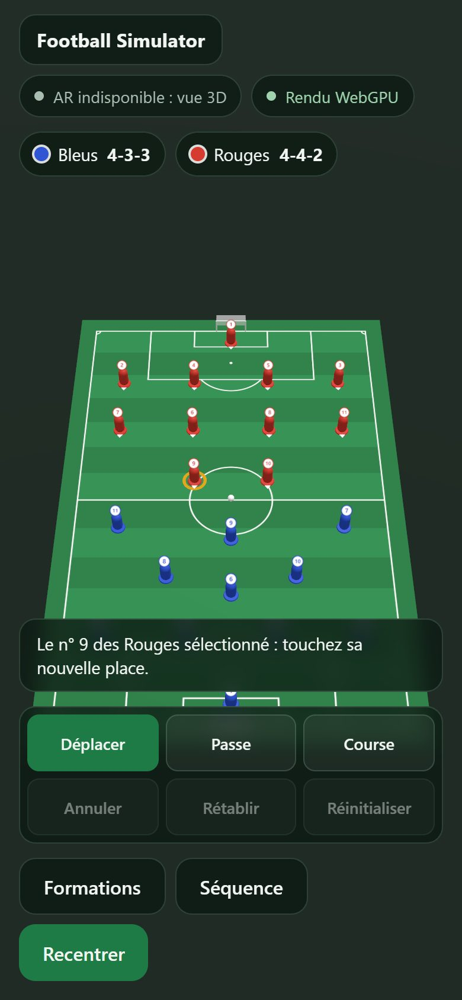</td>
    <td>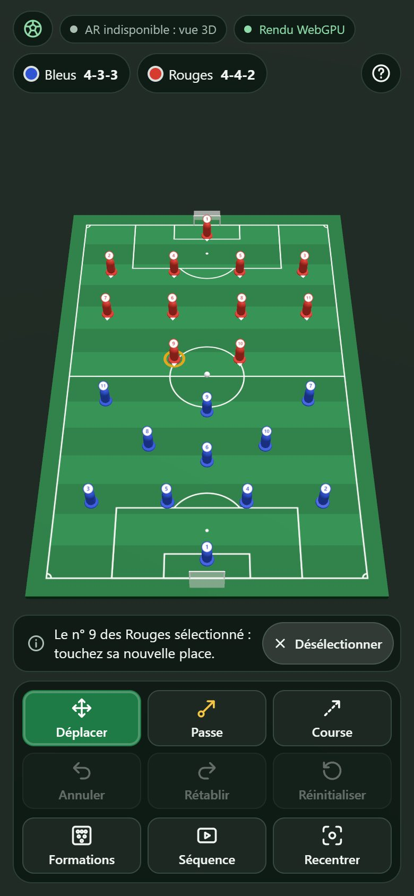</td>
  </tr>
</table>

Avant, le joueur sélectionné (n° 9 rouge) est caché sous l'aide et les boutons. Après, il reste visible ; le bouton « Désélectionner » est à côté de l'aide.

### Passe en cours (PC)

<table>
  <tr>
    <th>Avant</th>
    <th>Après</th>
  </tr>
  <tr>
    <td>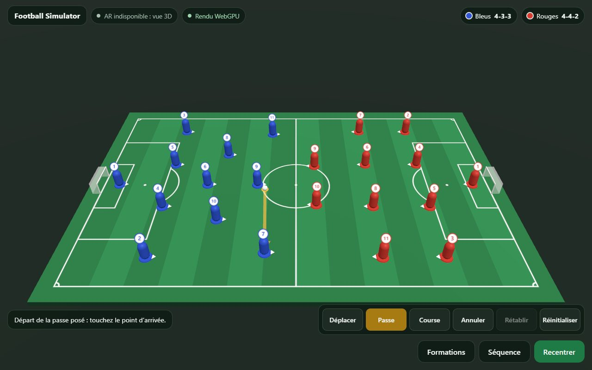</td>
    <td>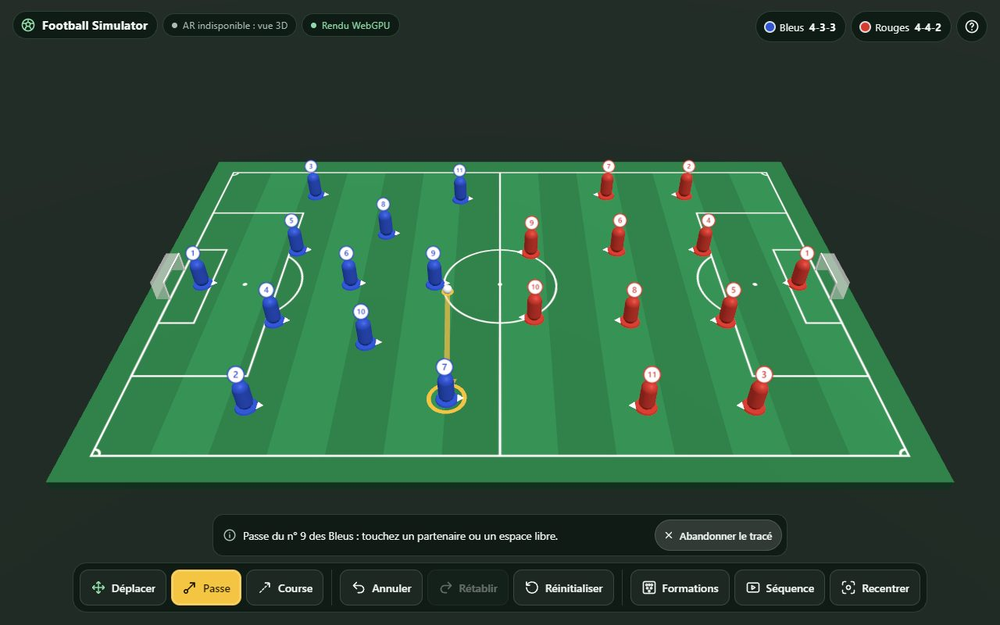</td>
  </tr>
</table>

Après : le bandeau nomme le passeur, le receveur est entouré, et « Abandonner le tracé » est proposé.

### Passe refusée (PC) et aide au premier lancement (téléphone)

<table>
  <tr>
    <th>Arrivée hors des lignes</th>
    <th>Première visite</th>
  </tr>
  <tr>
    <td></td>
    <td>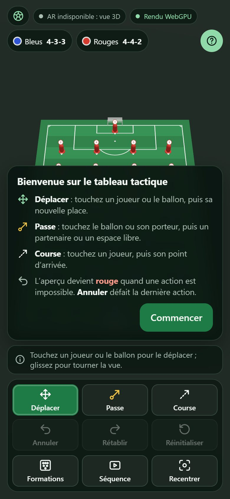</td>
  </tr>
</table>

### AR émulée, passe vers la bande de gazon

<table>
  <tr>
    <th>Avant</th>
    <th>Après</th>
  </tr>
  <tr>
    <td>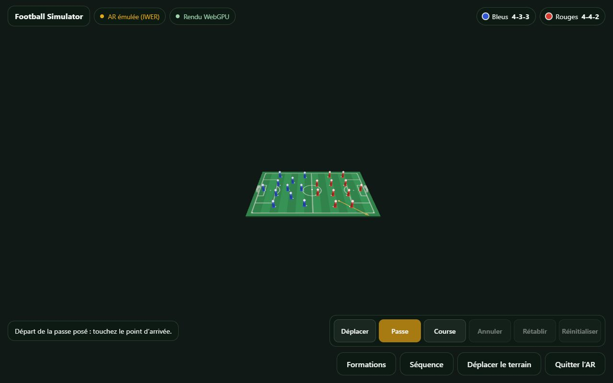</td>
    <td>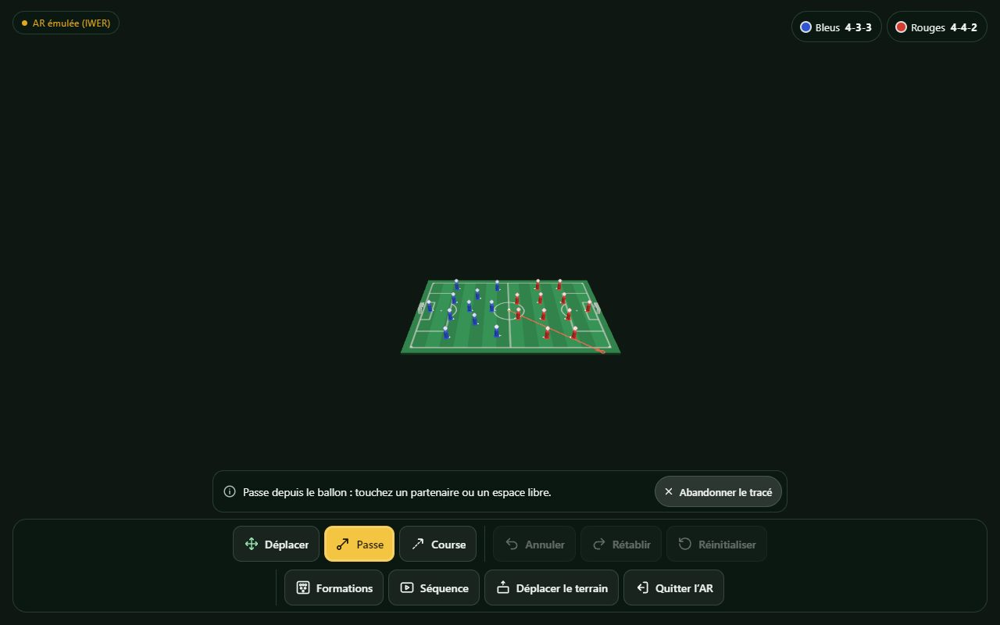</td>
  </tr>
</table>

Avant, le toucher visait le ballon, mais la passe est partie d'un joueur rouge placé devant, et son aperçu doré sortait du terrain. Après, elle part du ballon ; l'aperçu rouge annonce le refus avant le toucher.

## 4. Mises en page vérifiées

La reprise de `770d1e8` a révélé deux défauts que le premier relevé ne couvrait pas : à 320 × 568, l’aide de première visite poussait les outils sous le bord de l’écran ; à 568 × 320, ouvrir un panneau rendait « Séquence » inaccessible. Ces défauts ont été reproduits dans Chrome par des clics réels, puis corrigés.

Les panneaux et l’aide défilent désormais au-dessus de l’aide du geste et des outils ; « Commencer » reste visible pendant le défilement. En paysage court, le bandeau supérieur tient sur une ligne et les outils occupent deux rangées. Le cadrage hors AR réserve les dimensions réelles des commandes ; ouvrir l’aide ou un panneau ne recadre pas la caméra.

Un troisième cas couvrait encore des joueurs à 320 px : le long libellé d’abandon réduisait la largeur du message pendant une sélection ou une passe (3 puis 8 points cachés sur 26). Sous 380 px, ce bouton devient une croix de 40 × 40 px ; son nom complet reste accessible aux lecteurs d’écran. Les mêmes états ne cachent plus aucun des 26 points, sans déplacer la caméra.

| Avant la reprise (`770d1e8`) | Après correction |
| --- | --- |
| 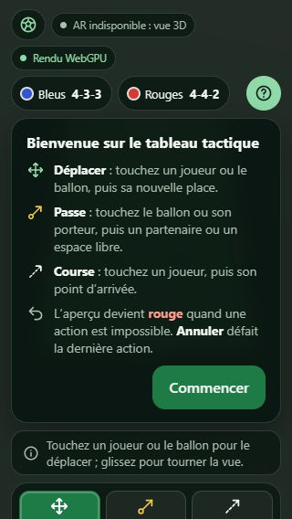 | 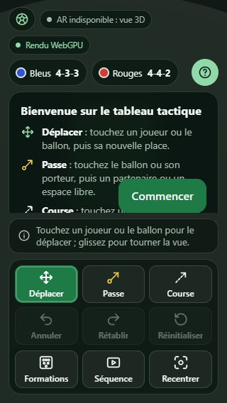 |
| 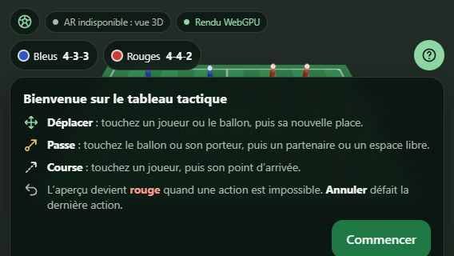 | 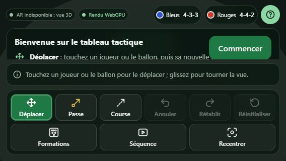 |

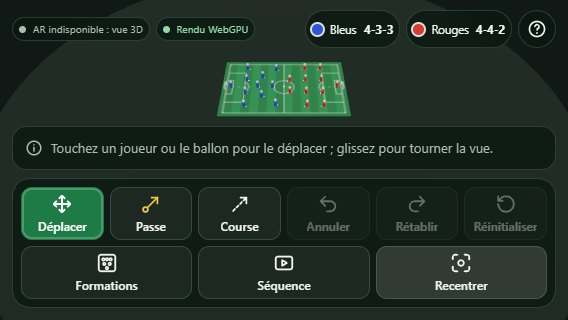

À cette hauteur, le terrain est petit : les cibles tactiques et le confort de zoom restent à juger sur téléphone. Le portrait donne plus de place pour une démonstration précise. Les panneaux ouverts couvrent volontairement une partie de la vue ; les refermer rend l’espace au terrain.

Le test `testResponsivePanels` couvre **320 × 568, 360 × 740, 390 × 844, 568 × 320, 740 × 360, 844 × 390 et 1280 × 800** : fermeture de l’aide, ouverture des deux panneaux, réouverture de l’aide, activation clavier et contrôles permanents visibles au centre, cibles d’au moins 38 px, aucun débordement horizontal. Après recentrage et fermeture des panneaux, les 26 points du terrain sont hors des commandes au repos, pendant la sélection d’un joueur et pendant une passe : 78 positions contrôlées dans chaque dimension. L’abandon est activé par son nom accessible, même quand seul le pictogramme apparaît. Les outils principaux font 52 px sur téléphone et en paysage court, 46 px sur bureau ; les commandes d’équipe et d’aide commencent à 38 px.

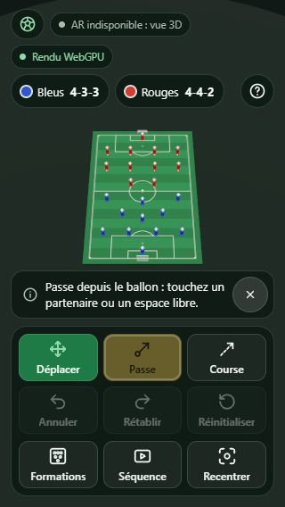

Les sessions AR émulées vérifient aussi les panneaux à 320 × 568 et 568 × 320, en WebGPU et en mode test WebGL. Cela ne mesure pas la caméra, les barres système ou les gestes d’un téléphone réel.

### Actions du joueur sélectionné (26 novembre 2026)

Après l’ajout de « Personnaliser le joueur » (PR #38), la barre d’état d’un joueur sélectionné portait sur une seule ligne l’aide, « Désélectionner », « Point de vue » et « Personnaliser le joueur ». Six des sept dimensions de `testResponsivePanels` échouaient alors sur `main` (`936fa78`) :

- sur téléphone (320 × 568, 360 × 740, 390 × 844) et à 740 × 360, « Personnaliser le joueur » sortait de l’écran ; en paysage court, la règle qui écrit « Annuler » sur l’abandon s’appliquait aussi aux deux nouveaux boutons (« Point de vue Annuler ») ;
- à 1280 × 800, panneau ouvert, l’aide écrasée faisait passer la barre de 44 à 127 px, et le recadrage qui suit sortait un coin du terrain de l’écran ;
- à 568 × 320, un seul toucher sur un joueur ouvrait son point de vue : la sélection se fait au relâchement du doigt, la barre grandit aussitôt, et le clic que le navigateur synthétise ensuite tombait sur « Point de vue », apparu sous le doigt.

« Point de vue » et « Personnaliser le joueur » deviennent des icônes de 44 px (un œil, une silhouette au crayon) tant que la barre d’état n’a pas 46 rem de large (requête de conteneur). Leur nom accessible reste l’aria-label (« Point de vue du n° 1 des Bleus ») et une infobulle donne leur libellé à la souris ; sur un bureau sans panneau ouvert, les libellés restent écrits. La règle « Annuler » ne vise plus que l’abandon. Enfin, `src/pointer-input.mjs` annule la fin du toucher (`touchend`) quand ce toucher a servi de tap, ce qui supprime le clic synthétisé : le point de vue ne s’ouvre plus que sur son bouton, comme prévu. La nouvelle mise en page suffit à faire réussir la vérification à 568 × 320, mais la barre grandit encore au-dessus du terrain pendant une sélection (de 60 à 118 px à cette dimension) : sans cette annulation, un joueur touché au bas du terrain pourrait se retrouver sous un bouton.

La croix d’abandon de 40 × 40 px décrite plus haut n’existe plus depuis la réorganisation en sept espaces (`2885bd2`, 24 novembre) : à 320 px, « Désélectionner » reste écrit et l’aide passe sur cinq lignes. Les sept dimensions réussissent de nouveau, avec les 234 vérifications de `npm run test:e2e` ; le confort sur un téléphone réel reste à juger (§5).

### Plusieurs flèches

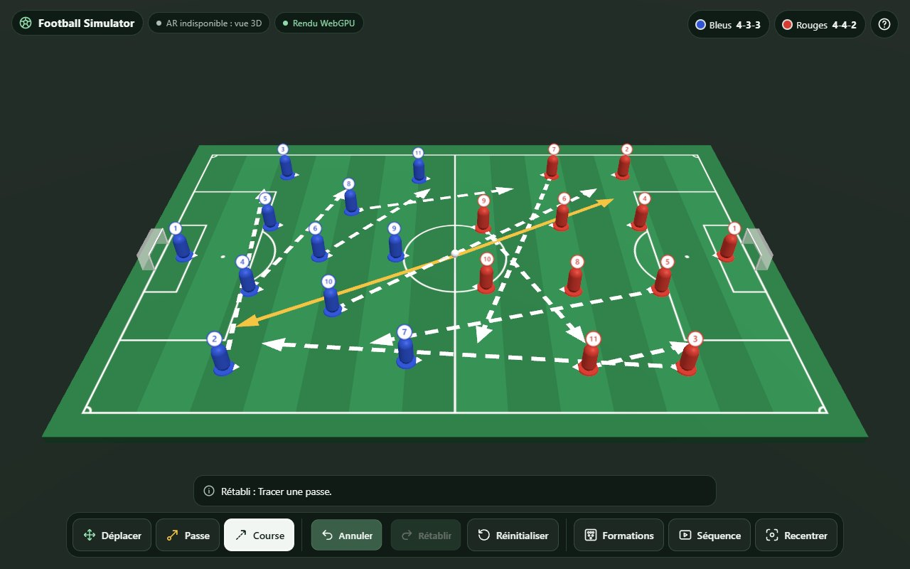

Capture finale réelle en WebGPU : 12 flèches créées par les règles pures et les commandes du tableau, puis changement d’outil, annulation et rétablissement dans l’interface. Les traits pleins dorés et les tirets blancs restent distincts. Ce contrôle visuel sur PC ne mesure pas la lisibilité des croisements sur téléphone.

## 5. Ce qui reste à vérifier sur un téléphone réel

Rien de ce qui suit n'a été mesuré sur un téléphone : l'émulation IWER sur PC ne remplace pas ces essais.

| Vérification | Comment |
| --- | --- |
| Visée au doigt en AR : l'aperçu suit le doigt, rouge hors des lignes, le relâcher trace la flèche | Protocole P8, [recette.md](recette.md#5-protocole-de-validation-physique) |
| Toucher le ballon caché par un joueur, téléphone près de la table | P8 |
| Lisibilité de la barre d'outils et du bandeau sur la caméra, en plein jour | P8 |
| Hors AR au doigt : visée, rotation à deux doigts, aucun toucher perdu | P9 |
| Passage d'une installation existante à la nouvelle version (sw.js puis sw.mjs), puis lancement hors-ligne | P10 |
