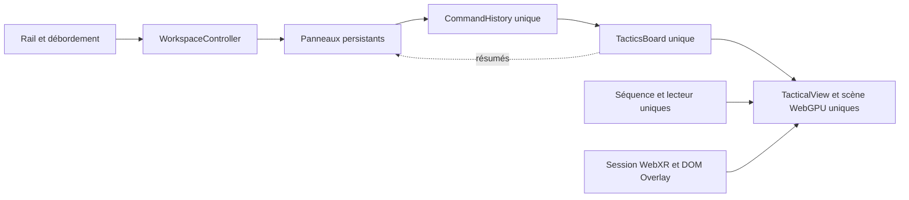
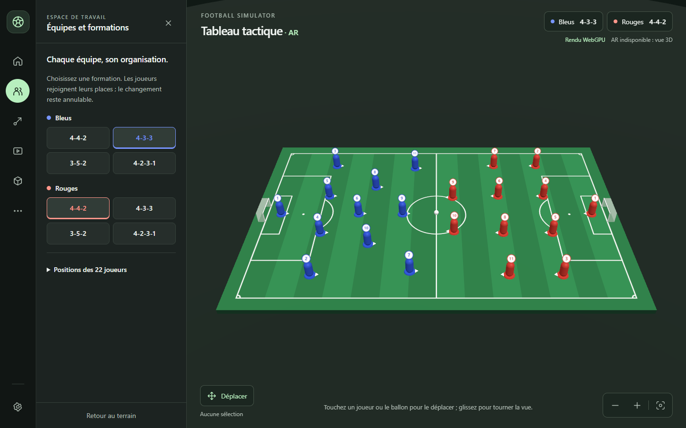

# Espaces de travail du tableau tactique

## État de départ vérifié le 24 novembre 2026

La branche `feature/espaces-coaching-sidebar` part de `origin/main`, commit
`27eff23a2ec8bc2cebbebde9e653c6c8a9524b9c`, vérifié après récupération distante.
La PR nº 15 et `feature/visualiseur-match` ne font pas partie de cette évolution.
La référence jointe décrit un rail sombre compact ; aucune image de référence n'était jointe.

## Inventaire avant modification et correspondance des commandes

| Fonction existante sur main | Module conservé | Espace / accès |
| --- | --- | --- |
| Terrain WebGPU, 22 joueurs instanciés, ballon, raycasting | `scene.mjs`, `pitch.mjs`, `players.mjs`, `tactical-view.mjs` | Terrain partagé, toujours présent |
| Rotation, zoom souris / pincement, recentrage | `scene.mjs`, OrbitControls tiers inchangé | Accueil, commandes de vue persistantes |
| Formations des Bleus et Rouges : 4-4-2, 4-3-3, 3-5-2, 4-2-3-1 ; transitions animées | `formations.mjs`, `formation-panel.mjs`, `formation-transition.mjs` | Équipes et formations ; résumé dans l'en-tête |
| Sélection et déplacement d'un joueur ou du ballon ; destination au doigt | `tactical-interaction.mjs`, `pointer-input.mjs` | Terrain et Outils tactiques |
| Passe, course, aperçu valide / rouge, accrochage, refus expliqués, annulation | `arrow-rules.mjs`, `tactical-arrows.mjs`, `tactical-toolbar.mjs` | Outils tactiques ; Abandonner toujours accessible |
| Historique unique : annuler, rétablir, réinitialiser avec confirmation | `commands.mjs`, `tactical-toolbar.mjs` | Outils tactiques ; raccourcis conservés partout |
| Images clés annulables, lecture / pause, recommencer, effacer, vitesses 0,5× / 1× / 2× | `tactical-sequence.mjs`, `sequence-player.mjs`, `sequence-panel.mjs` | Animation et séquences |
| Détection de capacité WebXR / liaison WebGPU, explication du réglage Chrome, copie de l'adresse | `xr-support.mjs`, `xr-session.mjs`, `main.mjs` | Réalité augmentée |
| Entrer / quitter l'AR, hit test, réticule, pose, ancre, repositionnement, saisie XR et DOM Overlay | `ar-surface.mjs`, `ar-view.mjs`, `xr-input.mjs` | Réalité augmentée ; sortie persistante pendant la session |
| Diagnostics FPS, durée image, CPU, rendu, XR, appels, triangles, mémoire ; paramètre `?diagnostics` | `diagnostics.mjs` | Plus d'outils, activation sans rechargement |
| Installation PWA quand proposée, état hors ligne, mise à jour / rechargement | `pwa.mjs`, `sw.mjs` | Plus d'outils ; avis de mise à jour persistant |
| Aide de première visite, réouverture, stockage de l'aide vue | `onboarding.mjs` | Réglages et aide ; aide de première visite conservée |
| D / P / C, Échap, Ctrl ou Cmd+Z, Ctrl+Y, Ctrl+Maj+Z | `keyboard-shortcuts.mjs` | Tous les espaces ; rappel dans Réglages et aide |
| Préférence système de réduction des animations | `main.mjs`, CSS | Respect automatique, indiqué dans Réglages et aide |
| Modes de développement `?debug`, `?iwer`, `?webgl` | Modules existants, inchangés | Paramètres d'adresse conservés, sans les présenter comme capacités de production |
| Lancement hors ligne, mise à jour atomique, migration sw.js, sous-chemin GitHub Pages | `pwa.mjs`, `sw.mjs`, `sw.js` | Tous les espaces ; nouveaux fichiers inclus dans la coquille |

### Correspondance des sélecteurs de commandes

| Espace | Commandes et éléments réutilisés |
| --- | --- |
| Accueil / terrain | `#home-toggle`, résumés des formations et de la sélection ; `#reset-view`, `#zoom-in`, `#zoom-out` restent au bord du terrain |
| Équipes et formations | `#formations-toggle`, `.team-chip`, `#formation-panel`, `.formation-button`, positions dans `#player-positions` |
| Outils tactiques | `#tactics-toggle`, `#active-tool`, `#tactical-toolbar`, `[data-mode]`, `[data-action="undo"]`, `[data-action="redo"]`, `[data-action="reset"]` |
| Animation et séquences | `#sequence-toggle`, `#sequence-panel`, `[data-sequence]`, `[data-speed]` |
| Réalité augmentée | `#ar-toggle`, `#enter-ar`, `#copy-flag`, état dans `#ar-capability` ; `#move-pitch` et `#exit-ar` restent persistants pendant la session |
| Plus d'outils | `#more-toggle`, `#diagnostics-toggle`, `#diagnostics`, `#install-app`, état réseau / cache, accès secondaire à AR et Réglages |
| Réglages et aide | `#settings-toggle`, `#help-toggle`, `#onboarding`, `#onboarding-close`, `[data-expand-rail]`, aide clavier et préférence système |
| Tous les espaces | `#hint`, `#cancel-draft`, `#ar-message`, `#update-notice`, `#reload-app`, badges `#gpu-status`, `#xr-status`, `#network-status` ; croix / Retour par `[data-workspace-close]` |

## Architecture réalisée

Un contrôleur central change uniquement l'espace actif et la visibilité des panneaux.
Les panneaux sont créés une seule fois et réutilisent les commandes existantes.
Une seule scène, un seul `TacticsBoard`, un seul `CommandHistory`, une seule séquence et une
seule boucle `setAnimationLoop` servent tous les espaces, y compris l'AR.
La navigation ne change ni le mode tactique, ni la sélection, ni le tracé en cours.
Échap conserve la priorité : confirmation, geste en cours, panneau, aide.
Le bouton Retour / Fermer replie l'interface et rend le focus à la navigation.
Le Retour du navigateur replie aussi le panneau. Les changements d'espace remplacent
une seule entrée d'historique ; une réouverture immédiate attend correctement le retour différé.
La liaison du rail est idempotente pour une même racine ; `destroy()` libère les écouteurs,
les événements de navigation et les abonnements au contrôleur.

## Comportement adaptatif et AR

| Contexte | Navigation et panneau | Terrain et gestes |
| --- | --- | --- |
| Bureau | Rail de 76 px ; panneau de 316 px, repliable ; libellés développables sur écran assez large | Le canvas réserve la largeur du panneau. La rotation et le pivot choisis restent conservés ; la distance s'adapte à la place libre |
| Portrait, largeur inférieure à 700 px | Cinq destinations en bas, AR et aide dans Plus ; panneau limité à 34 % de la hauteur, plafonné à 300 px | Canvas au-dessus du panneau et de la navigation. Commandes de vue et Abandonner restent accessibles |
| Paysage court | Rail de 60 px, panneau latéral limité à 250 px ou 37 % de la largeur ; contenu défilant | Recentrer près de l'en-tête ; zoom par molette ou pincement ; bouton compact Annuler avec nom accessible complet |
| AR immersive | Même racine DOM Overlay et panneaux réutilisés ; formations, tactique et animation désactivées avant la pose | Même terrain ancré, même tableau. Entrer seulement si support détecté ; repositionnement et sortie persistants ; `beforexrselect` bloque les gestes sur les surfaces UI |

Le guide de première visite se trouve dans Réglages et aide. Il ne recouvre pas les commandes
de vue. Le mode tactique actif reste indiqué quand son panneau est fermé.
Les raccourcis D / P / C et l'historique restent disponibles entre les espaces.
Échap traite d'abord la confirmation de réinitialisation, le geste, le guide, puis le panneau.
Les déplacements respectent la préférence système lue au lancement ; les transitions CSS
suivent aussi `prefers-reduced-motion`.

## Captures avant et après

Chrome sur PC, WebGPU réel ; profils mobiles émulés. Chaque paire présente les formations
initiales de main, dans les mêmes dimensions. Ces images ne constituent pas un essai physique.

| Dimensions | Avant, main `27eff23` | Après, terrain | Après, panneau des formations |
| --- | --- | --- | --- |
| Bureau 1440 × 900 | [Avant](images/sidebar/avant-bureau.png) | [Après](images/sidebar/apres-bureau.png) | [Panneau](images/sidebar/apres-formations-bureau.png) |
| Portrait 390 × 844 | [Avant](images/sidebar/avant-portrait.png) | [Après](images/sidebar/apres-portrait.png) | [Panneau](images/sidebar/apres-formations-portrait.png) |
| Paysage 844 × 390 | [Avant](images/sidebar/avant-paysage.png) | [Après](images/sidebar/apres-paysage.png) | [Panneau](images/sidebar/apres-formations-paysage.png) |

La [capture AR](images/sidebar/apres-ar-emulation.png) provient d'IWER sur PC, avec un terrain
posé et ancré. Le fond sombre remplace la caméra d'un téléphone réel.

Reproduction : `node tests/capture-workspaces.mjs`. Pour une référence, définir `CAPTURE_ROOT`
sur un checkout du commit voulu et `CAPTURE_PREFIX=avant`. La capture AR est produite par
`WORKSPACE_CAPTURE_AR=1 npm test` quand IWER est accessible.

## Fichiers et portée

| Fichier | Changement |
| --- | --- |
| `src/workspace-controller.mjs` | Nouveau : registre des sept espaces, état du panneau, disponibilité AR, événements Observer |
| `src/workspace-navigation.mjs` | Nouveau : délégation des clics, focus et clavier, Retour navigateur, cycle de vie, résumés du tableau, capacités AR et PWA |
| `index.html`, `src/styles.css` | Rail, sept sections réelles, disposition adaptative, guide dans son panneau, focus, cibles tactiles |
| `src/main.mjs` | Liaison aux contrôles existants, retours des formations, annulation, diagnostics à la demande et disponibilité des espaces pendant la pose AR |
| `src/scene.mjs` | Dimensions du canvas, cadrage du rectangle libre, zoom explicite, conservation de la rotation lors d'un changement de panneau |
| `src/onboarding.mjs` | Ouverture du guide dans l'espace d'aide ; restitution du focus |
| `sw.mjs` | Deux nouveaux modules dans `APP_SHELL`, empreinte recalculée |
| `tests/workspace-tests.mjs` | Nouveaux parcours navigateur, aussi appelés par la suite complète ; vérification des espaces en session IWER |
| `tests/workspace-test-helpers.mjs` | Parcours des vrais boutons ; outillage de raycasting extrait sans changer les assertions tactiques |
| `tests/unit/workspace-controller.test.mjs` | Non-mutation du tableau et de l'historique, disponibilité avant pose, notifications et erreurs |
| `tests/capture-workspaces.mjs` | Production des captures comparables |
| `tests/run-tests.mjs` | Accès aux commandes dans leur nouvel espace, vérification des cibles persistantes, nouveaux parcours inclus |

Le moteur des flèches, le tableau, les commandes, le lecteur et les modules WebXR restent ceux
de main. Aucune dépendance ajoutée, aucun fichier tiers modifié. `ATTRIBUTION.md` est conservé
sans modification ; la déclaration de ce nouveau lot reste à renseigner par l'équipe.

## Vérification et limites

Dernière exécution complète, le **24 novembre 2026**, sous Node.js **v24.11.0**, Chrome installé
sur PC et WebGPU matériel. `npm test` est terminé avec un code de sortie **0**.

| Contrôle | Résultat |
| --- | --- |
| `npm run test:unit` | **229 / 229**, aucun échec ni cas ignoré |
| `npm run test:e2e` | **129 / 129**, aucun échec ni cas ignoré |
| Nouveaux parcours d'espaces | 23 vérifications navigateur, plus 2 vérifications d'espaces pendant les parcours AR existants |
| Écrans de la régression complète | 320 × 568, 360 × 740, 390 × 844, 568 × 320, 740 × 360, 844 × 390, 1280 × 800 |
| Visibilité du terrain | 4 coins et 22 joueurs visibles au repos, pendant une sélection et pendant une passe dans les sept tailles testées |
| AR émulée | IWER : WebGPU, pose et ancre, raycasting, repositionnement, formations, flèches, séquence, DOM Overlay, sortie système et cinq cycles de session ; compatibilité du mode test WebGL conservée |
| PWA | Cache, navigation hors ligne dans les sept espaces, mise à jour atomique sur réseau lent, migration de sw.js vers sw.mjs et sous-chemin GitHub Pages |
| `npm run shell-version -- --check` | À jour : `988cf706406c3c22` ; les deux modules de navigation sont dans la coquille |
| `git diff --check` | Aucun défaut de blancs |
| Fichiers protégés | Aucun changement dans `ATTRIBUTION.md`, `src/vendor/`, le moteur tactique, les commandes, la lecture de séquence ou les modules WebXR |

Le [journal complet](validation/espaces-coaching-tests.txt) conserve les 229 résultats unitaires
et les 129 résultats navigateur de cette exécution, sans doubler les lignes de progression.
Le premier passage avant modification avait donné 226 tests unitaires et 64 vérifications
navigateur réussis ; trois groupes AR avaient été ignorés car le réseau du bac à sable empêchait
de charger IWER. La validation finale ci-dessus a accès au CDN et n'ignore aucun cas.

La suite conserve les assertions de géométrie et de logique des flèches de main ; seuls les
chemins d'accès aux commandes passent désormais par leur espace.

- Les profils mobiles sont émulés dans Chrome : aucune mesure de fluidité ou de stabilité sur téléphone réel n'est revendiquée.
- IWER vérifie le cycle AR et l'interface, sans valider l'ergonomie d'une caméra et d'un DOM Overlay sur un appareil physique.
- L'émulateur demande l'accès à son CDN ; les tests le signalent comme ignoré si ce téléchargement échoue.
- Une exécution a rencontré un dépassement de 20 s lors du chargement externe d'IWER, puis les deux parcours AR complets ont réussi. Le délai de démarrage du banc est désormais de 60 s avec `?iwer` ; celui de l'application normale reste à 20 s. Aucun délai du code de production n'a changé.
- Aucune image de référence n'accompagnait le texte joint : la structure sombre et compacte décrite dans la demande a servi de référence.
- La tactique est conservée entre les espaces et lors de la sortie AR. Comme sur main, elle vit en mémoire et n'est pas enregistrée lors d'un rechargement de page.
- La PR doit être relue puis fusionnée explicitement avant toute publication sur GitHub Pages.
