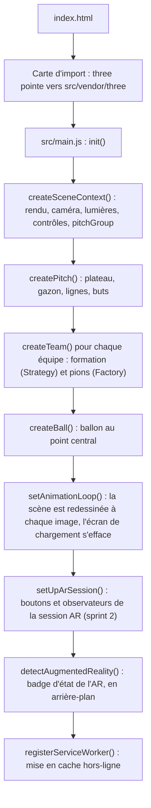
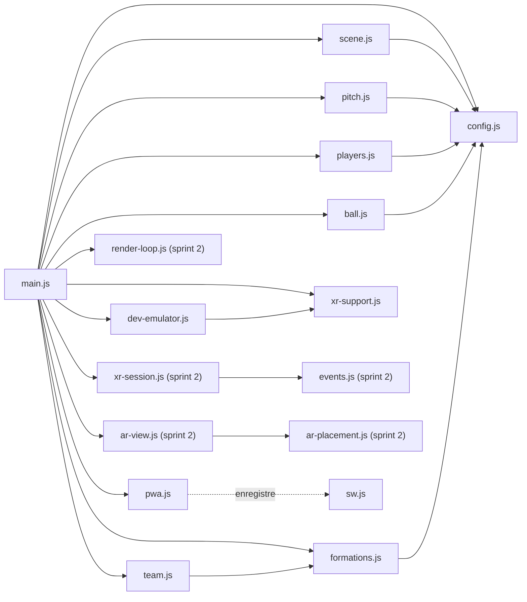
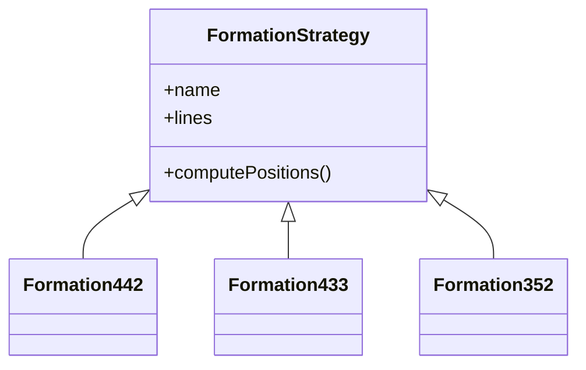
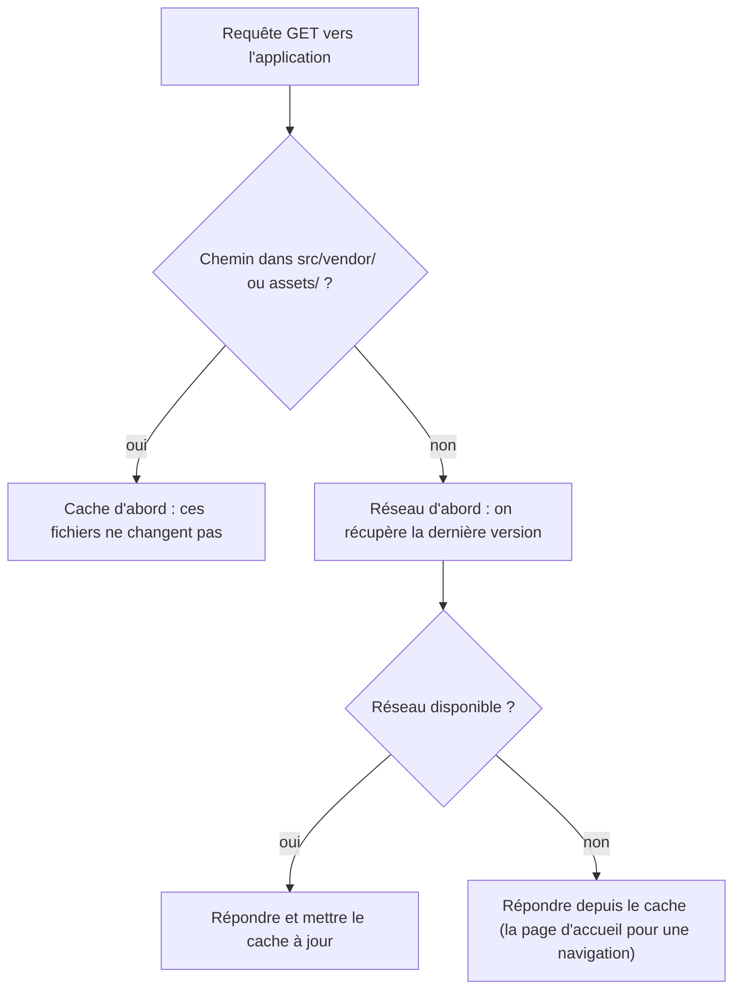

# Guide du code : sprint 1

Ce guide explique tout le code du sprint 1, fichier par fichier, pour que chaque membre de l'équipe puisse le présenter, le modifier et répondre aux questions du jury. Compter 30 à 45 minutes de lecture, avec le code ouvert à côté.

Le sprint 2 (session AR) a son propre document, [sprint-2.md](sprint-2.md), qui explique ses cinq nouveaux modules ; ce guide signale ce que le sprint 2 a changé dans le code du sprint 1.

**Sommaire**

1. [Ce qui se passe au chargement](#1-ce-qui-se-passe-au-chargement)
2. [Les notions à connaître](#2-les-notions-à-connaître)
3. [Fichier par fichier](#3-fichier-par-fichier)
4. [Patrons de conception](#4-patrons-de-conception)
5. [Choix techniques et leurs raisons](#5-choix-techniques-et-leurs-raisons)
6. [Tests](#6-tests)
7. [Limites connues](#7-limites-connues)
8. [Questions probables du jury](#8-questions-probables-du-jury)
9. [Après le sprint 1](#9-après-le-sprint-1)

---

## 1. Ce qui se passe au chargement

Le navigateur charge `index.html`, qui déclare une carte d'import puis lance `src/main.js`. Tout le reste découle de ce fichier, dans cet ordre :



Les modules dépendent les uns des autres ainsi (une flèche signifie « importe ») :



Les modules qui créent des objets 3D (`scene`, `pitch`, `players`, `team`, `ball`) importent aussi three.js, non représenté ici.

---

## 2. Les notions à connaître

### 2.1 three.js en six notions

| Notion | Dans notre code | Rôle |
| --- | --- | --- |
| Scène (`THREE.Scene`) | `scene.js` | Contient tout ce qui est affiché |
| Caméra (`PerspectiveCamera`) | `scene.js` | Le point de vue ; en AR, c'est le téléphone qui la pilotera (sprint 2) |
| Moteur de rendu (`WebGLRenderer`) | `scene.js` | Dessine la scène dans un canvas, à chaque image |
| Maillage (`Mesh`) = géométrie + matériau | `pitch.js`, `players.js`, `ball.js` | Un objet visible : sa forme, et l'apparence de sa surface |
| Groupe (`Group`) et graphe de scène | `pitchGroup` | Déplacer un parent déplace tous ses enfants |
| Boucle de rendu (`setAnimationLoop`) | `main.js` | Redessine la scène à chaque image ; en WebXR, c'est la session qui la cadence |

Le graphe de scène du sprint 1 :

```text
scene
├── lumières            hémisphérique et directionnelle, sans ombres portées
├── table               vue 3D hors AR seulement
└── pitchGroup          groupe racine : le déplacer ou l'ancrer déplace tout le terrain
    ├── pitch           plateau, gazon et buts
    ├── team-blue       11 joueurs
    ├── team-red        11 joueurs
    └── ball
```

### 2.2 Unités et repère

- **L'unité est le mètre.** Le terrain réel (105 × 68 m) devient une maquette de 0,6 × 0,389 m : l'échelle vaut 0,6/105, soit environ 1/175. En AR, ces mètres seront de vrais mètres : la maquette aura sa taille réelle sur la table.
- **L'axe Y monte.** Le gazon est le plan y = 0 ; joueurs et ballon reposent dessus.
- **L'axe X suit la longueur, l'axe Z la largeur.** L'origine est le point central.
- **Les Bleus attaquent vers +X, les Rouges vers −X.** Le flanc droit des Bleus est du côté +Z.

Vu de dessus, avec la caméra de la vue « télévision » en bas du schéma :

```text
            −Z (flanc gauche des Bleus)
   ┌───────────────────┬───────────────────┐
   │                   │                   │
−X │  but des Bleus    ●    but des Rouges │ +X
   │                   │                   │
   └───────────────────┴───────────────────┘
            +Z (flanc droit des Bleus)
```

### 2.3 WebXR, en bref

WebXR est l'API du navigateur qui donne accès à la réalité augmentée. Le sprint 1 ne fait que détecter sa présence ; les sprints suivants l'utiliseront ainsi :

| Notion | Rôle | Sprint |
| --- | --- | --- |
| Session `immersive-ar` | Le navigateur affiche l'image de la caméra et dessine la scène par-dessus | S2 |
| Couche de rendu (`XRWebGLLayer`) | Relie le canvas WebGL à la session ; three.js la crée lui-même | S2 |
| Espace de référence `local-floor` | Un repère dont l'origine est au sol, là où se trouve l'utilisateur | S2 |
| DOM Overlay | Afficher nos boutons HTML par-dessus la vue AR | S2 |
| Hit test | Trouver la surface réelle (la table) sous un rayon partant de l'écran | S3 |
| Ancre (`XRAnchor`) | Garder le terrain fixe sur la table quand le suivi se corrige | S3 |

WebXR n'existe qu'en contexte sécurisé : HTTPS, ou `localhost` pendant le développement.

### 2.4 PWA, en bref

Une application web progressive repose sur deux fichiers : le **manifeste** (`manifest.json`), qui permet de l'installer sur l'écran d'accueil, et le **Service Worker** (`sw.js`), qui met ses fichiers en cache pour la lancer hors-ligne.

---

## 3. Fichier par fichier

### [`index.html`](../index.html)

La page déclare une **carte d'import** : elle permet d'écrire `import * as THREE from 'three'` dans nos modules, alors que three.js est copié dans `src/vendor/three/`.

```html
<script type="importmap">
  { "imports": {
      "three": "./src/vendor/three/build/three.module.js",
      "three/addons/": "./src/vendor/three/examples/jsm/" } }
</script>
```

Le reste de la page :

- la zone de rendu (`#scene-container`), où three.js insère son canvas ;
- l'interface superposée (`#overlay`), racine du DOM Overlay en AR : le nom de l'application, le badge d'état de l'AR (`#xr-status`), les pastilles des formations et le bouton « Recentrer » (`#reset-view`) ; depuis le sprint 2, aussi « Entrer en AR », « Quitter l'AR » et un message d'échec (`#ar-message`) ;
- l'écran de chargement (`#loader`) ;
- un message pour les navigateurs sans JavaScript.

Chaque bloc porte un commentaire d'en-tête, comme l'exige le cahier (§7.1). La balise `viewport` contient `viewport-fit=cover`, nécessaire pour gérer l'encoche des téléphones (voir `styles.css`).

### [`src/config.js`](../src/config.js)

Toutes les constantes partagées, au même endroit :

| Constante | Valeur | Pourquoi |
| --- | --- | --- |
| `REAL_PITCH` | 105 × 68 m | Dimensions réglementaires d'un terrain |
| `PITCH_LENGTH` | 0,6 m | Taille de la maquette demandée par le cahier : environ 60 × 40 cm (§1.4) |
| `PITCH_SCALE` | 0,6/105 ≈ 1/175 | Facteur entre le réel et la maquette |
| `PITCH_RUNOFF` | 4 m réels | Bande de gazon autour des lignes, où se trouvent les buts |
| `BOARD_LENGTH`, `BOARD_WIDTH` | 0,646 × 0,434 m | Plateau complet, bande de gazon comprise |
| `PLAYER_SIZE` | rayon 6,5 mm, hauteur 2,8 cm | Pions exagérés environ 2,7 fois pour rester lisibles (voir §5) ; zone de sélection de 1,4 cm de rayon |
| `BALL_RADIUS` | 4,2 mm | Ballon exagéré, sinon invisible à cette échelle |
| `TEAMS` | Bleus et Rouges | Couleur, sens d'attaque (`attacksPositiveX`) |
| `DEFAULT_FORMATIONS` | Bleus 4-3-3, Rouges 4-4-2 | Le scénario de démonstration du cahier (§4.1) |
| `SCENE_COLORS` | | Couleurs du fond, de la table, du gazon, des lignes et des buts |

`Object.freeze` empêche de modifier ces objets par erreur.

### [`src/scene.js`](../src/scene.js)

Crée tout ce qui entoure le terrain. Ses fonctions :

- **`createRenderer`** : un `WebGLRenderer` avec anticrénelage et fond transparent (`alpha: true`). Le fond transparent servira en AR, où l'image de la caméra doit apparaître derrière la scène. La densité de pixels est plafonnée à 2 pour ménager les téléphones.
- **`addLights`** : une seule lumière directionnelle (intensité 1,6), qui donne le relief, et une lumière d'ambiance hémisphérique (ciel blanc, sol vert sombre, intensité 2,2), très peu coûteuse. Aucune ombre portée : c'est le calcul le plus lourd sur mobile. Le cahier conseille « une seule lumière » (§6.3) : si la mesure de fluidité du sprint 6 le demande, la lumière hémisphérique pourra être retirée.
- **`createTable`** : un disque sombre sous le terrain, nommé `table`. Il n'existe que hors AR : en AR, la vraie table le remplace.
- **`createControls`** : `OrbitControls` pour tourner, zoomer et déplacer la vue. L'amortissement rend les gestes fluides, la distance est bornée entre 15 cm et 3 m, et l'angle vertical est limité à 82° pour ne jamais passer sous la table.
- **`frameWholePitch`** : le **cadrage automatique**, détaillé ci-dessous.
- **`createSceneContext`** : assemble le tout, crée la caméra (plan proche à 1 cm, plan lointain à 20 m, adaptés à une maquette de 60 cm) et le groupe `pitchGroup`, et gère le redimensionnement de la fenêtre. Depuis le sprint 2, il renvoie aussi `table` et `resize`, qui ne fait rien pendant une session AR, et `createRenderer` active WebXR (`renderer.xr.enabled = true`).

**Le cadrage automatique.** Le terrain doit tenir à l'écran, en paysage comme en portrait. Plutôt qu'une formule approchée, la fonction mesure :

1. Elle choisit un angle de vue : en paysage, vue latérale « télévision » (élévation d'environ 40°, champ de 45°) ; en portrait, vue depuis le but des Bleus (élévation d'environ 54°, champ de 55°), qui exploite la hauteur de l'écran.
2. Elle place la caméra à 20 cm du centre, dans cette direction.
3. Elle **projette les 8 coins du plateau** à l'écran (`Vector3.project`), en coordonnées normalisées où 1 correspond au bord de l'écran.
4. Si un coin dépasse 0,92 en largeur ou 0,74 en hauteur (la marge laisse place aux bandeaux de l'interface), elle recule la caméra de 4 % et recommence.

Une première version, fondée sur une formule, coupait les coins du terrain à cause de la perspective. Les vérifications du sprint 1 l'ont montré, et cette méthode l'a remplacée.

Au redimensionnement, la vue n'est recadrée que si l'écran passe de paysage à portrait, ou l'inverse. Sur mobile, la barre d'adresse qui apparaît et disparaît redimensionne la fenêtre en permanence : recadrer à chaque fois effacerait la vue choisie par l'utilisateur.

### [`src/pitch.js`](../src/pitch.js)

Construit le terrain. Les lignes ne viennent pas d'une image : elles sont **dessinées sur un canvas 2D**, puis appliquées comme texture.

- **`drawPitchCanvas`** : crée un canvas de 1808 × 1216 pixels, soit 16 pixels par mètre réel. L'astuce : `ctx.scale(16, 16)` permet ensuite de dessiner directement en mètres réels, avec les mesures des lois du jeu de l'IFAB. On peint d'abord le gazon, puis une bande de tonte sur deux (14 bandes de 7,5 m), puis les lignes et les arcs de coin.
- **`drawPenaltyEnd`** : surface de réparation (16,5 × 40,32 m), surface de but (5,5 × 18,32 m), point de penalty à 11 m et arc de cercle. L'arc ne doit apparaître qu'en dehors de la surface : son demi-angle vaut arccos((16,5 − 11) / 9,15) ≈ 53°.
- **`createGrass`** : un `PlaneGeometry` couché à plat (rotation de −90° autour de X) qui reçoit la texture. Le filtrage anisotrope garde les lignes nettes quand on regarde le terrain en biais, et `SRGBColorSpace` respecte les couleurs du canvas.
- **`createBoard`** : une boîte de 8 mm d'épaisseur sous le gazon, abaissée de 0,3 mm. Sans ce décalage, le dessus de la boîte et le gazon seraient exactement au même niveau et clignoteraient (« z-fighting »).
- **`createGoal`** : deux poteaux, une barre transversale et un filet translucide. Le filet est une boîte dont deux faces sont invisibles : la bouche du but et le sol. Les faces d'une `BoxGeometry` sont rangées dans l'ordre +x, −x, +y, −y, +z, −z, d'où le tableau de six matériaux. La même fonction construit les deux buts ; celui de droite est tourné de 180°. La largeur du but suit l'échelle (4,2 cm), sa hauteur est exagérée (2 cm) pour rester visible.

Les lignes font 0,3 m réel au lieu de 0,12 m, pour rester lisibles à cette échelle. Pour des lignes plus nettes, on peut augmenter `PIXELS_PER_METER`, mais la taille de la texture croît avec son carré.

### [`src/formations.js`](../src/formations.js)

Le **patron Strategy** du cahier (§3.4) : chaque formation est une classe qui sait calculer les positions de ses 11 joueurs.



- **Le repère normalisé.** Une formation ne connaît ni la taille du terrain ni le sens d'attaque. Elle décrit chaque joueur par x (0 = sa propre ligne de but, 0,5 = la ligne médiane) et y (0 = son flanc gauche, 1 = son flanc droit). Une même formation sert donc aux deux équipes.
- **Les lignes.** Chaque formation se décrit ligne par ligne, du gardien à l'attaque ; tous les joueurs d'une ligne partagent la même profondeur x, sauf exception (le milieu défensif du 4-3-3 joue plus bas, à x = 0,27). La ligne du gardien est commune aux trois formations, la défense à quatre au 4-4-2 et au 4-3-3.
- **`computePositions`** est écrit une seule fois, dans la classe de base : il aplatit les lignes en 11 positions et vérifie qu'il y en a bien 11. Les sous-classes ne fournissent que `name` et `lines` (patron « méthode de modèle », au service de Strategy).
- **`FORMATIONS` et `getFormation`** : le registre des formations par nom, et une erreur claire pour un nom inconnu.
- **`toPitchCoordinates`** convertit une position normalisée en mètres de la scène :

  x_scène = s × (x − 0,5) × 0,6 et z_scène = s × (y − 0,5) × 0,389, avec s = +1 pour les Bleus et s = −1 pour les Rouges.

  Pour les Rouges, le signe inverse les deux axes : c'est une rotation de 180° autour du point central, ce qui place leur gardien dans l'autre but et leur flanc droit du bon côté.

Tous les joueurs sont placés dans leur moitié, comme au coup d'envoi : aucun n'entre dans le rond central (9,15 m).

**Ajouter une formation**, par exemple un 5-3-2, revient à écrire une classe dans ce fichier et à l'enregistrer :

```js
export class Formation532 extends FormationStrategy {
  get name() { return '5-3-2'; }
  get lines() {
    return [
      GOALKEEPER_LINE,
      { x: 0.16, slots: [ /* 5 défenseurs : { y, number, role } */ ] },
      { x: 0.30, slots: [ /* 3 milieux */ ] },
      { x: 0.44, slots: [ /* 2 attaquants */ ] },
    ];
  }
}
// puis l'ajouter dans FORMATIONS : new Formation532()
```

Les tests vérifient automatiquement toute formation enregistrée : 11 joueurs, numéros 1 à 11, placements valides.

### [`src/players.js`](../src/players.js)

Le **patron Factory** du cahier (§3.4) : `PlayerFactory.createPlayer({ team, number, role })` fabrique un pion complet selon l'équipe.

Un joueur est un `Group` de cinq éléments :

| Élément | Forme | Rôle |
| --- | --- | --- |
| Socle | Cylindre aplati, rayon d'environ 9 mm | Le pied du pion, à la couleur de l'équipe |
| Flèche | Triangle blanc posé au sol | Indique le sens d'attaque |
| Corps | Capsule de 2,8 cm | La silhouette du joueur |
| Numéro | Sprite (image toujours tournée vers la caméra) | Lisible sous tous les angles, en AR comme hors AR |
| Zone de sélection `hitbox` | Cylindre invisible, rayon 1,4 cm | Agrandit la cible du doigt pour le raycasting du sprint 5 (cahier §6.3) |

Trois points à savoir expliquer :

- **Ressources partagées.** Une seule fabrique sert les deux équipes : les géométries sont créées une fois et partagées par les 22 joueurs, il n'existe qu'un matériau par équipe, et un matériau de numéro par équipe et par numéro (22 au total). Cela économise la mémoire et le travail de la carte graphique, une contrainte du cahier (§6.1).
- **Les numéros** sont dessinés sur un petit canvas de 128 × 128 pixels (disque blanc, contour et chiffre à la couleur de l'équipe), puis affichés par un `Sprite`.
- **La zone de sélection invisible reste touchable.** Son matériau a `visible: false` : elle n'est pas dessinée, mais le `Raycaster` de three.js la détecte quand même. Dans three.js r186, `Mesh.raycast` ne vérifie que l'existence du matériau, pas sa visibilité (`src/vendor/three/build/three.core.js`). Au sprint 5, il suffira de viser la liste des hitbox ; `hit.object.parent` sera le joueur, et son `userData` (équipe, numéro, poste) dira lequel a été touché.

Les Rouges sont tournés de 180° (`rotation.y = Math.PI`) pour que leur flèche pointe vers le but des Bleus.

Le cahier (§6.3) cite aussi `InstancedMesh`, qui dessinerait les 22 corps en un seul appel. Il n'est pas utilisé : chaque joueur reste un objet indépendant, simple à sélectionner et à déplacer au sprint 5. Il sera à reconsidérer si la mesure de fluidité du sprint 6 le demande.

### [`src/team.js`](../src/team.js)

`createTeam(team, formation, playerFactory)` relie les deux patrons : la stratégie fournit les 11 positions, la fabrique crée les 11 pions, et `toPitchCoordinates` les place. Le groupe obtenu (`team-blue` ou `team-red`) retient la formation dans son `userData`.

### [`src/ball.js`](../src/ball.js)

Une sphère blanche de 4,2 mm de rayon, posée sur le point central (`y = BALL_RADIUS`, pour qu'elle repose sur le gazon).

### [`src/xr-support.js`](../src/xr-support.js)

- **`isImmersiveArSupported`** répond à la question « ce navigateur peut-il ouvrir une session AR ? » en trois vérifications : contexte sécurisé (HTTPS ou localhost), présence de `navigator.xr`, puis `navigator.xr.isSessionSupported('immersive-ar')`. Toute erreur vaut « non ».
- **`showXrStatus`** met à jour le badge : vérification, AR disponible, AR émulée ou AR indisponible. Sans AR, l'application reste utilisable en vue 3D, comme proposé par l'état de l'art.

### [`src/dev-emulator.js`](../src/dev-emulator.js)

Permet de tester l'AR sur PC, sans téléphone, avec **IWER** (Meta, licence MIT). L'Immersive Web Emulator prévu au cahier (§4.2) est archivé depuis le 1er octobre 2026 ; IWER est son moteur, toujours maintenu.

- Il ne se charge que si l'adresse contient `?iwer` **et** si le navigateur n'a pas d'AR native : il ne peut donc jamais gêner un vrai téléphone.
- Il importe IWER 2.7.0 depuis jsDelivr, en version épinglée, puis installe un casque Meta Quest 3 simulé.
- L'option `forceInstall` est nécessaire : Chrome sur PC expose déjà un `navigator.xr`, mais sans AR, et IWER refuse sinon de le remplacer. Ce comportement a été découvert pendant les tests.
- Limites vérifiées : la session `immersive-ar` s'ouvre avec `local-floor` et les ancres, mais le hit test demande en plus le module `@iwer/sem`, et le DOM Overlay n'est pas émulé.

### [`src/pwa.js`](../src/pwa.js) et [`sw.js`](../sw.js)

`registerServiceWorker` enregistre `sw.js`, seulement en contexte sécurisé. Le fichier `sw.js` est à la racine du dépôt parce que **l'emplacement d'un Service Worker fixe sa portée** : à la racine, il contrôle toutes les pages de l'application.

Le Service Worker réagit à trois événements :

| Événement | Ce qu'il fait |
| --- | --- |
| `install` | Télécharge et met en cache les 28 fichiers de `APP_SHELL` (23 au sprint 1, et les 5 modules du sprint 2), puis s'active aussitôt (`skipWaiting`) |
| `activate` | Supprime les caches des versions précédentes et prend le contrôle des pages ouvertes (`clients.claim`) |
| `fetch` | Répond aux requêtes GET vers l'application selon deux stratégies ; les autres requêtes (le CDN d'IWER, par exemple) passent sans cache |



Pourquoi deux stratégies : three.js et les icônes ne changent pas d'une version à l'autre, donc le cache suffit et va plus vite ; le code et la page changent souvent, donc le réseau d'abord évite de servir une version périmée tant qu'on est en ligne.

Deux règles à respecter : **tout nouveau fichier de l'application doit être ajouté à `APP_SHELL`**, et il faut incrémenter `CACHE_VERSION` quand une bibliothèque ou une icône change.

### [`manifest.json`](../manifest.json)

Rend l'application installable : nom (« Football Simulator », et « Football Sim » sous l'icône, où la place est limitée), page de départ et portée relatives (`./`, pour fonctionner sous le sous-chemin de GitHub Pages), affichage sans barre d'adresse comme une application installée (`display: standalone`) et icônes. L'icône « maskable » garde son motif dans la zone sûre (un cercle de 80 % de la largeur), parce qu'Android la découpe en cercle ou en carré arrondi.

### [`src/styles.css`](../src/styles.css)

- `#overlay` a `pointer-events: none` : les gestes traversent l'interface et atteignent le terrain ; seuls les boutons les captent.
- Le canvas a `touch-action: none` : le navigateur ne fait ni défiler ni zoomer la page, et les gestes vont aux contrôles d'orbite.
- Les marges utilisent `env(safe-area-inset-…)` pour éviter l'encoche des téléphones.
- Les boutons font au moins 48 px de haut, pour un usage d'une seule main (cahier §2.3).
- `prefers-reduced-motion` supprime le fondu de l'écran de chargement pour les utilisateurs qui le demandent.
- Depuis le sprint 2, les boutons sont regroupés dans `.actions`, alignés à droite, et pendant une session AR (`body[data-xr="active"]`) l'interface passe au-dessus du conteneur plein écran de l'émulateur IWER.

### [`src/main.js`](../src/main.js)

Le chef d'orchestre : il appelle les modules dans l'ordre du schéma de la partie 1. Quatre détails :

- `currentFormation` retient la formation de chaque équipe ; c'est l'un des noms donnés en exemple par le cahier (§7.1), comme `pitchGroup`. Les boutons pour en changer arrivent au sprint 4.
- Le nom de chaque formation s'affiche dans les pastilles du bandeau supérieur.
- `renderer.setAnimationLoop` remplace `requestAnimationFrame` : en session WebXR, c'est le casque ou le téléphone qui cadence les images, et seule cette méthode le permet. Quand la scène est prête, la classe `is-ready` est ajoutée à la page et l'écran de chargement s'efface.
- Si WebGL est indisponible, `init()` lève une erreur : `showStartupError` remplace alors l'écran de chargement par un message clair au lieu d'une page vide.

Depuis le sprint 2, la boucle de rendu elle-même est dans `render-loop.js`, et `setUpArSession()` branche les boutons de l'AR et les observateurs de la session : voir [sprint-2.md](sprint-2.md).

### [`src/vendor/three/`](../src/vendor/three/)

Une copie de three.js r186 (version 0.186.1), sous licence MIT. Son `README.md` explique comment la mettre à jour ou y ajouter un module.

### Fichiers du dépôt

- **`.editorconfig`** : règles communes à tous les éditeurs : UTF-8, fins de ligne LF, indentation de 2 espaces, ligne vide finale.
- **`.gitattributes`** : force les fins de ligne LF dans le dépôt, même sous Windows, et ne convertit jamais les images ni les PDF.
- **`.gitignore`** : exclut `node_modules/`, les fichiers système, ceux des éditeurs, les journaux et les fichiers intermédiaires de LaTeX.
- **`package.json`** : déclare `"type": "module"` (les fichiers `.js` sont des modules, y compris pour Node.js dans les tests), les commandes `npm start`, `npm test`, `npm run test:unit` et `npm run test:e2e`, et une seule dépendance de développement, `playwright-core` 1.64.1, en version épinglée. L'application elle-même n'a aucune dépendance npm.
- **`tests/`** : les tests de bout en bout, décrits dans la partie 6, et depuis le sprint 2 les tests unitaires (`tests/unit/`).

---

## 4. Patrons de conception

| Patron (cahier §3.4) | État | Où | Rôle |
| --- | --- | --- | --- |
| Strategy | En place | `formations.js` | Une classe par formation ; ajouter une formation revient à ajouter une classe |
| Factory | En place | `players.js` | Créer un pion selon l'équipe : couleur, numéro, orientation |
| Command | Sprint 5 | futur `commands.js` | Chaque action (déplacer, tracer une flèche, changer de formation) sera un objet avec `execute()` et `undo()` ; l'historique de ces objets donnera l'annulation |
| Observer | En place depuis le sprint 2 | `events.js`, `xr-session.js` | La session AR prévient l'interface de son début, de sa fin et de ses échecs ; le même mécanisme servira pour le terrain posé (sprint 3) et le joueur sélectionné (sprint 5) |

---

## 5. Choix techniques et leurs raisons

- **three.js plutôt qu'A-Frame ou Babylon.js** : le projet doit prouver la maîtrise de la chaîne WebXR / three.js / PWA (cahier §1.1), et three.js laisse visibles dans notre code la session WebXR, le hit test et le raycasting. Le comparatif complet est dans l'état de l'art.
- **three.js copié dans le dépôt plutôt que chargé depuis un CDN** : une seule origine HTTPS, un fonctionnement hors-ligne garanti par le Service Worker, aucune dépendance à la disponibilité d'un CDN, et une version figée (le modèle d'attribution du module proscrit les versions « latest »).
- **Aucune étape de compilation** : des modules JavaScript natifs et une carte d'import suffisent ; le dépôt se sert tel quel sur GitHub Pages.
- **Lignes dessinées sur un canvas** plutôt qu'une image : mesures exactes et modifiables dans le code, aucun fichier image à charger, netteté réglable.
- **Pions et buts exagérés** : à l'échelle exacte, un joueur de 1,80 m ferait 1 cm de haut et serait difficile à toucher. Les pions font 2,8 cm, soit environ 2,7 fois l'échelle ; la largeur des buts et toutes les longueurs de lignes, elles, respectent l'échelle.
- **Une lumière directionnelle, aucune ombre** : la fluidité de 30 images par seconde visée par le cahier (§2.3) passe avant le réalisme. L'écart avec le conseil « une seule lumière » (§6.3) est expliqué avec `addLights`.
- **Pas d'`InstancedMesh` pour l'instant** : des joueurs indépendants simplifient la sélection et le déplacement du sprint 5.
- **Fond transparent du moteur de rendu** : préparé pour l'AR, où l'image de la caméra doit apparaître derrière la scène.
- **Service Worker dès le sprint 1** : le sprint 1 demande la structure de la PWA (§5.3) ; avec le cache en place dès le début, chaque sprint est testé hors-ligne, et le sprint 6 n'aura qu'à le finaliser.
- **IWER 2.7.0 plutôt que 2.8.0** : la 2.8.0 a été publiée la veille du début du sprint 1 ; la version précédente a été préférée, faute de recul sur la nouvelle.

---

## 6. Tests

`npm test` lance d'abord les 28 tests unitaires du sprint 2 (`npm run test:unit`, sans navigateur), puis rejoue dans Chrome, sans interface, les vérifications de bout en bout (`npm run test:e2e`) : les 11 du sprint 1, décrites ici, et les 7 du parcours AR, décrites dans [sprint-2.md](sprint-2.md). Prérequis : Node.js 18 ou plus, Google Chrome, et un premier `npm install`. Pour utiliser Microsoft Edge à la place de Chrome : `BROWSER_CHANNEL=msedge npm test` (sous PowerShell : `$env:BROWSER_CHANNEL='msedge'; npm test`).

| Test | Ce qu'il vérifie |
| --- | --- |
| Chargement sans erreur (bureau, mobile, sous-chemin) | Aucune erreur de console, de script ou de réseau, en 1280 × 800, en 390 × 844 et sous `/footballsimulator/` comme sur GitHub Pages |
| Formations | Pour chaque formation : 11 joueurs, numéros 1 à 11, tous dans leur moitié, hors du rond central, sans pions qui se chevauchent (écart minimal mesuré : 7,1 cm, pour des socles de 1,8 cm de diamètre) |
| Badge d'état de l'AR | Le badge quitte l'état « vérification » et affiche un résultat |
| Service Worker et hors-ligne | Le Service Worker s'active, puis la page se recharge réseau coupé |
| Émulateur IWER | Avec `?iwer`, une session `immersive-ar` s'ouvre avec `local-floor` ; ignoré si le réseau manque |

Le test des formations reprend le critère d'acceptation du cahier « 11 joueurs bien placés » (§4.3). Le 9 novembre 2026, les 11 vérifications ont réussi. Pour s'assurer que ce test détecte vraiment une erreur, le même numéro a été donné volontairement à deux joueurs du 4-3-3 : le test a échoué avec le message « 4-3-3 : numéros 1,2,3,4,5,6,7,8,10,10,11 », puis le fichier a été restauré.

**Comment ils fonctionnent.**

- [`tests/serve.mjs`](../tests/serve.mjs) est un petit serveur statique en Node.js, sans dépendance. Il sert le dépôt avec les bons types MIME (les modules JavaScript exigent `text/javascript`), peut le servir sous un sous-chemin comme GitHub Pages, et refuse tout chemin qui sort du dépôt. `npm start` l'utilise aussi, sur `http://127.0.0.1:8080`.
- [`tests/run-tests.mjs`](../tests/run-tests.mjs) pilote le Chrome installé sur la machine avec `playwright-core` (aucun navigateur n'est téléchargé), en rendu WebGL logiciel (SwiftShader) pour fonctionner même sans carte graphique. Chaque test ouvre l'application et relève les erreurs de console, de script et les réponses HTTP en échec.
- Le test des formations importe les vrais modules `formations.js` et `config.js` dans la page : il vérifie le code de l'application, pas une copie.
- Le test hors-ligne recharge d'abord la page, pour qu'elle soit contrôlée par le Service Worker, puis coupe le réseau et la recharge encore.
- `requestSession` exige une action de l'utilisateur : le test de l'émulateur ajoute un bouton à la page et clique dessus.
- Le bilan s'affiche avec ✓, ✗ ou –, et la commande se termine en erreur si un test échoue.

Ce que les tests ne couvrent pas : le rendu visuel (contrôlé à l'œil sur les captures), un vrai téléphone et la fluidité.

---

## 7. Limites connues

- L'application n'a pas encore été essayée sur un vrai téléphone Android. Depuis le sprint 2, la session AR est en place et validée avec l'émulateur IWER ; le protocole du test sur Android est dans [sprint-2.md](sprint-2.md).
- La fluidité de 30 images par seconde reste à mesurer sur un téléphone de milieu de gamme (sprint 6).
- Le hit test ne peut pas encore être émulé sur PC : il faudra intégrer `@iwer/sem` ou tester sur téléphone (décision du sprint 3).
- Les formations ne se changent pas encore depuis l'interface (sprint 4).
- Safari sur iPhone ne prend pas en charge les sessions WebXR `immersive-ar` : sur iPhone, l'application restera en vue 3D.

---

## 8. Questions probables du jury

Des réponses suggérées, à reformuler avec vos mots.

**Pourquoi three.js et pas A-Frame ?**
Le projet doit démontrer la chaîne WebXR / three.js / PWA (cahier §1.1), et A-Frame cache la session WebXR et le hit test derrière des balises HTML. Avec three.js, chaque appel à l'API WebXR reste visible dans notre code.

**Pourquoi le terrain mesure-t-il 60 × 39 cm ?**
Le cahier demande environ 60 × 40 cm (§1.4). En gardant les proportions réelles de 105 × 68 m, 60 cm de long donnent 38,9 cm de large.

**Pourquoi les joueurs sont-ils plus grands que l'échelle ?**
À l'échelle exacte, un joueur ferait 1 cm de haut : illisible, et trop petit pour le toucher du doigt. Nous les avons agrandis environ 2,7 fois, en gardant les lignes et la largeur des buts à l'échelle.

**Comment le terrain est-il dessiné ?**
Sur un canvas, en mètres réels, avec les mesures des lois du jeu, puis appliqué comme texture sur un plan. Aucune image n'est chargée.

**Comment la caméra cadre-t-elle tout le terrain ?**
Elle projette les huit coins du plateau à l'écran et recule tant qu'un coin dépasse les marges. Une formule approchée coupait les coins à cause de la perspective.

**Comment ajoute-t-on une formation ?**
Avec une nouvelle classe qui hérite de `FormationStrategy` et décrit ses lignes, puis une ligne dans le registre `FORMATIONS`. C'est l'intérêt du patron Strategy, et les tests la vérifient automatiquement.

**Pourquoi les Rouges sont-ils en miroir ?**
Ils utilisent la même description de formation, tournée de 180° autour du point central : `toPitchCoordinates` inverse le signe des deux axes.

**Comment sélectionnerez-vous un joueur au sprint 5 ?**
Un `Raycaster` partira du point touché sur l'écran. Il visera la zone de sélection invisible de chaque joueur, plus large que le pion, et le `userData` du joueur touché indiquera son équipe et son numéro.

**Pourquoi deux lumières, alors que le cahier en conseille une seule ?**
Une seule lumière directionnelle donne le relief ; la lumière hémisphérique ajoute un éclairage d'ambiance très peu coûteux. Il n'y a aucune ombre portée, qui est le vrai coût. La mesure de fluidité du sprint 6 tranchera.

**Pourquoi `setAnimationLoop` ?**
En WebXR, c'est la session qui cadence les images, et c'est la méthode prévue par three.js pour cela. La même boucle servira donc hors AR et en AR.

**Que se passe-t-il sans réseau ?**
Après une première visite, le Service Worker sert l'application depuis son cache. Les tests le vérifient en coupant le réseau.

**Et sans WebGL ?**
La scène ne peut pas démarrer : un message clair remplace l'écran de chargement, au lieu d'une page vide.

**Pourquoi avoir copié three.js dans le dépôt ?**
Pour une seule origine HTTPS, un fonctionnement hors-ligne garanti et une version figée, sans dépendre d'un CDN.

**Comment testez-vous l'AR sans téléphone ?**
Avec l'émulateur IWER, activé par `?iwer` : depuis le sprint 2, « Entrer en AR » y ouvre une vraie session, et les tests de bout en bout parcourent l'entrée, le placement du terrain et la sortie. IWER n'émule ni l'image de la caméra, ni le hit test sans module supplémentaire, ni le DOM Overlay : pour ces points, le téléphone reste nécessaire.

**Pourquoi « Football Simulator », alors que le cahier exclut la simulation de match (§2.5) ?**
C'est un simulateur de tactique : l'entraîneur place et déplace les joueurs lui-même. Il n'y a ni intelligence artificielle des joueurs, ni simulation de match.

**Avez-vous utilisé l'IA ?**
Oui, et tout est déclaré dans `ATTRIBUTION.md` : le code, la documentation et l'état de l'art des sprints 1 et 2 ont été produits avec Claude Code, à partir de notre cahier des charges et de nos consignes. Le code est vérifié par des tests que chacun peut rejouer (`npm test`) et expliqué dans ce guide et dans `sprint-2.md`.

---

## 9. Après le sprint 1

Le sprint 2 est fait. Il suit les pistes laissées à la fin du sprint 1, avec deux écarts : la session est ouverte par notre module `src/xr-session.js` plutôt que par `ARButton.js`, et elle ne demande pas encore `hit-test` ni `anchors`, qui arrivent avec leur code au sprint 3.

Tout est expliqué dans [sprint-2.md](sprint-2.md), qui se termine par les points d'entrée du sprint 3.
