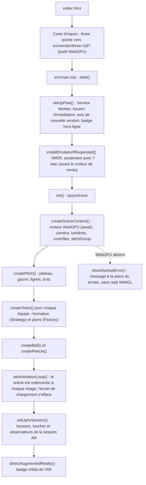
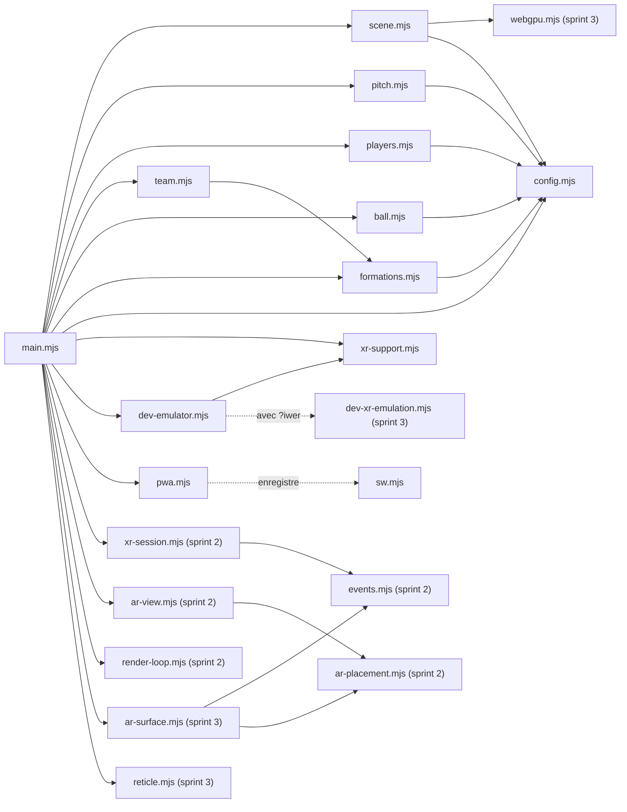
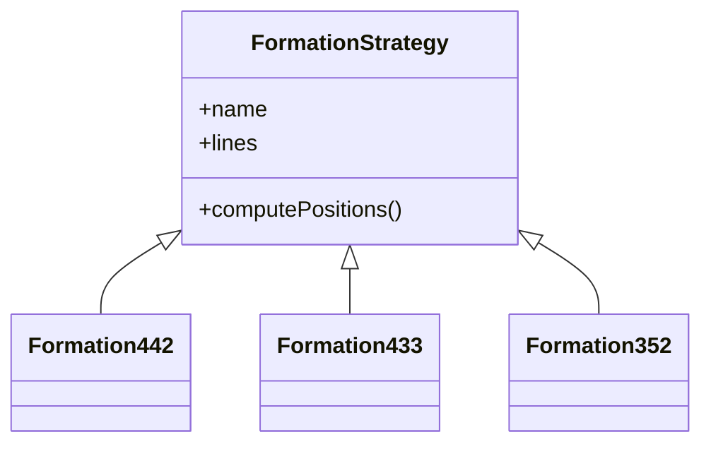
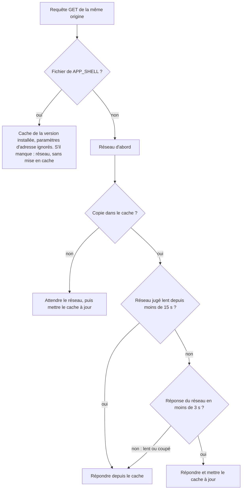

# Guide du code : sprint 1 et évolutions

> Les modules cités suivent les noms actuels `.mjs`. Les descriptions des étapes et les résultats datés restent historiques. Les retours du 23 novembre sont résumés dans l’[addendum](#10-retours-de-lévaluation-du-23-novembre).

> La navigation du 24 novembre est décrite dans [espaces-coaching.md](espaces-coaching.md) :
> inventaire, correspondance de toutes les commandes, contrôleur central, adaptation mobile et AR.
> `workspace-controller.mjs` porte uniquement l'état d'interface ; `workspace-navigation.mjs`
> relie les panneaux persistants aux objets métier existants.

Ce guide explique tout le code du sprint 1, fichier par fichier, pour que chaque membre de l'équipe puisse le présenter, le modifier et répondre aux questions du jury. Compter 30 à 45 minutes de lecture, avec le code ouvert à côté.

Le sprint 2 (session AR) a son propre document, [sprint-2.md](sprint-2.md), qui explique ses cinq nouveaux modules ; ce guide signale ce que le sprint 2 a changé dans le code du sprint 1.

Le sprint 3 a lui aussi son document, [sprint-3.md](sprint-3.md). Il explique le rendu **WebGPU sans repli WebGL** (`src/webgpu.mjs`), la pose du terrain sur une surface réelle (`src/ar-surface.mjs`, `src/reticle.mjs`), la boucle de rendu et l'émulation sur PC (`src/dev-xr-emulation.mjs`). Ce guide signale ce que le sprint 3 a changé dans le code des sprints 1 et 2 : le moteur de rendu, la copie de three.js (r187), un démarrage asynchrone et la PWA.

Les sprints 4, 5 et 6 ont aussi leur document : [sprint-4.md](sprint-4.md) (formations), [sprint-5.md](sprint-5.md) (raycasting, flèches, patron Command) et [sprint-6.md](sprint-6.md) (performance, fiabilité de l'AR, séquence animée, PWA versionnée). Ce guide signale ce qu'ils ont changé dans le code existant, et liste leurs nouveaux fichiers dans la partie 3.

**Sommaire**

1. [Ce qui se passe au chargement](#1-ce-qui-se-passe-au-chargement)
2. [Les notions à connaître](#2-les-notions-à-connaître)
3. [Fichier par fichier](#3-fichier-par-fichier)
4. [Patrons de conception](#4-patrons-de-conception)
5. [Choix techniques et leurs raisons](#5-choix-techniques-et-leurs-raisons)
6. [Tests](#6-tests)
7. [Limites connues](#7-limites-connues)
8. [Questions probables du jury](#8-questions-probables-du-jury)
9. [Après le sprint 1](#9-après-le-sprint-1)

---

## 1. Ce qui se passe au chargement

Le navigateur charge `index.html`, qui déclare une carte d'import puis lance `src/main.mjs`. Tout le reste découle de ce fichier, dans cet ordre :



Les modules dépendent les uns des autres ainsi (une flèche signifie « importe ») :



Les modules qui créent des objets 3D (`scene`, `pitch`, `players`, `team`, `ball`, `reticle`, `webgpu`) importent aussi three.js, non représenté ici.

---

## 2. Les notions à connaître

### 2.1 three.js en six notions

| Notion | Dans notre code | Rôle |
| --- | --- | --- |
| Scène (`THREE.Scene`) | `scene.mjs` | Contient tout ce qui est affiché |
| Caméra (`PerspectiveCamera`) | `scene.mjs` | Le point de vue ; en AR, c'est le téléphone qui la pilotera (sprint 2) |
| Moteur de rendu (`WebGpuOnlyRenderer` depuis le sprint 3, `WebGLRenderer` avant) | `webgpu.mjs`, `scene.mjs` | Dessine la scène dans un canvas, à chaque image, en WebGPU |
| Maillage (`Mesh`) = géométrie + matériau | `pitch.mjs`, `players.mjs`, `ball.mjs` | Un objet visible : sa forme, et l'apparence de sa surface |
| Groupe (`Group`) et graphe de scène | `pitchGroup` | Déplacer un parent déplace tous ses enfants |
| Boucle de rendu (`setAnimationLoop`) | `main.mjs` | Redessine la scène à chaque image ; en WebXR, c'est la session qui la cadence |

Le graphe de scène du sprint 1 :

```text
scene
├── lumières            hémisphérique et directionnelle, sans ombres portées
├── table               vue 3D hors AR seulement
└── pitchGroup          groupe racine : le déplacer ou l'ancrer déplace tout le terrain
    ├── pitch           plateau, gazon et buts
    ├── team-blue       11 joueurs
    ├── team-red        11 joueurs
    └── ball
```

### 2.2 Unités et repère

- **L'unité est le mètre.** Le terrain réel (105 × 68 m) devient une maquette de 0,6 × 0,389 m : l'échelle vaut 0,6/105, soit environ 1/175. En AR, ces mètres seront de vrais mètres : la maquette aura sa taille réelle sur la table.
- **L'axe Y monte.** Le gazon est le plan y = 0 ; joueurs et ballon reposent dessus.
- **L'axe X suit la longueur, l'axe Z la largeur.** L'origine est le point central.
- **Les Bleus attaquent vers +X, les Rouges vers −X.** Le flanc droit des Bleus est du côté +Z.

Vu de dessus, avec la caméra de la vue « télévision » en bas du schéma :

```text
            −Z (flanc gauche des Bleus)
   ┌───────────────────┬───────────────────┐
   │                   │                   │
−X │  but des Bleus    ●    but des Rouges │ +X
   │                   │                   │
   └───────────────────┴───────────────────┘
            +Z (flanc droit des Bleus)
```

### 2.3 WebXR, en bref

WebXR est l'API du navigateur qui donne accès à la réalité augmentée. Le sprint 1 ne fait que détecter sa présence ; les sprints suivants l'utiliseront ainsi :

| Notion | Rôle | Sprint |
| --- | --- | --- |
| Session `immersive-ar` | Le navigateur affiche l'image de la caméra et dessine la scène par-dessus | S2 |
| Couche de rendu (`XRWebGLLayer`) | Relie le canvas WebGL à la session ; three.js la crée lui-même | S2 |
| Liaison WebXR/WebGPU (`XRGPUBinding`) et couche de projection | Remplacent `XRWebGLLayer` : la session est rendue en WebGPU (fonctionnalité `webgpu`) | S3 |
| Espace de référence `local-floor` | Un repère dont l'origine est au sol, là où se trouve l'utilisateur | S2 |
| DOM Overlay | Afficher nos boutons HTML par-dessus la vue AR | S2 |
| Hit test | Trouver la surface réelle (la table) sous un rayon partant de l'écran | S3 |
| Ancre (`XRAnchor`) | Garder le terrain fixe sur la table quand le suivi se corrige | S3 |

WebXR n'existe qu'en contexte sécurisé : HTTPS, ou `localhost` pendant le développement.

### 2.4 PWA, en bref

Une application web progressive repose sur deux fichiers : le **manifeste** (`manifest.json`), qui permet de l'installer sur l'écran d'accueil, et le **Service Worker** (`sw.mjs`), qui met ses fichiers en cache pour la lancer hors-ligne. L’adresse historique `sw.js` reste un script de migration pour les installations anciennes.

---

## 3. Fichier par fichier

### [`index.html`](../index.html)

La page déclare une **carte d'import** : elle permet d'écrire `import * as THREE from 'three'` dans nos modules, alors que three.js est copié dans `src/vendor/three-r187/`. Depuis le sprint 3, `three` pointe vers le build WebGPU ; le build WebGL (`three.module.js`) n'est plus livré.

```html
<script type="importmap">
  { "imports": {
      "three": "./src/vendor/three-r187/build/three.webgpu.js",
      "three/webgpu": "./src/vendor/three-r187/build/three.webgpu.js",
      "three/tsl": "./src/vendor/three-r187/build/three.tsl.js",
      "three/addons/": "./src/vendor/three-r187/examples/jsm/" } }
</script>
```

Le reste de la page :

- la zone de rendu (`#scene-container`), où three.js insère son canvas ;
- l'interface superposée (`#overlay`), racine du DOM Overlay en AR : le nom de l'application, le badge d'état de l'AR (`#xr-status`), les pastilles des formations et le bouton « Recentrer » (`#reset-view`) ; depuis le sprint 2, aussi « Entrer en AR », « Quitter l'AR » et un message d'échec (`#ar-message`) ; depuis le sprint 3, le badge du rendu (`#gpu-status`), le badge hors-ligne, l'avis de nouvelle version et les boutons « Déplacer le terrain », « Installer l'application » et « Copier l'adresse du réglage » ;
- l'écran de chargement (`#loader`) ;
- un message pour les navigateurs sans JavaScript.

Chaque bloc porte un commentaire d'en-tête, comme l'exige le cahier (§7.1). La balise `viewport` contient `viewport-fit=cover`, nécessaire pour gérer l'encoche des téléphones (voir `styles.css`).

### [`src/config.mjs`](../src/config.mjs)

Toutes les constantes partagées, au même endroit :

| Constante | Valeur | Pourquoi |
| --- | --- | --- |
| `REAL_PITCH` | 105 × 68 m | Dimensions réglementaires d'un terrain |
| `PITCH_LENGTH` | 0,6 m | Taille de la maquette demandée par le cahier : environ 60 × 40 cm (§1.4) |
| `PITCH_SCALE` | 0,6/105 ≈ 1/175 | Facteur entre le réel et la maquette |
| `PITCH_RUNOFF` | 4 m réels | Bande de gazon autour des lignes, où se trouvent les buts |
| `BOARD_LENGTH`, `BOARD_WIDTH` | 0,646 × 0,434 m | Plateau complet, bande de gazon comprise |
| `PLAYER_SIZE` | rayon 6,5 mm, hauteur 2,8 cm | Pions exagérés environ 2,7 fois pour rester lisibles (voir §5) ; zone de sélection de 1,4 cm de rayon |
| `BALL_RADIUS` | 4,2 mm | Ballon exagéré, sinon invisible à cette échelle |
| `TEAMS` | Bleus et Rouges | Couleur, sens d'attaque (`attacksPositiveX`) |
| `DEFAULT_FORMATIONS` | Bleus 4-3-3, Rouges 4-4-2 | Le scénario de démonstration du cahier (§4.1) |
| `SCENE_COLORS` | | Couleurs du fond, de la table, du gazon, des lignes et des buts |

`Object.freeze` empêche de modifier ces objets par erreur.

### [`src/scene.mjs`](../src/scene.mjs)

Crée tout ce qui entoure le terrain. Ses fonctions :

- **`createRenderer`** : depuis le sprint 3, un moteur de rendu WebGPU sans repli WebGL, créé par `createWebGpuRenderer` (`src/webgpu.mjs`, expliqué dans [sprint-3.md](sprint-3.md#3-rendu-webgpu-sans-repli-webgl)), avec anticrénelage et fond transparent (`alpha: true`). La fonction est asynchrone : WebGPU demande l'adaptateur et le périphérique graphique avant le premier rendu. Le fond transparent sert en AR, où l'image de la caméra doit apparaître derrière la scène. La densité de pixels est plafonnée à 2 pour ménager les téléphones. Aux sprints 1 et 2, c'était un `WebGLRenderer`.
- **`addLights`** : une seule lumière directionnelle (intensité 1,6), qui donne le relief, et une lumière d'ambiance hémisphérique (ciel blanc, sol vert sombre, intensité 2,2), très peu coûteuse. Aucune ombre portée : c'est le calcul le plus lourd sur mobile. Le cahier conseille « une seule lumière » (§6.3) : si la mesure de fluidité du sprint 6 le demande, la lumière hémisphérique pourra être retirée.
- **`createTable`** : un disque sombre sous le terrain, nommé `table`. Il n'existe que hors AR : en AR, la vraie table le remplace.
- **`createControls`** : `OrbitControls` pour tourner, zoomer et déplacer la vue. L'amortissement rend les gestes fluides, la distance est bornée entre 15 cm et 3 m, et l'angle vertical est limité à 82° pour ne jamais passer sous la table.
- **`frameWholePitch`** : le **cadrage automatique**, détaillé ci-dessous.
- **`createSceneContext`** : assemble le tout, crée la caméra (plan proche à 1 cm, plan lointain à 20 m, adaptés à une maquette de 60 cm) et le groupe `pitchGroup`, et gère le redimensionnement de la fenêtre. Depuis le sprint 2, il renvoie aussi `table` et `resize`, qui ne fait rien pendant une session AR. WebXR est activé (`renderer.xr.enabled = true`) ; depuis le sprint 3, avant l'initialisation de WebGPU, pour obtenir un adaptateur compatible XR. Depuis le sprint 3 aussi, `createSceneContext` est asynchrone.

**Le cadrage automatique.** Le terrain doit tenir à l'écran, en paysage comme en portrait. Plutôt qu'une formule approchée, la fonction mesure :

1. Elle choisit un angle de vue : en paysage, vue latérale « télévision » (élévation d'environ 40°, champ de 45°) ; en portrait, vue depuis le but des Bleus (élévation d'environ 54°, champ de 55°), qui exploite la hauteur de l'écran.
2. Elle place la caméra à 20 cm du centre, dans cette direction.
3. Elle **projette les 8 coins du plateau** à l'écran (`Vector3.project`), en coordonnées normalisées où 1 correspond au bord de l'écran.
4. Si un coin dépasse 0,92 en largeur ou 0,74 en hauteur (la marge laisse place aux bandeaux de l'interface), elle recule la caméra de 4 % et recommence.

Une première version, fondée sur une formule, coupait les coins du terrain à cause de la perspective. Les vérifications du sprint 1 l'ont montré, et cette méthode l'a remplacée.

Au redimensionnement, la vue n'est recadrée que si l'écran passe de paysage à portrait, ou l'inverse. Sur mobile, la barre d'adresse qui apparaît et disparaît redimensionne la fenêtre en permanence : recadrer à chaque fois effacerait la vue choisie par l'utilisateur.

### [`src/pitch.mjs`](../src/pitch.mjs)

Construit le terrain. Les lignes ne viennent pas d'une image : elles sont **dessinées sur un canvas 2D**, puis appliquées comme texture.

- **`drawPitchCanvas`** : crée un canvas de 1808 × 1216 pixels, soit 16 pixels par mètre réel. L'astuce : `ctx.scale(16, 16)` permet ensuite de dessiner directement en mètres réels, avec les mesures des lois du jeu de l'IFAB. On peint d'abord le gazon, puis une bande de tonte sur deux (14 bandes de 7,5 m), puis les lignes et les arcs de coin.
- **`drawPenaltyEnd`** : surface de réparation (16,5 × 40,32 m), surface de but (5,5 × 18,32 m), point de penalty à 11 m et arc de cercle. L'arc ne doit apparaître qu'en dehors de la surface : son demi-angle vaut arccos((16,5 − 11) / 9,15) ≈ 53°.
- **`createGrass`** : un `PlaneGeometry` couché à plat (rotation de −90° autour de X) qui reçoit la texture. Le filtrage anisotrope garde les lignes nettes quand on regarde le terrain en biais, et `SRGBColorSpace` respecte les couleurs du canvas. Depuis le sprint 3, le niveau maximal se lit avec `renderer.getMaxAnisotropy()`, car `renderer.capabilities` n'existe qu'en WebGL.
- **`createBoard`** : une boîte de 8 mm d'épaisseur sous le gazon, abaissée de 0,3 mm. Sans ce décalage, le dessus de la boîte et le gazon seraient exactement au même niveau et clignoteraient (« z-fighting »).
- **`createGoal`** : deux poteaux, une barre transversale et un filet translucide. Le filet est une boîte dont deux faces sont invisibles : la bouche du but et le sol. Les faces d'une `BoxGeometry` sont rangées dans l'ordre +x, −x, +y, −y, +z, −z, d'où le tableau de six matériaux. La même fonction construit les deux buts ; celui de droite est tourné de 180°. La largeur du but suit l'échelle (4,2 cm), sa hauteur est exagérée (2 cm) pour rester visible.

Les lignes font 0,3 m réel au lieu de 0,12 m, pour rester lisibles à cette échelle. Pour des lignes plus nettes, on peut augmenter `PIXELS_PER_METER`, mais la taille de la texture croît avec son carré.

### [`src/formations.mjs`](../src/formations.mjs)

Le **patron Strategy** du cahier (§3.4) : chaque formation est une classe qui sait calculer les positions de ses 11 joueurs.



- **Le repère normalisé.** Une formation ne connaît ni la taille du terrain ni le sens d'attaque. Elle décrit chaque joueur par x (0 = sa propre ligne de but, 0,5 = la ligne médiane) et y (0 = son flanc gauche, 1 = son flanc droit). Une même formation sert donc aux deux équipes.
- **Les lignes.** Chaque formation se décrit ligne par ligne, du gardien à l'attaque ; tous les joueurs d'une ligne partagent la même profondeur x, sauf exception (le milieu défensif du 4-3-3 joue plus bas, à x = 0,27). La ligne du gardien est commune aux trois formations, la défense à quatre au 4-4-2 et au 4-3-3.
- **`computePositions`** est écrit une seule fois, dans la classe de base : il aplatit les lignes en 11 positions et vérifie qu'il y en a bien 11. Les sous-classes ne fournissent que `name` et `lines` (patron « méthode de modèle », au service de Strategy).
- **`FORMATIONS` et `getFormation`** : le registre des formations par nom, et une erreur claire pour un nom inconnu.
- **`toPitchCoordinates`** convertit une position normalisée en mètres de la scène :

  x_scène = s × (x − 0,5) × 0,6 et z_scène = s × (y − 0,5) × 0,389, avec s = +1 pour les Bleus et s = −1 pour les Rouges.

  Pour les Rouges, le signe inverse les deux axes : c'est une rotation de 180° autour du point central, ce qui place leur gardien dans l'autre but et leur flanc droit du bon côté.

Tous les joueurs sont placés dans leur moitié, comme au coup d'envoi : aucun n'entre dans le rond central (9,15 m).

**Ajouter une formation**, par exemple un 5-3-2, revient à écrire une classe dans ce fichier et à l'enregistrer :

```js
export class Formation532 extends FormationStrategy {
  get name() { return '5-3-2'; }
  get lines() {
    return [
      GOALKEEPER_LINE,
      { x: 0.16, slots: [ /* 5 défenseurs : { y, number, role } */ ] },
      { x: 0.30, slots: [ /* 3 milieux */ ] },
      { x: 0.44, slots: [ /* 2 attaquants */ ] },
    ];
  }
}
// puis l'ajouter dans FORMATIONS : new Formation532()
```

Les tests vérifient automatiquement toute formation enregistrée : 11 joueurs, numéros 1 à 11, placements valides.

### [`src/players.mjs`](../src/players.mjs)

Le **patron Factory** du cahier (§3.4) : `PlayerFactory.createPlayer({ team, number, role })` fabrique un pion complet selon l'équipe.

Un joueur est un `Group` de cinq éléments :

| Élément | Forme | Rôle |
| --- | --- | --- |
| Socle | Cylindre aplati, rayon d'environ 9 mm | Le pied du pion, à la couleur de l'équipe |
| Flèche | Triangle blanc posé au sol | Indique le sens d'attaque |
| Corps | Capsule de 2,8 cm | La silhouette du joueur |
| Numéro | Sprite (image toujours tournée vers la caméra) | Lisible sous tous les angles, en AR comme hors AR |
| Zone de sélection `hitbox` | Cylindre invisible, rayon 1,4 cm | Agrandit la cible du doigt pour le raycasting du sprint 5 (cahier §6.3) |

Trois points à savoir expliquer :

- **Ressources partagées.** Une seule fabrique sert les deux équipes : les géométries sont créées une fois et partagées par les 22 joueurs, il n'existe qu'un matériau par équipe, et un matériau de numéro par équipe et par numéro (22 au total). Cela économise la mémoire et le travail de la carte graphique, une contrainte du cahier (§6.1).
- **Les numéros** sont dessinés sur un petit canvas de 128 × 128 pixels (disque blanc, contour et chiffre à la couleur de l'équipe), puis affichés par un `Sprite`.
- **La zone de sélection invisible reste touchable.** Son matériau a `visible: false` : elle n'est pas dessinée, mais le `Raycaster` de three.js la détecte quand même. Dans three.js r186, et toujours dans la r187 du sprint 3, `Mesh.raycast` ne vérifie que l'existence du matériau, pas sa visibilité (`src/vendor/three-r187/build/three.core.js`, vérifié le 14 novembre 2026). Au sprint 5, il suffira de viser la liste des hitbox ; `hit.object.parent` sera le joueur, et son `userData` (équipe, numéro, poste) dira lequel a été touché.

Les Rouges sont tournés de 180° (`rotation.y = Math.PI`) pour que leur flèche pointe vers le but des Bleus.

Le cahier (§6.3) cite aussi `InstancedMesh`, qui dessine de nombreuses copies d'une forme en un seul appel. Aux sprints 1 à 5, il n'était pas utilisé : chaque joueur restait un objet indépendant, simple à sélectionner et à déplacer.

**Depuis le sprint 6, socles, flèches et corps sont instanciés**, après une mesure : 88 des 115 appels de dessin venaient des joueurs. `createTeamMeshes(team, joueurs)` crée, pour chaque équipe, un objet `TeamMeshes` : trois `InstancedMesh` de 11 instances (socles, flèches, corps), avec les mêmes géométries et matériaux partagés. Le `Group` de chaque joueur ne garde que son numéro et sa zone de sélection, mais il reste l'objet qu'on déplace, qu'on anime et qu'on sélectionne. À chaque image, `TeamMeshes.update()` recopie dans les instances la matrice des seuls joueurs qui ont bougé, et ne demande un envoi au processeur graphique (`instanceMatrix.needsUpdate`) que dans ce cas. Résultat : 55 appels de dessin au lieu de 115. Le tableau ci-dessus décrit donc le pion tel qu'on le voit ; ses trois premières formes sont dessinées par les maillages instanciés de l'équipe. Mesures dans [sprint-6.md](sprint-6.md#3-performance--mesurer-puis-optimiser).

### [`src/team.mjs`](../src/team.mjs)

`createTeam(team, formation, playerFactory)` relie les deux patrons : la stratégie fournit les 11 positions, la fabrique crée les 11 pions, et `toPitchCoordinates` les place. Le groupe obtenu (`team-blue` ou `team-red`) retient la formation dans son `userData`.

### [`src/ball.mjs`](../src/ball.mjs)

Une sphère blanche de 4,2 mm de rayon, posée sur le point central (`y = BALL_RADIUS`, pour qu'elle repose sur le gazon).

### [`src/xr-support.mjs`](../src/xr-support.mjs)

- **`isImmersiveArSupported`** répond à la question « ce navigateur peut-il ouvrir une session AR ? » en trois vérifications : contexte sécurisé (HTTPS ou localhost), présence de `navigator.xr`, puis `navigator.xr.isSessionSupported('immersive-ar')`. Toute erreur vaut « non ».
- **`showXrStatus`** met à jour le badge : vérification, AR disponible, AR émulée ou AR indisponible. Depuis le sprint 3, aussi « AR : réglage WebGPU à activer », quand l'AR existe mais sans la liaison WebXR/WebGPU (`XRGPUBinding`). Sans AR, l'application reste utilisable en vue 3D, comme proposé par l'état de l'art.

### [`src/dev-emulator.mjs`](../src/dev-emulator.mjs)

Permet de tester l'AR sur PC, sans téléphone, avec **IWER** (Meta, licence MIT). L'Immersive Web Emulator prévu au cahier (§4.2) est archivé depuis le 1er octobre 2026 ; IWER est son moteur, toujours maintenu.

- Il ne se charge que si l'adresse contient `?iwer` **et** si le navigateur n'a pas d'AR native : il ne peut donc jamais gêner un vrai téléphone.
- Il importe IWER 2.7.0 depuis jsDelivr, en version épinglée, puis installe un casque Meta Quest 3 simulé.
- L'option `forceInstall` est nécessaire : Chrome sur PC expose déjà un `navigator.xr`, mais sans AR, et IWER refuse sinon de le remplacer. Ce comportement a été découvert pendant les tests.
- Limites vérifiées : la session `immersive-ar` s'ouvre avec `local-floor` et les ancres, mais le hit test demande en plus le module `@iwer/sem`, et le DOM Overlay n'est pas émulé.
- Depuis le sprint 3, l'appareil émulé annonce la fonctionnalité `webgpu`, et `src/dev-xr-emulation.mjs` complète IWER : liaison WebXR/WebGPU, table virtuelle pour le hit test, clic changé en toucher, une seule vue. L'émulateur s'installe avant le moteur de rendu, qui vérifie la présence de `XRGPUBinding` à sa création. Voir [sprint-3.md](sprint-3.md#11-émulation-sur-pc).

### [`src/pwa.mjs`](../src/pwa.mjs) et [`sw.mjs`](../sw.mjs)

`registerServiceWorker` enregistre `sw.mjs` en module, seulement en contexte sécurisé. Un navigateur refusant ce type de Worker reçoit le même script en mode classique. Le fichier `sw.mjs` est à la racine du dépôt parce que **l'emplacement d'un Service Worker fixe sa portée** : à la racine, il contrôle toutes les pages de l'application. Le cycle de migration de l’ancien `sw.js` est décrit dans [migration-mjs.md](migration-mjs.md).

Depuis le sprint 3, `pwa.mjs` gère aussi :

- `setUpInstallButton` : bouton « Installer l'application », branché sur l'invite du navigateur (`beforeinstallprompt`), qui ne sert qu'une fois ; masqué si l'application est déjà installée ;
- `watchForUpdates` : avis « Nouvelle version installée » quand un nouveau Service Worker prend le contrôle (`controllerchange`), mais pas à la première visite ;
- `watchNetworkStatus` : badge « Hors-ligne », selon les événements `online` et `offline`.

Le Service Worker réagit à trois événements :

| Événement | Ce qu'il fait |
| --- | --- |
| `install` | Télécharge les 55 entrées de `APP_SHELL` d'un bloc (`cache.addAll`), sans le cache HTTP du navigateur (`cache: 'reload'`), dans le cache de la version (`football-simulator-<SHELL_VERSION>`), puis s'active aussitôt (`skipWaiting`). Si un seul fichier échoue, rien n'est installé |
| `activate` | Supprime les caches des versions précédentes et prend le contrôle des pages ouvertes (`clients.claim`) |
| `fetch` | Fichiers de la coquille : depuis le cache de la version (`fromShell`). Autres requêtes de la même origine : réseau d'abord, avec délai. Les requêtes vers d'autres origines (le CDN d'IWER) passent sans cache |



**Depuis le sprint 6, une coquille à version de contenu.** Jusqu'au sprint 5, le code passait par le réseau d'abord, fichier par fichier : pendant un déploiement, sur un réseau lent, une page pouvait recevoir certains fichiers de la nouvelle version et d'autres de l'ancienne. Un test de bout en bout le reproduit, et l'ancien `sw.js` y échoue. Désormais :

- `SHELL_VERSION` est une empreinte SHA-256 du contenu des fichiers de `APP_SHELL`, recalculée par `npm run shell-version` ([`tests/shell-version.mjs`](../tests/shell-version.mjs)). Un fichier modifié change donc `sw.mjs`, et le navigateur installe la nouvelle version complète ;
- la coquille est servie depuis le cache de sa version (`fromShell`) : une page ne mélange jamais deux versions, et se lance sans attendre le réseau ;
- la nouvelle version s'applique quand l'utilisateur touche « Recharger », sur l'avis « Nouvelle version installée ».

Le délai de 3 secondes (ajouté le 12 novembre 2026, voir [sprint-2.md](sprint-2.md#12-test-sur-android)) ne sert plus qu'aux autres requêtes de la même origine. Une connexion très lente peut faire attendre le navigateur plus d'une minute par fichier : si le cache possède le fichier, le réseau a 3 secondes (`NETWORK_TIMEOUT_MS`) ; au-delà, le cache répond, et il répond directement pendant les 15 secondes suivantes (`SLOW_NETWORK_WINDOW_MS`). Les fonctions : `fetchAndCache` télécharge et met en cache, `findInCache` cherche la copie, `withTimeout` limite l'attente, `networkFirst` choisit la réponse.

Deux règles à respecter, vérifiées par `npm test` (`tests/unit/service-worker.test.mjs`) : **tout nouveau fichier de l'application doit être ajouté à `APP_SHELL`**, et **`npm run shell-version` suit chaque modification d'un fichier de la coquille**. Le numéro `CACHE_VERSION`, incrémenté à la main jusqu'au sprint 5, a disparu. Détail dans [sprint-6.md](sprint-6.md#6-pwa--une-seule-version-à-la-fois).

### [`manifest.json`](../manifest.json)

Rend l'application installable : nom (« Football Simulator », et « Football Sim » sous l'icône, où la place est limitée), page de départ et portée relatives (`./`, pour fonctionner sous le sous-chemin de GitHub Pages), affichage sans barre d'adresse comme une application installée (`display: standalone`) et icônes. L'icône « maskable » garde son motif dans la zone sûre (un cercle de 80 % de la largeur), parce qu'Android la découpe en cercle ou en carré arrondi. Depuis le sprint 3 : un identifiant stable (`id`) et deux captures (`assets/screenshots/`, formats `wide` et `narrow`), que Chrome montre dans sa fenêtre d'installation.

### [`src/styles.css`](../src/styles.css)

- `#overlay` a `pointer-events: none` : les gestes traversent l'interface et atteignent le terrain ; seuls les boutons les captent.
- Le canvas a `touch-action: none` : le navigateur ne fait ni défiler ni zoomer la page, et les gestes vont aux contrôles d'orbite.
- Les marges utilisent `env(safe-area-inset-…)` pour éviter l'encoche des téléphones.
- Les boutons font au moins 48 px de haut, pour un usage d'une seule main (cahier §2.3).
- `prefers-reduced-motion` supprime le fondu de l'écran de chargement pour les utilisateurs qui le demandent.
- Depuis le sprint 2, les boutons sont regroupés dans `.actions`, alignés à droite, et pendant une session AR (`body[data-xr="active"]`) l'interface passe au-dessus du conteneur plein écran de l'émulateur IWER.
- Depuis le sprint 3 : la règle `[hidden] { display: none !important; }`, sans laquelle les badges en `display: flex` resteraient visibles malgré l'attribut `hidden` ; les états du badge du rendu ; l'avis de nouvelle version ; et, en AR, le masquage des boutons d'installation et de copie.

### [`src/main.mjs`](../src/main.mjs)

Le chef d'orchestre : il appelle les modules dans l'ordre du schéma de la partie 1. Depuis le sprint 3, le démarrage est asynchrone (`start()`, puis `await init()`), car WebGPU s'initialise avant le premier rendu. Quatre détails :

- `currentFormation` retenait la formation de chaque équipe ; c'est l'un des noms donnés en exemple par le cahier (§7.1), comme `pitchGroup`. Depuis le sprint 4, c'est le tableau tactique (`TacticsBoard`, `src/tactics-board.mjs`) qui la retient, et des boutons la changent : voir [sprint-4.md](sprint-4.md).
- Le nom de chaque formation s'affiche dans les pastilles du bandeau supérieur.
- `renderer.setAnimationLoop` remplace `requestAnimationFrame` : en session WebXR, c'est le casque ou le téléphone qui cadence les images, et seule cette méthode le permet. Quand la scène est prête, la classe `is-ready` est ajoutée à la page et l'écran de chargement s'efface.
- Si WebGPU est indisponible, `init()` lève une `WebGpuUnavailableError` : `showStartupError` remplace alors l'écran de chargement par un message qui dépend de la cause (pas de WebGPU, aucun processeur graphique utilisable), au lieu d'une page vide. Il n'y a pas de repli WebGL. Aux sprints 1 et 2, le message portait sur WebGL.

Depuis le sprint 2, la boucle de rendu elle-même est dans `render-loop.mjs`, et `setUpArSession()` branche les boutons de l'AR et les observateurs de la session : voir [sprint-2.md](sprint-2.md). Depuis le sprint 3, `setUpArSession()` crée aussi la pose du terrain (`SurfacePlacement`) à chaque session, écoute le toucher (`select`) et ses états (`statechange`), et `setUpPwa()` branche la PWA : voir [sprint-3.md](sprint-3.md). Depuis le sprint 5, `init()` crée aussi l'historique des commandes, la vue tactique, l'interaction et la saisie par pointeur, et `setUpArSession()` envoie chaque toucher à la pose du terrain ou à l'interaction tactique (`routeXrSelect`) : voir [sprint-5.md](sprint-5.md).

### [`src/vendor/three-r187/`](../src/vendor/three-r187/)

Une copie de three.js r187 (version 0.187.0), sous licence MIT : le build WebGPU (`three.webgpu.js`, `three.core.js`, `three.tsl.js`) et `OrbitControls.js`. Son `README.md` explique comment la mettre à jour, et donne les empreintes des fichiers, identiques au paquet npm. Aux sprints 1 et 2, c'était la r186, dans `src/vendor/three/`.

### Fichiers du sprint 5

Le sprint 5 ajoute neuf modules, expliqués dans [sprint-5.md](sprint-5.md) :

- **`src/raycasting.mjs`** : le calcul commun. Un rayon depuis la caméra (`setRayFromCamera`) ou depuis la pose d'une source d'entrée WebXR (`setRayFromXrPose`), la zone de sélection la plus proche (`pickTarget`), le point du plan du gazon dans le repère du terrain (`intersectPitchPlane`).
- **`src/tactical-interaction.mjs`** : la machine à états. Elle reçoit des rayons et crée des commandes ; elle ne dessine rien.
- **`src/commands.mjs`** : le patron Command. Cinq commandes annulables et l'historique (`CommandHistory`).
- **`src/tactical-view.mjs`** et **`src/tactical-arrows.mjs`** : la scène suit le tableau tactique ; flèches 3D, anneau de sélection, aperçu.
- **`src/pointer-input.mjs`** et **`src/xr-input.mjs`** : la saisie, à la souris ou au doigt hors AR, par l'événement `select` en AR.
- **`src/tactical-toolbar.mjs`** : la barre d'outils et le bandeau d'aide.
- **`src/diagnostics.mjs`** : le mode diagnostic (`?diagnostics`).

`src/tactics-board.mjs` garde désormais tout l'état tactique : formations, places des joueurs et du ballon, flèches. `src/ball.mjs` donne au ballon une zone de sélection, comme celle des joueurs.

### Fichiers du sprint 6

Le sprint 6 ajoute trois modules, expliqués dans [sprint-6.md](sprint-6.md) :

- **`src/tactical-sequence.mjs`** : les images clés de la séquence animée (bonus BF9). Chacune garde la place des 22 joueurs et du ballon, dans le repère du terrain ; 12 au plus.
- **`src/sequence-player.mjs`** : le lecteur. À chaque image, il avance un curseur selon le temps écoulé et la vitesse, puis place chaque objet entre deux images clés, avec la courbe `easeInOutCubic` des transitions du sprint 4. Il s'arrête à tout changement du tableau ou de la séquence.
- **`src/sequence-panel.mjs`** : le panneau « Séquence » : boutons, ligne d'état et retours.

Il modifie aussi :

- `src/players.mjs` : les maillages instanciés de chaque équipe (`createTeamMeshes`, `TeamMeshes`) ;
- `src/commands.mjs` : `AddKeyframeCommand` et `ClearSequenceCommand`, annulables ;
- `src/render-loop.mjs` : l'étape `beforeFrame`, au tout début de chaque image ;
- `src/diagnostics.mjs` : le temps CPU par image et la mémoire GPU estimée ;
- `src/tactical-view.mjs` (`returnToBoard`) et `src/formation-transition.mjs` (`clear`) : ramener la scène au tableau, et interrompre les déplacements en cours ;
- `sw.mjs` : la coquille à version de contenu ; `sw.js` : la migration des anciennes installations.

Deux outils de développement s'ajoutent dans `tests/` : `benchmark.mjs` (`npm run bench`), qui mesure les performances, et `shell-version.mjs` (`npm run shell-version`), qui calcule `SHELL_VERSION`.

### Modèle football (version 0.4)

- **`src/formations.mjs`** : huit formations, dont le 4-1-4-1, le 3-4-3, le 5-3-2 et le 4-4-2 en losange. Chaque place porte un poste normalisé (`POSTS`, `postOfRole`, `postOfNumber`) : GB, DD, DC, DG, PD, PG, MDC, MC, MD, MG, MOC, AD, AG, AT. Chaque formation décrit aussi ses dispositions en possession et hors possession (`phaseShapes`) : `computePositions(phase)` rend la place de chaque numéro dans la phase demandée.
- **`src/tactics-board.mjs`** : la phase de jeu de chaque équipe (`getPhase`, `setPhase`), dans les instantanés ; un changement de formation garde la phase.
- **`src/commands.mjs`** : `ChangePhaseCommand`, la bascule annulable entre base, possession et hors possession.
- **`src/tactical-metrics.mjs`** : fonctions pures. Largeur, profondeur, distance entre les lignes et surface occupée (enveloppe convexe), en mètres réels. Les lignes se lisent sur le terrain, d'après le nom de la disposition en place (« 4-5-1 » : les 4 joueurs de champ les plus bas, les 5 suivants, le dernier).
- **`src/offside.mjs`** : la ligne de hors-jeu (loi 11), fonction pure : la plus avancée de l'avant-dernier défenseur (gardien compris), du ballon et de la ligne médiane ; un joueur à hauteur n'est pas hors-jeu.
- **`src/offside-layer.mjs`** : les deux lignes de hors-jeu en 3D, dans le repère du terrain, masquées par défaut ; elles suivent le tableau (observateur).
- **`src/analysis-panel.mjs`** : le tableau « Analyse tactique » de l'espace Équipes et formations, recalculé à chaque changement du tableau (observateur), avec une phrase de hors-jeu par équipe et le bouton qui affiche les lignes.

### Fichiers du dépôt

- **`.editorconfig`** : règles communes à tous les éditeurs : UTF-8, fins de ligne LF, indentation de 2 espaces, ligne vide finale.
- **`.gitattributes`** : force les fins de ligne LF dans le dépôt, même sous Windows, et ne convertit jamais les images ni les PDF.
- **`.gitignore`** : exclut `node_modules/`, les fichiers système, ceux des éditeurs, les journaux et les fichiers intermédiaires de LaTeX.
- **`package.json`** : version 0.3.0 ; déclare `"type": "module"` (les fichiers `.js` sont des modules, y compris pour Node.js dans les tests), les commandes `npm start`, `npm test`, `npm run test:unit` et `npm run test:e2e` (depuis le sprint 6 aussi `npm run bench` et `npm run shell-version`), et une seule dépendance de développement, `playwright-core` 1.64.1, en version épinglée. L'application elle-même n'a aucune dépendance npm. Depuis le sprint 3, `test:unit` charge `tests/unit/import-map.mjs`, qui applique à Node.js la carte d'import de `index.html`.
- **`tests/`** : les tests de bout en bout, décrits dans la partie 6, et depuis le sprint 2 les tests unitaires (`tests/unit/`).

---

## 4. Patrons de conception

| Patron (cahier §3.4) | État | Où | Rôle |
| --- | --- | --- | --- |
| Strategy | En place | `formations.mjs` | Une classe par formation ; ajouter une formation revient à ajouter une classe, comme le 4-2-3-1 du sprint 4, dont le bouton est apparu de lui-même |
| Factory | En place | `players.mjs` | Créer un pion selon l'équipe : couleur, numéro, orientation ; depuis le sprint 6, aussi les maillages instanciés de chaque équipe |
| Command | En place depuis le sprint 5 | `commands.mjs` | Chaque action (déplacer un joueur ou le ballon, tracer une flèche, changer de formation, réinitialiser ; depuis le sprint 6, ajouter une image clé, effacer la séquence) est un objet avec `execute()` et `undo()` ; l'historique de ces objets donne Annuler et Rétablir |
| Observer | En place depuis le sprint 2 | `events.mjs`, `xr-session.mjs`, `ar-surface.mjs`, `tactics-board.mjs`, `tactical-sequence.mjs`, `sequence-player.mjs` | La session AR prévient l'interface de son début, de sa fin et de ses échecs ; depuis le sprint 3, la pose du terrain prévient de ses états (visée, surface, posé) ; depuis le sprint 4, le tableau tactique prévient la scène et les boutons des changements de formation ; depuis le sprint 5, la scène (`tactical-view.mjs`) suit tout l'état tactique, et la barre d'outils suit l'interaction et l'historique ; depuis le sprint 6, le lecteur s'arrête quand le tableau ou la séquence change, et le panneau de la séquence suit le lecteur |

---

## 5. Choix techniques et leurs raisons

- **three.js plutôt qu'A-Frame ou Babylon.js** : le projet doit prouver la maîtrise de la chaîne WebXR / three.js / PWA (cahier §1.1), et three.js laisse visibles dans notre code la session WebXR, le hit test et le raycasting. Le comparatif complet est dans l'état de l'art.
- **WebGPU sans repli WebGL (sprint 3)**, à la demande de l'enseignant : moteur de rendu construit avec le seul backend WebGPU, message explicite sinon. En AR, la session est rendue en WebGPU par la liaison WebXR/WebGPU, encore derrière un réglage de Chrome. Le détail est dans [sprint-3.md](sprint-3.md).
- **three.js copié dans le dépôt plutôt que chargé depuis un CDN** : une seule origine HTTPS, un fonctionnement hors-ligne garanti par le Service Worker, aucune dépendance à la disponibilité d'un CDN, et une version figée (le modèle d'attribution du module proscrit les versions « latest »).
- **Aucune étape de compilation** : des modules JavaScript natifs et une carte d'import suffisent ; le dépôt se sert tel quel sur GitHub Pages.
- **Lignes dessinées sur un canvas** plutôt qu'une image : mesures exactes et modifiables dans le code, aucun fichier image à charger, netteté réglable.
- **Pions et buts exagérés** : à l'échelle exacte, un joueur de 1,80 m ferait 1 cm de haut et serait difficile à toucher. Les pions font 2,8 cm, soit environ 2,7 fois l'échelle ; la largeur des buts et toutes les longueurs de lignes, elles, respectent l'échelle.
- **Une lumière directionnelle, aucune ombre** : la fluidité de 30 images par seconde visée par le cahier (§2.3) passe avant le réalisme. L'écart avec le conseil « une seule lumière » (§6.3) est expliqué avec `addLights`.
- **`InstancedMesh` seulement au sprint 6, après mesure** : aux sprints 1 à 5, des joueurs indépendants simplifiaient la sélection et le déplacement. Au sprint 6, la mesure a désigné les appels de dessin des joueurs ; leur dessin est instancié, mais chaque joueur reste un objet indépendant pour la sélection.
- **Fond transparent du moteur de rendu** : préparé pour l'AR, où l'image de la caméra doit apparaître derrière la scène.
- **Service Worker dès le sprint 1** : le sprint 1 demande la structure de la PWA (§5.3) ; avec le cache en place dès le début, chaque sprint est testé hors-ligne, et le sprint 6 n'aura qu'à le finaliser.
- **IWER 2.7.0 plutôt que 2.8.0** : la 2.8.0 a été publiée la veille du début du sprint 1 ; la version précédente a été préférée, faute de recul sur la nouvelle.

---

## 6. Tests

Au 17 novembre 2026, `npm test` lançait d’abord les 182 tests unitaires (`npm run test:unit`, sans navigateur), puis rejouait dans Chrome, sans interface, les 79 vérifications de bout en bout (`npm run test:e2e`). Celles des sprints 1 et 3 hors AR sont décrites ici ; le parcours AR est décrit dans [sprint-3.md](sprint-3.md#12-tests), les formations du sprint 4 dans [sprint-4.md](sprint-4.md#8-tests), l'interaction tactique du sprint 5 dans [sprint-5.md](sprint-5.md#10-tests), et la séquence animée, les versions de la PWA et les entrées répétées en AR du sprint 6 dans [sprint-6.md](sprint-6.md#7-tests). Le bilan du 23 novembre figure dans l’[addendum](#10-retours-de-lévaluation-du-23-novembre). Prérequis : Node.js 18 ou plus, Google Chrome, un processeur graphique compatible WebGPU, et un premier `npm install`. Pour utiliser Microsoft Edge à la place de Chrome : `BROWSER_CHANNEL=msedge npm test` (sous PowerShell : `$env:BROWSER_CHANNEL='msedge'; npm test`).

| Test | Ce qu'il vérifie |
| --- | --- |
| Chargement sans erreur (bureau, mobile, sous-chemin) | Aucune erreur de console, de script ou de réseau, en 1280 × 800, en 390 × 844 et sous `/footballsimulator/` comme sur GitHub Pages |
| Formations | Pour chaque formation : 11 joueurs, numéros 1 à 11, tous dans leur moitié, hors du rond central, sans pions qui se chevauchent (écart minimal mesuré : 7,1 cm, pour des socles de 1,8 cm de diamètre) |
| Badge d'état de l'AR | Le badge quitte l'état « vérification » et affiche un résultat |
| Service Worker et hors-ligne | Le Service Worker s'active, puis la page se recharge réseau coupé |
| Réseau très lent (ajouté le 12 novembre 2026) | L'application étant en cache, la page est prête en 10 secondes au plus quand le serveur met 30 secondes à répondre (3,7 secondes mesurées le 12 novembre ; 1,1 seconde depuis la coquille à version de contenu du sprint 6) |
| Versions de la PWA (sprint 6) | Nouveau déploiement sur réseau lent : la page reste sur une seule version ; nouveau `sw.js` : nouvelle version installée d'un bloc, avis, rechargement ; hors-ligne après la mise à jour |
| Rendu WebGPU (sprint 3) | three.js r187 rend en WebGPU, sans fonction de repli, et seuls des contextes `2d` et `webgpu` sont créés : aucun contexte WebGL |
| Sans WebGPU (sprint 3) | `navigator.gpu` retiré : message explicite, badge « WebGPU indisponible », aucun contexte WebGL |
| Manifeste (sprint 3) | Champs exigés pour l'installation, icônes 192 et 512 px, icône « maskable », captures `wide` et `narrow` accessibles |
| Émulateur IWER | Avec `?iwer`, une session `immersive-ar` s'ouvre avec `local-floor`, `webgpu`, `hit-test` et `anchors` ; ignoré si le réseau manque |

Le test des formations reprend le critère d'acceptation du cahier « 11 joueurs bien placés » (§4.3). Le 9 novembre 2026, les 11 vérifications ont réussi. Pour s'assurer que ce test détecte vraiment une erreur, le même numéro a été donné volontairement à deux joueurs du 4-3-3 : le test a échoué avec le message « 4-3-3 : numéros 1,2,3,4,5,6,7,8,10,10,11 », puis le fichier a été restauré.

**Comment ils fonctionnent.**

- [`tests/serve.mjs`](../tests/serve.mjs) est un petit serveur statique en Node.js, sans dépendance. Il sert le dépôt avec les bons types MIME (les modules JavaScript exigent `text/javascript`), peut le servir sous un sous-chemin comme GitHub Pages, et refuse tout chemin qui sort du dépôt. `npm start` l'utilise aussi, sur `http://127.0.0.1:8080`.
- [`tests/run-tests.mjs`](../tests/run-tests.mjs) pilote le Chrome installé sur la machine avec `playwright-core` (aucun navigateur n'est téléchargé). Aux sprints 1 et 2, il utilisait un rendu WebGL logiciel (SwiftShader), utilisable sans carte graphique. Depuis le sprint 3, il utilise le vrai processeur graphique, car SwiftShader ne fournit pas d'adaptateur WebGPU. Chaque test ouvre l'application et relève les erreurs de console, de script et les réponses HTTP en échec.
- Le test des formations importe les vrais modules `formations.mjs` et `config.mjs` dans la page : il vérifie le code de l'application, pas une copie.
- Le test hors-ligne recharge d'abord la page, pour qu'elle soit contrôlée par le Service Worker, puis coupe le réseau et la recharge encore.
- Le test du réseau lent utilise un serveur à part, dont `setLatency` retarde chaque réponse de 30 secondes, puis il mesure le temps de rechargement. Avec l'ancien `sw.js`, sans délai d'attente, il échoue : la page n'est pas prête après 30 secondes.
- `requestSession` exige une action de l'utilisateur : le test de l'émulateur ajoute un bouton à la page et clique dessus.
- Le bilan s'affiche avec ✓, ✗ ou –, et la commande se termine en erreur si un test échoue.

Ce que les tests ne couvrent pas : le rendu visuel (contrôlé à l'œil sur les captures), un vrai téléphone (détection des surfaces par ARCore, image de la caméra) et la fluidité sur téléphone. Depuis le sprint 6, `npm run bench` mesure la fluidité sur PC, pour comparer deux versions ; la mesure sur téléphone se fait avec le mode diagnostic ([recette](recette.md)).

---

## 7. Limites connues

- Depuis le sprint 2, la session AR est en place. Elle a été testée le 12 novembre 2026 sur deux téléphones Android avec Chrome, et la vue 3D sur un iPhone 15 et un PC : voir [sprint-2.md](sprint-2.md).
- La fluidité de 30 images par seconde reste à mesurer sur un téléphone de milieu de gamme. Le mode diagnostic (`?diagnostics`) l'affiche, aussi en AR, avec depuis le sprint 6 le temps CPU par image : protocole dans [recette.md](recette.md#5-protocole-de-validation-physique). Sur PC, processeur ralenti 4 fois, l'AR émulée atteint 62,5 images par seconde depuis l'instanciation des joueurs ([sprint-6.md](sprint-6.md#3-performance--mesurer-puis-optimiser)).
- Le hit test est émulé sur PC par une table virtuelle (sprint 3) ; la détection de vraies surfaces par ARCore se vérifie sur téléphone.
- En AR, la liaison WebXR/WebGPU est encore derrière un réglage de Chrome (`chrome://flags/#webxr-webgpu-binding`). Sans repli WebGL, l'AR demande ce réglage sur le téléphone (sprint 3).
- Sans WebGPU, l'application affiche un message au lieu du terrain : sur iPhone, il faut iOS 26 (Safari 26) ; sur Android, Chrome bloque WebGPU avant Android 12 (Galaxy S10e sous Android 9, testé le 14 novembre 2026).
- Pour tester malgré tout sur un tel téléphone, le mode test WebGL (`?webgl` dans l'adresse, `src/webgl-test-mode.mjs`) fait tourner la même scène en WebGL 2. Il est réservé aux tests : ce n'est pas un repli, l'application ne le choisit jamais d'elle-même. Voir [sprint-3.md](sprint-3.md#16-mode-test-webgl-webgl-réservé-aux-tests).
- L'AR rendue en WebGPU (sprint 3) a été testée avec succès sur un téléphone, le TECNO POVA 6 Pro 5G, le 14 novembre 2026 : voir [sprint-3.md](sprint-3.md#13-test-sur-téléphone).
- Depuis le sprint 5, joueurs et ballon se sélectionnent et se déplacent par raycasting, et les flèches et l'annulation sont en place. C'est vérifié sur PC, en vue 3D et en AR émulée ; le critère du cahier « réussite sur 9 essais sur 10 » (§4.3) reste à mesurer sur téléphone : voir [sprint-5.md](sprint-5.md#11-protocole-de-validation-sur-téléphone).
- Safari sur iPhone ne prend pas en charge les sessions WebXR `immersive-ar` : sur iPhone, l'application reste en vue 3D (vérifié sur un iPhone 15).
- La séquence animée du sprint 6 (BF9) est vérifiée sur PC, en vue 3D et en AR émulée. Elle n'est pas enregistrée : elle disparaît au rechargement de la page. Ses déplacements vont en ligne droite d'une image clé à l'autre.

---

## 8. Questions probables du jury

Des réponses suggérées, à reformuler avec vos mots.

**Pourquoi three.js et pas A-Frame ?**
Le projet doit démontrer la chaîne WebXR / three.js / PWA (cahier §1.1), et A-Frame cache la session WebXR et le hit test derrière des balises HTML. Avec three.js, chaque appel à l'API WebXR reste visible dans notre code.

**Pourquoi le terrain mesure-t-il 60 × 39 cm ?**
Le cahier demande environ 60 × 40 cm (§1.4). En gardant les proportions réelles de 105 × 68 m, 60 cm de long donnent 38,9 cm de large.

**Pourquoi les joueurs sont-ils plus grands que l'échelle ?**
À l'échelle exacte, un joueur ferait 1 cm de haut : illisible, et trop petit pour le toucher du doigt. Nous les avons agrandis environ 2,7 fois, en gardant les lignes et la largeur des buts à l'échelle.

**Comment le terrain est-il dessiné ?**
Sur un canvas, en mètres réels, avec les mesures des lois du jeu, puis appliqué comme texture sur un plan. Aucune image n'est chargée.

**Comment la caméra cadre-t-elle tout le terrain ?**
Elle projette les huit coins du plateau à l'écran et recule tant qu'un coin dépasse les marges. Une formule approchée coupait les coins à cause de la perspective.

**Comment ajoute-t-on une formation ?**
Avec une nouvelle classe qui hérite de `FormationStrategy` et décrit ses lignes, puis une ligne dans le registre `FORMATIONS`. C'est l'intérêt du patron Strategy, et les tests la vérifient automatiquement.

**Pourquoi les Rouges sont-ils en miroir ?**
Ils utilisent la même description de formation, tournée de 180° autour du point central : `toPitchCoordinates` inverse le signe des deux axes.

**Comment sélectionnerez-vous un joueur au sprint 5 ?**
Un `Raycaster` partira du point touché sur l'écran. Il visera la zone de sélection invisible de chaque joueur, plus large que le pion, et le `userData` du joueur touché indiquera son équipe et son numéro.

**Pourquoi deux lumières, alors que le cahier en conseille une seule ?**
Une seule lumière directionnelle donne le relief ; la lumière hémisphérique ajoute un éclairage d'ambiance très peu coûteux. Il n'y a aucune ombre portée, qui est le vrai coût. La mesure du sprint 6 a désigné un autre coût, le nombre d'appels de dessin, réduit par l'instanciation des joueurs ; aucune mesure ne justifiait de retirer la lumière d'ambiance.

**Pourquoi `setAnimationLoop` ?**
En WebXR, c'est la session qui cadence les images, et c'est la méthode prévue par three.js pour cela. La même boucle servira donc hors AR et en AR.

**Que se passe-t-il sans réseau ?**
Après une première visite, le Service Worker sert l'application depuis son cache. Les tests le vérifient en coupant le réseau.

**Et sans WebGPU ?**
La scène ne démarre pas : un message clair remplace l'écran de chargement, au lieu d'une page vide, et il n'y a volontairement aucun repli sur WebGL (sprint 3). Aux sprints 1 et 2, le même mécanisme s'appliquait à WebGL.

**Pourquoi avoir copié three.js dans le dépôt ?**
Pour une seule origine HTTPS, un fonctionnement hors-ligne garanti et une version figée, sans dépendre d'un CDN.

**Comment testez-vous l'AR sans téléphone ?**
Avec l'émulateur IWER, activé par `?iwer` : « Entrer en AR » y ouvre une vraie session, et les tests de bout en bout parcourent l'entrée, la pose du terrain et la sortie. Depuis le sprint 3, notre module `dev-xr-emulation.mjs` ajoute la liaison WebXR/WebGPU et une table virtuelle pour le hit test. IWER n'émule ni l'image de la caméra, ni le DOM Overlay : pour ces points, le téléphone reste nécessaire.

**Pourquoi « Football Simulator », alors que le cahier exclut la simulation de match (§2.5) ?**
C'est un simulateur de tactique : l'entraîneur place et déplace les joueurs lui-même. Il n'y a ni intelligence artificielle des joueurs, ni simulation de match.

**Avez-vous utilisé l'IA ?**
Oui. Les contributions historiques figurent dans `ATTRIBUTION.md` ; les ajouts Claude Code puis Codex du 23 novembre sont proposés séparément dans [attribution-proposee.md](attribution-proposee.md), à relire par l’équipe : le code, la documentation et l'état de l'art des sprints 1 à 6 ont été produits avec Claude Code, à partir de notre cahier des charges, de nos consignes et des demandes de l'enseignant. Le code est vérifié par des tests que chacun peut rejouer (`npm test`) et expliqué dans ce guide et dans les comptes rendus des sprints 2 à 6.

---

## 9. Après le sprint 1

Le sprint 2 est fait. Il suit les pistes laissées à la fin du sprint 1, avec deux écarts : la session est ouverte par notre module `src/xr-session.mjs` plutôt que par `ARButton.js`, et elle ne demande pas encore `hit-test` ni `anchors`, qui arrivent avec leur code au sprint 3.

Tout est expliqué dans [sprint-2.md](sprint-2.md), qui se termine par les points d'entrée du sprint 3.

Le sprint 3 est fait lui aussi : terrain posé sur la table (hit test, réticule, toucher, ancre), rendu WebGPU sans repli WebGL, PWA complétée. Voir [sprint-3.md](sprint-3.md), qui se termine par les points d'entrée du sprint 4.

Le sprint 4 est fait : formation de chaque équipe choisie par des boutons, joueurs qui rejoignent leurs places (patrons Strategy et Observer). Voir [sprint-4.md](sprint-4.md), qui se termine par les points d'entrée du sprint 5.

Le sprint 5 est fait : sélection et déplacement des joueurs et du ballon par raycasting, flèches de passe et de course, annuler, rétablir et réinitialiser (patron Command), mode diagnostic. Voir [sprint-5.md](sprint-5.md).

Le sprint 6, le dernier, est fait : performance mesurée et joueurs instanciés, fiabilité de l'AR revue, séquence animée (bonus BF9), PWA à version de contenu. Voir [sprint-6.md](sprint-6.md), la [recette finale](recette.md), le [manuel utilisateur](manuel-utilisateur.md), les [diagrammes UML](uml.md) et le [script de la vidéo](video-demonstration.md).

## 10. Retours de l’évaluation du 23 novembre

- `arrow-rules.mjs` reçoit des données simples, sans scène : `resolveArrowStart`, `resolveArrowEnd` et `validateArrow` jugent la flèche avant toute commande. Le tableau protège encore sa géométrie. [Règles et seuils](regles-des-fleches.md).
- `tactical-interaction.mjs` garde la machine à états et les raisons des refus ; `tactical-view.mjs` les représente par l’aperçu rouge, le receveur et les départs possibles.
- `onboarding.mjs` gère l’aide de première visite ; `keyboard-shortcuts.mjs` les outils et l’historique au clavier. Le HTML/CSS garde les outils visibles et permet aux panneaux de défiler. Le cadrage hors AR réserve les dimensions réelles du bandeau et des commandes, sans suivre l’ouverture des panneaux.
- `sw.mjs` sert une coquille de 51 entrées ; `sw.js` migre les anciennes installations. Aucun fichier tiers renommé. [Migration et limites](migration-mjs.md).

**Validation automatisée finale du 23 novembre 2026 : 226 tests unitaires et 104 vérifications de navigateur réussis (`npm test`), aucun échec et aucun cas ignoré.** Sont inclus les écrans étroits et en paysage, les sessions AR IWER en WebGPU et en mode test WebGL, les imports/MIME locaux, les en-têtes, la mise à jour cohérente de la PWA, la migration installée (un rechargement, un enregistrement et un cache), puis le démarrage hors-ligne. Aucun essai physique de cette version n’est consigné.
