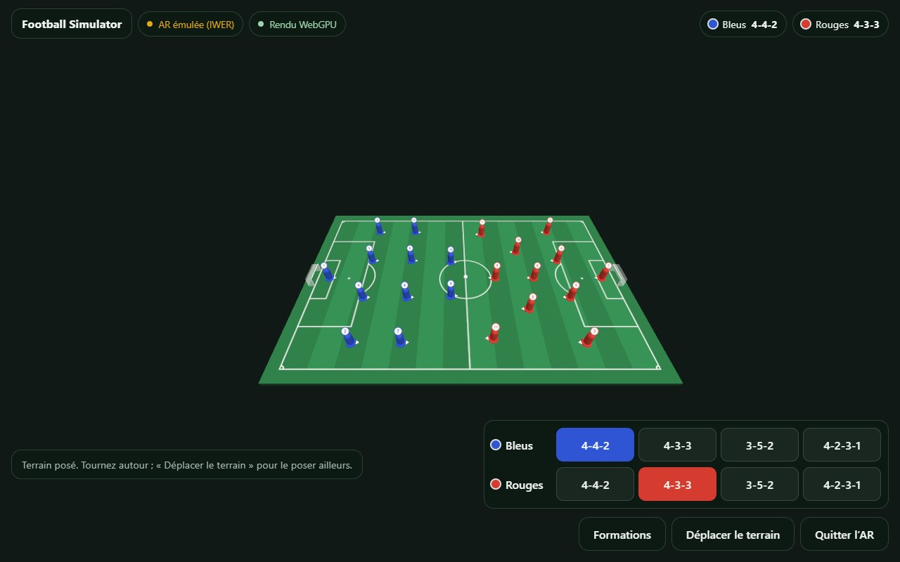
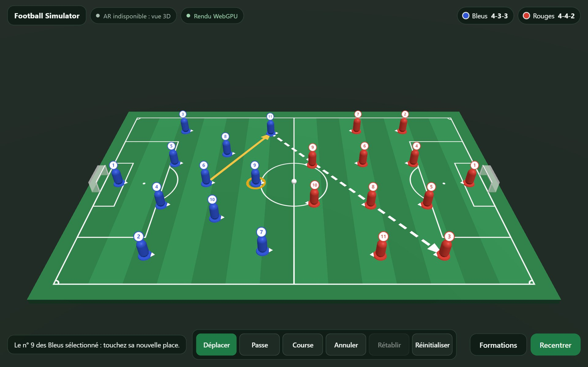
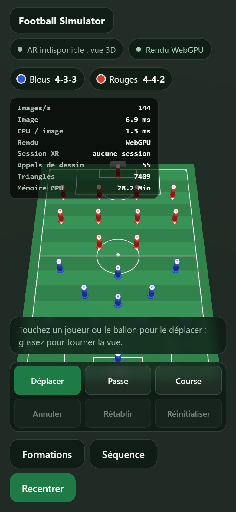

# Manuel utilisateur

Football Simulator pose un mini-terrain de football en 3D sur votre table, à travers la caméra de votre téléphone. Vous y placez deux équipes, déplacez les joueurs et le ballon, tracez des passes et des courses, puis animez l'action. Tout se fait d'un doigt, sans compte ni installation obligatoire.

> Ce manuel décrit les espaces de coaching du 24 novembre 2026, à publier après fusion autorisée. Les captures dans `images/sidebar/` montrent cette interface. Les images `sprint*` et `ux-*` illustrent les étapes précédentes ; leurs boutons diffèrent de la navigation actuelle.
>
> Les captures de ce manuel sont prises sur un ordinateur, avec l'émulateur de réalité augmentée : le fond y est sombre. Sur un téléphone, l'image de la caméra remplace ce fond, et le terrain apparaît sur votre vraie table.

**Sommaire**

1. [Ce qu'il vous faut](#1-ce-quil-vous-faut)
2. [Ouvrir et installer l'application](#2-ouvrir-et-installer-lapplication)
3. [Activer l'AR de Chrome (une seule fois)](#3-activer-lar-de-chrome-une-seule-fois)
4. [Poser le terrain sur la table](#4-poser-le-terrain-sur-la-table)
5. [Choisir les formations](#5-choisir-les-formations)
6. [Déplacer un joueur ou le ballon](#6-déplacer-un-joueur-ou-le-ballon)
7. [Tracer une passe ou une course](#7-tracer-une-passe-ou-une-course)
8. [Annuler, rétablir, réinitialiser](#8-annuler-rétablir-réinitialiser)
9. [Animer une action](#9-animer-une-action)
10. [Quitter l'AR](#10-quitter-lar)
11. [Sans AR : la vue 3D](#11-sans-ar--la-vue-3d)
12. [Mesurer la fluidité](#12-mesurer-la-fluidité)
13. [En cas de problème](#13-en-cas-de-problème)

---

## 1. Ce qu'il vous faut

| Pour | Il faut |
| --- | --- |
| La réalité augmentée (AR) | Un téléphone Android compatible ARCore, sous Android 12 ou plus, avec Chrome à jour et les Services Google Play pour la RA |
| La vue 3D seulement | Chrome ou Edge à jour sur ordinateur, Chrome sur Android, ou Safari 26 sur iPhone |

Pour l'AR, choisissez une table bien éclairée, avec un peu de texture : bois, nappe à motifs, journal posé dessus. Une surface blanche et unie se détecte mal.

## 2. Ouvrir et installer l'application

1. Ouvrez **https://bilelkhlif.github.io/footballsimulator/** dans Chrome, ou scannez ce QR code avec l'appareil photo du téléphone :

   

2. Facultatif : ouvrez **Plus d'outils**, puis « Installer l'application » lorsque le navigateur le propose. Le menu d'installation du navigateur reste utilisable. L'icône « Football Sim » apparaît sur l'écran d'accueil, et l'application s'ouvre ensuite sans barre d'adresse.

Une installation antérieure à la migration `.mjs` a besoin d’une connexion pour recevoir la nouvelle version ; elle peut se recharger une fois automatiquement. Attendez que la nouvelle interface soit prête avant de repasser hors-ligne.

Après une première ouverture, l'application se lance aussi **sans réseau** : le badge « Hors-ligne » s'affiche alors. Quand une nouvelle version est publiée, l'avis « Nouvelle version installée. » apparaît : touchez « Recharger ».

Les espaces se choisissent dans le rail à gauche. En portrait sur téléphone, cinq destinations
occupent le bas de l'écran : **Accueil**, **Équipes**, **Tactique**, **Séquences**, **Plus**.
**Plus** donne aussi accès à **Réalité augmentée** et **Réglages et aide**.
Un seul panneau est ouvert à la fois. Sa croix le ferme ; son contenu défile indépendamment.
Le terrain reste visible et interactif. Changer d'espace conserve les positions, les flèches,
les images clés, l'historique et le geste en cours.

## 3. Activer l'AR de Chrome (une seule fois)

L'application dessine l'AR avec WebGPU. Chrome propose encore cette fonction derrière un réglage :

1. Dans la barre d'adresse de Chrome, ouvrez `chrome://flags/#webxr-webgpu-binding`.
2. Choisissez « Enabled », puis touchez « Relaunch ».

Sans ce réglage, l'application affiche le badge « AR : réglage WebGPU à activer » et un bouton « Copier l'adresse du réglage ». Quand tout est prêt, le badge indique « AR disponible (WebGPU) » et le bouton « Entrer en AR » apparaît.

## 4. Poser le terrain sur la table

1. Ouvrez **Réalité augmentée** et touchez **« Entrer en AR »**, si ce bouton est proposé. Autorisez l'accès à la caméra.
2. Visez la table à environ 60 cm, en déplaçant lentement le téléphone. Un **cercle doré** apparaît sur la surface détectée.
3. **Touchez l'écran** : le terrain se pose sur le cercle, sa longueur face à vous. Il reste accroché à la table.

<table>
  <tr>
    <td width="50%"></td>
    <td width="50%"></td>
  </tr>
  <tr>
    <td align="center">Le cercle doré montre où le terrain sera posé</td>
    <td align="center">Un toucher pose le terrain, qui reste en place</td>
  </tr>
</table>

Tournez autour de la table : vous voyez la tactique sous tous les angles, et le terrain ne bouge pas. Pour le poser ailleurs, touchez **« Déplacer le terrain »**, puis recommencez à l'étape 2.

## 5. Choisir les formations

Ouvrez **Équipes et formations**, ou touchez la pastille d'une équipe en haut de l'écran. Six formations sont proposées par équipe : 4-4-2, 4-3-3, 3-5-2, 4-2-3-1, 4-1-4-1 (bloc compact avec une sentinelle devant la défense) et 3-4-3 (largeur donnée par les pistons). Les joueurs rejoignent leurs nouvelles places en glissant. Le changement est confirmé dans l'aide du geste et reste annulable. La formation est rappelée sur la pastille de l'équipe. Dépliez « Positions des 22 joueurs » pour lire leurs coordonnées actuelles.

## 6. Déplacer un joueur ou le ballon

L'outil **« Déplacer »** (icône en croix) est actif au départ. Ses commandes se trouvent dans **Outils tactiques** ; le bouton du mode actif au bord du terrain ouvre aussi cet espace.

1. **Touchez un joueur.** Un anneau doré l'entoure, et l'aide indique par exemple « Le n° 9 des Bleus sélectionné : touchez sa nouvelle place. »
2. **Touchez sa nouvelle place** sur le terrain : il y glisse. Vous pouvez aussi **laisser le doigt posé** : un anneau montre la place visée, vert sur le plateau, rouge en dehors ; glissez le doigt pour l'ajuster, puis relâchez.

Le ballon se déplace de la même façon. Pour annuler une sélection, touchez à nouveau l'objet sélectionné, ou **« Désélectionner »** à côté de l'aide ; pour en choisir un autre, touchez-le directement. En paysage court, ce bouton porte le libellé compact **« Annuler »**, aussi pendant un tracé. Un toucher hors du plateau est refusé : « Hors du terrain : touchez une place sur le plateau. » Tant qu'un joueur est sélectionné, la vue tourne à deux doigts. L'espace Accueil rappelle l'objet sélectionné et ses coordonnées.

## 7. Tracer une passe ou une course

| Bouton | Flèche | Sens | Départ | Arrivée |
| --- | --- | --- | --- | --- |
| « Passe » | Pleine et dorée | Le trajet du ballon | Le ballon, son porteur, ou l’arrivée d’une passe déjà tracée | Un partenaire, un espace libre, ou la fin d'une course |
| « Course » | En tirets et blanche | Le déplacement d'un joueur | Le joueur qui court | Un point du terrain |

**Une passe**, pas à pas :

1. Touchez **« Passe »**. Des anneaux dorés pulsés marquent d'où une passe peut partir : le ballon, et la fin des passes déjà tracées.
2. Touchez **le ballon** ou son porteur. L'aide nomme le passeur, par exemple « Passe du n° 9 des Bleus : touchez un partenaire ou un espace libre. »
3. Visez l'arrivée : à la souris en survolant, au doigt en le laissant posé. L'aperçu suit ; le receveur est entouré. **L'aperçu devient rouge** si l'arrivée est impossible.
4. Touchez, ou relâchez le doigt : la passe est tracée. Pour enchaîner, touchez le receveur, puis le joueur suivant.

**Une course** : touchez **« Course »**, le joueur qui court, puis son point d'arrivée.

Ce qui est refusé, avec un message en rouge et sans rien enregistrer :

- une passe qui ne part ni du ballon, ni de son porteur, ni d’une arrivée de passe déjà tracée ; une course qui ne part pas d'un joueur ;
- une arrivée hors des lignes du terrain ;
- une passe du porteur vers un adversaire ;
- une flèche trop courte, ou identique à une flèche déjà tracée.

Passes longues, en retrait, centres et courses croisées restent possibles. Pour abandonner un tracé : touchez de nouveau son départ, ou **« Abandonner le tracé »** à côté de l'aide. Touchez « Déplacer » pour revenir aux déplacements. Le détail des règles : [regles-des-fleches.md](regles-des-fleches.md).

## 8. Annuler, rétablir, réinitialiser

Ces commandes se trouvent dans **Outils tactiques**. Les raccourcis restent disponibles dans tous les espaces.

- **« Annuler »** défait la dernière action : déplacement, flèche, formation, image clé de la séquence.
- **« Rétablir »** refait l'action annulée.
- **« Réinitialiser »** remet les formations de départ, les joueurs à leurs places, le ballon au centre, et retire les flèches. Le bouton demande une confirmation : il devient « Confirmer ? » ; touchez-le une seconde fois après au moins 0,4 s, dans les 4 s. Un double toucher immédiat ne confirme pas. « Annuler » rétablit tout ensuite.

Annuler, rétablir ou réinitialiser pendant un tracé l'abandonne : son départ a pu bouger.

## 9. Animer une action

Ouvrez **Animation et séquences**. Le principe est celui d'un dessin animé : vous enregistrez des **images clés**, et la lecture fait glisser les joueurs de l'une à l'autre.

1. Placez joueurs et ballon au départ de l'action, puis touchez **« Image clé »**.
2. Déplacez des joueurs ou le ballon, puis **« Image clé »** à nouveau. Recommencez pour chaque temps de l'action, jusqu'à 12 images clés.
3. Touchez **« Lecture »** : l'action se joue. Le même bouton devient « Pause ».
4. **« Recommencer »** revient au début ; **0,5×**, **1×** et **2×** règlent la vitesse.
5. **« Effacer »** vide la séquence ; « Annuler » la rétablit.

La ligne du haut du panneau indique où vous en êtes, par exemple « Lecture : étape 1 sur 2, vitesse 1×. »

<table>
  <tr>
    <td width="60%"></td>
    <td width="40%"></td>
  </tr>
  <tr>
    <td align="center">Une contre-attaque en trois images clés, mise en pause au milieu de la première passe</td>
    <td align="center">En AR, l'action se joue sur la table</td>
  </tr>
</table>

Bon à savoir :

- Tracez d'abord les passes et les courses : les flèches montrent le plan, et la séquence joue les déplacements.
- Pendant la lecture, vous pouvez tourner autour de la table : l'action reste sur le terrain.
- Déplacer un joueur pendant la lecture l'arrête, et chacun rejoint la place enregistrée.
- La séquence n'est pas gardée quand la page est rechargée.

## 10. Quitter l'AR

Touchez **« Quitter l'AR »**, ou le bouton retour du téléphone. Vous retrouvez la vue 3D, avec votre tactique : formations, places, flèches et séquence.

## 11. Sans AR : la vue 3D

Sur ordinateur, sur iPhone, ou avant d'entrer en AR, le terrain s'affiche en 3D. Les mêmes outils y fonctionnent, à la souris ou au doigt. Glissez pour tourner la vue, pincez ou utilisez la molette pour zoomer ; « Recentrer » ramène la vue de départ.

À la première visite, **Réglages et aide** s'ouvre sur le guide « Bienvenue ». Le bouton
**Guide de prise en main** le rouvre ensuite. Ce guide reste dans le panneau et défile avec lui ;
il ne recouvre pas les commandes de vue. La croix ou **Retour au terrain** replie le panneau.
Le bouton Retour du navigateur le replie aussi ; Avancer peut le rouvrir. Sur ordinateur,
**Afficher les libellés du rail** développe la navigation pendant la session.

Au clavier :

| Touche | Action |
| --- | --- |
| D, P, C | Outils Déplacer, Passe, Course |
| Échap | Abandonner la sélection ou le tracé, fermer un panneau |
| Ctrl+Z (Cmd+Z sur Mac) | Annuler |
| Ctrl+Y, ou Ctrl+Maj+Z | Rétablir |
| Tab, puis Entrée ou Espace | Atteindre et activer chaque bouton |
| Flèches, Début, Fin dans le rail | Déplacer le focus entre les espaces |

<table>
  <tr>
    <td width="72%"></td>
    <td width="28%"></td>
  </tr>
  <tr>
    <td align="center">Sur ordinateur</td>
    <td align="center">Sur téléphone, en portrait</td>
  </tr>
</table>

## 12. Mesurer la fluidité

Ouvrez **Plus d'outils**, puis **Afficher les diagnostics**, sans recharger le terrain.
Le paramètre `?diagnostics` reste accepté. Un panneau affiche les images par seconde, la durée
d'une image, le temps de calcul par image, le rendu utilisé, l'état de la session AR, les appels
de dessin, les triangles et la mémoire graphique, aussi pendant l'AR. L'objectif du cahier est
au moins 30 images par seconde ; une mesure sur PC ne valide pas cet objectif sur téléphone.

*Capture prise sur un ordinateur : les valeurs d'un téléphone seront plus basses.*

## 13. En cas de problème

| Message ou symptôme | Que faire |
| --- | --- |
| « Football Simulator a besoin de WebGPU, absent de ce navigateur… » | Mettez à jour Chrome, ou ouvrez l'application dans Chrome ou Edge sur ordinateur, ou Safari 26 sur iPhone |
| « WebGPU est présent, mais aucun processeur graphique compatible n'a été trouvé sur cet appareil. » | L'appareil ne permet pas WebGPU, par exemple un téléphone sous Android 11 ou plus ancien : utilisez un autre appareil |
| Badge « AR : réglage WebGPU à activer » | Activez le réglage de Chrome (partie 3) |
| « Session AR refusée : autorisez l'accès à la caméra et vérifiez que les Services Google Play pour la RA sont installés. » | Autorisez la caméra pour Chrome (Paramètres → Applications → Chrome → Autorisations), et installez « Services Google Play pour la RA » depuis le Play Store |
| Badge « AR indisponible : vue 3D » | Ce navigateur ne propose pas l'AR (ordinateur, iPhone) : la vue 3D reste disponible |
| Le cercle doré n'apparaît pas | Ajoutez de la lumière, visez une surface texturée, déplacez lentement le téléphone d'un côté à l'autre |
| Le terrain s'est décalé | Touchez « Déplacer le terrain », puis posez-le à nouveau |
| L'application paraît ancienne | Ouvrez-la avec le réseau, puis touchez « Recharger » quand l'avis « Nouvelle version installée. » apparaît |
