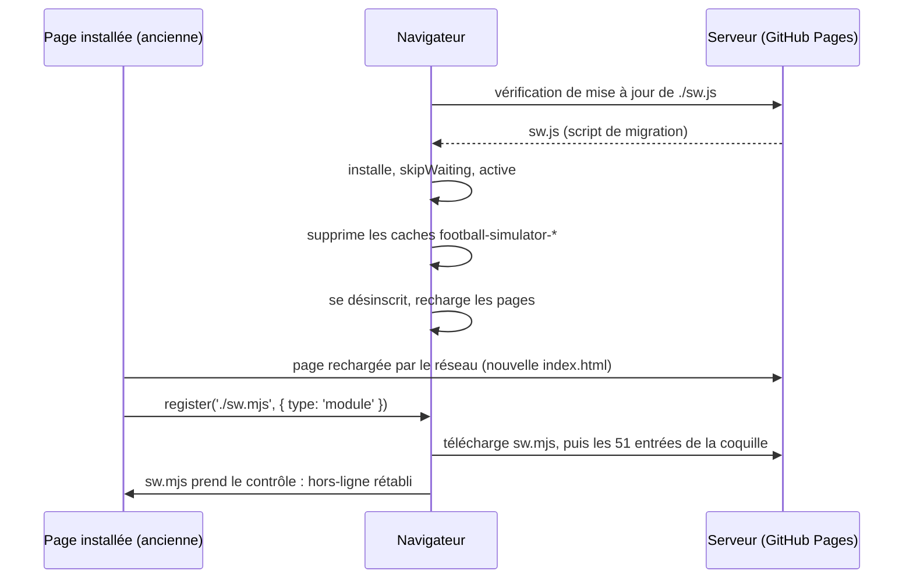

# Migration des modules JavaScript en `.mjs`

À la demande du professeur, les fichiers JavaScript du projet portent l'extension `.mjs`, celle des modules ES. Le contenu reste du JavaScript : c'était déjà des modules ES (`import`, `export`), chargés par `<script type="module">`. Le renommage conserve cette architecture ; les changements de règles et d’interface sont décrits séparément.

## 1. Fichiers renommés

| Ensemble | Avant | Après |
| --- | --- | --- |
| Application | 36 modules `src/*.js` | `src/*.mjs` (renommés par `git mv`, historique conservé) |
| Service Worker | `sw.js` | `sw.mjs`, enregistré en module |
| Tests, serveur, outils | déjà en `.mjs` | inchangés |

Les 36 modules renommés : `ar-placement`, `ar-surface`, `ar-view`, `ball`, `commands`, `config`, `dev-emulator`, `dev-xr-emulation`, `diagnostics`, `events`, `formation-panel`, `formation-transition`, `formations`, `main`, `pitch`, `players`, `pointer-input`, `pwa`, `raycasting`, `render-loop`, `reticle`, `scene`, `sequence-panel`, `sequence-player`, `tactical-arrows`, `tactical-interaction`, `tactical-sequence`, `tactical-toolbar`, `tactical-view`, `tactics-board`, `team`, `webgl-test-mode`, `webgpu`, `xr-input`, `xr-session`, `xr-support`.

Les modules ajoutés ensuite sont créés directement en `.mjs` : `arrow-rules`, `keyboard-shortcuts`, `onboarding`.

Ont suivi :

- chaque `import` et `import()` dynamique, et les types JSDoc `import('./….mjs')` ;
- `index.html` : `<script type="module" src="src/main.mjs">` ;
- `APP_SHELL` et `SHELL_VERSION` dans `sw.mjs` ; `tests/shell-version.mjs` lit désormais `sw.mjs` ;
- le contrôle des en-têtes de fonction (`tests/unit/documentation.test.mjs`) : `src/*.mjs`, `sw.mjs` et `sw.js` ;
- les tests de bout en bout qui importent des modules dans la page ;
- la documentation : README, architecture, guide du code, conformité, UML, convention et comptes rendus de sprint. Dans les comptes rendus historiques, les noms et résultats restent ceux de l’époque ; seuls les liens vers les fichiers renommés suivent leur destination actuelle. « `sw.js` » y désigne le Service Worker de l’époque, devenu `sw.mjs`.

`package.json` déclare déjà `"type": "module"`. Node.js traite de toute façon un `.mjs` comme un module ES : les commandes `npm` n'ont pas changé.

## 2. Exceptions : fichiers restés en `.js`

| Fichier | Pourquoi il reste en `.js` |
| --- | --- |
| `src/vendor/three-r187/build/three.webgpu.js`, `three.core.js`, `three.tsl.js` | Bibliothèque tierce (three.js r187, licence MIT), copiée telle quelle. Ses fichiers s'importent entre eux par ces noms (`three.webgpu.js` importe `./three.core.js`) : les renommer obligerait à modifier le code de three.js. La carte d'import de `index.html` les désigne. |
| `src/vendor/three-r187/examples/jsm/controls/OrbitControls.js` | Même bibliothèque ; importé par `three/addons/…` |
| `sw.js` | **Script de migration**, qui doit garder cette adresse (§3) |
| `https://cdn.jsdelivr.net/npm/iwer@2.7.0/build/iwer.module.js` | Émulateur IWER (Meta), chargé seulement avec `?iwer` ; fichier extérieur au dépôt |

Documents laissés tels quels, parce qu'ils décrivent un état passé ou appartiennent à l'équipe :

- `ATTRIBUTION.md`, tenu à jour par l'équipe : ses renvois aux anciens noms sont à mettre à jour par elle ;
- `docs/etat-de-l-art/` (source LaTeX et PDF compilé) et `docs/presentation/` (PowerPoint et PDF), livrables déjà remis.

Un test unitaire vérifie qu'aucun autre fichier `.js` n'existe dans le dépôt, hors `node_modules` et `src/vendor` : `tests/unit/migration-mjs.test.mjs`.

## 3. Le Service Worker : passer de `sw.js` à `sw.mjs` sans bloquer les installations

### Le problème

Une application déjà installée se lance depuis son cache : l'ancien Service Worker sert l'ancienne page (« cache d'abord »). Cette page n'enregistre jamais `sw.mjs`. Son seul lien avec le serveur est la vérification de mise à jour, que le navigateur fait sur l'adresse du Service Worker enregistré, c'est-à-dire `./sw.js`. Si `sw.js` disparaissait, cette vérification échouerait (404) et l'application resterait sur l'ancienne version, indéfiniment.

### La solution

`sw.js` reste à son adresse, réduit à un **script de migration** de quelques lignes. Il est sans gestionnaire `fetch` : tout passe par le réseau pendant la migration.

Le nouvel enregistrement (`src/pwa.mjs`) :

- demande `type: 'module'` ;
- si un navigateur refuse les Service Workers en module (`TypeError`), enregistre le même fichier en script classique. `sw.mjs` n'importe rien, il s'exécute de la même façon dans les deux cas ;
- remplace, pour la même portée, un éventuel enregistrement de `sw.js` : une page déjà chargée par le réseau passe directement à `sw.mjs`.

Le préfixe des caches ne change pas (`football-simulator-`) : l'activation de `sw.mjs` supprime aussi tout cache d'une version antérieure.

Le script relève seulement les pages qu’il contrôle (`matchAll({ type: 'window' })`), avant sa désinscription. Il ne revendique pas les pages non contrôlées et n’installe aucun gestionnaire `fetch`. Le test vérifie un seul rechargement de migration, puis une nouvelle vérification de mise à jour sans rechargement supplémentaire.

Pendant la migration, l'application a besoin du réseau une fois. Une installation hors-ligne garde l'ancienne version, qui fonctionne, et migre à la prochaine connexion.

### Vérifié par un test

`testServiceWorkerMigration` ([tests/run-tests.mjs](../tests/run-tests.mjs)) :

1. sert la dernière version d'avant la migration, tirée de git (commit `f7da74f`) ; `sw.js` contrôle la page, avec son cache ;
2. déploie la nouvelle version à la même adresse et déclenche la vérification de mise à jour : la page est rechargée en nouvelle version ; `sw.mjs` la contrôle, seul enregistrement ; seul reste le cache de la nouvelle version ;
3. coupe le réseau et recharge : la nouvelle version se lance depuis le cache de `sw.mjs`.

## 4. Type MIME de `.mjs`

Un module ES et un Service Worker ne sont acceptés qu'avec un type MIME JavaScript.

| Serveur | Type servi pour `.mjs` | Vérification |
| --- | --- | --- |
| Serveur local (`npm start`, tests) | `text/javascript; charset=utf-8` | `tests/serve.mjs` |
| GitHub Pages | `text/javascript; charset=utf-8` | Requête HEAD du 23 novembre 2026 : HTTP 200 sur `tests/serve.mjs` déjà publié. Cela ne valide pas encore le futur `sw.mjs` en production |

Le test de bout en bout `testModuleLoading` vérifie dans Chrome que chaque script de l'application est un `.mjs` servi en `text/javascript`, et que les seuls `.js` chargés sont ceux de three.js.

## 5. Ajouter un module

1. Créer `src/nom.mjs`, avec l'en-tête de fichier et les en-têtes de fonction ([convention](convention-de-documentation.md)).
2. L'importer avec son extension : `import { … } from './nom.mjs';`.
3. L'ajouter à `APP_SHELL` dans `sw.mjs`, puis lancer `npm run shell-version`.
4. `npm test` vérifie l'extension, les imports, la coquille et les en-têtes.

## 6. Déploiement et intégration ultérieure

Cette branche n’est pas encore fusionnée. Après autorisation de fusion, contrôler le build Pages, `src/main.mjs` et `sw.mjs` (HTTP 200 et MIME JavaScript), la mise à jour d’une installation ancienne et le lancement hors-ligne. Le test local de migration n’est pas une preuve sur téléphone ou en production.

La compatibilité future de la PR #15, qui importe encore neuf modules partagés en `.js`, est consignée dans [integration-future-visualiseur.md](integration-future-visualiseur.md). Cette PR n’a pas été modifiée.
