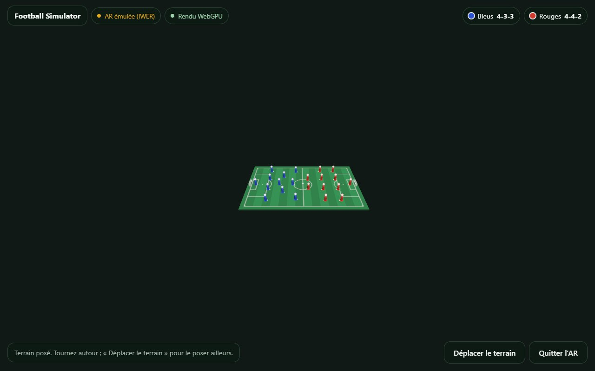
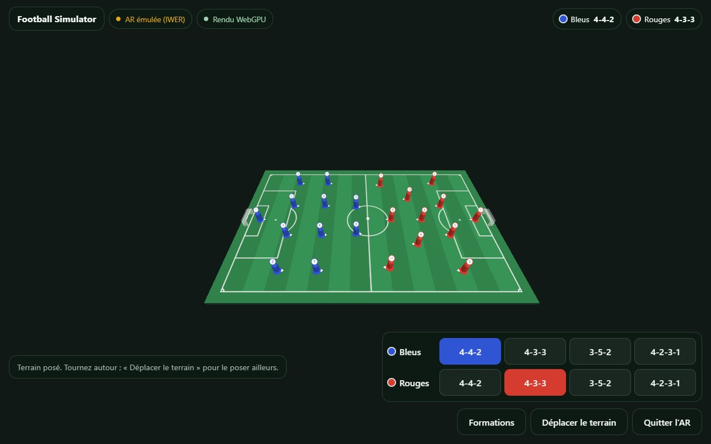
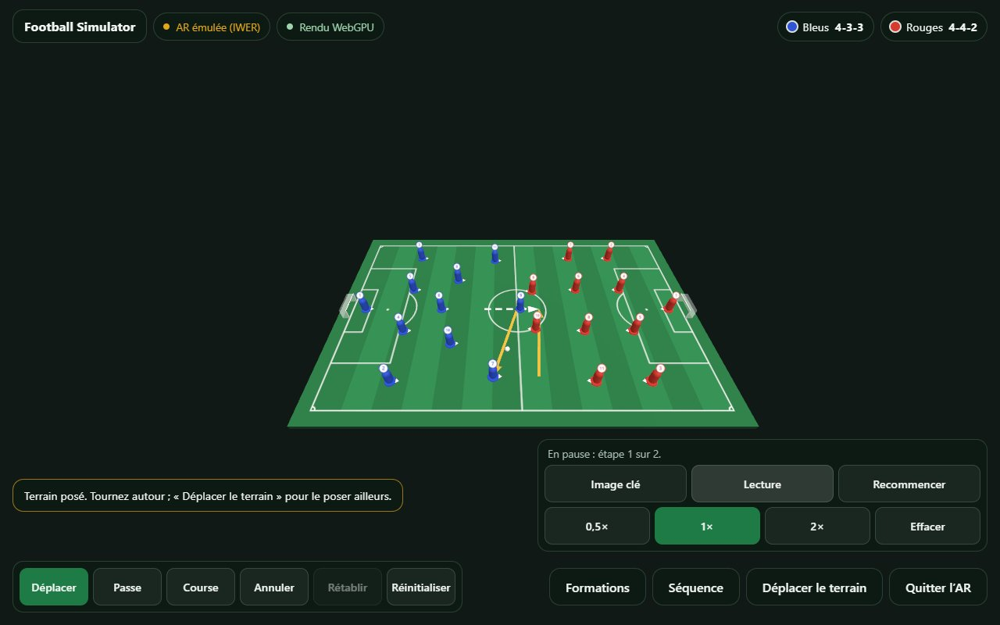

# Rapport final : Football Simulator

**Tableau tactique de football en réalité augmentée** (AR Football Tactics)

| | |
| --- | --- |
| Cadre | SUP'COM, département SIA, module Réalité Étendue, projet WebXR, 2026–2027 |
| Équipe | Iyed Rachdi, Bilel Khlif, Ghassen Dallekji |
| Encadrant | Dr. Ing. Mohamed-Bécha Kaâniche |
| Version | Branche `main` du dépôt, 17 novembre 2026 |
| Application | https://bilelkhlif.github.io/footballsimulator/ |

## Résumé

Football Simulator pose un mini-terrain de football en 3D sur une vraie table, à travers la caméra d'un smartphone Android, depuis un simple lien web. L'utilisateur y place deux équipes, choisit leurs formations, déplace joueurs et ballon d'un toucher, trace passes et courses, annule ses actions et anime une action pas à pas.

Les six sprints du cahier des charges sont livrés. Les neuf besoins fonctionnels, BF1 à BF9 dont le bonus, sont implémentés. 261 tests automatisés sont réussis, dont le parcours AR complet dans une session WebXR émulée.

Le rendu passe par WebGPU, sans repli WebGL, à la demande de l'enseignant. L'application est une PWA installable, utilisable hors-ligne.

Restent les mesures que seul un téléphone permet : stabilité d'une minute, sélection réussie sur 9 essais sur 10, 30 images par seconde. Reste aussi la vidéo, à tourner par l'équipe.

---

## 1. Contexte et objectifs

Un entraîneur amateur explique sa tactique sur un tableau blanc : une vue de dessus en 2D, des déplacements difficiles à montrer, aucun partage à distance, et des logiciels 3D réservés aux clubs professionnels (cahier §1.2). Le projet y répond par une application web de réalité augmentée, sans budget ni matériel spécialisé : un smartphone Android ou un émulateur sur PC suffit (§1.1).

Les sept objectifs du cahier (§1.4) sont atteints :

1. session `immersive-ar` ;
2. surface détectée par hit testing ;
3. terrain de 60 × 38,9 cm, les proportions réelles ramenées à 60 cm de long ;
4. joueurs placés selon la formation choisie ;
5. sélection et déplacement par raycasting ;
6. flèches tactiques ;
7. installation et fonctionnement hors-ligne.

La matrice de conformité complète, exigence par exigence, est dans [conformite.md](conformite.md).

## 2. Ce que fait l'application

| Besoin | Réalisation |
| --- | --- |
| BF1 Démarrer une session AR | Bouton « Entrer en AR » ; session rendue en WebGPU ; échecs expliqués (caméra refusée, réglage de Chrome manquant) |
| BF2 Réticule | Cercle doré sur la surface trouvée par le hit test |
| BF3 Poser le terrain | Un toucher pose le terrain sur le cercle, face à l'utilisateur, puis une ancre spatiale le garde en place |
| BF4 Formations | 4-4-2, 4-3-3, 3-5-2 et 4-2-3-1 pour chaque équipe ; les joueurs glissent vers leurs places |
| BF5 Sélection et déplacement | Toucher un joueur (anneau doré), puis sa nouvelle place |
| BF6 Ballon | Même geste que pour un joueur |
| BF7 Flèches | Passe (pleine, dorée) et course (tirets blancs), avec aperçu |
| BF8 Annuler, réinitialiser | Annuler, Rétablir, Réinitialiser ; chaque action est une commande |
| BF9 Animer une action (bonus) | Images clés, Lecture, Pause, Recommencer, vitesses 0,5×, 1× et 2× |

| Pose du terrain | Formations en AR | Séquence animée en AR |
| --- | --- | --- |
|  |  |  |

Le mode d'emploi illustré est le [manuel utilisateur](manuel-utilisateur.md).

## 3. Architecture

L'application est entièrement exécutée dans le navigateur. Des fichiers statiques servis en HTTPS par GitHub Pages, sans serveur applicatif ni étape de compilation (cahier §3.1).

| Couche | Choix |
| --- | --- |
| Rendu | three.js r187, copié dans le dépôt ; moteur WebGPU sans repli WebGL (`src/webgpu.js`) ; matériaux traduits en WGSL, réticule écrit en TSL |
| Réalité augmentée | WebXR : `immersive-ar`, espace `local-floor`, `hit-test`, `anchors`, `dom-overlay` ; liaison WebXR/WebGPU (`XRGPUBinding`) |
| État tactique | Un tableau tactique (`src/tactics-board.js`) garde formations, places, ballon et flèches ; la scène ne fait que le suivre |
| Interaction | Un toucher devient un rayon, puis une commande annulable |
| PWA | `manifest.json` ; Service Worker à version de contenu (`sw.js`) |
| Tests | `node --test` pour les tests unitaires ; Chrome piloté par `playwright-core` pour les tests de bout en bout ; émulateur IWER pour l'AR sur PC |

Les quatre patrons du cahier (§3.4) sont en place :

- **Strategy** : une classe par formation ;
- **Command** : sept commandes et un historique ;
- **Observer** : l'interface et la scène suivent la session, la pose, le tableau et la séquence ;
- **Factory** : les pions et leurs maillages instanciés.

Détails : [architecture.md](architecture.md), [diagrammes UML](uml.md) (cas d'utilisation, séquences, déploiement, classes) et [guide du code](guide-du-code.md), fichier par fichier.

## 4. Points techniques

**Pose sur une surface réelle (sprint 3).**

- La source de hit test part de l'espace `viewer` : le réticule suit la surface visée au centre de l'écran.
- Le toucher pose le terrain à l'image suivante, car `frame.createAnchor` n'est valable que pendant l'image active.
- Le terrain suit ensuite son ancre. Si le suivi s'interrompt, il garde sa dernière pose ; quand le suivi reprend, il rejoint l'ancre recalée.

Détail dans [sprint-3.md](sprint-3.md).

**Raycasting (sprint 5).**

- En AR, le rayon d'un toucher vient du `targetRaySpace` de la source d'entrée, lu dans l'image de l'événement `select`.
- Hors AR, il part de la caméra.
- Il vise d'abord les zones de sélection invisibles des pions, puis le plan du gazon. Le point est ensuite ramené dans le repère du terrain : le résultat ne dépend ni de la place ni de l'orientation de l'ancre. Il est exact au millimètre sur un terrain tourné de 25°.
- Avec le DOM Overlay, un toucher sur l'interface est arrêté par `beforexrselect`.

Détail dans [sprint-5.md](sprint-5.md).

**Annulation exacte (sprint 5).** Le tableau garde les places voulues, jamais les positions intermédiaires d'une animation. Annuler rend donc exactement l'état précédent, même au milieu d'une transition de formation.

**Séquence animée (sprint 6, BF9).** Une image clé garde la place des 23 objets dans le repère du terrain. La lecture avance selon le temps écoulé, dans la boucle de rendu existante ; elle interpole avec une courbe douce, exacte aux deux bouts. Enregistrer et effacer sont des commandes annulables. Toute action sur le tableau arrête la lecture.

**Performance (sprint 6).** Mesure sur PC, processeur ralenti 4 fois, médiane de 3 mesures. Les pions instanciés (`InstancedMesh`) divisent les appels de dessin par deux, à image identique :

| Scénario | Images/s | Temps CPU du rendu | Appels de dessin |
| --- | ---: | ---: | ---: |
| Vue 3D au repos | 62,7 → 90,1 | 12,7 → 8,2 ms | 115 → 55 |
| Vue 3D, changements de formation | 46,3 → 76,9 | 18,2 → 9,8 ms | 115 → 55 |
| AR émulée, terrain posé | 47,2 → 62,5 | 13,7 → 9,1 ms | 114 → 54 |

Cette mesure compare deux versions ; elle ne remplace pas la mesure sur téléphone.

**PWA (sprint 6).** Les 48 entrées de l'application sont installées d'un bloc, dans un cache nommé d'après une empreinte de leur contenu, puis servies depuis ce cache. Une page ne mélange donc jamais deux versions, et se lance hors-ligne. Sur un réseau très lent, la page est prête en 1,1 s au lieu de 3,5 s.

Détail dans [sprint-6.md](sprint-6.md).

## 5. Démarche

Six sprints, du 5 au 16 novembre 2026, chacun sur sa branche et fusionné dans `main` par une pull request après relecture (cahier §7.2) :

| Sprint | Contenu | Fusion |
| --- | --- | --- |
| S1 | Dépôt, PWA, scène 3D hors AR | PR #1, 9 novembre |
| S2 | Session `immersive-ar`, espace `local-floor` | PR #3, 12 novembre |
| S3 | Hit test, réticule, pose et ancre ; WebGPU sans repli ; PWA complétée | PR #6, 14 novembre ; mode test WebGL : PR #7 |
| S4 | Formations (Strategy), deux équipes, ballon, boutons | PR #8, 14 novembre |
| S5 | Raycasting, flèches, annulation (Command), mode diagnostic | PR #12, 15 novembre |
| S6 | Performance, fiabilité de l'AR, séquence animée, PWA versionnée, recette | PR #13, 16 novembre |

La répartition des rôles du cahier (§5.2) était un plan. Les contributions effectivement documentées, et l'usage de l'assistant Claude Code pour l'implémentation, les tests et la documentation, sont déclarés dans [ATTRIBUTION.md](../ATTRIBUTION.md).

## 6. Qualité et tests

- **Tests unitaires** : 182, sous Node.js, avec des doublures de WebXR et de WebGPU.
- **Tests de bout en bout** : 79, dans Chrome. Ils couvrent le rendu WebGPU sans contexte WebGL, la PWA et le hors-ligne, et le parcours AR complet dans une session émulée, en WebGPU et en mode test WebGL. Dans ce parcours, le terrain est posé, ancré, tourné, le raycasting est exact, les flèches, l'annulation et la séquence fonctionnent, et cinq entrées et sorties de suite ne laissent aucune fuite.
- **Erreurs introduites volontairement** à chaque sprint, puis retirées : toutes détectées, dont 16 au sprint 6. Deux ne l'ont été qu'après le renforcement d'un test, l'une au sprint 5, l'autre au sprint 6.
- **Documentation du code vérifiée par un test** : chaque fonction porte son responsable, sa date et son rôle (cahier §7.1).
- **Diagrammes vérifiés** : les 22 diagrammes Mermaid du dépôt s'affichent avec Mermaid 11.4.1.

Résultat du 17 novembre 2026 : 182 tests unitaires et 79 vérifications de bout en bout, tous réussis.

## 7. Validation

| Niveau | Ce qui est validé |
| --- | --- |
| Automatisé | BF1 à BF9 ; règles de placement des formations (« 11 joueurs bien placés ») ; rendu WebGPU sans repli ; PWA et hors-ligne |
| Émulé | Parcours AR complet : session, réticule, pose, ancre, sélection, flèches, annulation, séquence, sorties répétées |
| Physique | 12 novembre : entrée en AR et sortie sur deux téléphones Android. 14 novembre : AR rendue en WebGPU sur le TECNO POVA 6 Pro 5G ; mode test WebGL sur le Galaxy S10e. Ces essais portaient sur des versions antérieures aux sprints 5 et 6 |

**La version finale n'a pas encore été testée sur un téléphone.** Le protocole à suivre, avec ses critères et sa fiche de résultats, est dans [recette.md](recette.md#5-protocole-de-validation-physique).

## 8. Limites et perspectives

- **Mesures sur téléphone à faire** : stabilité d'une minute, 9 essais sur 10, 30 images par seconde.
- **Liaison WebXR/WebGPU** : Chrome la propose encore derrière un réglage (`chrome://flags/#webxr-webgpu-binding`). Sans WebGPU, par exemple sur Android 11 ou plus ancien, l'application affiche un message ; le mode `?webgl` ne sert qu'aux tests.
- **Pas d'AR sur iPhone** : Safari ne propose pas de session `immersive-ar`. L'application y reste en vue 3D.
- **Séquence non enregistrée** : elle disparaît au rechargement ; ses déplacements vont en ligne droite d'une image clé à l'autre.
- **Perspectives** :
  - partager une tactique par un lien ;
  - enregistrer les séquences ;
  - rejouer une action réelle à partir de données ouvertes, comme le suggérait l'état de l'art ;
  - suivre l'arrivée de la liaison WebXR/WebGPU sans réglage dans Chrome.

## 9. Conclusion

Le tableau tactique demandé existe, ouvert par un lien, posé sur une vraie table, manipulable en temps réel, installable et utilisable hors-ligne. Il met en œuvre toute la chaîne WebXR, three.js et PWA du module, ainsi que les patrons de conception du cahier. Les dernières preuves attendues sont physiques : elles se mesurent sur un téléphone, avec le protocole de la recette.

## Documents du projet

| Document | Contenu |
| --- | --- |
| [README](../README.md) | Présentation, installation, tests, déploiement |
| [conformite.md](conformite.md) | Matrice de conformité au cahier des charges |
| [recette.md](recette.md) | Recette de BF1 à BF9, critères d'acceptation, protocole physique |
| [manuel-utilisateur.md](manuel-utilisateur.md) | Manuel utilisateur illustré |
| [uml.md](uml.md) | Diagrammes UML |
| [architecture.md](architecture.md), [guide-du-code.md](guide-du-code.md) | Architecture ; explication du code, fichier par fichier |
| [sprint-1.md](sprint-1.md) à [sprint-6.md](sprint-6.md) | Comptes rendus des sprints |
| [video-demonstration.md](video-demonstration.md) | Storyboard et voix off de la vidéo |
| [presentation/](presentation/) | Présentation de soutenance (PowerPoint et PDF) |
| [etat-de-l-art/](etat-de-l-art/) | Rapport d'état de l'art (PDF) |
| [ATTRIBUTION.md](../ATTRIBUTION.md) | Origine des ressources et usage de l'IA |
