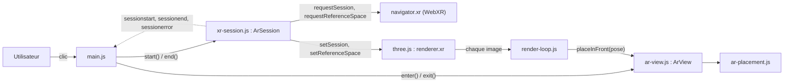
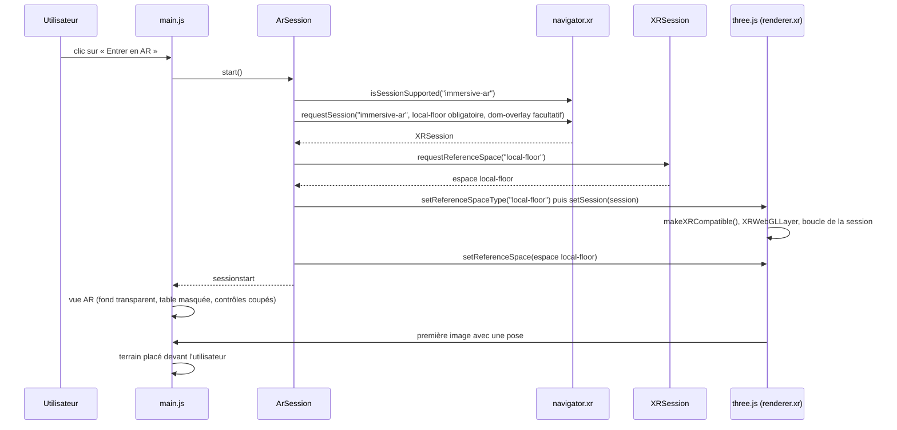
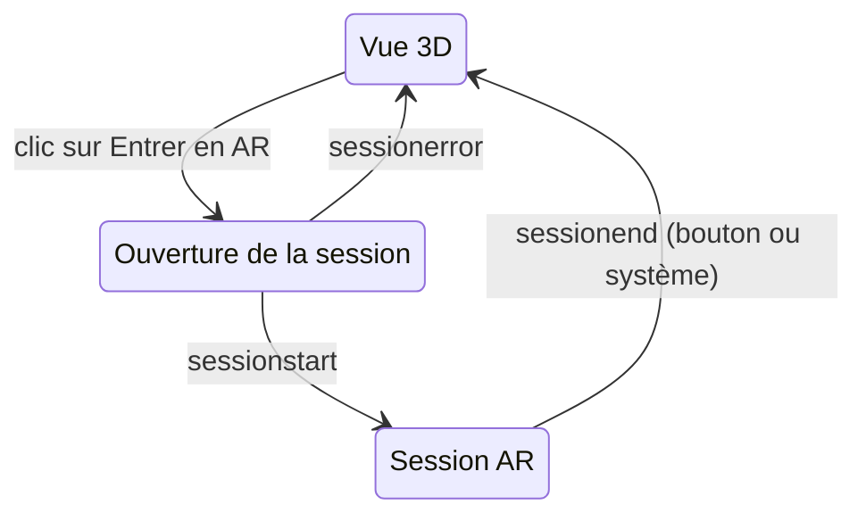
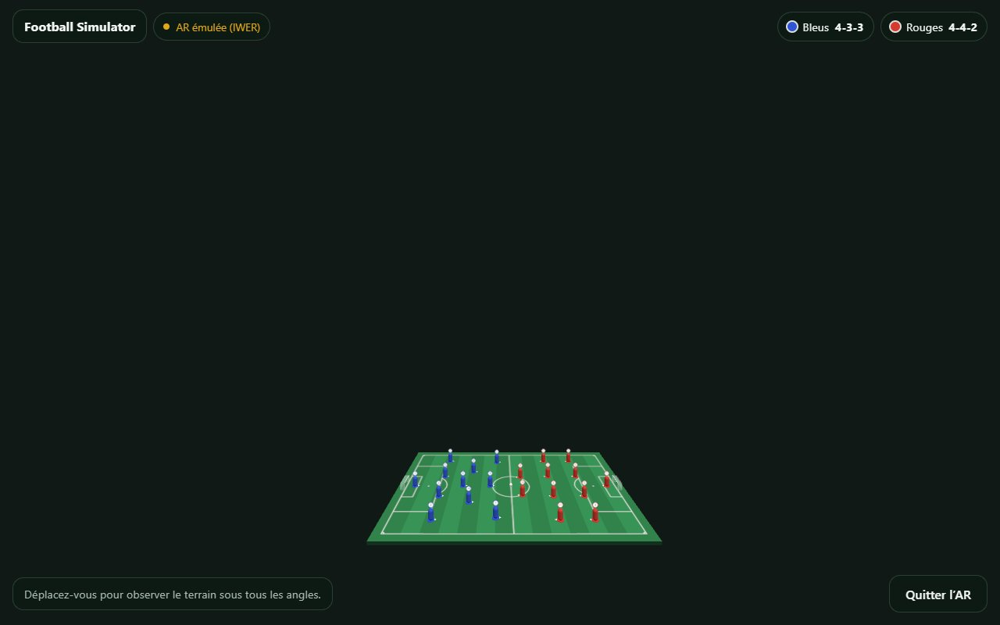
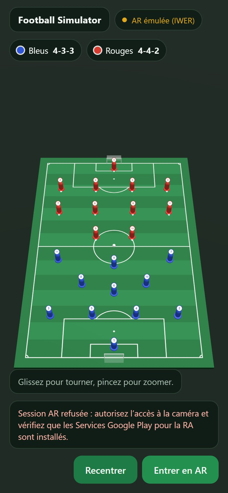

# Sprint 2 : session AR immersive

Réalisé le 9 et le 10 novembre 2026 sur la branche `feature/sprint-2`, sous la conduite de Bilel Khlif. Le code est généré avec Claude, sur des consignes détaillées fournies par Bilel Khlif : voir [ATTRIBUTION.md](../ATTRIBUTION.md).

**Sommaire**

1. [Objectifs](#1-objectifs)
2. [Architecture](#2-architecture)
3. [Le module xr-session.js](#3-le-module-xr-sessionjs)
4. [Séquence d'entrée en AR](#4-séquence-dentrée-en-ar)
5. [La couche de rendu XRWebGLLayer](#5-la-couche-de-rendu-xrwebgllayer)
6. [L'espace de référence local-floor](#6-lespace-de-référence-local-floor)
7. [Patron Observer et cycle de vie](#7-patron-observer-et-cycle-de-vie)
8. [Placement du terrain](#8-placement-du-terrain)
9. [Sortie et restauration de la vue 3D](#9-sortie-et-restauration-de-la-vue-3d)
10. [Tests](#10-tests)
11. [Validation avec IWER](#11-validation-avec-iwer)
12. [Test sur Android](#12-test-sur-android)
13. [Captures](#13-captures)
14. [Écarts, décisions et questions probables du jury](#14-écarts-décisions-et-questions-probables-du-jury)
15. [Pour le sprint 3](#15-pour-le-sprint-3)

---

## 1. Objectifs

Le cahier des charges (§5.3) fixe au sprint 2 : la session `immersive-ar`, la configuration du `XRWebGLLayer` et de l'espace de référence `local-floor`.

| Objectif | État |
| --- | --- |
| Ouvrir une session `immersive-ar` depuis « Entrer en AR » (BF1) | Fait, validé avec l'émulateur IWER |
| `XRWebGLLayer` créé à partir du contexte WebGL du moteur de rendu | Fait par three.js, vérifié : couche `XRWebGLLayer` sous IWER |
| Espace de référence `local-floor` | Demandé et vérifié par notre module, puis confié à three.js |
| Terrain visible dans la vue AR | Placé devant l'utilisateur au premier rendu de la session |
| Sortie par « Quitter l'AR » ou par le système, retour à la vue 3D | Fait, avec une nouvelle entrée possible ensuite |
| Test sur un téléphone Android | Pas encore fait : voir la partie 12 |

Hors du sprint 2, comme prévu : hit test, réticule, pose du terrain sur la table et ancres (sprint 3).

---

## 2. Architecture

Cinq petits modules s'ajoutent, chacun avec un seul rôle :

| Fichier | Rôle |
| --- | --- |
| [`src/events.js`](../src/events.js) | `EventEmitter` : le patron Observer (`on`, `off`, `emit`) |
| [`src/xr-session.js`](../src/xr-session.js) | `ArSession` : ouvre et ferme la session WebXR, la relie à three.js, signale son cycle de vie |
| [`src/ar-view.js`](../src/ar-view.js) | Bascule la scène entre la vue 3D et la vue AR, et la restaure à la sortie |
| [`src/ar-placement.js`](../src/ar-placement.js) | Calcule la position du terrain devant l'utilisateur, à partir de la pose du téléphone |
| [`src/render-loop.js`](../src/render-loop.js) | Boucle de rendu commune : contrôles d'orbite hors AR, placement du terrain en AR |



La séparation demandée est respectée : `xr-session.js` ne connaît ni le DOM ni les objets de la scène. C'est `main.js` qui s'abonne à ses événements et met à jour la scène (par `ar-view.js`) et l'interface.

---

## 3. Le module xr-session.js

```js
const arSession = new ArSession({ renderer, overlayRoot: document.getElementById('overlay') });
arSession.on('sessionstart', (detail) => { /* … */ });
arSession.start();   // depuis un clic
arSession.end();
```

| Élément | Rôle |
| --- | --- |
| `start()` | Entre en AR ; renvoie la session, ou `null` en cas d'échec. Un double clic ne lance qu'une demande |
| `end()` | Quitte l'AR ; l'événement `sessionend` suit |
| `isSupported()` | Vrai si le navigateur propose `immersive-ar` |
| `isActive`, `referenceSpace` | État de la session en cours |
| `sessionstart` | `{ session, referenceSpace, layer, domOverlay }` |
| `sessionend` | `{ session }`, une fois le rendu de three.js restauré |
| `sessionerror` | `{ reason, error }` ; aucune session ne reste ouverte |

Les causes d'échec et le message affiché par `main.js` :

| `reason` | Cause | Message affiché |
| --- | --- | --- |
| `unavailable` | `navigator.xr` absent : navigateur sans WebXR, ou page en HTTP | WebXR est indisponible : ouvrez l'application dans Chrome sur Android, en HTTPS. |
| `unsupported` | WebXR présent, sans le mode `immersive-ar` | Ce navigateur ne propose pas la réalité augmentée immersive. |
| `rejected` | Session refusée : caméra non autorisée, ARCore absent… | Session AR refusée : autorisez l'accès à la caméra et vérifiez que les Services Google Play pour la RA sont installés. |
| `reference-space` | `local-floor` indisponible | Cet appareil ne fournit pas l'espace de référence local-floor. |
| `layer` | three.js n'a pas pu relier son rendu à la session | Le rendu 3D n'a pas pu être relié à la session AR. |

Trois détails de conception :

- **`navigator.xr` est lu au moment de l'entrée en AR**, pas au chargement : l'émulateur IWER le remplace après le chargement de la page.
- **Rien ne reste à moitié ouvert.** Dès qu'une étape échoue après `requestSession`, la session est refermée avant que `sessionerror` soit émis.
- **Les dépendances sont injectables** (`xr`, `renderer`) : les tests unitaires remplacent le navigateur et three.js par des doublures.

---

## 4. Séquence d'entrée en AR



`requestSession` doit être appelé pendant une action de l'utilisateur : c'est pourquoi `start()` est déclenché par le clic sur le bouton.

---

## 5. La couche de rendu XRWebGLLayer

La couche de rendu relie le contexte WebGL du moteur de rendu à la session : le navigateur affiche à chaque image ce que three.js dessine dans son framebuffer.

**Qui la crée ?** Dans three.js r186, `renderer.xr.setSession(session)` (dans `src/vendor/three/build/three.module.js`, vers la ligne 14291) fait tout l'enchaînement :

1. `gl.makeXRCompatible()`, car notre contexte n'a pas été créé compatible XR ;
2. `new XRWebGLLayer(session, gl, { alpha: true, … })` puis `session.updateRenderState({ baseLayer })`, quand le navigateur ne propose pas les couches de projection (`XRWebGLBinding.createProjectionLayer`) ; sinon, une `XRProjectionLayer` ;
3. la demande de l'espace de référence, puis le passage de la boucle de rendu à la cadence de la session.

**Pourquoi ne pas la créer nous-mêmes ?** three.js remplacerait notre couche par la sienne, et il doit rester responsable du rendu. Notre module lui confie la session, puis vérifie le résultat : l'événement `sessionstart` indique la couche obtenue (`layer`). Sous IWER, c'est bien une `XRWebGLLayer` (test de bout en bout). Le fond reste transparent (`alpha: true`) pour laisser voir l'image de la caméra.

---

## 6. L'espace de référence local-floor

- **Ce qu'il représente** : un repère dont l'origine est au sol, sous la position de l'utilisateur au début de la session ; l'axe Y monte et l'axe −Z part dans la direction où il regardait.
- **Comment il est obtenu** : `local-floor` est une fonctionnalité obligatoire de la session (`requiredFeatures`). Notre module le demande lui-même (`session.requestReferenceSpace('local-floor')`) avant tout rendu, pour donner un message d'erreur précis s'il manque.
- **Comment three.js l'utilise** : `setReferenceSpaceType('local-floor')`, puis `setReferenceSpace(espace)` après `setSession`, car `setSession` réinitialise l'espace personnalisé. three.js place alors la caméra dans ce repère à chaque image.
- **À quoi il sert ensuite** : la pose du téléphone (`frame.getViewerPose(espace)`) sert au placement du terrain ; au sprint 3, les résultats du hit test seront exprimés dans le même repère (`arSession.referenceSpace`).

---

## 7. Patron Observer et cycle de vie

`events.js` implémente le patron Observer du cahier (§3.4) : un sujet (`ArSession`, qui hérite d'`EventEmitter`) prévient ses observateurs sans les connaître. `on()` renvoie une fonction de désabonnement, et un observateur en erreur n'empêche pas les suivants d'être prévenus.



Les observateurs de `main.js` :

| Événement | Scène (`ar-view.js`) | Interface |
| --- | --- | --- |
| `sessionstart` | Fond transparent, table masquée, contrôles d'orbite coupés, terrain en attente de placement | « Quitter l'AR » remplace « Entrer en AR » et « Recentrer » ; aide aux gestes adaptée ; `data-xr="active"` sur la page |
| `sessionend` | Fond, table, terrain au centre et contrôles restaurés, puis taille du rendu et cadrage recalculés | Boutons et aide de la vue 3D ; `data-xr="inactive"` |
| `sessionerror` | Taille du rendu recalculée à l'image suivante | Message d'échec affiché ; « Entrer en AR » réactivé |

`sessionend` n'est émis qu'après l'événement `sessionend` de `renderer.xr` : three.js a alors déjà restauré son rendu (taille, densité de pixels, champ de vision de la caméra), et la vue 3D peut être recadrée sans conflit.

---

## 8. Placement du terrain

Sans hit test, le terrain ne peut pas encore être posé sur la vraie table. Il est placé **par rapport au téléphone, à la première image de la session où sa pose est connue** :

- 0,9 m devant le téléphone, à l'horizontale (`PLACEMENT_DISTANCE`) ;
- 0,5 m plus bas (`PLACEMENT_DROP`), à peu près à hauteur de table ;
- tourné pour que l'utilisateur le voie de côté, les Bleus attaquant vers sa droite, comme dans la vue « télévision ».

La direction du regard est l'axe −Z de la vue tourné par le quaternion d'orientation, ramené à l'horizontale ; un téléphone pointé droit vers le sol garde la direction −Z par défaut. Le terrain reste masqué jusqu'à son placement, pour ne pas apparaître une image au sol. Le terrain garde sa taille réelle de maquette (60 × 39 cm).

Pourquoi par rapport au téléphone plutôt qu'à des coordonnées fixes : la hauteur du sol de `local-floor` est estimée différemment selon les appareils. Placé par rapport au téléphone, le terrain est visible partout, y compris dans la vue d'IWER (à 1,05 m, ses quatre coins à l'écran). Le sprint 3 remplacera ce placement par la pose sur la table.

---

## 9. Sortie et restauration de la vue 3D

Deux façons de sortir, un seul chemin :

1. « Quitter l'AR » appelle `arSession.end()`, qui termine la session ; le système peut aussi la terminer (bouton retour du téléphone, changement d'application) ;
2. three.js restaure son rendu : cible de rendu, densité de pixels, taille, champ de vision de la caméra ;
3. `ArSession` émet `sessionend` ;
4. `ar-view.js` restaure le fond, la table, le terrain au centre et les contrôles d'orbite ;
5. `resize()` reprend la taille actuelle de la fenêtre, au cas où le téléphone aurait tourné pendant la session, et `resetView()` recadre le terrain.

Pendant une session, `resize()` ne fait rien : la taille du rendu vient alors de la session.

**Particularité d'IWER.** Pendant une session émulée, IWER place le canvas dans un conteneur plein écran de `z-index` 999, qui cachait nos boutons. Une règle CSS place l'interface au-dessus pendant une session (`body[data-xr="active"] #overlay`) ; sur un téléphone, c'est le DOM Overlay qui s'en charge.

---

## 10. Tests

`npm test` lance d'abord les tests unitaires (`npm run test:unit`, sans navigateur), puis les tests de bout en bout (`npm run test:e2e`, dans Chrome).

**Tests unitaires : 28**, dans `tests/unit/`, avec le lanceur intégré à Node.js (`node --test`). Le navigateur, la session WebXR et `renderer.xr` y sont remplacés par des doublures qui reproduisent le comportement documenté de three.js r186.

| Comportement demandé | Test |
| --- | --- |
| Détection de WebXR | `xr-session` : sans `navigator.xr`, sans le mode `immersive-ar`, avec |
| Entrée réussie | `xr-session` : options de la session, ordre des appels à three.js, détail de `sessionstart` |
| Session refusée | `xr-session` : `rejected`, sans toucher au rendu |
| Échec de l'espace de référence | `xr-session` : `reference-space`, session refermée |
| Échec de la couche de rendu | `xr-session` : `layer`, session refermée, aucun `sessionend` parasite |
| Fin de session | `xr-session` : par `end()` et par le système, une seule notification, nouvelle entrée possible |
| Notifications | `events` : abonnement, désabonnement, observateur en erreur |
| Restauration de la scène | `ar-view` : fond, table, terrain et contrôles, avec de vrais objets three.js |
| Contrôles d'orbite en pause en AR | `render-loop` : aucune mise à jour en AR, rendu continu |
| Placement du terrain | `ar-placement` (5 tests) et `render-loop` : une seule fois, dans l'espace `local-floor` |

**Tests de bout en bout : 18**, dans `tests/run-tests.mjs` : les 11 du sprint 1, et 7 pour le parcours AR avec IWER (partie 11).

**Résultat le 10 novembre 2026** : 28 tests unitaires réussis sur 28, 18 vérifications de bout en bout réussies sur 18, en une trentaine de secondes.

Pour vérifier que les tests détectent vraiment une erreur, deux défauts ont été introduits volontairement, puis retirés : des contrôles d'orbite mis à jour même en AR (deux tests en échec), et une session laissée ouverte quand `local-floor` manque (un test en échec).

Une exécution de `npm test` est restée bloquée pendant ce sprint, sans se reproduire lors des exécutions suivantes ; si cela arrive, relancer la commande.

---

## 11. Validation avec IWER

Le parcours demandé est automatisé dans `npm run test:e2e`, avec `?iwer&debug` : `?debug` expose les objets internes dans `window.__footballSimulator`, pour vérifier la scène.

| Étape | Résultat |
| --- | --- |
| Ouvrir `http://127.0.0.1:8080/?iwer` | Badge « AR émulée (IWER) » |
| Le bouton « Entrer en AR » apparaît | Oui |
| Cliquer sur « Entrer en AR » : la session s'ouvre | Oui, couche `XRWebGLLayer`, espace `local-floor` |
| Le terrain apparaît devant la caméra | Oui, à 1,05 m, ses quatre coins à l'écran |
| La table est masquée, le fond transparent | Oui |
| Les contrôles d'orbite sont en pause | 0 mise à jour pendant environ 47 images |
| Sortir par « Quitter l'AR » | Vue 3D identique à celle du départ, contrôles relancés |
| Entrer de nouveau, puis sortie décidée par le système | Vue 3D identique à celle du départ |
| Session refusée (simulée) | Message affiché, bouton réutilisable |
| Erreurs dans la console | Aucune |

Limites de l'émulation : IWER n'affiche pas d'image de caméra (fond sombre sur PC), n'émule ni le DOM Overlay ni le hit test sans le module `@iwer/sem`, et simule un casque Meta Quest 3, pas un téléphone.

---

## 12. Test sur Android

**État : pas encore testé sur un téléphone.** Aucun appareil n'était disponible pendant ce sprint ; rien dans ce document n'affirme le contraire.

**Prérequis**

- un téléphone Android compatible ARCore, avec les Services Google Play pour la RA à jour ;
- Google Chrome à jour (WebXR AR est proposé par Chrome sur Android) ;
- une page servie en contexte sécurisé : HTTPS, ou `localhost`.

**Trois façons de servir l'application en contexte sécurisé**

1. **USB, sans exposer le PC** : lancer `npm start` sur le PC, activer le débogage USB sur le téléphone, ouvrir `chrome://inspect/#devices` dans Chrome sur le PC, puis rediriger le port 8080 vers `localhost:8080`. Sur le téléphone, `http://localhost:8080` est un contexte sécurisé.
2. **GitHub Pages** : publier la branche (Settings → Pages), puis ouvrir `https://bilelkhlif.github.io/footballsimulator/`. C'est la solution de la démonstration, avec un QR code (cahier §4.1).
3. **Tunnel HTTPS temporaire**, par exemple `cloudflared tunnel --url http://127.0.0.1:8080` : une adresse HTTPS publique pointe vers le serveur local tant que la commande tourne.

**Protocole à suivre sur le téléphone**

| Étape | Résultat attendu |
| --- | --- |
| Ouvrir l'application | Badge « AR disponible », bouton « Entrer en AR » |
| Toucher « Entrer en AR » | Chrome demande l'accès à la caméra |
| Accepter | Image de la caméra, terrain devant soi, à peu près à hauteur de table ; boutons visibles par-dessus |
| Tourner autour du terrain | Le terrain reste fixe dans la pièce |
| Toucher « Quitter l'AR » | Retour à la vue 3D, cadrée |
| Entrer de nouveau, puis bouton retour du téléphone | Retour à la vue 3D, cadrée |
| Refuser l'accès à la caméra (réglages du site) | Message « Session AR refusée… » |
| Fluidité (outils de développement de Chrome) | Au moins 30 images par seconde, mesure prévue au sprint 6 |

---

## 13. Captures

<p align="center">
  
</p>
<p align="center"><sub>Session AR émulée sur PC avec IWER : le terrain est placé devant la vue. Sur un téléphone, l'image de la caméra remplace le fond sombre.</sub></p>

<table>
  <tr>
    <td width="50%"></td>
    <td width="50%"></td>
  </tr>
  <tr>
    <td align="center"><sub>Vue 3D sur mobile, avec « Entrer en AR »</sub></td>
    <td align="center"><sub>Session refusée : le message explique quoi vérifier</sub></td>
  </tr>
</table>

---

## 14. Écarts, décisions et questions probables du jury

**Écarts et décisions**

- **Pas d'`ARButton.js`** (prévu dans `sprint-1.md`) : notre module garde chaque appel WebXR visible dans le code, avec des libellés en français et nos propres messages d'erreur.
- **La couche `XRWebGLLayer` est créée par three.js**, pas par nous : voir la partie 5.
- **Pas de `hit-test` ni d'`anchors` dans la session** : ces fonctionnalités arrivent au sprint 3, avec leur code.
- **Placement par rapport au téléphone** plutôt qu'à des coordonnées fixes : voir la partie 8.
- **`?debug`** expose les objets internes pour les tests ; sans ce paramètre, rien n'est exposé.
- **`package.json`** : version 0.2.0, `"type": "module"` pour que Node.js lise les modules de `src/` dans les tests unitaires, et `npm test` qui enchaîne tests unitaires et tests de bout en bout.

**Questions probables du jury**

**Où créez-vous l'XRWebGLLayer ?**
three.js la crée dans `renderer.xr.setSession()`, à partir du contexte WebGL du moteur de rendu. En créer une nous-mêmes ferait double emploi : three.js la remplacerait. Nous vérifions la couche obtenue dans l'événement `sessionstart`.

**Pourquoi demander local-floor vous-mêmes, alors que three.js le fait aussi ?**
Pour échouer tôt avec un message précis, avant de lancer le rendu, puis pour donner à three.js exactement cet espace : c'est le même que celui du hit test au sprint 3.

**Que se passe-t-il si l'utilisateur refuse la caméra ?**
`requestSession` est rejeté : l'événement `sessionerror` porte la cause `rejected`, l'interface affiche quoi vérifier, et le bouton reste utilisable.

**Comment l'interface sait-elle que la session est terminée, même par le bouton retour ?**
Elle est abonnée à l'événement `sessionend` d'`ArSession` (patron Observer). Cet événement suit la fin de la session, quelle qu'en soit la cause, une fois le rendu de three.js restauré.

**Pourquoi le terrain n'est-il pas posé sur la table ?**
La détection de la table (hit test) est l'objet du sprint 3. Au sprint 2, il est placé devant l'utilisateur, à hauteur de table.

**Comment testez-vous sans téléphone ?**
Avec des doublures de WebXR dans les tests unitaires, et avec l'émulateur IWER dans les tests de bout en bout. Le test sur Android reste à faire : le protocole est dans la partie 12.

---

## 15. Pour le sprint 3

- Dans `src/xr-session.js`, ajouter `hit-test` et `anchors` aux fonctionnalités facultatives de la session.
- Demander une source de hit test depuis l'espace `viewer` (`session.requestHitTestSource`), lire ses résultats à chaque image (`frame.getHitTestResults`) et exprimer leur pose dans `arSession.referenceSpace`.
- Afficher un réticule sur la surface détectée, puis poser le terrain au toucher (événement `select`) : ce placement remplacera `placeInFront` dans `src/ar-view.js`.
- Ancrer le terrain (`hitTestResult.createAnchor()`), pour qu'il ne dérive pas (cahier §4.3 : stable pendant 1 minute).
- Avec le DOM Overlay, un toucher sur un bouton déclenche aussi `select` : appeler `preventDefault()` sur l'événement `beforexrselect` des boutons.
- IWER n'émule le hit test qu'avec `@iwer/sem` : décider entre l'intégrer et tester sur téléphone, après le premier essai sur Android.
