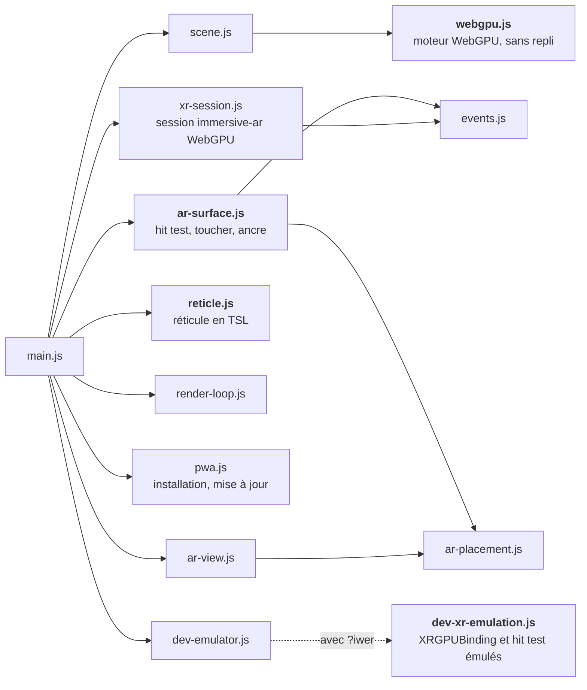
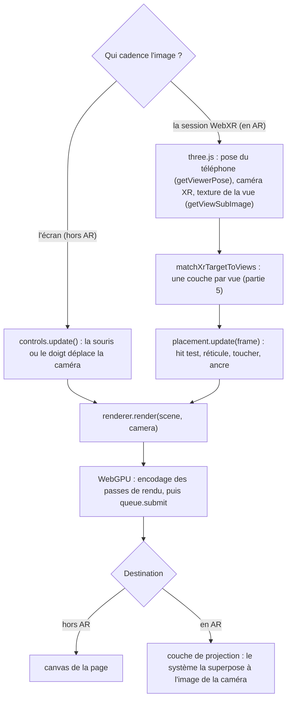
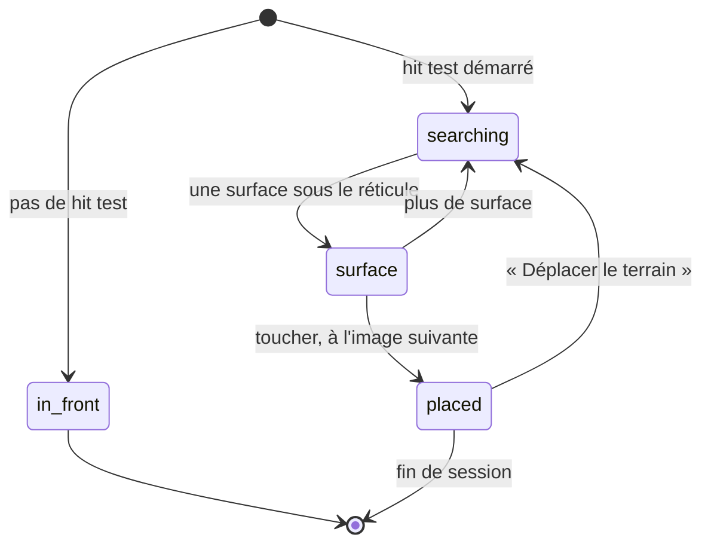
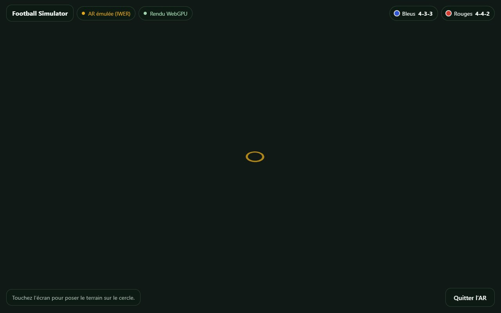
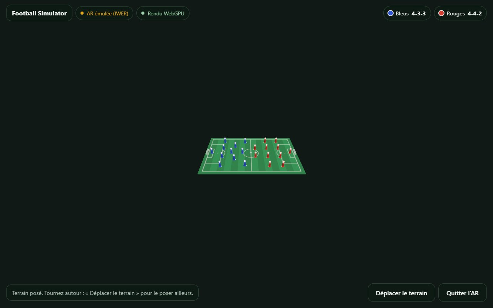

# Sprint 3 : terrain posé sur la table, rendu WebGPU et application installable

Réalisé le 14 novembre 2026 sur la branche `feature/sprint-3`. Bilel Khlif a transmis les demandes de l'enseignant : un rendu WebGPU sans repli WebGL, la PWA, l'explication de la boucle de rendu dans le README, et un nouveau sprint. Le code est généré avec Claude, à partir de ces demandes et du cahier des charges : voir [ATTRIBUTION.md](../ATTRIBUTION.md).

**Sommaire**

1. [Objectifs](#1-objectifs)
2. [Architecture](#2-architecture)
3. [Rendu WebGPU sans repli WebGL](#3-rendu-webgpu-sans-repli-webgl)
4. [WebXR et WebGPU : la liaison XRGPUBinding](#4-webxr-et-webgpu--la-liaison-xrgpubinding)
5. [Une vue ou deux : la cible de rendu XR de three.js r187](#5-une-vue-ou-deux--la-cible-de-rendu-xr-de-threejs-r187)
6. [La boucle de rendu](#6-la-boucle-de-rendu)
7. [Hit test et réticule](#7-hit-test-et-réticule)
8. [Poser le terrain : le toucher et l'ancre](#8-poser-le-terrain--le-toucher-et-lancre)
9. [États de la pose et patron Observer](#9-états-de-la-pose-et-patron-observer)
10. [Application installable (PWA)](#10-application-installable-pwa)
11. [Émulation sur PC](#11-émulation-sur-pc)
12. [Tests](#12-tests)
13. [Test sur téléphone](#13-test-sur-téléphone)
14. [Captures](#14-captures)
15. [Écarts, décisions et questions probables du jury](#15-écarts-décisions-et-questions-probables-du-jury)
16. [Mode test WebGL (?webgl), réservé aux tests](#16-mode-test-webgl-webgl-réservé-aux-tests)
17. [Pour le sprint 4](#17-pour-le-sprint-4)

---

## 1. Objectifs

| Demande | Réponse | Où |
| --- | --- | --- |
| Enseignant : implémenter WebGPU, sans repli sur WebGL | three.js r187 ; moteur de rendu construit avec le seul backend WebGPU ; message explicite si WebGPU manque ; session AR rendue en WebGPU | `src/webgpu.js`, `src/xr-session.js` |
| Enseignant : implémenter la PWA | Manifeste complet (identifiant, captures), cache de three.js r187, délai d'attente du réseau, bouton « Installer l'application », avis de nouvelle version, badge hors-ligne | `manifest.json`, `sw.js`, `src/pwa.js` |
| Enseignant : montrer le fonctionnement de la boucle dans le README | Partie « La boucle de rendu » du README, détaillée ici en partie 6 | `README.md`, `src/render-loop.js` |
| Cahier §5.3, sprint 3 : hit testing, réticule, pose du terrain par un tap | Hit test depuis le centre de l'écran, réticule animé, toucher pour poser | `src/ar-surface.js`, `src/reticle.js` |
| Cahier §4.3 : terrain stable pendant une minute | Ancre WebXR à la pose du terrain | `src/ar-surface.js` |
| Première évaluation : terrain « projeté via WebXR sur une surface réelle » | Le terrain repose sur la surface détectée, dans l'espace `local-floor` | `src/ar-placement.js` |

---

## 2. Architecture

Quatre nouveaux modules, en gras ; les autres existent depuis les sprints 1 et 2.



Graphe de scène : le réticule est en dehors de `pitchGroup`, car il se déplace avant que le terrain soit posé.

```text
scene
├── lumières
├── table               vue 3D hors AR seulement
├── reticle             anneau du hit test, en AR seulement
└── pitchGroup          posé sur la surface, puis recalé sur son ancre
    ├── pitch
    ├── team-blue
    ├── team-red
    └── ball
```

---

## 3. Rendu WebGPU sans repli WebGL

**Pourquoi WebGPU.** WebGPU est l'API graphique moderne du web : elle s'appuie sur Vulkan, Metal et Direct3D 12, prépare le travail du processeur graphique en commandes regroupées, et ses shaders s'écrivent en WGSL. three.js r187 l'exploite avec ses matériaux à nœuds et TSL (Three Shading Language).

**Ce que fait three.js.** `WebGPURenderer` combine la classe de base `Renderer` et le backend `WebGPUBackend`. Si WebGPU manque, il bascule de lui-même sur un backend WebGL 2 : il affiche alors un avertissement, et la scène tourne en WebGL.

**Ce que nous faisons.** Le repli WebGL est exclu par construction. `src/webgpu.js` crée le moteur de rendu à partir de `Renderer`, avec le seul backend WebGPU, et sans fonction de repli :

```js
export class WebGpuOnlyRenderer extends Renderer {
  constructor(parameters = {}) {
    // getFallback: null : en cas d'échec de WebGPU, init() rejette au lieu de passer en WebGL.
    super(new WebGPUBackend(parameters), { ...parameters, getFallback: null });
    this.library = new StandardNodeLibrary(); // matériaux classiques traduits en WGSL
    this.isWebGPURenderer = true;
  }
}
```

`createWebGpuRenderer()` vérifie d'abord que `navigator.gpu` existe, active WebXR, initialise le moteur, puis contrôle `renderer.backend.isWebGPUBackend`. En cas d'échec, une `WebGpuUnavailableError` porte la cause : `no-api` (pas de WebGPU), `no-adapter` (aucun processeur graphique utilisable) ou `wrong-backend` (garde-fou). `main.js` l'affiche à la place du terrain, et le badge du rendu passe à « WebGPU indisponible ».

**Ce qui n'a pas changé.** Les fichiers de la scène (`pitch.js`, `players.js`, `team.js`, `ball.js`) gardent leurs `MeshStandardMaterial`, `SpriteMaterial` et textures sur canvas : la bibliothèque `StandardNodeLibrary` les traduit en matériaux à nœuds, compilés en WGSL. Seule exception : le filtrage anisotrope se lit avec `renderer.getMaxAnisotropy()`, car `renderer.capabilities` n'existe qu'en WebGL.

**Les preuves.**

- Le badge « Rendu WebGPU » de l'interface donne le processeur graphique au survol, par exemple « nvidia ampere ».
- three.js marque le canvas `data-engine="three.js r187 webgpu"`.
- Le test de bout en bout « Rendu WebGPU, sans aucun contexte WebGL » enregistre chaque contexte demandé à un canvas : seulement `2d` (textures des lignes et des numéros) et `webgpu`.
- Le test « Sans WebGPU » retire `navigator.gpu` : la page affiche le message, et aucun contexte WebGL n'est créé.
- Sous Node.js, un test construit notre moteur de rendu et le compare au `WebGPURenderer` de three.js : le nôtre n'a pas de fonction de repli, le sien en a une ; quand WebGPU échoue, le nôtre rejette et reste en WebGPU.

**Où WebGPU est disponible.**

| Navigateur | WebGPU |
| --- | --- |
| Chrome et Edge sur ordinateur | Depuis la version 113 ; vérifié avec Chrome 157 sous Windows (processeur NVIDIA) |
| Chrome sur Android | Depuis la version 121, sur Android 12 ou plus avec un processeur graphique Qualcomm ou ARM |
| Safari sur iPhone, iPad et Mac | Depuis Safari 26 (iOS 26) |
| Firefox | Sous Windows depuis la version 141 |

Conséquence assumée : un navigateur sans WebGPU affiche un message au lieu du terrain. L'iPhone 15 testé le 12 novembre 2026 affichait la vue 3D en WebGL ; il faut iOS 26 pour la voir en WebGPU.

**Copie de three.js.** La r187 est copiée dans `src/vendor/three-r187/` : `three.webgpu.js`, `three.core.js`, `three.tsl.js` et `OrbitControls.js`. `three.module.js`, qui contient `WebGLRenderer`, n'est plus copié. Le numéro de version est dans le nom du dossier : les adresses changent à chaque mise à jour, et le cache du Service Worker ne peut pas mélanger deux versions. `three.webgpu.js` contient encore le backend WebGL de secours de three.js, mais rien ne l'instancie.

---

## 4. WebXR et WebGPU : la liaison XRGPUBinding

Jusqu'ici, WebXR ne savait afficher qu'un rendu WebGL, par une couche `XRWebGLLayer`. La spécification WebXR/WebGPU Binding ajoute :

- la fonctionnalité de session `webgpu`, à demander dans `requestSession` ;
- l'objet `XRGPUBinding`, qui relie la session au périphérique WebGPU ;
- une couche de projection (`XRProjectionLayer`), dont la session fournit, à chaque image, la texture WebGPU où dessiner chaque vue (`getViewSubImage`).

```mermaid
sequenceDiagram
  participant App as xr-session.js
  participant Nav as Navigateur (WebXR)
  participant Three as three.js r187
  App->>Nav: requestSession('immersive-ar', local-floor + webgpu ; hit-test, anchors, dom-overlay)
  Nav-->>App: XRSession
  App->>Nav: requestReferenceSpace('local-floor')
  App->>Three: renderer.xr.setSession(session)
  Three->>Nav: new XRGPUBinding(session, device WebGPU)
  Three->>Nav: createProjectionLayer({ colorFormat })
  Three->>Nav: updateRenderState({ layers: [couche] })
  loop chaque image de la session
    Three->>Nav: getViewSubImage(couche, vue) : texture WebGPU de la vue
    Three->>Three: rendu de la scène dans cette texture
  end
```

**État dans les navigateurs, vérifié le 14 novembre 2026.**

- Sur [Chrome Platform Status](https://chromestatus.com/feature/5077077997649920), la fiche « WebXR/WebGPU integration » a été mise à jour le 26 octobre 2026 par son responsable chez Google. Elle ne donne aucune version de livraison et désigne le réglage `webxr-webgpu-binding`.
- Dans le code de Chromium (`chrome/browser/about_flags.cc`), ce réglage s'appelle « WebXR/WebGPU Binding » et n'est proposé que sous Windows et Android.
- Sur Android, le périphérique ARCore de Chrome accepte les sessions `webgpu` quand le réglage est activé. Le code est en place depuis le 17 octobre 2024, avec le commit « WebGPU support for ARCore WebXR » (`device/vr/android/arcore/arcore_device.cc`).
- Safari l'a livrée sur visionOS (Safari 26.2).
- three.js r187 l'utilise dès que `XRGPUBinding` existe et que la session a la fonctionnalité `webgpu`. Ses propres exemples se replient sur WebGL sinon.

**Notre choix : pas de repli WebGL en AR non plus.** La session exige `webgpu` (`requiredFeatures: ['local-floor', 'webgpu']`). Si `XRGPUBinding` manque, le badge affiche « AR : réglage WebGPU à activer ». Un message donne le réglage à activer, et un bouton copie son adresse, car une page web ne peut pas ouvrir `chrome://flags` elle-même. Aucune session n'est alors demandée. La vue 3D, elle, fonctionne en WebGPU sans aucun réglage.

**Pour l'activer sur un téléphone Android** : dans Chrome, ouvrir `chrome://flags/#webxr-webgpu-binding`, choisir « Enabled », puis relancer Chrome. La description du réglage rappelle que les couches de projection WebXR doivent aussi être actives ; Chromium les active par défaut (`kWebXRLayers`), et Chrome Platform Status les donne livrées depuis Chrome 147.

**Adaptateur compatible XR.** `XRGPUBinding` exige un périphérique WebGPU créé à partir d'un adaptateur « compatible XR ». three.js le demande (`requestAdapter({ xrCompatible: true })`) si `renderer.xr.enabled` est vrai au moment de `init()` : c'est pourquoi `createWebGpuRenderer` active WebXR avant d'initialiser le moteur.

---

## 5. Une vue ou deux : la cible de rendu XR de three.js r187

En session WebGPU, three.js r187 crée sa cible de rendu XR avec **deux couches de texture, une par œil**, comme pour un casque (`depth: 2` dans `_initWebGPUSession`). Puis sa passe de sortie, qui convertit les couleurs, dessine dans chaque couche. Un téléphone n'a qu'une vue, et sa texture n'a qu'une couche. WebGPU rejette alors la commande à chaque image :

```text
Texture view array layer range (baseArrayLayer: 1, arrayLayerCount: 1) exceeds the texture's array layer count (1).
```

Le défaut est apparu avec l'émulateur en vue unique : le premier essai a produit 877 erreurs en deux secondes de session. La trace d'appel menait à `_renderOutputLayers`, qui parcourt `renderTarget.texture.image.depth` couches.

**Correctif, par l'API publique de three.js.** three.js désigne sa cible XR comme cible de sortie (`setOutputRenderTarget`), puis appelle notre boucle de rendu. À ce moment, `matchXrTargetToViews` (dans `src/render-loop.js`) compare le nombre de couches au nombre de vues (`renderer.xr.getCamera().cameras.length`). S'ils diffèrent, il redimensionne la cible avec `RenderTarget.setSize(largeur, hauteur, vues)`. Pour un casque à deux vues, rien ne change. Après le correctif : zéro erreur WebGPU pendant toute la session émulée.

Ce correctif repose sur un comportement de three.js r187. À chaque mise à jour de three.js, relancer `npm test` : le test unitaire « téléphone (une vue) » et le contrôle « aucune erreur dans la console » du parcours AR le surveillent.

---

## 6. La boucle de rendu

La boucle de rendu est la fonction que three.js appelle à chaque image. Elle est créée par `createRenderLoop` dans `src/render-loop.js` et confiée à `renderer.setAnimationLoop` dans `main.js`. Deux horloges la cadencent :

- **hors AR**, l'écran : three.js utilise `window.requestAnimationFrame`, environ 60 fois par seconde ;
- **en AR**, la session WebXR : pendant `setSession`, three.js arrête sa propre horloge et s'abonne à `XRSession.requestAnimationFrame`. Chaque appel reçoit alors un `XRFrame`, la photographie de l'instant : pose du téléphone, résultats du hit test et ancres. Il n'est valable que pendant cet appel.



Le code complet de la boucle :

```js
export function createRenderLoop({ renderer, scene, camera, controls, getArPlacement }) {
  return (time, frame) => {
    if (renderer.xr.isPresenting) {
      matchXrTargetToViews(renderer);
      // XRFrame : n'est valable que pendant cet appel (pose du téléphone, hit test, ancres).
      const placement = getArPlacement();
      if (frame && placement) {
        placement.update(frame);
      }
    } else {
      controls.update();
    }
    renderer.render(scene, camera);
  };
}
```

Trois règles en découlent :

1. **Rien de WebXR hors de la boucle.** `getViewerPose`, `getHitTestResults`, `getPose` et `createAnchor` exigent un `XRFrame` actif. C'est pourquoi un toucher ne pose pas le terrain tout de suite : il le demande, et la pose se fait à l'image suivante (partie 8).
2. **Les contrôles d'orbite se taisent en AR.** Sinon, ils écraseraient à chaque image la pose de la caméra que three.js vient de lire. Un test le vérifie : zéro appel à `controls.update()` en AR.
3. **Une seule boucle pour les deux modes.** `setAnimationLoop` bascule tout seul d'une horloge à l'autre à l'entrée et à la sortie de la session.

Ce que fait `renderer.render` en WebGPU : three.js trie les objets visibles et prépare un pipeline WGSL par matériau (compilé une seule fois, puis mis en cache). Il encode une passe de rendu dans un `GPUCommandEncoder`, puis une passe de sortie pour la conversion des couleurs, et soumet le tout à la file du processeur graphique (`device.queue.submit`). Le navigateur affiche le résultat au rafraîchissement suivant.

---

## 7. Hit test et réticule

Le **hit test** répond à la question « où ce rayon rencontre-t-il une surface réelle ? ». Sur Android, c'est ARCore qui détecte les surfaces planes à partir de l'image de la caméra.

1. Au début de la session, `SurfacePlacement.start()` demande l'espace `viewer`, centré sur le téléphone et orienté comme lui. Il crée ensuite une source de hit test depuis cet espace : `session.requestHitTestSource({ space: viewerSpace })`. Le rayon part donc du centre de l'écran, dans la direction du regard.
2. À chaque image, `frame.getHitTestResults(source)` renvoie les surfaces touchées, de la plus proche à la plus lointaine. On garde la première et on lit sa pose dans `local-floor` (`result.getPose(referenceSpace)`).
3. Le réticule (`src/reticle.js`) prend cette pose : sa matrice est copiée directement depuis la matrice 4 × 4 de la pose (`matrixAutoUpdate = false`). L'axe Y de la pose est la normale de la surface ; l'anneau, couché dans le plan XZ, se pose donc à plat sur la table.

**Le réticule en TSL.** Son matériau est écrit en nœuds TSL, que three.js traduit en WGSL :

```js
const material = new MeshBasicNodeMaterial({ transparent: true, depthWrite: false, side: DoubleSide });
material.colorNode = color(RETICLE_COLOR);
// oscSine(t) varie de 0 à 1 : opacité entre 0,55 et 1.
material.opacityNode = oscSine(time.mul(PULSE_FREQUENCY)).mul(0.45).add(0.55);
```

La pulsation est calculée par le processeur graphique, à partir du nœud `time`. Aucune ligne de JavaScript ne s'exécute à chaque image pour l'animer.

---

## 8. Poser le terrain : le toucher et l'ancre

**Le toucher.** Sur un téléphone, toucher l'écran pendant une session AR produit l'événement `select` de la session. `main.js` l'écoute et appelle `placement.requestPlacement()`. La demande n'est prise en compte que si une surface est visée (état `surface`) : un toucher dans le vide ne pose rien.

**La pose, à l'image suivante.** Dans `update(frame)`, si un toucher est en attente et qu'une surface est toujours visée :

1. `computeSurfacePlacement(point visé, position du téléphone)` (dans `src/ar-placement.js`) calcule la pose :
   - le centre du terrain est sur le point visé, 8 mm plus haut : le plateau, épais de 8 mm, repose sur la table au lieu de s'y enfoncer ;
   - la rotation autour de la verticale présente la longueur du terrain à l'utilisateur, comme la vue « télévision » hors AR. Les Bleus attaquent vers sa droite.
2. `arView.placeAt(placement)` rend le terrain visible à cette pose et masque le réticule.
3. Une **ancre** est créée exactement à cette pose : `frame.createAnchor(new XRRigidTransform(position, quaternion), referenceSpace)`. Elle est demandée pendant l'image active, comme l'exige la spécification.

**L'ancre.** Le système de suivi corrige sans cesse sa connaissance de la pièce. Un objet placé à des coordonnées fixes peut alors sembler glisser, alors qu'une ancre est recalée avec la pièce. À chaque image, si `frame.trackedAnchors` contient l'ancre, `frame.getPose(anchor.anchorSpace, referenceSpace)` donne sa pose à jour, et `arView.followAnchor` y replace le terrain. Si le suivi perd l'ancre un instant, le terrain garde sa dernière pose. C'est la réponse au critère « terrain stable pendant une minute » (cahier §4.3), à mesurer sur téléphone.

**Déplacer le terrain.** Le bouton « Déplacer le terrain » supprime l'ancre, masque le terrain et relance la visée. Une ancre peut arriver après ce déplacement : sa création est asynchrone. Un compteur de générations la reconnaît alors comme périmée, et elle est supprimée aussitôt.

**Les boutons ne posent pas le terrain.** Avec le DOM Overlay, toucher un bouton HTML produit aussi un `select` WebXR. `main.js` annule ce `select` (`preventDefault()` sur l'événement `beforexrselect`) quand la cible est un bouton.

**Les secours.** Le hit test et les ancres sont demandés en fonctionnalités facultatives :

- sans hit test (fonctionnalité non accordée, ou source refusée), le terrain est placé devant l'utilisateur, comme au sprint 2 (état `in-front`) ;
- sans ancres, le terrain posé reste à sa pose dans `local-floor`.

---

## 9. États de la pose et patron Observer

`SurfacePlacement` (`src/ar-surface.js`) est une petite machine à états. Elle hérite d'`EventEmitter` et signale chaque changement par l'événement `statechange` : c'est le patron Observer du sprint 2, réutilisé.



`main.js` s'abonne à `statechange` et met à jour l'aide affichée et le bouton « Déplacer le terrain » :

| État | Aide affichée | Bouton « Déplacer le terrain » |
| --- | --- | --- |
| `searching` | « Visez la table : un cercle doré apparaît sur la surface détectée. » | masqué |
| `surface` | « Touchez l'écran pour poser le terrain sur le cercle. » | masqué |
| `placed` | « Terrain posé. Tournez autour ; « Déplacer le terrain » pour le poser ailleurs. » | visible |
| `in-front` | « Détection des surfaces indisponible : terrain placé devant vous. » | masqué |

---

## 10. Application installable (PWA)

Ce qui existait depuis le sprint 1 : le manifeste, le Service Worker, le lancement hors-ligne. Ce que le sprint 3 ajoute :

| Élément | Avant | Sprint 3 |
| --- | --- | --- |
| `manifest.json` | Nom, icônes, affichage `standalone` | Identifiant stable (`id`), description, deux captures (`wide` et `narrow`), que Chrome montre dans sa fenêtre d'installation |
| `sw.js` | 28 fichiers en cache, version 1 | 32 fichiers : three.js r187 et les 3 nouveaux modules ; version 2, qui efface le cache de la r186 |
| `sw.js` | Réseau d'abord, sans délai | Délai de 3 secondes, puis cache (correctif du 12 novembre, [sprint-2.md](sprint-2.md#12-test-sur-android)) |
| Bouton « Installer l'application » | Absent | Affiché quand le navigateur propose l'installation (`beforeinstallprompt`) ; masqué une fois installée |
| Nouvelle version | Prise en compte au chargement suivant, sans le dire | Avis « Nouvelle version installée » avec un bouton « Recharger » (événement `controllerchange`) |
| Hors-ligne | Fonctionnait, sans le dire | Badge « Hors-ligne » (événements `online` et `offline`) |

**Le démarrage reste installable sans WebGPU.** `setUpPwa()` s'exécute avant la création du moteur de rendu. Même sur un navigateur sans WebGPU, le Service Worker met l'application en cache, et le bouton d'installation fonctionne.

**Installer l'application.**

- **Android** (Chrome) : bouton « Installer l'application », ou menu ⋮ → « Installer l'application ».
- **Ordinateur** (Chrome ou Edge) : bouton de l'application, ou icône d'installation dans la barre d'adresse.
- **iPhone** (Safari) : Partager → « Sur l'écran d'accueil ». Safari ne propose pas d'invite d'installation, et le bouton n'apparaît donc pas.

---

## 11. Émulation sur PC

IWER 2.7.0 émule une session `immersive-ar`, mais ni `XRGPUBinding`, ni le hit test sans son module d'environnement synthétique (`@iwer/sem`, environ 10 Mo). `src/dev-xr-emulation.js` ajoute ce qui manque. Il n'est chargé qu'avec `?iwer`, et le Service Worker ne le met pas en cache.

1. **`XRGPUBinding` émulé.** La couche de projection est le canvas WebGPU de l'application : `getViewSubImage` renvoie la texture courante du canvas, et three.js y dessine directement.
2. **Une horloge d'images.** IWER ne cadence les images d'une session que si elle a une couche de base WebGL. Une couche vide, sur un canvas caché de 1 pixel, lui sert d'horloge : rien n'y est dessiné. Elle n'existe qu'avec `?iwer` ; sur un téléphone, aucune couche WebGL n'est créée.
3. **Une table virtuelle.** C'est un plan horizontal de 1,6 × 1 m, à 72 cm du sol, centré 90 cm devant la position de départ. `requestHitTestSource` et `getHitTestResults` calculent où le regard du téléphone émulé la rencontre.
4. **Le toucher.** Un clic sur la scène, hors des boutons, appuie brièvement sur la gâchette de la manette droite d'IWER, qui produit l'événement `select` de WebXR.
5. **La pose de départ.** Le téléphone émulé est tenu à 1,35 m du sol, incliné de 35° vers la table. Son regard touche la table en son centre.
6. **Une seule vue.** IWER 2.7.0 rend toujours les deux yeux d'un casque ; l'émulation ne garde que la première vue, comme sur un téléphone.

L'émulateur doit être installé **avant** la création du moteur de rendu. three.js r187 vérifie la présence de `XRGPUBinding` une seule fois, à sa création ; le premier essai, émulateur installé après, échouait avec « Cannot read properties of null (reading 'createProjectionLayer') ». `main.js` installe donc l'émulateur, puis crée la scène, puis lui donne le canvas (`setCanvas`).

**Utilisation** : ouvrir `http://127.0.0.1:8080/?iwer` puis « Entrer en AR ». Le réticule apparaît sur la table virtuelle ; un clic pose le terrain. Avec `&debug`, la console donne accès à `window.__footballSimulator.xrDevice`, pour orienter le téléphone émulé (`xrDevice.quaternion.set(...)`).

---

## 12. Tests

`npm test` : **67 tests unitaires** (contre 28 au sprint 2), puis **26 vérifications de bout en bout** (contre 19).

**Tests unitaires** (`npm run test:unit`, sans navigateur) :

| Fichier | Tests | Ce qu'ils vérifient |
| --- | --- | --- |
| `webgpu.test.mjs` | 7 | Pas de fonction de repli, contrairement au `WebGPURenderer` de three.js ; sans WebGPU, `init()` rejette et le moteur reste en WebGPU ; cause `no-api` ; garde-fou du backend ; description du processeur graphique |
| `ar-surface.test.mjs` | 12 | Hit test depuis `viewer`, réticule, toucher sans surface ignoré, pose à l'image suivante, ancre à la pose exacte du terrain, suivi de l'ancre, déplacement, ancre périmée supprimée, ancres refusées, surface perdue, secours sans hit test, fin de session |
| `ar-placement.test.mjs` | 9 | Sprint 2, plus : terrain centré sur le point visé et 8 mm au-dessus, rotation face à l'utilisateur, quaternion de l'ancre |
| `ar-view.test.mjs` | 8 | Réticule, pose, suivi de l'ancre, retrait du terrain, restauration de la vue 3D, avec de vrais objets three.js r187 |
| `render-loop.test.mjs` | 5 | Contrôles d'orbite, pose du terrain à chaque image, cible XR alignée sur une vue (téléphone), rien à faire pour deux vues (casque) |
| `xr-session.test.mjs` | 14 | Sprint 2, plus : fonctionnalités `webgpu`, `hit-test` et `anchors` demandées, échec `webgpu-binding` sans session, `XRGPUBinding` lu à l'entrée en AR, couche de projection, espace de référence retiré à la sortie |
| `pwa.test.mjs` | 5 | Bouton d'installation, application déjà installée, `appinstalled`, avis de nouvelle version (aucun à la première visite, un seul ensuite), badge hors-ligne |
| `dev-xr-emulation.test.mjs` | 4 | Rotation par quaternion, table virtuelle touchée depuis la pose de départ, regard horizontal, rayon à côté |
| `events.test.mjs` | 3 | Inchangé (sprint 2) |

Les tests unitaires chargent three.js comme le navigateur : `tests/unit/import-map.mjs` relit la carte d'import de `index.html` et l'applique à Node.js.

**Tests de bout en bout** (`npm run test:e2e`, dans Chrome) :

| Vérification | Résultat le 14 novembre 2026 |
| --- | --- |
| Chargement sans erreur : bureau, mobile, sous-chemin | Réussi |
| Formations | Réussi |
| Rendu WebGPU, sans aucun contexte WebGL | Réussi : `three.js r187 webgpu`, contextes `2d` et `webgpu`, badge « nvidia ampere » |
| Sans WebGPU : message explicite, aucun repli WebGL | Réussi : message affiché, aucun contexte créé |
| Manifeste : application installable | Réussi : 3 icônes, 2 captures |
| Badge de l'AR, Service Worker, hors-ligne (racine et sous-chemin) | Réussi |
| Lancement sur réseau très lent | Réussi : page prête en 3,5 s, serveur retardé de 30 s |
| Émulateur IWER : `local-floor`, `webgpu`, `hit-test`, `anchors` | Réussi |
| Parcours AR : entrée, session rendue en WebGPU, une couche de projection | Réussi |
| Parcours AR : réticule sur la table détectée | Réussi : réticule en (0 ; 0,72 ; −0,9) |
| Parcours AR : toucher, terrain posé puis ancré | Réussi : terrain en (0 ; 0,728 ; −0,9), 4 coins sur 4 à l'écran |
| Parcours AR : contrôles d'orbite en pause | Réussi : 0 mise à jour pour 147 images |
| Parcours AR : « Déplacer le terrain », nouvelle pose face à l'utilisateur | Réussi : regard tourné de 25°, terrain tourné de 25° |
| Parcours AR : regard hors de la table, toucher sans effet | Réussi |
| Parcours AR : sortie par le bouton, puis par le système | Réussi : vue 3D identique au départ |
| Parcours AR : sans `XRGPUBinding`, réglage indiqué, aucune session | Réussi |
| Parcours AR : caméra refusée | Réussi |
| Parcours AR : aucune erreur dans la console, WebGPU compris | Réussi |

**Les tests détectent-ils vraiment les erreurs ?** Trois défauts ont été introduits volontairement, un à la fois, puis retirés :

| Défaut introduit | Tests unitaires | Tests de bout en bout |
| --- | --- | --- |
| Retour au `WebGPURenderer` de three.js, avec son repli WebGL, sans nos vérifications | 1 échec : « sans navigator.gpu : erreur no-api » | 2 échecs : « Rendu WebGPU, sans aucun contexte WebGL » (une fonction de repli existe) et « Sans WebGPU » (la page bascule en WebGL au lieu d'afficher le message) |
| Plus d'alignement de la cible XR sur le nombre de vues | 1 échec : « téléphone (une vue) » | 1 échec : « aucune erreur dans la console », avec l'erreur de validation WebGPU de la partie 5 |
| Le terrain posé n'est jamais ancré | 6 échecs, dans `ar-surface.test.mjs` | Non lancé : les tests unitaires suffisent à le détecter |

Après chaque essai, le fichier a été restauré, et `npm test` est de nouveau entièrement réussi.

**Prérequis nouveau.** Les tests de bout en bout demandent un processeur graphique compatible WebGPU. Le rendu logiciel SwiftShader, utilisé aux sprints 1 et 2, ne fournit pas d'adaptateur WebGPU : avec lui, l'application affiche « aucun processeur graphique compatible ». C'est le comportement voulu, sans repli WebGL.

---

## 13. Test sur téléphone

**À faire par l'équipe**, après la fusion dans `main` (GitHub Pages), ou avant, par redirection de port USB (voir [sprint-2.md](sprint-2.md#12-test-sur-android)).

**Préparer le téléphone Android :**

1. Mettre à jour Chrome et les Services Google Play pour la RA.
2. Ouvrir `chrome://flags/#webxr-webgpu-binding` dans Chrome, choisir « Enabled », puis « Relaunch ».
3. Ouvrir l'application deux fois avec le réseau, pour installer la nouvelle version du Service Worker. L'avis « Nouvelle version installée » peut aussi apparaître : toucher « Recharger ».

**Protocole :**

| Étape | Résultat attendu |
| --- | --- |
| Ouvrir l'application, réglage désactivé | Badge « Rendu WebGPU » ; badge « AR : réglage WebGPU à activer », message et bouton « Copier l'adresse du réglage » |
| Ouvrir l'application, réglage activé | Badges « Rendu WebGPU » et « AR disponible (WebGPU) », bouton « Entrer en AR » |
| Entrer en AR, viser une table | Image de la caméra ; cercle doré sur la table ; aide « Touchez l'écran… » |
| Toucher l'écran | Terrain posé sur la table, à l'endroit du cercle, sa longueur face à soi ; bouton « Déplacer le terrain » |
| Tourner autour de la table pendant une minute | Le terrain reste à sa place (cahier §4.3) |
| « Déplacer le terrain », viser ailleurs, toucher | Terrain posé au nouvel endroit |
| Toucher un bouton de l'interface | Le bouton agit ; le terrain ne bouge pas |
| « Quitter l'AR », puis bouton retour pendant une autre session | Retour à la vue 3D, cadrée |
| iPhone avec iOS 26 | Vue 3D en WebGPU, sans AR |
| iPhone avec une version plus ancienne | Message « Football Simulator a besoin de WebGPU… » |
| Menu ⋮ → « Installer l'application » | Icône sur l'écran d'accueil ; lancement sans barre d'adresse |

**Résultats du 14 novembre 2026**, sur le site publié, rapportés par Bilel Khlif :

| Appareil | Navigateur | Résultat |
| --- | --- | --- |
| PC ASUS TUF A15 | Chrome, réglage « WebXR/WebGPU Binding » activé | Vue 3D en WebGPU, bouton « Installer l'application » ; « AR indisponible », normal sur un PC |
| Samsung Galaxy S10e (SM-G970F), Android 9 | Brave | Message « WebGPU est présent, mais aucun processeur graphique compatible n'a été trouvé sur cet appareil » |
| Samsung Galaxy S10e, Android 9 | Chrome 138.0.7204.179 | Même message. Le rapport `chrome://gpu` l'explique : Vulkan désactivé, seul le backend OpenGL ES de WebGPU (mode compatibilité) existe, et Chrome le bloque (« Blocklisted : Limited support / testing currently available on Android \| OpenGLES not fully supported on Android ») |
| Samsung Galaxy S10e, Android 9 | Chrome 138, avec le réglage `#enable-unsafe-webgpu` | Rendu dégradé : gazon, lignes et numéros absents, panneaux HTML remplacés par des rectangles blancs ou noirs. C'est la raison du blocage de Chrome |
| Samsung Galaxy S10e | Mise à jour d'Android | Le téléphone ne propose aucune mise à jour |
| iPhone, iOS 18 | Safari | Pas d'AR, comme prévu : Safari sur iPhone ne propose pas de session WebXR `immersive-ar` |
| TECNO POVA 6 Pro | | Pas disponible le 14 novembre ; à tester |

Conséquence : sans repli WebGL, le Galaxy S10e ne peut pas afficher l'application. C'était le seul téléphone disponible ce jour-là ; le mode test WebGL de la partie 16 a été ajouté pour pouvoir tester l'AR dessus.

---

## 14. Captures

Prises par script dans Chrome, avec l'émulateur IWER. Sur un téléphone, l'image de la caméra remplace le fond sombre.

| | |
| --- | --- |
|  |  |
| Visée : le réticule sur la surface détectée | Toucher : le terrain posé et ancré |

---

## 15. Écarts, décisions et questions probables du jury

**Écarts et décisions**

- **WebGPU partout, sans repli WebGL**, à la demande de l'enseignant. Conséquence : l'AR demande aujourd'hui un réglage de Chrome (partie 4), et un navigateur sans WebGPU affiche un message au lieu du terrain.
- **three.js r187** remplace la r186 : c'est la version qui relie WebXR à WebGPU (`XRGPUBinding`).
- **Correctif de la cible XR de three.js** (partie 5), plutôt qu'une modification de la bibliothèque copiée : la copie reste identique au paquet npm (empreintes dans `src/vendor/three-r187/README.md`).
- **Ancre créée à la pose du terrain** (`frame.createAnchor`), plutôt que depuis le résultat du hit test (`hitTestResult.createAnchor`) : l'ancre porte ainsi aussi l'orientation choisie pour le terrain.
- **Pose à l'image suivante** : `createAnchor` exige une image active ; le toucher arrive entre deux images.
- **Hit test émulé par une table virtuelle**, plutôt qu'avec `@iwer/sem` : 150 lignes de code testées, contre environ 10 Mo et une seconde copie de three.js.
- **`package.json`** : version 0.3.0 ; les tests unitaires chargent la carte d'import (`node --import ./tests/unit/import-map.mjs --test`).

**Questions probables du jury**

**Où est WebGPU dans votre code ?**
Dans `src/webgpu.js` : notre moteur de rendu est la classe `Renderer` de three.js avec le seul backend `WebGPUBackend`. Les matériaux sont traduits en WGSL, et le réticule est écrit en TSL. Le badge « Rendu WebGPU » et l'attribut `data-engine` du canvas le montrent ; un test vérifie qu'aucun contexte WebGL n'est créé.

**Que se passe-t-il sans WebGPU ?**
Un message remplace le terrain, et le badge passe à « WebGPU indisponible ». Il n'y a aucun repli : `getFallback: null`. Les tests retirent `navigator.gpu` pour le vérifier.

**Pourquoi l'AR demande-t-elle un réglage de Chrome ?**
Parce que la liaison WebXR/WebGPU n'est pas encore livrée dans Chrome. La fiche Chrome Platform Status mise à jour le 26 octobre 2026 n'a pas de version de livraison. Le périphérique ARCore de Chrome la prend déjà en charge derrière le réglage `webxr-webgpu-binding`. Sans repli WebGL, c'est la seule façon d'afficher du WebGPU en AR aujourd'hui.

**Comment le terrain trouve-t-il la table ?**
Par le hit test WebXR : un rayon part du centre de l'écran, et ARCore renvoie le point où il rencontre une surface détectée. Le réticule s'y affiche, et un toucher y pose le terrain.

**Pourquoi le terrain ne dérive-t-il pas ?**
Il est ancré : une ancre WebXR est créée à sa pose, et le système de suivi la recale quand sa connaissance de la pièce s'améliore. À chaque image, le terrain reprend la pose de l'ancre.

**Comment fonctionne la boucle de rendu ?**
Une seule fonction, confiée à `setAnimationLoop`. Hors AR, l'écran la cadence et les contrôles d'orbite déplacent la caméra. En AR, la session WebXR la cadence avec un `XRFrame` : three.js lit la pose du téléphone, puis notre code met à jour le hit test, le réticule et l'ancre. Dans les deux cas, `renderer.render` encode les commandes WebGPU et les soumet au processeur graphique. Le détail est dans la partie 6.

**Comment testez-vous le hit test sans téléphone ?**
L'émulateur IWER, complété par `dev-xr-emulation.js`, simule une table virtuelle, et un clic sur la scène simule le toucher. Les tests de bout en bout posent le terrain, le déplacent et vérifient sa position au millimètre. La détection de vraies surfaces par ARCore se vérifie, elle, sur téléphone.

**Qu'apporte la PWA de plus qu'au sprint 1 ?**
Un manifeste avec identifiant et captures, un bouton d'installation et un avis de nouvelle version. Elle ajoute aussi un badge hors-ligne, un cache qui ne mélange jamais deux versions de three.js, et un délai qui garde l'application utilisable sur un réseau lent.

---

## 16. Mode test WebGL (?webgl), réservé aux tests

Ajouté le 14 novembre 2026, après la fusion du sprint 3, à la demande de Bilel Khlif : son seul téléphone disponible, un Galaxy S10e sous Android 9, ne peut pas faire tourner WebGPU (partie 13).

**Ce que c'est.** Avec `?webgl` dans l'adresse, par exemple `https://bilelkhlif.github.io/footballsimulator/?webgl`, la même scène tourne sur le backend WebGL 2 de three.js : `WebGPURenderer` avec l'option `forceWebGL`, sans fonction de repli lui non plus (`src/webgl-test-mode.js`). Le badge du rendu affiche « Rendu WebGL (mode test) », en doré, pour qu'on ne le confonde pas avec le badge vert « Rendu WebGPU ». En AR, la session est rendue par une couche `XRWebGLLayer` : elle n'exige ni la fonctionnalité `webgpu` ni `XRGPUBinding`, donc ni le réglage de Chrome. Le hit test, le réticule (TSL, traduit cette fois en GLSL), le toucher et l'ancre sont les mêmes.

**Ce que ce n'est pas : un repli.**

- L'application ne passe jamais en WebGL d'elle-même. Sans `?webgl`, le rendu est WebGPU, et sans WebGPU l'application s'arrête avec un message.
- L'écran d'erreur ne propose pas WebGL, et aucun bouton de l'application ne mène au mode test : il s'utilise comme `?iwer` (émulateur) et `?debug`, des outils de test.
- WebGPU reste le rendu de l'application, celui que mesurent les tests par défaut.

**Les preuves, dans les tests.**

- « Rendu WebGPU, sans aucun contexte WebGL » : sans paramètre, seuls des contextes `2d` et `webgpu` sont créés.
- « Sans WebGPU : message explicite, aucun repli WebGL » vérifie aussi que l'écran d'erreur ne contient ni lien ni bouton vers WebGL.
- « Mode test WebGL, seulement avec ?webgl » : badge « Rendu WebGL (mode test) », backend WebGL 2, aucune fonction de repli.
- Tests unitaires : le mode par défaut est WebGPU, seul le paramètre exact `webgl` active le mode test, et une session AR WebGPU sans `XRGPUBinding` échoue au lieu de passer sur une couche WebGL.
- Le parcours AR complet est rejoué en mode test avec l'émulateur : entrée sur une couche WebGL, réticule, pose et ancre du terrain, déplacement, sorties.

**Émulation.** IWER dessine une couche WebGL dans le framebuffer par défaut du canvas : `XRWebGLLayer.framebuffer` y vaut `null`. Un vrai navigateur fournit un framebuffer opaque non nul, et le backend WebGL de three.js r187 l'exige, car il s'en sert de clé dans une `WeakMap`. Le premier essai échouait donc à chaque image (« Invalid value used as weak map key »), et la sortie de l'AR ne se faisait plus. `src/dev-xr-emulation.js` donne à chaque couche WebGL un vrai framebuffer, recopié dans le canvas à la fin de chaque image (`blitFramebuffer`). Ce problème ne concerne que l'émulateur : sur un téléphone, Chrome fournit son propre framebuffer.

**Tests.** `npm test` : 73 tests unitaires et 37 vérifications de bout en bout, tous réussis le 14 novembre 2026. La pose du terrain en mode test a été vérifiée à l'image : le terrain s'affiche, rendu par WebGL, avec le badge doré.

**Sur le Galaxy S10e** : ouvrir `https://bilelkhlif.github.io/footballsimulator/?webgl` dans Chrome, une fois ce mode fusionné dans `main`, puis « Entrer en AR » ; ARCore doit être installé. Résultat à consigner ici.

---

## 17. Pour le sprint 4

- Boutons HTML pour changer la formation de chaque équipe (patron Strategy déjà en place) : un clic remplace les positions des 11 joueurs, avec une transition.
- Le Observer de `SurfacePlacement` permet d'afficher ces boutons seulement une fois le terrain posé (état `placed`).
- Mesurer sur téléphone la fluidité en WebGPU (objectif de 30 images par seconde, cahier §2.3) et la stabilité de l'ancre pendant une minute.
- Suivre la livraison de la liaison WebXR/WebGPU dans Chrome stable : quand elle sera livrée, le réglage ne sera plus nécessaire, sans changement de code.
