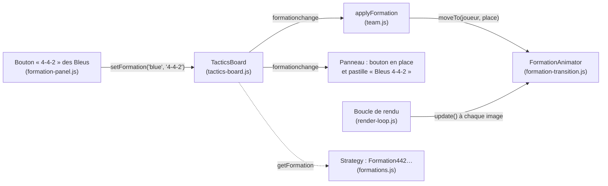
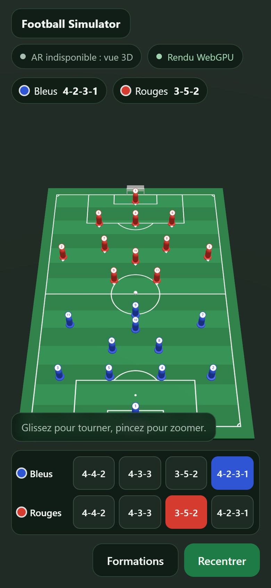
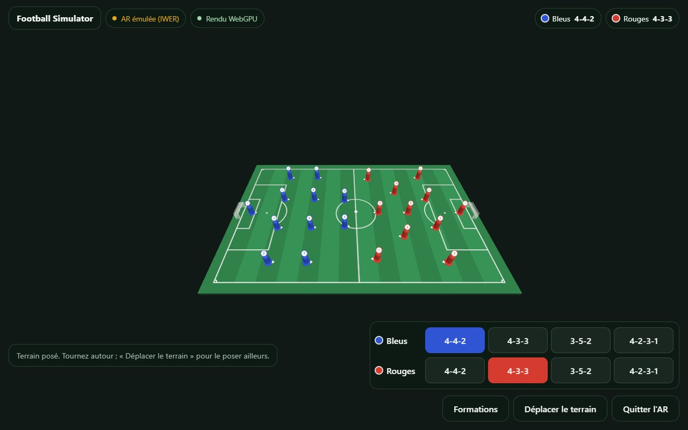

# Sprint 4 : système de formations et boutons HTML

Réalisé le 14 novembre 2026 sur la branche `feature/sprint-4`, à la demande de Bilel Khlif. Le code est généré avec Claude, à partir du cahier des charges : voir [ATTRIBUTION.md](../ATTRIBUTION.md).

**Sommaire**

1. [Objectifs](#1-objectifs)
2. [Architecture](#2-architecture)
3. [Les formations : patron Strategy](#3-les-formations--patron-strategy)
4. [Le tableau tactique : patron Observer](#4-le-tableau-tactique--patron-observer)
5. [Les joueurs rejoignent leurs places](#5-les-joueurs-rejoignent-leurs-places)
6. [Les boutons de formation](#6-les-boutons-de-formation)
7. [Deux équipes et le ballon](#7-deux-équipes-et-le-ballon)
8. [Tests](#8-tests)
9. [Captures](#9-captures)
10. [Écarts, décisions et questions probables du jury](#10-écarts-décisions-et-questions-probables-du-jury)
11. [Pour le sprint 5](#11-pour-le-sprint-5)

---

## 1. Objectifs

| Exigence du cahier | Réponse | Où |
| --- | --- | --- |
| §5.3, sprint 4 : système de formations (Strategy), deux équipes, ballon, boutons HTML | Formations choisies par des boutons ; chaque équipe a sa formation | `src/formation-panel.js`, `src/tactics-board.js` |
| BF4 : choisir une formation (4-4-2, 4-3-3, 3-5-2) pour chaque équipe | Les trois, plus le 4-2-3-1, pour les Bleus et pour les Rouges | `src/formations.js` |
| §4.1, étape 5 : « il choisit 4-3-3 pour l'équipe bleue et 4-4-2 pour l'équipe rouge : les joueurs se placent automatiquement » | Un clic, et les 11 joueurs rejoignent leurs places, en 0,7 s | `src/formation-transition.js`, `src/team.js` |
| §4.3 : « la formation choisie s'applique correctement : 11 joueurs bien placés » | Vérifié pour chaque formation et chaque équipe, au millimètre | tests |
| §3.4 : Strategy (« ajouter une formation revient à ajouter une classe ») | Le 4-2-3-1 a été ajouté ainsi ; son bouton est apparu sans toucher à l'interface | `src/formations.js` |
| §3.4 : Observer (« l'interface HTML s'abonne aux événements de la scène ») | Le tableau tactique émet `formationchange` ; la scène et le panneau s'y abonnent | `src/tactics-board.js` |
| §2.3 : gros boutons utilisables d'une seule main | Boutons de 48 px de haut, une ligne par équipe, même sur un écran de 360 px | `src/styles.css` |

Le sprint commence aussi par consigner le test du Galaxy S10e en mode test WebGL : Bilel Khlif rapporte que tout fonctionne, AR comprise. Voir [sprint-3.md](sprint-3.md#16-mode-test-webgl-webgl-réservé-aux-tests).

---

## 2. Architecture



Trois nouveaux modules :

| Fichier | Rôle | Patron |
| --- | --- | --- |
| `src/tactics-board.js` | Formation en place de chaque équipe ; émet `formationchange` | Observer (sujet) |
| `src/formation-transition.js` | Places cibles d'une formation, et déplacement des joueurs image par image | |
| `src/formation-panel.js` | Boutons de formation, créés depuis le registre des stratégies ; s'abonne au tableau | Observer (observateur) |

Modifiés : `src/formations.js` (4-2-3-1), `src/team.js` (`applyFormation`), `src/render-loop.js` (avance les déplacements), `src/main.js` (assemblage), `index.html` (bouton « Formations » et panneau), `src/styles.css` et `sw.js` (36 fichiers en cache).

---

## 3. Les formations : patron Strategy

Chaque formation est une sous-classe de `FormationStrategy` qui décrit ses lignes, du gardien à l'attaque ; `computePositions()`, commun à toutes, en déduit les 11 places dans un repère propre à l'équipe (voir le [guide du code](guide-du-code.md#srcformationsjs)).

Le sprint ajoute le **4-2-3-1** : deux milieux défensifs, trois milieux offensifs et un avant-centre. C'est la démonstration du patron : une classe de 30 lignes et une entrée dans le registre `FORMATIONS`, et rien d'autre. Son bouton apparaît dans l'interface, les tests la vérifient, et le changement de formation l'anime, sans qu'aucun autre fichier ne la connaisse.

Les quatre formations respectent les mêmes règles, vérifiées par les tests : 11 joueurs numérotés de 1 à 11, tous dans leur moitié, hors du rond central (le 4-2-3-1 a son joueur le plus avancé à 9,5 m du point central, pour un rond de 9,15 m), et au moins 3,6 cm entre deux joueurs.

---

## 4. Le tableau tactique : patron Observer

`TacticsBoard` (`src/tactics-board.js`) retient la formation en place de chaque équipe. Il hérite d'`EventEmitter`, comme la session AR et la pose du terrain :

- `setFormation(teamId, name)` change la formation d'une équipe et émet `formationchange` avec `{ teamId, formation, previous }` ; rien ne se passe si la formation est déjà en place ;
- il renvoie la formation précédente : au sprint 5, l'annulation (patron Command) n'aura qu'à la rétablir ;
- il ne connaît ni la scène ni le HTML.

Deux observateurs s'abonnent dans `main.js` :

1. **la scène** : `applyFormation` (`src/team.js`) envoie chaque joueur vers sa nouvelle place ;
2. **le panneau** : il marque le bouton de la formation en place (`aria-pressed`) et écrit son nom dans la pastille du bandeau supérieur.

Le bouton ne met donc jamais l'interface à jour lui-même : il demande, et tout le monde suit l'événement. Au sprint 5, l'annulation changera la formation sans passer par un bouton, et l'interface suivra de la même façon. Ce découplage est vérifié : sans l'abonnement du panneau, deux tests de bout en bout échouent (partie 8).

L'ancienne variable `currentFormation` de `main.js`, citée en exemple de nom explicite par le cahier (§7.1), est devenue ce tableau tactique.

---

## 5. Les joueurs rejoignent leurs places

**Par numéro.** Le numéro 9 de l'ancienne formation va à la place du numéro 9 de la nouvelle, et prend son poste (`userData.role`). Les numéros ont été choisis pour que les mouvements restent naturels : en passant du 4-4-2 au 4-3-3, le milieu gauche (11) monte en ailier gauche.

**En 0,7 s, en douceur.** `FormationAnimator` (`src/formation-transition.js`) interpole chaque joueur de sa position actuelle à sa place, avec une courbe qui accélère puis ralentit (`easeInOutCubic`). La dernière image le pose exactement sur sa place : sans cela, une erreur d'arrondi de 4 × 10⁻¹⁷ m subsistait, et un test unitaire l'a révélée.

**Dans la boucle de rendu.** L'animateur avance à chaque image, avant le rendu : en 3D au rythme de l'écran, en AR au rythme de la session WebXR. Les joueurs se déplacent dans le repère du terrain (`pitchGroup`) : en AR, ils restent sur la table posée et ancrée.

```js
export function createRenderLoop({ renderer, scene, camera, controls, animator = null, getArPlacement }) {
  return (time, frame) => {
    if (renderer.xr.isPresenting) {
      matchXrTargetToViews(renderer);
      const placement = getArPlacement();
      if (frame && placement) {
        placement.update(frame);
      }
    } else {
      controls.update();
    }
    animator?.update();
    renderer.render(scene, camera);
  };
}
```

**Changement pendant une transition.** Un nouveau clic pendant un déplacement fait repartir chaque joueur d'où il est : pas de saut.

**Moins d'animations.** Si l'utilisateur a demandé à son système de réduire les animations (`prefers-reduced-motion`), les joueurs vont directement à leur place.

---

## 6. Les boutons de formation

Le bouton **« Formations »** du bandeau inférieur ouvre et ferme le panneau (`aria-expanded`). Le panneau a une ligne par équipe : le nom de l'équipe et sa pastille de couleur, puis un bouton par formation. Le bouton de la formation en place prend la couleur de l'équipe (`aria-pressed="true"`).

- **Créés depuis le registre.** `createFormationPanel` parcourt `FORMATIONS` : le 4-2-3-1 a eu son bouton sans modification de l'interface.
- **Une seule main.** Boutons de 48 px de haut ; sur un téléphone en portrait, chaque équipe tient sur une ligne, même à 360 px de large (Galaxy S10e), et les colonnes des deux équipes sont alignées. Sur grand écran, le panneau garde une largeur de 36 rem.
- **En AR.** Le bouton « Formations » est caché pendant la visée, et n'apparaît qu'une fois le terrain posé (états `placed` ou `in-front` de la pose, partie 9 de [sprint-3.md](sprint-3.md#9-états-de-la-pose-et-patron-observer)). Toucher un bouton de formation ne pose pas le terrain ailleurs : le `select` WebXR des boutons est annulé (`beforexrselect`), et le test le vérifie (« terrain toujours posé »).
- **Après l'AR.** La formation choisie en AR est gardée dans la vue 3D.

---

## 7. Deux équipes et le ballon

Les deux équipes et le ballon existent depuis le sprint 1 : 22 joueurs créés par la fabrique (patron Factory), et le ballon sur le point central. Le sprint 4 les relie au système de formations : chaque équipe a désormais sa formation propre, modifiable à tout moment, en 3D comme en AR.

Le **déplacement du ballon** (BF6, priorité moyenne) n'est pas dans ce sprint : c'est le même geste que le déplacement d'un joueur (toucher, puis toucher une nouvelle place), qui repose sur le raycasting du sprint 5. Il sera fait avec lui ; le ballon a déjà son `userData.type = 'ball'` pour être reconnu.

---

## 8. Tests

`npm test` : **94 tests unitaires** (contre 73) et **44 vérifications de bout en bout** (contre 37), tous réussis le 14 novembre 2026.

**Nouveaux tests unitaires** (21) :

| Fichier | Ce qu'ils vérifient |
| --- | --- |
| `formations.test.mjs` | Les quatre formations, dans l'ordre des boutons ; pour chacune : 11 joueurs numérotés de 1 à 11, dans leur moitié, hors du rond central, sans chevauchement ; une nouvelle stratégie s'ajoute par une sous-classe ; une formation incomplète est refusée ; les Rouges en miroir |
| `tactics-board.test.mjs` | Formations de départ ; `formationchange` avec l'ancienne et la nouvelle ; rien si la formation est déjà en place ; erreurs sans changement ; retour à la formation précédente |
| `formation-transition.test.mjs` | Courbe d'animation ; places cibles par numéro ; mi-chemin au milieu de la durée et place exacte à la fin ; changement pendant une transition sans saut ; sans animation ; `applyFormation` sur de vrais joueurs three.js |
| `render-loop.test.mjs` (1 de plus) | Les déplacements avancent à chaque image, en 3D comme en AR, avant le rendu |

**Nouvelles vérifications de bout en bout** (7) :

| Vérification | Résultat |
| --- | --- |
| Panneau ouvert par « Formations », 4 boutons par équipe | Réussi : fermé au départ, 8 boutons |
| Transition animée | Réussi : à 0,25 s, joueur le plus loin à 10 cm de sa place ; à la fin, 0 cm |
| Chaque formation s'applique aux deux équipes | Réussi : 8 changements, 11 joueurs à leur place, postes, pastilles et boutons à jour |
| Scénario de démonstration : Bleus 4-3-3, Rouges 4-4-2 | Réussi |
| Sans animation si l'utilisateur réduit les animations | Réussi : à leur place dès le clic |
| AR (WebGPU) : formations sur le terrain posé | Réussi : bouton caché pendant la visée, visible terrain posé ; Bleus 4-2-3-1 et Rouges 3-5-2 à 0 cm ; terrain toujours posé |
| AR (mode test WebGL) : même vérification | Réussi |

**Les tests détectent-ils les erreurs ?** Trois défauts introduits volontairement, un à la fois, puis retirés :

| Défaut | Résultat |
| --- | --- |
| La boucle de rendu ne fait plus avancer les déplacements | 1 test unitaire en échec |
| Les joueurs associés aux places par leur rang au lieu de leur numéro | 1 test unitaire en échec |
| Le panneau ne s'abonne plus au tableau tactique (Observer retiré) | 2 vérifications de bout en bout en échec |

---

## 9. Captures

| | |
| --- | --- |
|  |  |
| Téléphone (390 px) : Bleus en 4-2-3-1, Rouges en 3-5-2 | AR émulée, terrain posé : Bleus en 4-4-2, Rouges en 4-3-3 |

---

## 10. Écarts, décisions et questions probables du jury

**Écarts et décisions**

- **Quatre formations au lieu de trois** : le 4-2-3-1 démontre le patron Strategy en conditions réelles. Les trois du cahier sont toutes là.
- **Pas de reprise des 13 formations de boardx**, envisagée dans l'état de l'art : nos formations se décrivent en quelques lignes de nombres, propres au projet, et chaque nouvelle formation est vérifiée par les tests. Aucun code ni aucune donnée de boardx n'a été copié.
- **Déplacement du ballon au sprint 5**, avec le raycasting (partie 7).
- **Panneau fermé par défaut**, pour garder la vue dégagée, surtout en AR ; ouvert par « Formations ».
- **Formations au rythme de l'utilisateur** : la transition dure 0,7 s, assez pour suivre chaque joueur, assez court pour ne pas faire attendre.

**Questions probables du jury**

**Comment ajoute-t-on une formation ?**
On écrit une sous-classe de `FormationStrategy` qui décrit ses lignes, et on l'ajoute au registre `FORMATIONS`. C'est ce qui a été fait pour le 4-2-3-1 : son bouton est apparu, les tests l'ont vérifiée, et rien d'autre n'a changé.

**Où est le patron Observer ?**
Le tableau tactique émet `formationchange`. La scène et le panneau s'y abonnent dans `main.js`. Le bouton ne touche ni à la scène ni à l'interface : il demande le changement au tableau.

**Comment les joueurs savent-ils où aller ?**
Par leur numéro : la stratégie donne la place de chaque numéro, et `applyFormation` envoie chaque joueur vers la place de son numéro.

**Et si l'on change de formation pendant qu'ils bougent ?**
Chaque joueur repart d'où il est ; un test unitaire le vérifie.

**Est-ce que ça marche en AR ?**
Oui : le bouton « Formations » apparaît une fois le terrain posé, et les joueurs se déplacent sur la table, dans le repère du terrain ancré. Les tests le vérifient en WebGPU et en mode test WebGL.

**Pourquoi le ballon ne bouge-t-il pas encore ?**
Le déplacer, c'est le même geste que déplacer un joueur : toucher, puis toucher une place. Ce geste repose sur le raycasting du sprint 5, et le ballon sera déplacé avec lui.

---

## 11. Pour le sprint 5

- **Sélection par raycasting** : un `Raycaster` part du point touché (en AR, du rayon de l'événement `select`). Il vise les zones de sélection invisibles des joueurs (`hitbox`, prêtes depuis le sprint 1) et le ballon (`userData.type = 'ball'`). Le joueur touché passe en surbrillance.
- **Déplacement** : un second toucher sur le terrain (intersection avec le plan du gazon) envoie le joueur ou le ballon à cette place, avec `FormationAnimator.moveTo`. Critère du cahier : 9 essais réussis sur 10.
- **Patron Command et annulation (BF8)** : chaque action (déplacer un joueur, changer de formation, tracer une flèche) devient un objet avec `execute()` et `undo()`. `TacticsBoard.setFormation` renvoie déjà la formation précédente.
- **Flèches tactiques (BF7)** : entre deux points du terrain, enfants de `pitchGroup`.
- En AR, distinguer le toucher qui pose le terrain de celui qui sélectionne un joueur : une fois le terrain posé (état `placed`), les touchers vont à la sélection.
