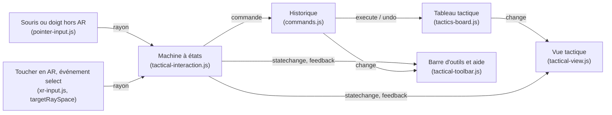
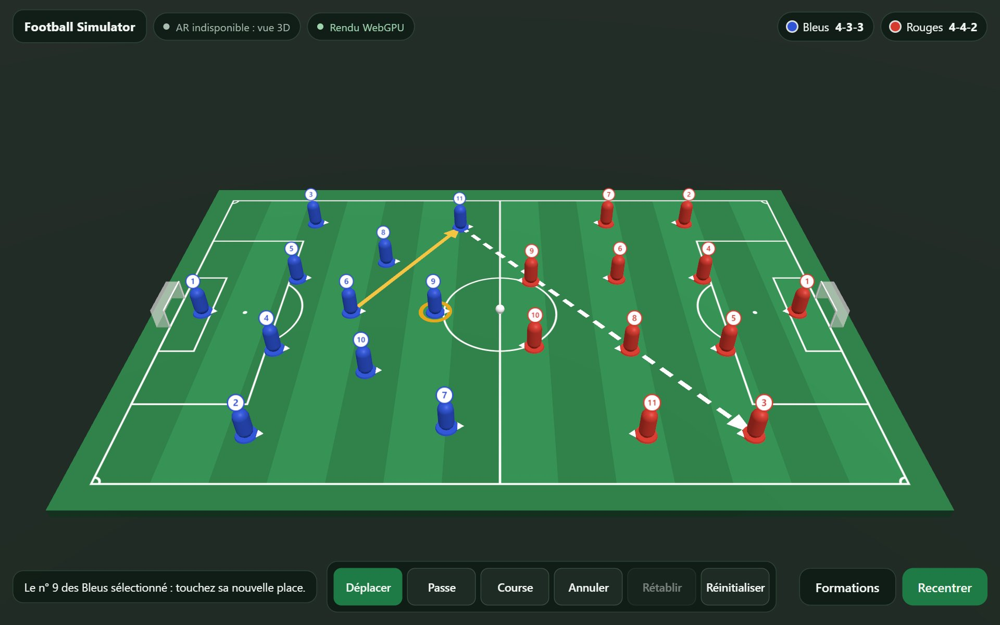
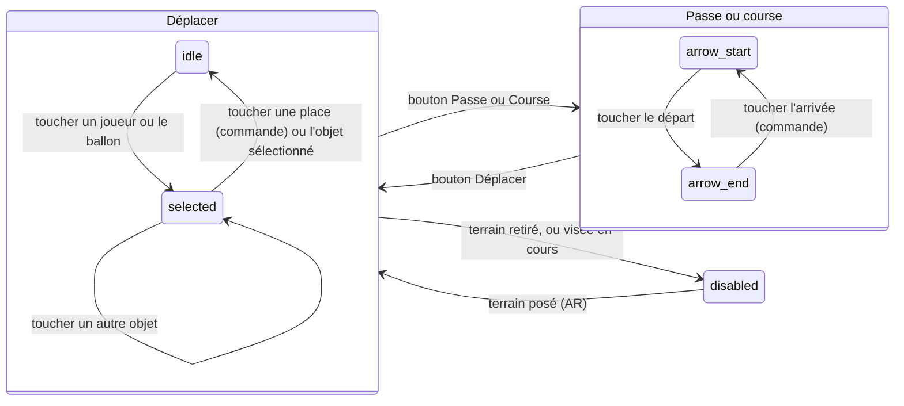

# Sprint 5 : sélection et déplacement par raycasting, flèches tactiques et annulation

Réalisé le 15 novembre 2026 sur la branche `feature/sprint-5`, à la demande de Bilel Khlif. Le code est généré avec Claude Code, à partir du cahier des charges et des consignes de Bilel Khlif : voir [ATTRIBUTION.md](../ATTRIBUTION.md).

**Sommaire**

1. [Objectifs](#1-objectifs)
2. [Architecture](#2-architecture)
3. [Raycasting : les mathématiques](#3-raycasting--les-mathématiques)
4. [Espaces de référence et changements de repère](#4-espaces-de-référence-et-changements-de-repère)
5. [La machine à états de l'interaction](#5-la-machine-à-états-de-linteraction)
6. [Le patron Command](#6-le-patron-command)
7. [Intégration dans la boucle de rendu](#7-intégration-dans-la-boucle-de-rendu)
8. [Les flèches tactiques](#8-les-flèches-tactiques)
9. [Performance et mode diagnostic](#9-performance-et-mode-diagnostic)
10. [Tests](#10-tests)
11. [Protocole de validation sur téléphone](#11-protocole-de-validation-sur-téléphone)
12. [Limites et suites](#12-limites-et-suites)
13. [Décisions et questions probables du jury](#13-décisions-et-questions-probables-du-jury)

---

## 1. Objectifs

| Exigence | Réponse | Où |
| --- | --- | --- |
| Cahier §5.3, sprint 5 : sélection et déplacement des joueurs (raycasting), flèches tactiques, Undo (Command) | Les trois, plus Rétablir, Réinitialiser et le déplacement du ballon | `src/tactical-interaction.js`, `src/commands.js` |
| BF5 : sélectionner un joueur puis le déplacer | Toucher le joueur (anneau doré), puis une place du terrain | `src/raycasting.js` |
| BF6 : déplacer le ballon | Même geste ; zone de sélection du ballon de 2,4 cm de diamètre | `src/ball.js` |
| BF7 : tracer une flèche de passe ou de course | Deux touchers, avec aperçu ; passe pleine et dorée, course en tirets et blanche | `src/tactical-arrows.js` |
| BF8 : annuler la dernière action et réinitialiser le terrain | « Annuler », « Rétablir », « Réinitialiser », lui-même annulable | `src/commands.js`, `src/tactical-toolbar.js` |
| §3.3 : `THREE.Raycaster` pour savoir quel joueur l'utilisateur a touché | Zones de sélection invisibles (`hitbox`), prévues dès le sprint 1 | `src/players.js`, `src/raycasting.js` |
| §3.4 : Command (« chaque action est encapsulée dans une commande, ce qui rend l'Undo simple ») | Cinq commandes et un historique | `src/commands.js` |
| §3.4 : Observer (« l'interface HTML s'abonne aux événements de la scène : joueur sélectionné, terrain posé ») | L'interaction émet `statechange` et `feedback` ; la scène, la barre d'outils et l'aide s'y abonnent | `src/tactical-view.js`, `src/tactical-toolbar.js` |
| §4.1, étapes 6 et 7 : toucher un joueur, puis une nouvelle position ; tracer une passe, puis « Annuler » | Rejoué par les tests, en vue 3D et en AR émulée | `tests/run-tests.mjs` |
| §4.3 : un joueur peut être sélectionné et déplacé, réussite sur 9 essais sur 10 | Exact au millimètre sur PC ; mesure sur téléphone à faire (partie 11) | tests, partie 11 |
| §2.3 et §4.3 : au moins 30 images par seconde sur un téléphone de milieu de gamme | Mode diagnostic (`?diagnostics`), aussi en AR ; mesure sur téléphone à faire | `src/diagnostics.js` |
| Enseignant : WebGPU sans repli WebGL | Inchangé : vérifié pendant l'interaction tactique | tests |

---

## 2. Architecture

Une action de l'utilisateur suit toujours le même chemin, en quatre temps séparés :



La saisie ne fait que produire un rayon. L'interaction ne dessine rien et ne modifie pas l'état elle-même : elle crée des commandes. Les commandes ne connaissent ni la scène ni les gestes. La scène ne fait que suivre l'état tactique. Chaque couche se teste donc seule, sous Node.js.

| Fichier | Rôle | Patron |
| --- | --- | --- |
| `src/raycasting.js` | Rayon depuis la caméra ou depuis une pose WebXR ; zones de sélection ; plan du gazon et changement de repère | |
| `src/tactical-interaction.js` | Machine à états : sélection, déplacement, flèches ; places refusées ou ramenées sur le plateau | Observer (sujet) |
| `src/commands.js` | `MovePlayerCommand`, `MoveBallCommand`, `AddArrowCommand`, `ChangeFormationCommand`, `ResetBoardCommand`, `CommandHistory` | Command |
| `src/tactics-board.js` | Tout l'état tactique : formations, places des joueurs et du ballon, flèches ; instantanés pour l'annulation | Observer (sujet) |
| `src/tactical-view.js` | La scène suit le tableau : joueurs, ballon, flèches ; anneau de sélection et aperçu | Observer |
| `src/tactical-arrows.js` | Géométrie des flèches, couche des flèches, aperçu | |
| `src/pointer-input.js` | Tap et survol à la souris ou au doigt, hors AR | |
| `src/xr-input.js` | Toucher en AR (`select`) et aperçu guidé par la source d'entrée ; séparation pose du terrain / tactique | |
| `src/tactical-toolbar.js` | Barre d'outils, aide de chaque état, retours | Observer |
| `src/diagnostics.js` | Mode diagnostic | |

Les patrons existants servent tels quels : Strategy pour les places des formations, Factory pour les joueurs et leurs zones de sélection, Observer pour tous les liens entre état et affichage.

---



*Capture prise par script sur l'application réelle (Chrome, 1280 × 800) : une passe, une course et le n° 9 des Bleus sélectionné.*

---

## 3. Raycasting : les mathématiques

Un rayon a une origine **O** et une direction unitaire **d** ; ses points sont **P(t) = O + t·d**, pour t ≥ 0.

**Hors AR**, le point touché (x, y), en pixels, devient des coordonnées normalisées (NDC), de -1 à 1 :

```text
x_ndc = 2 · (x - gauche) / largeur - 1
y_ndc = -(2 · (y - haut) / hauteur - 1)
```

`THREE.Raycaster.setFromCamera` fait le chemin inverse de la projection : O est la position de la caméra, et d la direction vers le point (x_ndc, y_ndc) projeté en sens inverse par l'inverse de la matrice de projection, puis par la matrice monde de la caméra.

**En AR**, l'événement `select` d'un toucher porte son image WebXR (`event.frame`), valable pendant l'événement. La pose du rayon de la source d'entrée vient de `frame.getPose(event.inputSource.targetRaySpace, espace local-floor)`. La spécification WebXR définit ce rayon ainsi : il part de l'origine de l'espace et suit son axe -Z. D'où :

```text
O = transform.position
d = q · (0, 0, -1) · q⁻¹      (q = transform.orientation, quaternion unitaire)
```

Sur un téléphone (`targetRayMode` « screen »), ce rayon part de la caméra et passe par le point touché ; avec une manette (« tracked-pointer »), il part de la manette. Le même code sert aux deux : `setRayFromXrPose`.

**Sélection.** Le rayon est confronté aux zones de sélection invisibles : un cylindre de 1,4 cm de rayon et 4,2 cm de haut par joueur, une sphère de 1,2 cm de rayon pour le ballon. `intersectObjects` les trie par distance, et la plus proche l'emporte. Un pion fait 1,8 cm de diamètre : la zone double presque la cible sous le doigt (cahier §6.3).

**Plan du gazon.** Le gazon est le plan y = 0 du repère du terrain. En coordonnées monde, ce plan passe par C, la position monde de `pitchGroup`, avec pour normale **n**, l'axe Y de `pitchGroup` tourné par sa matrice monde. Le rayon le coupe en :

```text
t = ((C - O) · n) / (d · n)      si d · n ≠ 0 et t ≥ 0
P = O + t · d                    (point monde)
P_terrain = M⁻¹ · P              (M = matrice monde de pitchGroup)
```

Un rayon parallèle au gazon, ou tourné vers le ciel, ne donne aucun point : « Visez le terrain ».

**Places permises.** Le plateau mesure 64,6 × 43,4 cm (terrain et bande de 4 m réels). Un toucher hors du plateau est refusé, avec un message, et la sélection reste. Un toucher au bord est ramené sur le plateau, de sorte que le socle du pion (0,91 cm de rayon) ou le ballon (0,42 cm) y tienne entier : |x| ≤ 32,3 - m et |z| ≤ 21,7 - m, en centimètres, m étant la marge. Le tableau tactique refuse lui aussi toute place hors du plateau : un état incohérent est impossible, même par erreur de programmation.

---

## 4. Espaces de référence et changements de repère

| Repère | Origine et axes | Qui l'utilise |
| --- | --- | --- |
| `local-floor` (AR) | Au sol, sous la position de départ du téléphone ; Y vers le haut | WebXR (`getPose`), et three.js, qui reçoit le même espace : ses coordonnées « monde » sont celles de `local-floor` |
| Monde (vue 3D) | Centre de la table virtuelle | three.js hors AR |
| Terrain (`pitchGroup`) | Point central du terrain, sur le gazon ; X le long du terrain, Z en largeur | Places des joueurs, du ballon et des flèches, dans le tableau tactique |

En AR, la pose de `pitchGroup` vient de son ancre (sprint 3) : la boucle de rendu la recale à chaque image. Toutes les places tactiques sont gardées dans le repère du terrain, jamais dans celui du monde ni de la caméra. Elles ne dépendent donc ni de la place ni de l'orientation de l'ancre, et restent justes quand le système de suivi recale l'ancre.

Deux précautions rendent le calcul exact au moment du toucher :

- les matrices monde de `pitchGroup` et de ses enfants sont recalculées juste avant le lancer de rayon (`updateMatrixWorld`), car l'ancre ou une animation ont pu les changer depuis l'image précédente ;
- three.js et `getPose` reçoivent le même espace `local-floor` : le rayon WebXR s'emploie sans conversion.

Les tests le vérifient avec trois poses d'ancre : à l'origine, déplacée et tournée de 25° comme sur la table émulée, et inclinée sur les trois axes. Le point touché est retrouvé dans le repère du terrain à 10⁻⁹ m près (partie 10).

---

## 5. La machine à états de l'interaction



- **Déplacer** (`idle`, `selected`) : un toucher sur un joueur le sélectionne, un toucher sur une place l'y envoie, et la sélection se termine. Toucher à nouveau l'objet sélectionné annule la sélection ; toucher un autre objet le sélectionne à la place.
- **Passe ou course** (`arrow-start`, `arrow-end`) : un premier toucher pose le départ, un second l'arrivée. Un point touché sur un joueur ou le ballon s'accroche à sa place : la flèche relie exactement deux joueurs. Une flèche de moins de 2 cm (environ 3,5 m réels) est refusée.
- **Coupée** (`disabled`) : en AR, tant que le terrain n'est pas posé. Changer de mode, retirer le terrain ou quitter l'AR abandonne la sélection et la flèche en cours.

**Pose du terrain et tactique sont séparées.** En AR, un toucher va à la pose du terrain tant qu'il n'est pas posé, puis à l'interaction tactique (`routeXrSelect`, d'après `SurfacePlacement.pitchReady`). Un même toucher ne fait jamais les deux : celui qui pose le terrain ne sélectionne pas un joueur.

**L'interface ne déclenche pas de sélection.** Avec le DOM Overlay, un toucher sur un élément HTML est d'abord annoncé par l'événement `beforexrselect`. `main.js` l'annule sur les boutons, la barre d'outils, le panneau des formations et les avis : aucun `select` n'est alors produit. Ces panneaux captent aussi les touchers entre leurs boutons (`pointer-events: auto`), pour qu'un doigt qui manque un bouton n'atteigne pas le terrain.

**Retours.** L'aide décrit l'étape courante (« Le n° 9 des Bleus sélectionné : touchez sa nouvelle place. »). Chaque geste affiche aussi son retour pendant 2,5 s : action faite (bord doré), refusée (texte rouge : « Hors du terrain… », « Flèche trop courte… »), ou information. Le mode actif est marqué dans la barre d'outils (`aria-pressed`), et « Annuler » et « Rétablir » ne sont actifs que s'il y a une action à défaire ou à refaire.

---

## 6. Le patron Command

| Commande | `execute()` | `undo()` |
| --- | --- | --- |
| `MovePlayerCommand` | Garde la place du joueur, puis le déplace | Le ramène à la place gardée |
| `MoveBallCommand` | Garde la place du ballon, puis le déplace | Le ramène |
| `AddArrowCommand` | Ajoute la flèche ; garde son identifiant | La retire ; rétablie, elle reprend le même identifiant |
| `ChangeFormationCommand` | Garde l'équipe (formation et 11 places), puis change la formation | Rétablit l'équipe gardée |
| `ResetBoardCommand` | Garde tout le tableau, puis le remet dans son état de départ | Rétablit le tableau gardé |

`CommandHistory` exécute une commande et la garde si elle a changé l'état. Une action sans effet, comme choisir la formation en place, n'est pas gardée. Une nouvelle action efface les actions annulées, et l'historique garde les 100 dernières. Une commande refusée par le tableau, par exemple une place hors du plateau, lève une erreur avant toute modification et n'est pas gardée.

**Places voulues, pas positions affichées.** Le tableau garde la place *voulue* de chaque joueur. La position affichée en est une conséquence, qui la rejoint en 0,35 s après un déplacement à la main, ou en 0,7 s après un changement de formation. Les instantanés des commandes contiennent donc des places voulues, exactes au bit près, et jamais une position intermédiaire d'animation. C'est ce qui rend l'annulation exacte dans tous les cas :

- **Transition interrompue.** On choisit 3-5-2, puis 4-2-3-1 avant la fin de la transition. « Annuler » ramène exactement au 3-5-2 : places, postes, pastille et bouton. La transition vers 3-5-2 n'était pas finie, mais son but était connu.
- **Déplacement pendant une transition.** Un joueur déplacé à la main quitte la transition sans saut : `FormationAnimator.moveTo` repart de sa position affichée. Les autres joueurs terminent la leur. « Annuler » le renvoie à sa place de formation.
- **Formation après des déplacements à la main.** Changer de formation replace les 11 joueurs ; « Annuler » rend aussi leurs places manuelles.

---

## 7. Intégration dans la boucle de rendu

```text
image   placement.update(frame)     hit test, ancre : pose de pitchGroup        (sprint 3)
        animator.update()            joueurs et ballon vers leurs places
        tâches de l'image :
          saisie AR (xr-input)       aperçu : pose du targetRaySpace, si une flèche est en cours
          vue tactique               anneau de sélection, départ et aperçu de la flèche
          diagnostic                 instant de l'image
        renderer.render()            WebGPU
        après le rendu :
          diagnostic                 statistiques de l'image dessinée (renderer.info)
toucher événement select             rayon du targetRaySpace, lu dans event.frame
```

Le toucher n'est pas traité dans la boucle, mais dans son événement `select`, dont l'image WebXR n'est valable que pendant l'événement. L'aperçu, lui, est lu à chaque image dans la boucle. Il suit la source d'entrée qui a posé le départ de la flèche : une manette, suivie en continu, ou sur un téléphone un nouveau doigt posé sur l'écran, car la source d'un toucher disparaît quand le doigt se lève. Une autre manette, qui vise ailleurs, ne le guide pas.

**Sans allocation dans la boucle.** Les vecteurs, quaternions, plans et le rayon sont créés une fois et réutilisés. Les boucles de la boucle de rendu sont indexées, sans itérateur. L'anneau de sélection et l'aperçu se déplacent et s'étirent, au lieu d'être reconstruits. Sans flèche en cours, la saisie AR ne fait rien à chaque image. Pendant le tracé d'une flèche, three.js crée tout de même un petit objet par zone de sélection touchée par le rayon (résultat d'intersection), et WebXR un objet de pose : ces allocations, inévitables avec ces API, ne durent que le tracé.

**Statistiques après le rendu.** three.js r187 remet ses statistiques à zéro au début de chaque image (`info.reset()` dans `Animation`), avant d'appeler la boucle. Lues avant le rendu, elles valaient 0 ; elles sont donc lues juste après (`afterRender`).

---

## 8. Les flèches tactiques

- **Dans le repère du terrain.** Chaque flèche est gardée par le tableau en coordonnées du terrain, et dessinée par un maillage enfant de `pitchGroup`, à 1,2 mm au-dessus du gazon. Elle tourne et se recale avec le terrain : l'utilisateur peut tourner autour de la table sans qu'elle bouge.
- **Code couleur.** La passe, trajet du ballon, est une flèche pleine et dorée (#f4c542) ; la course, déplacement d'un joueur, est une flèche en tirets et blanche. Le bouton du mode actif prend la même couleur.
- **Géométrie.** Une flèche est construite le long de +X, de 0 à sa longueur L : un corps de 4,5 mm de large, plein ou en tirets de 12 mm séparés de 8 mm, puis une pointe de 2 cm. Elle est ensuite tournée de θ = atan2(-dz, dx) autour de Y, car cette rotation envoie +X sur (cos θ, 0, -sin θ).
- **Ressources.** Chaque flèche a sa géométrie, libérée (`dispose`) dès qu'elle disparaît, par une annulation ou une réinitialisation ; les deux matériaux sont partagés. L'aperçu réutilise deux maillages fixes : un corps de longueur 1 étiré, et une pointe.

---

## 9. Performance et mode diagnostic

Ajouter `?diagnostics` à l'adresse affiche, sous le bandeau supérieur et aussi en AR par le DOM Overlay :

| Mesure | Source |
| --- | --- |
| Images par seconde, durée moyenne d'une image | Les 120 dernières images de la boucle de rendu : (n - 1) intervalles pendant la durée couverte |
| Rendu | WebGPU, ou WebGL 2 en mode test |
| Session XR | Aucune session, ou l'état de la pose du terrain, ancré ou non |
| Appels de dessin, triangles | `renderer.info.render` de three.js, lus après le rendu |

Le mode est désactivé par défaut. Actif, il coûte à chaque image une écriture dans un tableau de taille fixe, et le texte n'est réécrit que deux fois par seconde. Une horloge qui recule ou un trou de plus d'une seconde, par exemple en entrant en AR, relancent la mesure.

**Mesure sur PC, pas sur téléphone.** Le test de bout en bout du 15 novembre 2026, dans Chrome sans interface, sur le PC de développement, a relevé 144 images par seconde (6,9 ms par image), 115 appels de dessin et 7 409 triangles en vue 3D. La plupart des appels viennent des joueurs : 22 joueurs de 4 maillages visibles, soit 88 appels. Cette mesure ne dit rien d'un téléphone de milieu de gamme : la mesure demandée par le cahier se fait avec le protocole de la partie 11. Si elle est sous les 30 images par seconde, la piste est d'instancier les maillages des joueurs (`InstancedMesh`, cahier §6.3), en gardant leurs zones de sélection.

---

## 10. Tests

`npm test` : 165 tests unitaires (68 nouveaux) et 67 vérifications de bout en bout (23 nouvelles), tous réussis le 15 novembre 2026.

**Tests unitaires nouveaux**

| Fichier | Ce qu'ils vérifient |
| --- | --- |
| `raycasting.test.mjs` (8) | Coordonnées normalisées ; rayon WebXR (origine, -Z tourné) ; chacun des 22 joueurs et le ballon sélectionnés par leur zone ; vue en biais ; terrain déplacé et tourné ; point du gazon exact dans le repère du terrain pour trois poses d'ancre ; aller-retour monde / terrain ; rayon parallèle ou vers le ciel |
| `tactical-interaction.test.mjs` (11) | Sélection puis déplacement par commande annulable ; deux équipes et le ballon ; désélection et changement de sélection ; place hors du plateau refusée, place au bord ramenée ; flèches, accrochage aux joueurs, flèche trop courte ; changement de mode ; interaction coupée ; aperçu ; AR sur ancre tournée ; événements |
| `commands.test.mjs` (10) | Chaque commande s'exécute, s'annule et se rétablit exactement ; formations enchaînées annulées une à une ; actions sans effet non gardées ; historique (Rétablir effacé par une nouvelle action, limite, événements) ; commande refusée |
| `tactical-view.test.mjs` (7) | Déplacement en 0,35 s ; joueur déplacé pendant une transition, sans saut ; transition interrompue puis annulée, places et postes exacts ; réinitialisation pendant une animation ; flèches dans `pitchGroup`, pointe sur l'arrivée, géométrie libérée ; anneau de sélection ; libération de la vue |
| `xr-input.test.mjs` (6) | Destination d'un toucher ; rayon lu dans le `targetRaySpace` et non dans la pose du téléphone ; suivi perdu ; aperçu guidé par la manette du départ, pas par l'autre ; nouveau doigt sur l'écran ; fin de session |
| `pointer-input.test.mjs` (5) | Tap reconnu ; rayon de la caméra ; glissé et pincement ignorés ; saisie muette en AR ; survol à la souris et détachement |
| `diagnostics.test.mjs` (6) | Désactivé par défaut ; 60 et 30 images par seconde ; reprise après un trou ; panneau réécrit deux fois par seconde ; statistiques lues après le rendu |
| `tactical-toolbar.test.mjs` (3) | Aide de chaque état ; retour affiché 2,5 s ; changement de contexte |
| `tactics-board.test.mjs` (6 de plus) | Places de départ ; déplacement et refus ; limites du plateau ; formation qui replace les joueurs déplacés ; flèches et identifiants ; instantanés et réinitialisation |
| `ar-surface.test.mjs`, `dev-xr-emulation.test.mjs`, `render-loop.test.mjs`, `formation-transition.test.mjs` (6 de plus) | `pitchReady` ; rayon d'un clic émulé à travers le point cliqué ; tâches de l'image et `afterRender` dans l'ordre ; durée propre à un déplacement |

**Vérifications de bout en bout nouvelles**

| Vérification | Résultat du 15 novembre 2026 |
| --- | --- |
| Vue 3D : joueur sélectionné par un clic sur son pion, anneau et aide | Réussi |
| Vue 3D : clic sur le gazon, le joueur y va | Réussi : placé à 0,000 mm du point visé |
| Vue 3D : « Annuler » puis « Rétablir » | Réussi : retour à l'état de départ, puis place exacte |
| Vue 3D : ballon sélectionné puis déplacé | Réussi : 0,000 mm |
| Vue 3D : clic hors du terrain | Réussi : refusé, message, rien ne bouge, sélection gardée |
| Vue 3D : passe en deux clics, aperçu au survol | Réussi : départ accroché au joueur, arrivée à 0,000 mm |
| Vue 3D : formation changée puis annulée | Réussi : le joueur déplacé à la main retrouve sa place exacte |
| Vue 3D : « Réinitialiser », puis « Annuler » | Réussi : état de départ, puis tout rétabli |
| Vue 3D : rendu | Réussi : contextes `2d` et `webgpu` seulement, aucune erreur |
| Téléphone 360 × 740 : barre d'outils | Réussi : six boutons de 48 px, dans l'écran, libellés entiers |
| Téléphone 360 × 740 : toucher un joueur puis le gazon | Réussi : 0,000 mm |
| Mode diagnostic désactivé par défaut ; affiché avec `?diagnostics` | Réussi : 144 images par seconde, WebGPU, 115 appels de dessin, 7 409 triangles |
| AR émulée (WebGPU), terrain tourné de 25° : joueur touché, sélectionné par le `targetRaySpace` | Réussi |
| AR émulée : joueur déplacé, place dans le repère du terrain tourné | Réussi : 0,000 mm |
| AR émulée : passe avec aperçu guidé par la source d'entrée, puis « Annuler » | Réussi |
| AR émulée : toucher sur la barre d'outils | Réussi : aucun `select` ne parvient à la scène ; un toucher sur le gazon, si |
| AR émulée : fin de session | Réussi : saisie AR arrêtée, tactique gardée pour la vue 3D |
| Les cinq vérifications AR, en mode test WebGL | Réussi |

Dans l'émulateur, un clic devient le rayon d'un toucher de téléphone : la manette droite d'IWER est placée sur la vue et orientée à travers le point cliqué, à partir de la projection de la vue (`rayDirectionThroughPixel`). L'application lit ensuite ce rayon dans le `targetRaySpace`, exactement comme sur un téléphone. Le clic est aussi proposé d'abord à l'interface par `beforexrselect`, comme le fait le DOM Overlay.

**Erreurs introduites volontairement, une à une, puis retirées**

| Défaut | Détecté par |
| --- | --- |
| Point du gazon laissé en coordonnées monde (pas de changement de repère) | 2 tests unitaires |
| Rayon WebXR le long de +Z au lieu de -Z | 3 tests unitaires |
| Pose du téléphone au lieu du `targetRaySpace` du toucher | 2 tests unitaires |
| Aperçu guidé par n'importe quelle manette | 1 test unitaire, après renforcement : la première version du test ne le voyait pas, la manette du départ restant dans la liste des sources |
| Annulation d'une formation sans les places | 1 test unitaire |
| Déplacement à la main ignoré pendant une transition | 2 tests unitaires |
| Géométrie des flèches non libérée | 1 test unitaire |
| Place au bord non ramenée sur le plateau | 1 test unitaire |
| Sélection retrouvée par l'ordre des joueurs, pas par leur numéro | 1 test unitaire |
| Statistiques lues avant le rendu | 1 test unitaire |
| Tout relâchement compté comme un tap | 1 test unitaire |
| Barre d'outils absente de la protection DOM Overlay | 2 vérifications de bout en bout (WebGPU et mode test WebGL) |

---

## 11. Protocole de validation sur téléphone

**Aucun résultat sur téléphone n'est consigné pour le sprint 5 à ce jour.** Ce protocole est à suivre par l'équipe, et ses résultats à reporter dans le tableau de fin de partie.

**Préparation.** Un téléphone Android compatible ARCore, de milieu de gamme, avec Android 12 ou plus et Chrome à jour. Activer `chrome://flags/#webxr-webgpu-binding`, puis ouvrir `https://bilelkhlif.github.io/footballsimulator/?diagnostics`. Noter le modèle, la version d'Android et celle de Chrome. Sur un téléphone dont Chrome bloque WebGPU, le mode test (`?webgl&diagnostics`) permet de tester l'interaction, mais ne valide pas le rendu WebGPU.

**A. Sélection et déplacement : réussite sur 9 essais sur 10 (cahier §4.3).** Poser le terrain sur une table, debout à environ 60 cm. Faire 10 essais : toucher l'objet désigné, puis une place libre du terrain. Varier les objets : joueurs proches et lointains des deux équipes, et le ballon. Un essai réussit si l'objet désigné est sélectionné (anneau doré) du premier coup, et rejoint la place touchée à un pion près. Critère : au moins 9 réussites sur 10. Refaire la série à environ 1 m.

**B. Flèches et annulation.** Tracer 3 passes et 2 courses, dont une accrochée entre deux joueurs. Vérifier l'aperçu pendant que le doigt touche l'écran, puis « Annuler », « Rétablir », « Réinitialiser » et « Annuler ».

**C. Stabilité spatiale : stable pendant 1 minute (cahier §4.3).** Poser le terrain, puis placer une pièce de monnaie au coin d'un but, sur la table. Tourner autour de la table pendant une minute, en continuant à déplacer des joueurs, puis revenir. Le coin du but doit rester sur la pièce, à moins de 1 cm près, et les flèches à leur place sur le gazon.

**D. Fluidité : au moins 30 images par seconde (cahier §2.3).** Pendant les essais A à C, relever toutes les 10 secondes le nombre d'images par seconde du panneau diagnostic, sur une minute. Critère : moyenne d'au moins 30, sans baisse durable en dessous. Noter aussi les appels de dessin.

**E. Interface et fin de session.** Toucher chaque bouton de la barre d'outils, un joueur étant sélectionné : aucun joueur ne doit bouger. Quitter l'AR : la tactique doit se retrouver dans la vue 3D.

| Date | Appareil (modèle, Android, Chrome) | Essai | Résultat |
| --- | --- | --- | --- |
| à remplir | | A : 10 essais à 60 cm | |
| à remplir | | A : 10 essais à 1 m | |
| à remplir | | B : flèches et annulation | |
| à remplir | | C : stabilité, 1 minute | |
| à remplir | | D : images par seconde (moyenne, minimum) | |
| à remplir | | E : interface et fin de session | |

---

## 12. Limites et suites

- **Validation sur téléphone à faire** : le critère de 9 essais sur 10, la stabilité d'une minute et les 30 images par seconde ne sont vérifiés que sur PC et en émulation (partie 11).
- **Joueurs indépendants**, sans `InstancedMesh` : 115 appels de dessin en vue 3D. La décision dépend de la mesure sur téléphone (sprint 6).
- **Pas de glisser-déposer** : un déplacement se fait en deux touchers, et une flèche aussi. Sur téléphone, l'aperçu d'une flèche n'apparaît que pendant que le doigt touche l'écran.
- **Pas de suppression d'une flèche seule** : « Annuler » retire la dernière, « Réinitialiser » les retire toutes.
- **Chevauchements permis** : deux pions peuvent être posés au même endroit ; seules les places hors du plateau sont refusées.
- **BF9 (animer une action pas à pas, bonus)** : prévu au sprint 6 ; les flèches gardées par le tableau en sont la base.

---

## 13. Décisions et questions probables du jury

**Pourquoi garder les places dans un tableau, au lieu de lire les positions des objets three.js ?**
Pour une annulation exacte. Une position affichée change à chaque image pendant une animation ; une place voulue, non. L'état tactique se teste aussi sans scène, sous Node.js, et la scène ne peut pas diverger de lui : elle ne fait que le suivre.

**Pourquoi le rayon du `targetRaySpace`, et pas celui du centre de l'écran, comme pour le réticule ?**
Le rayon du centre obligerait à viser avec le téléphone. Celui du `targetRaySpace` passe par le point touché, et le même code sert aussi à une manette.

**Comment un toucher sur un bouton ne sélectionne-t-il pas aussi un joueur ?**
Le DOM Overlay annonce chaque toucher sur l'interface par `beforexrselect`, et `main.js` l'annule sur les boutons, la barre d'outils, le panneau des formations et les avis. Un test le vérifie en AR émulée : aucun `select` ne parvient à la scène.

**Que se passe-t-il si l'utilisateur déplace un joueur pendant un changement de formation, puis annule ?**
Le joueur quitte la transition sans saut, va à la place touchée, puis revient à sa place de formation à l'annulation. Les autres joueurs terminent leur transition : partie 6.

**Le résultat dépend-il de la position de l'ancre ?**
Non : le point touché est ramené dans le repère du terrain par l'inverse de sa matrice monde, et les tests le vérifient pour une ancre déplacée, tournée et même inclinée.

**Comment mesurez-vous les 30 images par seconde ?**
Avec le mode diagnostic, sur le téléphone, pendant la session AR : partie 11. Sur PC, la mesure n'a pas de valeur pour ce critère.
