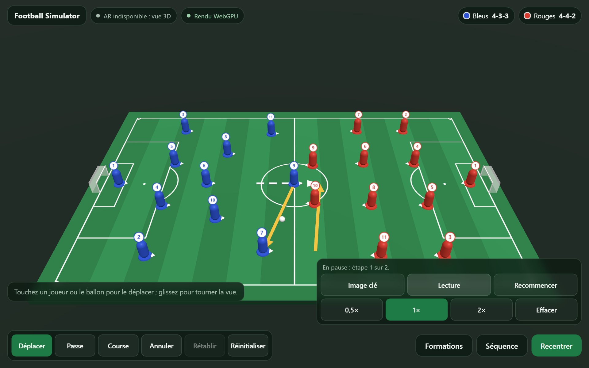
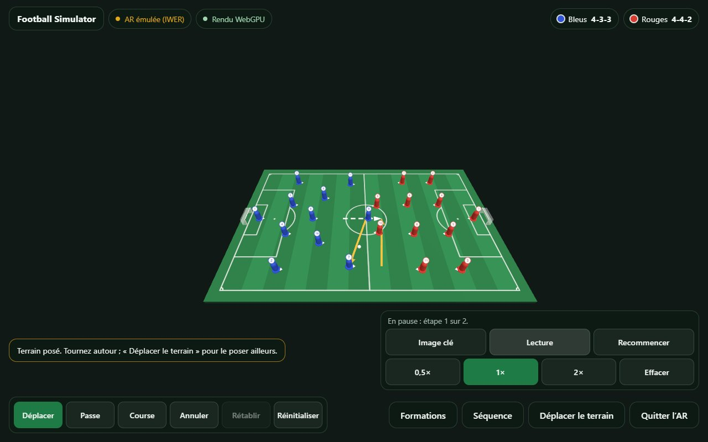
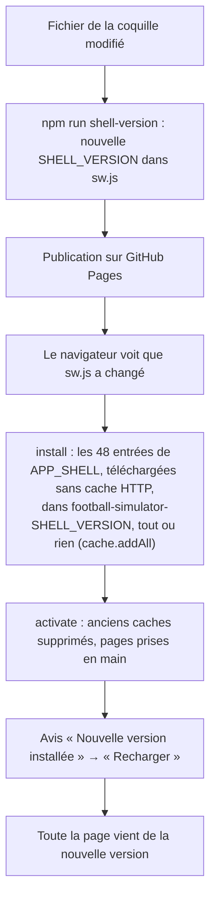

# Sprint 6 : performance XR, fiabilité de l'AR, séquence animée (BF9), PWA versionnée et recette

> Document historique : les noms `.js`, les mesures et les résultats décrivent la version de l’époque. Depuis le 23 novembre 2026, les modules applicatifs portent `.mjs` ; les liens vers le code suivent ce renommage. Voir la [migration](migration-mjs.md).

Réalisé le 16 novembre 2026 sur la branche `feature/sprint-6`, à la demande de Bilel Khlif. C'est le dernier sprint du cahier des charges. Le code est généré avec Claude Code, à partir du cahier des charges et des consignes de Bilel Khlif : voir [ATTRIBUTION.md](../ATTRIBUTION.md).

Documents livrés avec ce sprint : [recette finale](recette.md), [manuel utilisateur](manuel-utilisateur.md), [diagrammes UML](uml.md) et [script de la vidéo de démonstration](video-demonstration.md).

**Sommaire**

1. [Objectifs](#1-objectifs)
2. [Point de départ : le sprint 5 vérifié](#2-point-de-départ--le-sprint-5-vérifié)
3. [Performance : mesurer, puis optimiser](#3-performance--mesurer-puis-optimiser)
4. [Fiabilité de l'AR](#4-fiabilité-de-lar)
5. [Séquence animée (bonus BF9)](#5-séquence-animée-bonus-bf9)
6. [PWA : une seule version à la fois](#6-pwa--une-seule-version-à-la-fois)
7. [Tests](#7-tests)
8. [Limites](#8-limites)
9. [Décisions et questions probables du jury](#9-décisions-et-questions-probables-du-jury)

---

## 1. Objectifs

| Exigence | Réponse | Où |
| --- | --- | --- |
| Cahier §5.3, sprint 6 : Service Worker, optimisation mobile, tests finaux, documentation et vidéo ; bonus : animation d'une action | Les cinq, plus la recette finale | ce document |
| §2.3 et §4.3 : au moins 30 images par seconde sur un téléphone de milieu de gamme | Mesure avant et après, dans les mêmes conditions ; joueurs instanciés : 115 → 55 appels de dessin. Mesure sur téléphone à faire | partie 3 |
| §6.3 : « Baisse de performance avec 22 joueurs » → `InstancedMesh` | Trois maillages instanciés par équipe, mêmes sélection, identité et ancrage | `src/players.js` |
| Fiabilité de l'AR : cycle de vie, `XRGPUBinding`, hit test, ancres, suivi interrompu, entrées et sorties répétées | Revue du parcours complet ; cinq entrées et sorties de suite sans fuite de ressources | partie 4 |
| BF9 : animer une action pas à pas (« Play ») | Images clés, Lecture, Pause, Recommencer, vitesses 0,5×, 1× et 2× | `src/tactical-sequence.js`, `src/sequence-player.js`, `src/sequence-panel.js` |
| §2.3 et §4.3 : lancement hors-ligne après une première visite ; versions de cache cohérentes | Coquille de l'application à version de contenu, installée d'un bloc | `sw.js`, `tests/shell-version.mjs` |
| §5.4 : diagrammes UML, manuel utilisateur illustré, vidéo de 5 minutes au plus | [uml.md](uml.md), [manuel-utilisateur.md](manuel-utilisateur.md), [video-demonstration.md](video-demonstration.md) | `docs/` |
| §4.3 : critères d'acceptation | Recette de BF1 à BF9, validation physique, émulée ou automatisée | [recette.md](recette.md) |
| Enseignant : WebGPU sans repli WebGL | Inchangé, vérifié par les tests à chaque étape | tests |

---

## 2. Point de départ : le sprint 5 vérifié

Avant tout changement, la branche part de `main` après la fusion du sprint 5 (`a1df302`). Sur ce code, `npm test` donne 165 tests unitaires réussis sur 165 et 67 vérifications de bout en bout réussies sur 67, le 16 novembre 2026. La première mesure de performance (partie 3) est faite sur ce même code, avant toute optimisation.

---

## 3. Performance : mesurer, puis optimiser

### 3.1 Méthode

`npm run bench` (`tests/benchmark.mjs`) mesure trois scénarios dans Chrome sans interface, sur le vrai processeur graphique :

| Scénario | Conditions |
| --- | --- |
| Vue 3D au repos | Écran de téléphone, 390 × 844 points, densité 3 |
| Vue 3D, changements de formation | Même écran ; la formation des Bleus change toutes les 0,75 s : 11 joueurs en mouvement en permanence |
| AR émulée | IWER, 1280 × 800 ; session WebGPU, terrain posé sur la table et ancré |

- **Processeur central ralenti 4 fois** (`Emulation.setCPUThrottlingRate`, Chrome DevTools Protocol), pour approcher le processeur d'un téléphone de milieu de gamme.
- Chaque mesure dure 6 s, après 3 s de mise en route ; le résultat est la médiane de 3 mesures.
- Une sonde enveloppe `renderer.render` : temps du processeur central passé dans le rendu, et statistiques de three.js lues juste après (`renderer.info`).
- La mémoire est l'estimation de three.js (`renderer.info.memory`) : les tampons et les textures qu'il a créés, pas la mémoire réelle du pilote.

**Ce que la mesure vaut.** Elle compare deux versions dans des conditions identiques : même PC (ASUS TUF Gaming A15 ; adaptateur WebGPU retenu par Chrome : NVIDIA GeForce RTX 2050), même Chrome (157.0.8103.52), même script, à quelques minutes d'intervalle. Elle ne prédit pas le nombre d'images par seconde d'un téléphone : son processeur graphique n'est pas ralenti, et Chrome sans interface n'est pas calé sur un écran à 60 Hz. Le critère du cahier se mesure sur le téléphone, avec le mode diagnostic ([recette](recette.md)).

### 3.2 Avant l'optimisation : où part le temps

Sur le code du sprint 5, la vue 3D fait **115 appels de dessin** par image, dont 88 pour les joueurs : 22 joueurs, chacun avec 4 maillages visibles (socle, flèche, corps, numéro). Le reste : terrain, buts, ballon, table. Chaque appel coûte du temps au processeur central : three.js prépare un objet de rendu, un tampon de paramètres (`uniform buffer`) et des commandes WebGPU. La géométrie, elle, est légère : 7 409 triangles.

### 3.3 Joueurs instanciés

`PlayerFactory.createTeamMeshes(team, joueurs)` crée, pour chaque équipe, **trois `InstancedMesh`** de 11 instances : socles, flèches et corps, avec les géométries et matériaux partagés existants. Les 3 × 11 appels d'une équipe deviennent 3.

Ce qui ne change pas :

- **Identité et sélection.** Chaque joueur reste un `THREE.Group` dans `team-blue` ou `team-red`, avec son `userData` (équipe, numéro, poste), son numéro (sprite) et sa zone de sélection invisible. Le raycasting du sprint 5 vise toujours ces zones : il ne voit pas les maillages instanciés.
- **Ancrage.** Les maillages instanciés sont enfants de `pitchGroup` (`player-meshes-blue`, `player-meshes-red`) : ils suivent l'ancre comme le reste du terrain.
- **Animation.** Formations, déplacements et séquence déplacent toujours le `Group` du joueur. `TeamMeshes.update()`, tâche de la boucle de rendu, recopie ensuite sa matrice dans l'instance.

Sans travail inutile : `TeamMeshes.update()` garde, pour chaque joueur, la position et l'orientation déjà écrites (`Float64Array`). Seuls les joueurs qui ont bougé sont réécrits, et `instanceMatrix.needsUpdate` n'est levé que si l'un d'eux a bougé. Au repos, rien n'est envoyé au processeur graphique. La boucle est indexée et n'alloue rien.

### 3.4 Résultats

Médianes de 3 mesures, processeur central ralenti 4 fois, Chrome 157.0.8103.52, PC ASUS TUF Gaming A15, le 16 novembre 2026 :

| Scénario | Version | Images/s | Image, médiane (p95) | Rendu, temps CPU médian (p95) | Appels de dessin | Triangles | Tampons de paramètres | Mémoire (textures) |
| --- | --- | ---: | ---: | ---: | ---: | ---: | ---: | ---: |
| Vue 3D au repos | Sprint 5 | 62,7 | 15,8 ms (19,3) | 12,7 ms (15,9) | 115 | 7 409 | 107 | 28,2 Mio (28,1) |
| | **Sprint 6** | **90,1** | **10,8 ms (13,9)** | **8,2 ms (10,8)** | **55** | 7 409 | **47** | 28,2 Mio (28,1) |
| Vue 3D, changements de formation | Sprint 5 | 46,3 | 21,5 ms (27,9) | 18,2 ms (24,2) | 115 | 7 409 | 107 | 28,2 Mio (28,1) |
| | **Sprint 6** | **76,9** | **12,7 ms (16,7)** | **9,8 ms (12,4)** | **55** | 7 409 | **47** | 28,2 Mio (28,1) |
| AR émulée, terrain posé | Sprint 5 | 47,2 | 21,3 ms (26,7) | 13,7 ms (17,8) | 114 | 7 337 | 124 | 40,5 Mio (40,4) |
| | **Sprint 6** | **62,5** | **16,0 ms (19,4)** | **9,1 ms (11,7)** | **54** | 7 337 | **64** | 40,5 Mio (40,4) |

- Le nombre de triangles est identique : l'image dessinée est la même.
- Le temps du rendu baisse de 35 % au repos, de 46 % pendant les changements de formation et de 34 % en AR ; la durée d'une image au 95e centile, la plus visible pour l'utilisateur, de 27 % à 40 %.
- Les tampons des instances ajoutent environ 10 Kio de mémoire.
- Mesure intermédiaire, avec les seuls joueurs instanciés : 86,0, 74,6 et 56,5 images par seconde. La version finale, qui ajoute la séquence animée et le reste du sprint, n'est pas plus lente.

### 3.5 Ce qui n'a pas été changé, et pourquoi

| Piste | Mesure | Décision |
| --- | --- | --- |
| Numéros des joueurs dans un atlas (22 sprites en un appel) | Borne haute, numéros masqués : 33 appels de dessin, 6,8 ms de rendu au repos au lieu de 8,2 ms | Reportée. Le gain possible est faible devant le budget de 33 ms d'une image à 30 par seconde. C'est la piste suivante si le téléphone se révèle limité par son processeur central |
| Textures plus petites (gazon 1808 × 1216, numéros 128 × 128) | 28 Mio de textures, sans signe de limite mémoire ; le temps d'image vient des appels de dessin | Gardées. Le gazon porte les lignes du terrain : il occupe une grande part de l'écran à 60 cm, et sa netteté se voit. Aucune mesure ne justifie de la réduire |
| Moins de lumières, ombres | Aucune ombre portée ; deux lumières | Gardées : aucune mesure ne désigne les lumières |

### 3.6 Mode diagnostic complété

`?diagnostics` affiche deux mesures de plus :

| Mesure | Source |
| --- | --- |
| CPU / image | Temps du processeur central entre le début de l'image (`beforeFrame`, nouvelle étape de la boucle de rendu) et la fin du rendu (`afterRender`), en moyenne sur les 120 dernières images |
| Mémoire GPU | `renderer.info.memory.total`, l'estimation de three.js, en Mio |

Si le téléphone affiche moins de 30 images par seconde avec un temps CPU proche de la durée d'une image, il est limité par son processeur central : l'atlas des numéros est alors la piste. Avec un temps CPU faible, la limite est le processeur graphique : la piste est alors la résolution des textures ou de la couche de rendu.

---

## 4. Fiabilité de l'AR

Le parcours AR complet a été relu, du bouton « Entrer en AR » à la sortie, en le confrontant aux tests existants. Une seule lacune de test a été comblée : la reprise après une interruption du suivi. Deux vérifications de bout en bout ont été ajoutées : la séquence animée sur le terrain ancré, et les entrées et sorties répétées.

| Point du parcours | Comportement | Vérifié par |
| --- | --- | --- |
| Cycle de vie de la session | Une seule demande par double clic ; échec signalé et session refermée si `local-floor` ou la couche de rendu manquent ; sortie par le bouton ou par le système ; nouvelle session possible | `xr-session.test.mjs` (16) |
| Liaison WebXR/WebGPU | `webgpu` exigée ; sans `XRGPUBinding`, aucune session et réglage de Chrome indiqué, sans repli ; cible de rendu XR alignée sur le nombre de vues | tests unitaires et de bout en bout (sprint 3) |
| Espace de référence | `local-floor`, le même pour three.js et pour `getPose` : le rayon d'un toucher s'emploie sans conversion | `raycasting.test.mjs` |
| Source de hit test | Demandée depuis l'espace `viewer` au démarrage, annulée à la fin de la session | `ar-surface.test.mjs` |
| Ancres | Créée à la pose ; une ancre qui arrive après un déplacement du terrain ou la fin de la session est aussitôt supprimée ; ancres refusées : le terrain reste posé | `ar-surface.test.mjs` |
| **Suivi interrompu, puis rétabli** | Ancre plus suivie, ou pose du téléphone perdue : le terrain garde sa dernière pose, reste posé et ancré, sans retour à la visée. Suivi rétabli : il rejoint l'ancre recalée dès l'image suivante. Un toucher pendant l'interruption ne vise rien | `ar-surface.test.mjs` (renforcé au sprint 6), `xr-input.test.mjs` |
| Terrain déplacé et tourné | Points touchés ramenés dans le repère du terrain ; exact à 0,000 mm sur un terrain tourné de 25° | tests unitaires et de bout en bout (sprint 5) |
| **Séquence en AR** | Lecture dans le repère du terrain ; la pose de `pitchGroup` est identique avant et après, et le terrain reste ancré pendant toute la lecture | nouveau test de bout en bout, en WebGPU et en mode test WebGL |
| **Entrées et sorties répétées** | Cinq entrées en AR de suite, terrain posé puis sortie à chaque fois : 20 géométries, 26 textures et 1 cible de rendu après la 1re sortie comme après la 5e ; pose du terrain et saisie AR libérées | nouveau test de bout en bout, en WebGPU et en mode test WebGL |
| Pose du terrain et tactique séparées | Un toucher va à la pose tant que le terrain n'est pas posé, ensuite à l'interaction tactique ; le panneau de la séquence et son bouton s'ajoutent aux éléments protégés par `beforexrselect` ; le bouton « Séquence » n'apparaît qu'une fois le terrain posé | `xr-input.test.mjs`, test de bout en bout du DOM Overlay |

---

## 5. Séquence animée (bonus BF9)

### 5.1 Utilisation

Le bouton « Séquence », dans la barre du bas, ouvre le panneau ; il ferme celui des formations, et inversement. Le principe est celui d'un dessin animé : on enregistre des images clés, et la lecture passe de l'une à l'autre.

1. Placer les joueurs et le ballon, puis « Image clé ».
2. Déplacer des joueurs ou le ballon, puis « Image clé » à nouveau ; et ainsi de suite, jusqu'à 12 images clés.
3. « Lecture » joue l'action ; le même bouton devient « Pause ». « Recommencer » revient au début. 0,5×, 1× et 2× règlent la vitesse.
4. « Effacer » vide la séquence ; « Annuler » la rétablit.

Une ligne d'état décrit la séquence, et elle est lue par les lecteurs d'écran (`aria-live`) : « 3 images clés : « Lecture » joue l'action. », « Lecture : étape 1 sur 2, vitesse 1×. », « Fin de l'action : « Lecture » la rejoue. »

| Vue 3D | AR émulée |
| --- | --- |
|  |  |

*Captures prises par script sur l'application réelle : une action en trois images clés, mise en pause au milieu de la première étape. Les flèches, tracées avec les outils du sprint 5, montrent le plan ; la séquence joue les déplacements.*

### 5.2 Les mathématiques

Une image clé garde la place de chaque joueur et du ballon dans le repère du terrain : (x, z) pour 23 objets. La lecture avance un curseur c, compté en étapes, de 0 à n − 1 pour n images clés :

```text
c ← min(n − 1, c + Δt · v / 1500 ms)      Δt : temps écoulé depuis l'image précédente, v : vitesse (0,5, 1 ou 2)
k = ⌊c⌋ (au plus n − 2),  t = c − k        étape en cours, et avancement dans l'étape, de 0 à 1
e = easeInOutCubic(t)                       départ et arrivée en douceur, la courbe des formations du sprint 4
place = place_k · (1 − e) + place_k+1 · e  pour x et pour z ; la hauteur ne change pas
```

- **Temps écoulé, pas nombre d'images.** Δt vient du temps que la boucle de rendu reçoit à chaque image, cadencée par l'écran hors AR et par la session WebXR en AR. Une étape dure donc 1,5 s à 1×, quelle que soit la fluidité du téléphone.
- **Pause sans saut.** La première image après « Lecture » ne fait que noter l'instant : le temps passé en pause ne compte pas.
- **Exact aux deux bouts.** La forme a · (1 − e) + b · e donne exactement a pour e = 0 et b pour e = 1. La forme a + (b − a) · e, essayée d'abord, donnait 0,11999999999999997 au lieu de 0,12 en fin de lecture.
- **Dans le repère du terrain.** La lecture écrit la position des joueurs et du ballon, enfants de `pitchGroup`. En AR, le terrain reste sur son ancre : l'action se joue sur la table, quelle que soit la place ou l'orientation de l'ancre.

### 5.3 Intégration dans la boucle de rendu

Pas de seconde boucle : le lecteur est une tâche de la boucle de rendu existante, avant la vue tactique et avant les maillages instanciés.

```text
image   beforeFrame                   diagnostic : début de la mesure du temps CPU
        placement.update(frame)       AR : hit test, ancre, pose de pitchGroup
        animator.update()             transitions de formation et déplacements à la main
        tâches :
          saisie AR                   aperçu d'une flèche (sprint 5)
          SequencePlayer.update(t)    séquence : places interpolées
          TacticalView.update()       anneau de sélection, aperçu de flèche
          TeamMeshes.update() × 2     matrices des joueurs qui ont bougé → instances
        renderer.render()             WebGPU
        afterRender                   diagnostic : statistiques et temps CPU
```

Hors lecture, `SequencePlayer.update` s'arrête dès sa première instruction. En lecture, il n'alloue rien : les places des images clés sont copiées une fois dans des `Float64Array` au lancement.

### 5.4 Conflits avec l'interaction et l'historique

| Situation | Règle |
| --- | --- |
| Enregistrer ou effacer | Ce sont des commandes (`AddKeyframeCommand`, `ClearSequenceCommand`) : « Annuler » retire la dernière image clé ou rétablit la séquence effacée. Effacer une séquence vide n'entre pas dans l'historique |
| Lecture | Elle ne touche ni au tableau tactique ni à l'historique : elle ne change que l'affichage. « Annuler » après une lecture annule la dernière action réelle |
| L'utilisateur agit pendant la lecture | Tout changement du tableau (déplacement, formation, flèche, Annuler, Rétablir, Réinitialiser) ou de la séquence arrête la lecture. La scène rejoint alors le tableau en 0,35 s (`TacticalView.returnToBoard`) : ce qui est affiché redevient ce qui est enregistré |
| Animation en cours au lancement | Les transitions de formation et déplacements en cours sont interrompus sur place (`FormationAnimator.clear`) : deux animations ne se disputent jamais un joueur |
| Plus de 12 images clés | Refusé, avec le message « Séquence pleine : 12 images clés au plus » |

### 5.5 Fichiers

| Fichier | Rôle | Patron |
| --- | --- | --- |
| `src/tactical-sequence.js` | Les images clés : ajout, retrait de la dernière, effacement, rétablissement ; émet `change` | Observer (sujet) |
| `src/sequence-player.js` | Le lecteur : états (arrêtée, en lecture, en pause), vitesse, interpolation ; émet `statechange` | Observer (sujet et observateur) |
| `src/sequence-panel.js` | Le panneau : boutons, ligne d'état, retours | Observer |
| `src/commands.js` | `AddKeyframeCommand`, `ClearSequenceCommand` | Command |

---

## 6. PWA : une seule version à la fois

### 6.1 Le défaut de la version précédente

Jusqu'au sprint 5, le Service Worker servait le code « réseau d'abord », fichier par fichier, avec un repli sur le cache après 3 s. Pendant un déploiement, sur un réseau lent, une page pouvait donc recevoir certains fichiers de la nouvelle version, par le réseau, et d'autres de l'ancienne, par le cache. Deux autres risques : le téléchargement de l'installation passait par le cache HTTP du navigateur, qui pouvait fournir des fichiers anciens, et `CACHE_VERSION` devait être incrémenté à la main.

Le nouveau test de bout en bout « PWA, versions » reproduit le premier cas : il publie une version B dont `main.js` importe un nouvel export de `config.js`, et ralentit `config.js`. **Avec l'ancien `sw.js`, la page ne démarre pas** : « The requested module './config.js' does not provide an export named 'DEPLOY_MARKER' ». Avec le nouveau, elle reste entière sur la version A, puis passe entière à la version B.

### 6.2 La coquille à version de contenu



- **`SHELL_VERSION`** est une empreinte SHA-256 du contenu des fichiers de `APP_SHELL` (16 chiffres hexadécimaux). `npm run shell-version` la recalcule et l'écrit dans `sw.js`. Un fichier modifié change l'empreinte, donc `sw.js`, et le navigateur installe la nouvelle version.
- **Installation d'un bloc.** `cache.addAll` télécharge les 48 entrées avec `cache: 'reload'`, sans passer par le cache HTTP. Si une seule échoue, rien n'est installé et l'ancienne version reste en place.
- **Coquille servie depuis le cache de sa version** (« cache d'abord »), sans attendre le réseau. Une page ne mélange donc jamais deux versions, et elle se lance aussitôt, même sur un réseau lent ou coupé. Un fichier absent du cache est téléchargé, mais pas ajouté au cache de la version.
- **Mise à jour.** Le nouveau Service Worker prend la main (`skipWaiting`, `clients.claim`) ; la page propose « Recharger ». Rien ne change sous les pieds de l'utilisateur au milieu d'une session AR.
- **Autres requêtes** de la même origine (module de l'émulateur) : réseau d'abord, repli sur le cache après 3 s, comme avant.

**Garde-fous automatiques** (`tests/unit/service-worker.test.mjs`) :

1. tout fichier chargé par l'application est dans `APP_SHELL` : les imports statiques depuis `src/main.js`, la carte d'import, les liens de `index.html` et les icônes du manifeste ;
2. chaque entrée de `APP_SHELL` existe ;
3. `SHELL_VERSION` correspond au contenu : une modification sans `npm run shell-version` fait échouer `npm test`.

**Effet mesuré sur un réseau très lent** (serveur retardé de 30 s, application déjà en cache) : page prête en 1,1 s, contre 3,5 s avec l'ancien `sw.js`, qui attendait d'abord la fin du délai de 3 s.

---

## 7. Tests

`npm test` : **182 tests unitaires** (17 nouveaux) et **79 vérifications de bout en bout** (12 nouvelles), toutes réussies le 16 novembre 2026. `npm run bench` mesure les performances (partie 3) ; il ne fait pas partie de `npm test`.

**Tests unitaires nouveaux ou renforcés**

| Fichier | Ce qu'ils vérifient |
| --- | --- |
| `team-meshes.test.mjs` (4) | 3 maillages instanciés de 11 instances par équipe, à la pose exacte de chaque joueur ; identité, numéro et zone de sélection gardés par le joueur ; seuls les joueurs déplacés sont réécrits, rien n'est envoyé au repos ; libération |
| `sequence.test.mjs` (7) | Images clés par commandes annulables, limite de 12 ; interpolation au quart et au milieu d'une étape, puis exacte à la fin ; pause, 2× et reprise sans saut ; moins de deux images clés ; arrêt sur un changement du tableau, historique intact ; terrain déplacé et tourné ; textes du panneau |
| `service-worker.test.mjs` (3) | Fichiers chargés dans `APP_SHELL` ; entrées existantes ; `SHELL_VERSION` à jour |
| `diagnostics.test.mjs`, `render-loop.test.mjs`, `tactical-view.test.mjs` (3 de plus) | Temps CPU d'une image avec une horloge simulée ; ordre `beforeFrame`, tâches, rendu, `afterRender` ; retour de la scène au tableau et interruption des déplacements |
| `ar-surface.test.mjs` (renforcé) | Suivi interrompu (ancre et téléphone), puis rétabli : le terrain rejoint l'ancre recalée |

**Vérifications de bout en bout nouvelles**

| Vérification | Résultat du 16 novembre 2026 |
| --- | --- |
| Séquence : trois images clés enregistrées par le panneau | Réussi |
| Séquence : à mi-étape pendant la lecture, puis exactement sur la dernière image, tableau inchangé | Réussi |
| Séquence : immobile en pause ; à 2×, deux étapes en 1,52 s (3 s à 1×) | Réussi |
| Séquence : un changement du tableau arrête la lecture, la scène rejoint le tableau | Réussi : 0,0000 mm d'écart |
| Séquence : « Annuler » retire la dernière image clé ; rendu WebGPU, aucune erreur | Réussi |
| PWA : nouveau déploiement sur réseau lent, la page reste sur une seule version | Réussi ; échoue avec l'ancien `sw.js` |
| PWA : nouveau `sw.js`, installation d'un bloc, avis, rechargement en version B, un seul cache | Réussi |
| PWA : hors-ligne après la mise à jour, la version B se lance | Réussi |
| AR émulée : séquence sur le terrain tourné de 25°, terrain ancré | Réussi, en WebGPU et en mode test WebGL |
| AR émulée : cinq entrées et sorties, ressources stables | Réussi, en WebGPU et en mode test WebGL |

**Erreurs introduites volontairement, une à une, puis retirées : 16 sur 16 détectées**

| Défaut | Détecté par |
| --- | --- |
| Ancien `sw.js` du sprint 5 (versions mélangées) | Test de bout en bout « PWA, versions » |
| Module oublié dans `APP_SHELL` | Test unitaire |
| Fichier modifié sans nouvelle `SHELL_VERSION` | Test unitaire |
| Instances jamais écrites | Test unitaire |
| Envoi au processeur graphique jamais demandé (`needsUpdate`) | Test unitaire |
| Toutes les instances réécrites à chaque image | Test unitaire |
| Lecture non arrêtée par un changement du tableau | Test unitaire |
| Interpolation linéaire au lieu de la courbe | Test unitaire, après renforcement : le milieu d'une étape est le même pour les deux courbes, le quart non |
| Vitesse ignorée | Test unitaire |
| Temps de pause compté à la reprise | Test unitaire |
| Image clé non retirée par « Annuler » | Test unitaire |
| Effacement d'une séquence vide inscrit dans l'historique | Test unitaire |
| Temps CPU jamais mesuré | Test unitaire |
| `beforeFrame` jamais appelée | Test unitaire |
| Scène non ramenée au tableau à l'arrêt | Test unitaire |
| Déplacements en cours non interrompus | Test unitaire |

---

## 8. Limites

- **Validation sur téléphone à faire** : la stabilité d'une minute, les 9 essais sur 10, les 30 images par seconde, la séquence et le lancement hors-ligne n'ont pas été mesurés sur un téléphone pendant ce sprint. Protocole et tableau à remplir : [recette.md](recette.md).
- **Mesure de performance sur PC** : le banc compare deux versions, il ne remplace pas la mesure sur téléphone (partie 3.1).
- **Séquence non enregistrée** : elle disparaît au rechargement de la page. Elle n'interpole que des lignes droites, entre deux images clés, et ne joue pas les flèches : elles restent affichées comme un plan.
- **Hors périmètre, comme le prévoit le cahier (§2.5)** : aucune simulation de match ; aucun extrait de match réel importé (l'idée SkillCorner de l'état de l'art n'a pas été retenue).
- **Mise à jour de la PWA** : une nouvelle version s'applique au rechargement proposé par l'avis, pas au milieu d'une session.

---

## 9. Décisions et questions probables du jury

**Pourquoi `InstancedMesh` seulement maintenant ?**
Le cahier le cite comme mesure contre la baisse de performance (§6.3). Au sprint 1, des joueurs indépendants simplifiaient la sélection et le déplacement. Au sprint 6, la mesure a montré que 88 des 115 appels de dessin venaient des joueurs : l'instanciation se justifiait. Elle garde les joueurs comme objets indépendants pour la sélection, et ne remplace que leur dessin.

**Le raycasting est-il aussi précis qu'avant ?**
Oui : il vise toujours les zones de sélection des joueurs, qui n'ont pas changé. Les vérifications du sprint 5 donnent toujours 0,000 mm, en vue 3D et en AR.

**Combien d'images par seconde sur un téléphone ?**
Ce n'est pas encore mesuré. Sur PC, avec un processeur ralenti 4 fois, l'AR émulée passe de 47,2 à 62,5 images par seconde. La mesure sur téléphone se fait avec le mode diagnostic, selon le protocole de la recette.

**Pourquoi la séquence n'a-t-elle pas sa propre boucle d'animation ?**
Une seconde boucle, avec `setInterval` ou `requestAnimationFrame`, ne serait pas cadencée par la session WebXR en AR. Elle écrirait les positions à d'autres moments que le rendu. Comme tâche de la boucle de rendu, la lecture écrit les places juste avant que la scène soit dessinée, au rythme de l'écran ou de la session.

**Que se passe-t-il si l'utilisateur déplace un joueur pendant la lecture ?**
Le déplacement est une commande qui change le tableau : la lecture s'arrête, et la scène rejoint le tableau. L'utilisateur voit toujours, au repos, l'état enregistré, celui que « Annuler » défait.

**Pourquoi une empreinte du contenu plutôt qu'un numéro de version ?**
Un numéro dépend d'un oubli : un fichier modifié sans incrémenter le numéro restait servi dans son ancienne version. L'empreinte change d'elle-même avec le contenu, et un test vérifie qu'elle est à jour.

**Et si le réseau coupe pendant une mise à jour ?**
`cache.addAll` échoue en entier : la nouvelle version n'est pas installée, et l'ancienne continue de servir l'application, complète. Le navigateur réessaiera à la visite suivante.
