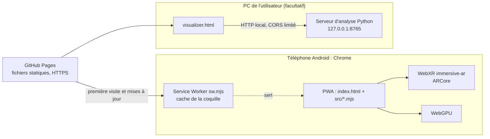

# Documentation technique

Point d'entrée unique pour comprendre, lancer, déployer et faire évoluer Football Simulator.
Chaque section résume l'essentiel et renvoie au document détaillé. État vérifié sur le code de
`main` au 25 novembre 2026 (commit `829e33b`).

## 1. Vue d'ensemble

Le dépôt contient deux sous-systèmes indépendants :

| Sous-système | Contenu | Licence | Dépend de l'autre ? |
| --- | --- | --- | --- |
| **Tableau tactique AR** | `index.html`, `src/*.mjs`, `sw.mjs`, `manifest.json` | Droits réservés à l'équipe (accord de licence en attente) | Non |
| **Visualiseur de match (Bêta)** | `visualizer.html`, `src/visualizer/`, `demo/`, `analysis/` (Python) | AGPL-3.0-only | Non : l'application n'y ajoute qu'un lien |

Choix structurants :

- **Site statique, sans compilation.** three.js r187 est copié dans `src/vendor/three-r187/` et
  chargé par une carte d'import dans `index.html`. Aucune dépendance de production.
- **WebGPU sans repli WebGL.** `src/webgpu.mjs` construit le moteur sans la bascule automatique
  de three.js. Le mode `?webgl` existe pour les tests uniquement.
- **WebXR `immersive-ar`** : espace `local-floor`, hit test, ancres, DOM Overlay.
- **PWA** installable et utilisable hors ligne, à coquille versionnée par empreinte de contenu.

## 2. Installation et lancement

Prérequis : Node.js 18 ou plus (pour `npm start` et les tests), Chrome ou Edge à jour avec WebGPU.

```bash
npm start            # sert le dépôt sur http://127.0.0.1:8080, sans npm install
npm install          # une fois, pour les tests : playwright-core 1.64.1
npm test             # tests unitaires puis tests de bout en bout dans Chrome
```

Ouvrir `index.html` directement depuis le disque ne fonctionne pas : les modules et le Service
Worker exigent HTTP.

| Paramètre d'adresse | Effet |
| --- | --- |
| `?iwer` | Émule un appareil AR sur PC (IWER) et ajoute la liaison WebGPU et une table virtuelle |
| `?webgl` | Mode test WebGL 2, pour un téléphone qui bloque WebGPU. Jamais activé tout seul |
| `?diagnostics` | Images par seconde, temps CPU, appels de dessin, triangles, mémoire GPU |
| `&debug` | Expose les objets internes dans `window.__footballSimulator` |

**Sur téléphone Android** (ARCore, Chrome à jour) : activer
`chrome://flags/#webxr-webgpu-binding`, puis ouvrir le site publié, ou rediriger le port local
par `chrome://inspect/#devices`.

**Serveur d'analyse (facultatif)** : Python 3.11, de préférence un GPU NVIDIA. Recette complète,
vérification des poids et sécurité dans [analysis/README.md](../analysis/README.md).

```bash
cd analysis
python -m football_analysis models --download
python -m football_analysis serve      # http://127.0.0.1:8765
```

## 3. Déploiement

GitHub Pages publie `main`, à la racine, en HTTPS (exigé par WebXR et le Service Worker) :
https://bilelkhlif.github.io/footballsimulator/

1. Sur une branche : modifier, puis `npm run shell-version` si un fichier de l'application a changé.
2. `npm test` : tout doit passer.
3. Pull request, relecture, fusion dans `main`.
4. GitHub Pages republie en une à deux minutes ; les appareils installés affichent
   « Nouvelle version installée ».

Pour un autre hébergeur, `npm run pages:prepare` produit un dossier qui ne contient que la partie
publique (sans serveur Python, tests, poids ni médias non déclarés). Les fichiers `.js` et `.mjs`
doivent être servis avec le type `text/javascript`.

### Intégration continue (`.github/workflows/`)

| Workflow | Quand | Ce qu'il fait |
| --- | --- | --- |
| `tests.yml` | Chaque push sur `main` et chaque pull request | Tests unitaires sur Node.js 20, 22 et 24 ; empreinte `SHELL_VERSION` et en-têtes de documentation (JavaScript et Python) contrôlés à part |
| `pages.yml` | Après des tests verts sur `main`, ou à la main | Prépare le site public avec `pages:prepare`, puis le publie si la variable `PAGES_DEPLOY` vaut `actions` |

Les tests de bout en bout ne tournent pas en intégration continue : ils exigent un GPU WebGPU.

**Passer la publication à GitHub Actions** (administrateur du dépôt, une seule fois) :
Settings → Pages → Source : « GitHub Actions », puis Settings → Secrets and variables → Actions →
Variables : `PAGES_DEPLOY` = `actions`. Le site publié ne contient alors que la partie publique
préparée par `pages:prepare`. Tant que ce n'est pas fait, Pages publie la branche `main` comme avant.

## 4. Architecture

### 4.1 Déploiement



Le diagramme UML de déploiement complet est dans [uml.md](uml.md).

### 4.2 Modules par couche

| Couche | Fichiers | Rôle |
| --- | --- | --- |
| Assemblage | `main.mjs` | Crée la scène, le tableau, l'historique, la session AR, la PWA, puis lance la boucle |
| Rendu | `webgpu.mjs`, `webgl-test-mode.mjs`, `scene.mjs`, `render-loop.mjs`, `theme.mjs` | Moteur, caméra, lumières, boucle unique, thèmes clair et sombre |
| Modèle 3D | `pitch.mjs`, `players.mjs`, `team.mjs`, `ball.mjs`, `reticle.mjs`, `tactical-arrows.mjs` | Terrain, joueurs instanciés, ballon, réticule TSL, flèches |
| État tactique | `tactics-board.mjs`, `tactical-sequence.mjs`, `formations.mjs`, `arrow-rules.mjs` | Source de vérité : places, formations, flèches, images clés |
| Actions | `commands.mjs` | Toute modification de l'état, annulable |
| Interaction | `pointer-input.mjs`, `xr-input.mjs`, `raycasting.mjs`, `tactical-interaction.mjs`, `keyboard-shortcuts.mjs` | Un geste devient un rayon, puis une commande |
| Vue | `tactical-view.mjs`, `formation-transition.mjs`, `sequence-player.mjs` | La scène suit l'état |
| Interface | `workspace-controller.mjs`, `workspace-navigation.mjs`, `formation-panel.mjs`, `tactical-toolbar.mjs`, `sequence-panel.mjs`, `onboarding.mjs`, `diagnostics.mjs` | Rail, sept espaces, panneaux, aide |
| AR | `xr-support.mjs`, `xr-session.mjs`, `ar-surface.mjs`, `ar-placement.mjs`, `ar-view.mjs` | Détection, session, hit test, ancre, passage 3D / AR |
| Développement | `dev-emulator.mjs`, `dev-xr-emulation.mjs` | Émulation IWER, avec `?iwer` seulement |
| PWA | `pwa.mjs`, `sw.mjs`, `sw.js` | Enregistrement, installation, mise à jour, migration |
| Analyse | `tactical-metrics.mjs`, `offside.mjs`, `offside-layer.mjs`, `analysis-panel.mjs` | Largeur, profondeur, distance entre les lignes et surface occupée de chaque équipe, en mètres réels ; ligne de hors-jeu (loi 11) et ses lignes en 3D ; panneau observateur du tableau |
| Équipes | `team-colors.mjs`, `team-identity.mjs`, `team-kits-view.mjs`, `team-panel.mjs` | Noms et maillots, contraste vérifié pour les daltoniens, gardien distinct ; l'identité est dans `TacticsBoard`, modifiée par `ChangeTeamIdentityCommand` |
| Marquage | `marking-layer.mjs` | Traits défenseur → attaquant, tâche de la boucle de rendu ; l'état est dans `TacticsBoard`, modifié par `MarkPlayerCommand` |
| Persistance | `tactic-storage.mjs` | Tactique enregistrée dans IndexedDB 0,4 s après chaque changement et à la page masquée, vérifiée puis rétablie au lancement |
| Partagé | `config.mjs`, `events.mjs` | Constantes ; émetteur d'événements |

Le rôle de chaque fichier, avec les raisons des choix, est dans [guide-du-code.md](guide-du-code.md)
et [architecture.md](architecture.md).

### 4.3 Chemin d'une action

Toute action de l'utilisateur suit le même chemin, à sens unique :

```text
pointer-input / xr-input ─rayon─▶ tactical-interaction ─▶ Command ─▶ TacticsBoard ─change─▶ TacticalView
     (saisie)                     (machine à états)       (historique)  (état)                (scène)
```

La saisie ne modifie pas l'état. Les commandes ne connaissent pas la scène. La scène ne fait que
suivre l'état. Annuler et rétablir passent donc par le même chemin, et la scène ne peut pas
diverger du tableau. Seule exception : pendant la lecture d'une séquence, la scène montre des
places interpolées. Tout changement du tableau arrête la lecture.

### 4.4 Repère

Unité : le mètre. Le terrain de 105 × 68 m devient 0,6 × 0,389 m (environ 1/175). Toutes les
positions tactiques sont exprimées dans le repère de `pitchGroup` : elles restent justes quand le
terrain est ancré et tourné en AR. Détail : [architecture.md](architecture.md#repère-et-unités).

## 5. Pipeline de réalité augmentée

| Étape | Fichier | Appel WebXR |
| --- | --- | --- |
| 1. Détection | `xr-support.mjs` | `navigator.xr.isSessionSupported('immersive-ar')` |
| 2. Session | `xr-session.mjs` | `requestSession('immersive-ar', { requiredFeatures: ['webgpu', 'local-floor'], optionalFeatures: ['hit-test', 'anchors', 'dom-overlay'] })` |
| 3. Hit test | `ar-surface.mjs` | `requestHitTestSource({ space: viewerSpace })`, puis à chaque image `frame.getHitTestResults()` |
| 4. Réticule | `ar-view.mjs`, `reticle.mjs` | Suit la pose du premier résultat |
| 5. Pose | `ar-surface.mjs`, `ar-placement.mjs` | Un toucher arme la pose ; elle est faite à l'image suivante, terrain tourné vers l'utilisateur |
| 6. Ancre | `ar-surface.mjs` | `frame.createAnchor()` ; ensuite `frame.getPose(anchor.anchorSpace)` à chaque image |
| 7. Interaction | `xr-input.mjs`, `raycasting.mjs` | Événement `select` : rayon du `targetRaySpace`, ramené dans le repère du terrain |

Deux règles :

- **Rien de WebXR hors de la boucle de rendu**, sauf l'événement `select`, qui porte sa propre
  image. C'est pourquoi le toucher pose le terrain à l'image suivante.
- **Les ancres sont protégées contre les courses** : un compteur de génération supprime une ancre
  arrivée après un « Déplacer le terrain » ou la fin de la session.

Sans hit test, le terrain est placé devant l'utilisateur. Sans ancres, il reste à sa pose dans
`local-floor`. Détail : [sprint-2.md](sprint-2.md), [sprint-3.md](sprint-3.md), [sprint-5.md](sprint-5.md).

```js
// src/render-loop.mjs : la seule boucle, en 3D comme en AR
return (time, frame) => {
  if (renderer.xr.isPresenting) {
    matchXrTargetToViews(renderer);
    const placement = getArPlacement();
    if (frame && placement) placement.update(frame); // hit test, réticule, ancre
  } else {
    controls.update();                                 // orbite, hors AR seulement
  }
  animator?.update();
  for (const task of tasks) task.update(time, frame);  // flèches, séquence, instances
  renderer.render(scene, camera);
};
```

## 6. Patrons de conception

### Strategy : les formations (`src/formations.mjs`)

Chaque formation est une sous-classe qui décrit ses lignes ; le calcul est commun et vérifie
qu'elle place 11 joueurs. Ajouter une formation, c'est ajouter une classe à `FORMATIONS`.

```js
export class FormationStrategy {
  get name()  { throw new Error('la sous-classe doit définir name'); }
  get lines() { throw new Error('la sous-classe doit définir lines'); }
  computePositions() {
    const positions = this.lines.flatMap((line) => line.slots.map((slot) => ({
      x: slot.x ?? line.x, y: slot.y, number: slot.number, role: slot.role,
    })));
    if (positions.length !== 11) throw new Error(`La formation ${this.name} place ${positions.length} joueurs`);
    return positions;
  }
}
export class Formation442 extends FormationStrategy { get name() { return '4-4-2'; } /* lines… */ }
```

### Command : les actions annulables (`src/commands.mjs`)

Sept commandes : déplacer un joueur, déplacer le ballon, tracer une flèche, changer de formation,
réinitialiser, ajouter une image clé, effacer la séquence. `CommandHistory` garde 100 actions au
plus ; une commande qui ne change rien n'est pas gardée.

```js
export class MovePlayerCommand extends Command {
  execute() {
    this.#from = this.#board.getPlayerPosition(this.#teamId, this.#number);
    return this.#board.setPlayerPosition(this.#teamId, this.#number, this.#to);
  }
  undo() {
    this.#board.setPlayerPosition(this.#teamId, this.#number, this.#from);
  }
}
```

### Observer : l'état prévient la scène (`src/events.mjs`)

`TacticsBoard`, `CommandHistory`, `TacticalSequence`, la session AR et la pose du terrain héritent
d'`EventEmitter`. `on()` renvoie la fonction de désabonnement. Un observateur en erreur
n'empêche pas les autres d'être prévenus.

```js
export class EventEmitter {
  #listeners = new Map();
  on(type, listener) { /* … */ return () => this.off(type, listener); }
  emit(type, detail) {
    for (const listener of [...(this.#listeners.get(type) ?? [])]) {
      try { listener(detail); } catch (error) { console.error(error); }
    }
  }
}
```

### Factory : les joueurs (`src/players.mjs`)

`PlayerFactory` partage géométries et matériaux, crée chaque joueur (numéro, zone de sélection,
orientation) et les maillages instanciés de son équipe : 3 appels de dessin par équipe.

```js
createPlayer({ team, number, role }) {
  const player = new THREE.Group();
  player.userData = { type: 'player', teamId: team.id, number, role };
  player.add(new THREE.Sprite(this.getLabelMaterial(team, number)),
             new THREE.Mesh(this.hitboxGeometry, this.hitboxMaterial));
  player.rotation.y = team.attacksPositiveX ? 0 : Math.PI;
  return player;
}
```

## 7. PWA et Service Worker

| Requête | Stratégie |
| --- | --- |
| Fichier de `APP_SHELL` (55 entrées : page, modules, styles, three.js, icônes, manifeste) | **Cache d'abord**, dans le cache de la version installée |
| Autre requête de la même origine | **Réseau d'abord** ; le cache répond après 3 s, puis directement pendant 15 s |
| Requête `Range`, vidéo, autre origine, méthode autre que GET | Non interceptée |

- `SHELL_VERSION` est une empreinte SHA-256 du contenu de la coquille, recalculée par
  `npm run shell-version`. Un fichier modifié change `sw.mjs`, donc le navigateur installe la
  nouvelle version.
- L'installation est atomique (`cache.addAll`, `cache: 'reload'`) : tout ou rien.
- `sw.js` ne sert plus rien : il fait migrer les installations antérieures vers `sw.mjs`.
- `npm test` vérifie que tout fichier chargé est dans `APP_SHELL` et que l'empreinte est à jour.

Détail : [sprint-6.md](sprint-6.md#6-pwa--une-seule-version-à-la-fois), [migration-mjs.md](migration-mjs.md).

## 8. Visualiseur de match et serveur d'analyse

- **Mode démonstration** : lit les exports statiques de `demo/` (manifeste, pistes, segments JSON
  validés par les schémas de `src/visualizer/schemas/`). Fonctionne sur GitHub Pages, sans Python.
- **Mode analyse locale** : `src/visualizer/api-client.mjs` envoie la vidéo au serveur Python
  local. Pipeline : coupures de plan (PySceneDetect), détection (YOLOv8 de Roboflow Sports),
  suivi (ByteTrack), équipes (SigLIP + UMAP + KMeans), calibration par homographie stabilisée,
  métriques, export par segments.
- **Sécurité du serveur** : écoute sur la boucle locale seulement, en-tête `Host` vérifié (rebond
  DNS), origines CORS explicites, taille de téléversement bornée (4 Gio), poids vérifiés par
  empreinte (`models.lock.json`).

Détail : [visualiseur-match.md](visualiseur-match.md), [visualiseur-modes.md](visualiseur-modes.md),
[stabilisation-homographie.md](stabilisation-homographie.md).

## 9. Tests

| Commande | Contenu | Résultat du 25 novembre 2026 |
| --- | --- | --- |
| `npm run test:unit` | 285 tests Node, doublures de WebXR et WebGPU, documentation du code | 285 réussis |
| `npm run test:e2e` | Vérifications dans Chrome sans interface, AR émulée comprise | 226 réussies |
| `python -m unittest discover -s tests` (dans `analysis/`) | Serveur, pipeline, sécurité | 144 réussis (selon la livraison), dans l'environnement de `analysis/README.md` |
| `npm run bench` | Performances, processeur ralenti 4 fois | Hors `npm test` |

Les tests de bout en bout exigent un GPU compatible WebGPU : ils ne tournent pas sur un serveur
d'intégration continue sans GPU.

## 10. Limites connues et pistes d'amélioration

Classées par priorité pour la soutenance.

### Priorité 1 : à faire avant la soutenance

| # | Point | Pourquoi | Action |
| --- | --- | --- | --- |
| 1 | **Essais sur téléphone de la version actuelle** | L'interface « verre » et les sept espaces n'ont été vérifiés qu'en émulation. Les essais physiques datent du 12 et du 14 novembre | Dérouler P0 à P10 de [recette.md](recette.md) sur le TECNO POVA 6 Pro, remplir le tableau |
| 2 | **Mesures du cahier** | 8 exigences restent partielles : 30 images par seconde, stabilité d'une minute, 9 essais sur 10 | `?diagnostics` sur téléphone, puis reporter les chiffres dans [conformite-cahier-des-charges.md](conformite-cahier-des-charges.md) |
| 3 | **Vidéo de démonstration** | Seule exigence « non faite » | Tourner selon le [storyboard](video-demonstration.md) |
| 4 | **Accord de licence des trois coauteurs** | L'application est publiée sans licence | Signer la [demande](demande-accord-licence.md) |

### Priorité 2 : qualité du dépôt

| # | Point | Action |
| --- | --- | --- |
| 5 | Aucune intégration continue : les tests ne tournent que sur le PC de celui qui les lance | Fait dans ce lot : `.github/workflows/tests.yml` lance les tests unitaires à chaque push et pull request. Les tests de bout en bout restent manuels (GPU nécessaire) |
| 6 | Chiffres périmés dans la documentation : plusieurs comptes de tests différents dans le README (369, 285, 277, 226), coquille annoncée à 51 entrées au lieu de 54 (55 depuis la sauvegarde automatique) | Coquille corrigée dans ce lot. Garder un seul tableau de résultats daté, dans le README, et renvoyer vers lui |
| 7 | README de 617 lignes, qui répète les comptes rendus de sprint | Le ramener à environ 150 lignes : présentation, lancement, liens. Le reste est déjà dans `docs/` |
| 8 | 60 documents dans `docs/`, dont des doublons apparents (`conformite.md` et `conformite-cahier-des-charges.md` ; `architecture.md` et `guide-du-code.md`) | Fait : index [docs/README.md](README.md), qui distingue les deux matrices de conformité ; revues archivées dans `docs/archives/` |
| 9 | `src/visualizer/visualizer-main.mjs` fait 1 525 lignes | Le découper (chargement des sources, lecture vidéo, panneaux, sélection), comme l'a été `main.mjs` |
| 10 | Le serveur local `tests/serve.mjs` sert les vidéos `.webm` des tests en `application/octet-stream` | Corrigé dans ce lot : types `.webm`, `.webp`, `.ico`, `.txt` ajoutés |

### Priorité 3 : évolutions fonctionnelles

| # | Idée | Remarque |
| --- | --- | --- |
| 11 | Partager une tactique (export JSON, lien) | Le cahier cite l'absence de partage à distance comme défaut du tableau blanc. La sauvegarde automatique est faite (`tactic-storage.mjs`) : son format versionné et sa vérification peuvent servir tels quels à l'import d'un lien |
| 12 | Hors ligne : une navigation vers `visualizer.html` sans réseau retombe sur `index.html` | Servir une petite page « Visualiseur indisponible hors ligne » plutôt que l'application |
| 13 | iPhone : pas de WebXR dans Safari | Hors de portée du web ; documenter la vue 3D seule comme mode iPhone |
| 14 | La liaison WebXR/WebGPU reste derrière un drapeau de Chrome | À surveiller : quand Chrome l'active par défaut, retirer l'aide du drapeau |
