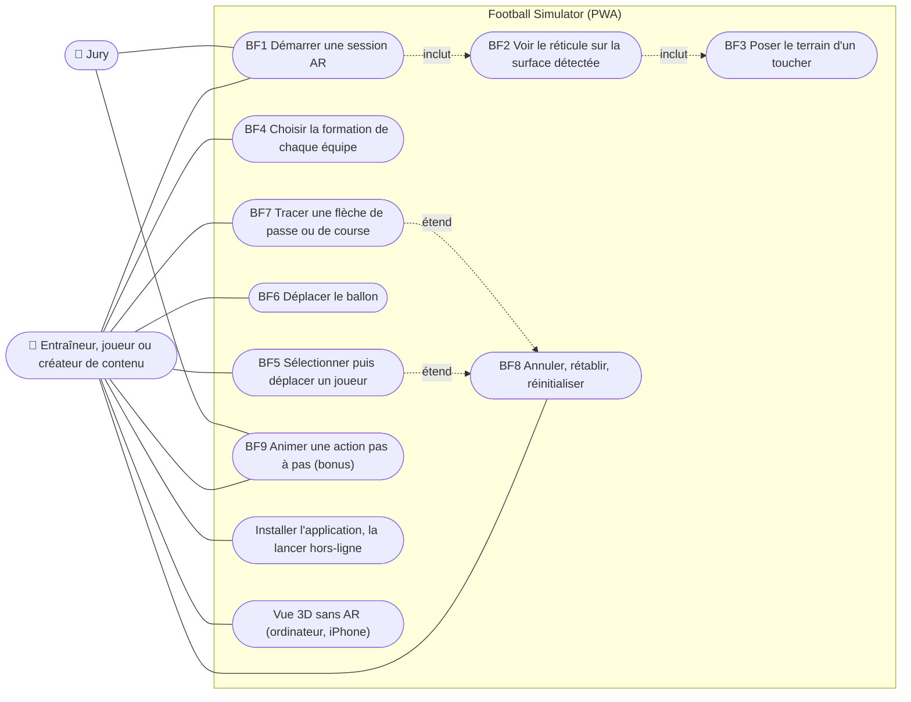
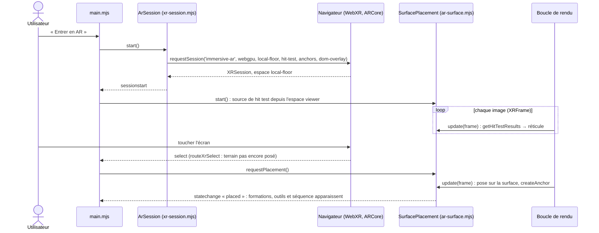
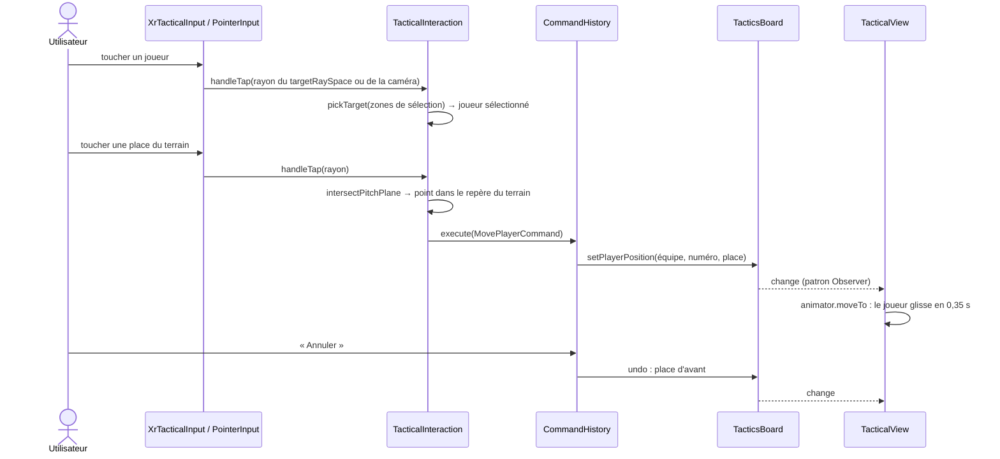
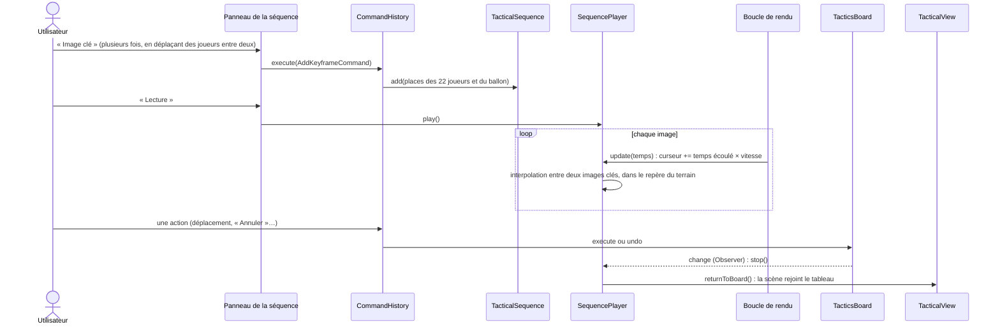
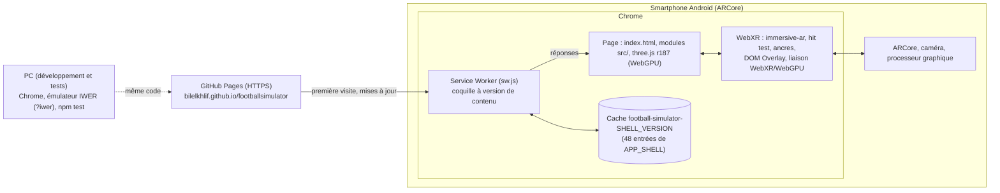
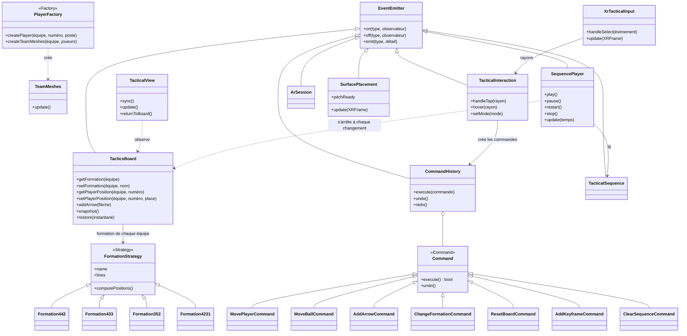

# Diagrammes UML

Diagrammes de la version finale (sprint 6), demandés par le cahier des charges (§5.4 : cas d'utilisation, séquence, déploiement), complétés par un diagramme des classes principales. Ils sont écrits en Mermaid : GitHub les affiche directement.

## 1. Cas d'utilisation

## 2. Séquences

### 2.1 Poser le terrain (BF1 à BF3)

### 2.2 Déplacer un joueur (BF5), patron Command

### 2.3 Animer une action (BF9)

## 3. Déploiement

## 4. Classes principales

