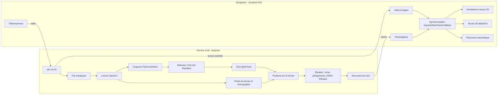

# Visualiseur de match : architecture et validation

Phases B et D du visualiseur de match. La phase A, la recherche des composants libres, est dans [opensource-research.md](opensource-research.md). Les deux modes (démonstration publique sans serveur, analyse locale), l'export statique, la sécurité et les licences de redistribution sont dans [visualiseur-modes.md](visualiseur-modes.md). La [recherche sur les équipes et la lumière](equipes-lumiere-recherche.md) compare les corrections légères. L'installation et l'utilisation sont dans [analysis/README.md](../analysis/README.md).

**Statut :** prototype sur la branche `feature/visualiseur-match`, pas encore fusionné dans `main`. L'application AR n'est pas modifiée : aucun fichier de sa coquille ne change, et `SHELL_VERSION` reste `0cabdc0abc04da44`.

---

## 1. Ce que fait le prototype

1. L'utilisateur téléverse une vraie vidéo de match dans [visualizer.html](../visualizer.html).
2. Le serveur local l'analyse avec des modèles préentraînés publics :
   - détection des joueurs, des gardiens, des arbitres et du ballon ;
   - suivi image par image ;
   - deux équipes ;
   - calibration de la caméra et position sur le terrain.
3. La vidéo d'origine s'affiche avec ses annotations : une ellipse à la couleur de l'équipe et l'identifiant de suivi.
4. Le terrain 3D de l'application, rendu en WebGPU, est posé dans la vidéo, synchronisé image par image :
   - un panneau déplaçable, redimensionnable, orientable, zoomable, réductible et verrouillable ;
   - placé automatiquement dans la zone la moins encombrée de l'image.
5. Un joueur se sélectionne sur la vidéo ou sur le terrain 3D. Il est mis en évidence aux deux endroits, avec :
   - sa vitesse ;
   - sa distance parcourue ;
   - sa trace et sa flèche de déplacement.

Rien n'est inventé : sans calibration pour une image, aucune position n'est donnée et le terrain 3D reste vide ; sans équipe sûre, le joueur reste gris.

---

## 2. Architecture



| Rôle | Fichiers | Remarque |
| --- | --- | --- |
| Lecture de la vidéo | `pipeline.py` (`probe_video`, `_analyse_frames`) | OpenCV ; échantillonnage à cadence fixe (12,5 images/s), horodatage de la vidéo source |
| Détection et suivi | `detection.py`, `tracking.py` | YOLOv8 (Roboflow Sports) ; ByteTrack (trackers) ; coupures (PySceneDetect) |
| Calibration | `calibration.py` | 32 points du terrain, homographie RANSAC, contrôles, causes d'échec |
| Équipes | `teams.py` | Torse avec SigLIP, personne entière avec CLIP ; `TeamClassifier` de Roboflow, extraction par lots, vote par trajectoire |
| Données | `contract.py`, `metrics.py`, `jobs.py` | Format commun au fichier et au direct ; mesures de qualité ; un dossier par analyse |
| Transport | `server.py` | HTTP, bibliothèque standard ; lecture partielle de la vidéo |
| Rendu et interaction | `src/visualizer/` | Magasin, synchronisation, annotations, terrain 3D, panneau, placement, mesures |

### API du serveur

| Requête | Réponse |
| --- | --- |
| `GET /api/health` | Matériel de calcul, poids manquants, réglages |
| `POST /api/analyses?name=<fichier>` (corps : la vidéo) | 202 et l'état de l'analyse ; 415 si le format n'est pas pris en charge ; 422 si OpenCV ne peut pas lire la vidéo |
| `GET /api/analyses` | Liste des analyses |
| `GET /api/analyses/<id>` | État, progression, `results` (segments déjà écrits), et à la fin mesures et limites |
| `GET /api/analyses/<id>/manifest` | En-tête et disponibilité, sans images ; 409 tant qu'aucun segment n'existe |
| `GET /api/analyses/<id>/frames?from=&to=` | Fenêtre de trente secondes au plus, images voisines comprises |
| `POST /api/analyses/<id>/interrupt` | Interruption au prochain lot d'images ; l'analyse reste reprenable |
| `POST /api/analyses/<id>/resume` | Reprise depuis le dernier segment validé |
| `GET /api/analyses/<id>/tracking` | Document de suivi ; 409 avant la fin |
| `GET /api/analyses/<id>/video` | Vidéo source, avec `Range` |

Le serveur écoute `127.0.0.1:8765` et ne sert que `visualizer.html`, `src/`, `assets/` et `demo/` (vidéos avec `Range`). Il vérifie l'en-tête `Host` et l'origine des requêtes : voir [visualiseur-modes.md](visualiseur-modes.md), partie 5. Il ne sert ni `index.html` ni `sw.js` : le Service Worker de l'application AR ne peut donc pas s'installer sur son origine, où il mettrait en cache les réponses de l'API.

---

## 3. Format des données de suivi

Un document de suivi est un JSON. Exemple réduit, tiré de l'analyse réelle de la vidéo de la Bundesliga :

```json
{
  "format": "football-tracking", "version": 1,
  "source": { "kind": "file", "name": "roboflow-dfl-2e57b9_0.mp4", "width": 1920, "height": 1080, "fps": 25.0, "frameCount": 750,
              "duration": 30.0, "constantFrameRate": true, "timestamps": "container" },
  "analysis": { "stride": 2, "fps": 12.5, "models": { "players": { "file": "football-player-detection.pt", "sha256": "…" } } },
  "pitch": { "length": 105.0, "width": 68.0, "origin": "centre", "units": "m" },
  "frames": [
    { "index": 200, "time": 8.0, "shot": 0, "cut": false,
      "calibration": { "status": "ok", "keypoints": 13, "inliers": 13, "fitErrorPx": 2.3, "fitErrorM": 0.2,
                       "holdoutErrorPx": 4.3, "holdoutErrorM": 0.39, "homography": [9 nombres] },
      "objects": [ { "id": 1, "role": "player", "confidence": 0.91, "box": [x1, y1, x2, y2], "pitch": [15.6, 7.66],
                     "pitchStatus": "ok", "team": 0, "teamConfidence": 1.0 } ],
      "ball": { "confidence": 0.62, "box": [x1, y1, x2, y2], "pitch": [x, y], "pitchStatus": "ok" } }
  ],
  "teams": [ { "id": 0, "color": "#f7f8ed", "tracks": 11 } ],
  "tracks": [ { "id": 1, "role": "player", "team": 0, "teamConfidence": 1.0, "teamVotes": 8, "firstTime": 0.0, "lastTime": 29.92 } ],
  "metrics": { "…": "partie 5" },
  "limitations": [ "Les numéros de maillot ne sont pas lus…" ]
}
```

Règles du format :

- **Temps.** Chaque image analysée garde son numéro et son instant dans la vidéo source, lu dans l'horodatage du conteneur (`timestamps: "container"`), ce qui rend les cadences et les résolutions indifférentes, cadence variable comprise. `constantFrameRate` dit si la cadence est fixe.
- **Boîtes.** Elles sont en pixels de la vidéo source.
- **Positions.** Elles sont en mètres, l'origine au point central :
  - `x` va vers le but de droite de l'image ;
  - `y` va vers la caméra principale.
- **Position absente.** `pitch: null` est toujours accompagné d'une cause :
  - `no-calibration` : l'image n'a pas pu être calibrée ;
  - `outside-pitch` : la position calculée tombe à plus de 5 m des lignes.

  `validate_document` refuse une position dans une image non calibrée.
- **Échec de calibration.** Il porte sa cause (`reason`), parmi `too-few-keypoints`, `too-few-inliers`, `aligned-keypoints`, `mirrored`, `reprojection-error`, `homography-failed` et `no-pitch-detected`.
- **Confiance.** Chaque détection a la sienne ; chaque équipe a sa part des votes (`teamConfidence`). Sous deux tiers des votes, l'équipe reste `null`.
- **Erreurs de calibration.** `fitError*` est mesurée sur les repères qui ont servi à l'estimation, `holdoutError*` sur chaque repère prédit sans lui (partie 6.3). Aucune n'est une précision des positions de joueurs.

### Même format pour le direct

Le document se découpe en messages, et inversement (`document_to_messages`, `messages_to_document`) :

- un en-tête (`header`) : source, analyse, terrain ;
- une image analysée (`frame`), qui se suffit à elle-même : équipe et confiance y sont recopiées ;
- un résumé (`summary`), qui peut être renvoyé à tout moment.

Côté navigateur, `TrackingStore.ingest` reçoit ces mêmes messages, y compris dans le désordre ; c'est testé.

Le transport du direct n'est pas écrit. Le plus simple serait un WebSocket qui pousse ces messages en JSON, un par image analysée. Le WebRTC ne servirait qu'à transporter l'image elle-même.

Pour un flux, une différence demeure : les équipes demandent une phase d'apprentissage. Les premières secondes resteraient avec `team: null`, puis le résumé et les images suivantes porteraient les équipes.

---

## 4. Réutilisation des modules three.js du projet

| Module | Usage dans le visualiseur |
| --- | --- |
| `webgpu.js` | `createWebGpuRenderer` : WebGPU sans repli, fond transparent (`alpha`) pour laisser voir la vidéo |
| `pitch.js` | Le terrain, tel quel |
| `players.js` | `PlayerFactory` et `TeamMeshes` : une réserve de pions instanciés par équipe ; numéro = identifiant de suivi |
| `ball.js` | Le ballon |
| `tactical-arrows.js` | `buildArrowGeometry` : les flèches de déplacement, en un seul maillage instancié |
| `raycasting.js`, `pointer-input.js` | Sélection d'un joueur au tap dans le terrain 3D |
| `config.js` | Échelle de la maquette (105 × 68 m réels) |
| `events.js` | Événements du panneau flottant |

---

## 5. Cas difficiles

| Situation | Traitement |
| --- | --- |
| Caméra qui suit le jeu, zoom | Une homographie par image analysée, à partir des points du terrain visibles |
| Coupure de plan | PySceneDetect ; suivi remis à zéro, identifiants neufs, numéro de plan dans chaque image ; aucune interpolation à travers une coupure |
| Joueur masqué ou hors champ | Absent de l'image analysée : ni dessiné, ni interpolé. ByteTrack garde sa trajectoire ouverte 1 s (réglage par défaut de trackers : 30 images à 30 images/s), puis l'abandonne |
| Échange d'identifiants | Non corrigé (pas de réidentification) ; mesuré : fragmentation, déplacements invraisemblables. Les votes couvrent toute la trajectoire : un échange peut les partager. L'équipe reste inconnue sous le seuil, mais une majorité suffisante peut encore donner une équipe fausse après l'échange. Un saut de plus de 12 m/s ne compte ni dans la vitesse, ni dans la distance, ni dans les traces |
| Échec de calibration | Cause enregistrée, aucune position ; le visualiseur l'écrit et laisse le terrain 3D vide |
| Équipes faussées par la lumière ou le fond | Cadrage sur le torse avant SigLIP ; mêmes UMAP et vote. L'indicateur d'équipe majoritaire reste un avertissement, pas une preuve de justesse. Validation de la correction en partie 6.7 |
| Position incertaine | Erreur d'ajustement et erreur hors échantillon par image ; position hors du terrain écartée ; confiance de détection et d'équipe |
| Cadences et résolutions | Échantillonnage à cadence fixe ; horodatage du conteneur (une vidéo à cadence variable était décalée jusqu'à 2,4 s avant la correction) ; boîtes mises à l'échelle de l'image affichée |
| Synchronisation | `requestVideoFrameCallback` en lecture ; après un déplacement dans la vidéo, `currentTime`, ramené au début de l'image affichée si la cadence est fixe ; interpolation linéaire seulement entre deux analyses consécutives d'un même joueur |

---

## 6. Validation

Revue critique du 17 novembre 2026 : toutes les vidéos ont été réanalysées avec le code corrigé, avec le réglage par défaut (SigLIP), sur un PC portable (RTX 2050 de 4 Go, Ryzen 7 6800HS).

Les parties 6.1 à 6.6 conservent cette première campagne, avant la correction du cadrage des
équipes. La nouvelle campagne, ses 55 tests Python et ses mesures avant/après sont en partie 6.7.

### 6.1 Niveaux de preuve

| Niveau | Contenu |
| --- | --- |
| **Automatisé** | 40 tests Python (sans GPU ni poids), 15 tests unitaires du visualiseur dans `npm test`, 15 vérifications de bout en bout dans Chrome avec WebGPU, sur des données synthétiques |
| **Mesuré sur de vraies vidéos** | 8 analyses (partie 6.2), dont deux téléversements complets par l'interface |
| **Inspecté à l'œil** | Comptage manuel sur deux images en pleine résolution ; images annotées et vue de dessus comparées à la vidéo, sur cinq vidéos |
| **Non fait** | Vérité terrain des positions de joueurs ; autres angles de caméra (partie 6.2) |

### 6.2 Vidéos

| Vidéo | Origine | Format | Ce qu'elle teste |
| --- | --- | --- | --- |
| `2e57b9_0`, `0bfacc_0`, `121364_0`, `08fd33_0`, `573e61_0` | Les cinq exemples de Roboflow Sports (`setup.sh`), tirés du concours Kaggle « DFL – Bundesliga Data Shootout » | 1920 × 1080, 25 images/s, 30 s chacune | Caméra principale qui suit le jeu, cinq stades ; soleil et ombre marqués sur `08fd33_0` et `573e61_0` |
| `2e57b9_0` en 720p | Copie réencodée en local (ffmpeg) | 1280 × 720, 30 images/s, 30 s | Autre résolution, autre cadence |
| Montage à coupures | Montage local de `2e57b9_0` : plan large de 0 à 8 s, zoom numérique ×2,5 de 8 à 16 s, plan large après un saut de 6 s | 1920 × 1080, 25 images/s, 24 s | Vraies coupures dans de vraies images ; plan serré. Ce n'est pas une réalisation de télévision : le zoom est un recadrage |
| Copie à cadence variable | Copie locale de `2e57b9_0` : une image sur trois pendant 5 s, puis toutes | 1920 × 1080, 8 puis 25 images/s, 10 s | Horodatage à cadence variable, fréquent au téléphone |

Les conditions d'utilisation des vidéos du concours n'ont pas pu être lues (partie 6 de la recherche) : elles restent en local, ni versionnées ni diffusées.

**Autres angles de caméra : non testés.** Les vidéos libres repérées sur Wikimedia Commons (tribunes, match amateur, résumés à coupures) ont été refusées par le serveur de fichiers (« 429 Too Many Requests ») à chaque essai, le matin puis l'après-midi du 17 novembre 2026. Sa règle demande une adresse de contact dans la requête, que nous n'avons pas mise. Les deux candidates trouvées sur Internet Archive ne convenaient pas : l'une est filmée hors du stade, l'autre est un montage de la NFL faussement marqué CC BY.

### 6.3 Méthode de mesure

- **Erreur d'ajustement** (`fitError`). C'est la distance entre chaque repère du terrain détecté et le même repère du gabarit, reprojeté par l'homographie. Elle porte sur les repères qui ont servi à l'estimation, donc elle est optimiste par construction : avec 5 repères, il ne reste que 2 degrés de liberté pour absorber le bruit. **Correction de la revue :** la première version de ce document l'a présentée, en moyenne quadratique, comme l'erreur de calibration (0,35 à 0,49 m).
- **Erreur hors échantillon** (`holdoutError`). Chaque repère est prédit par une homographie estimée sans lui (validation croisée « un point de côté »). C'est la meilleure estimation disponible sans vérité terrain. Les deux erreurs sont des médianes par repère, donc comparables.
- **Ce qu'aucune des deux ne mesure : la précision des positions de joueurs.**
  - Les repères sont des marquages, et les joueurs sont ailleurs sur le terrain.
  - Le pied d'un joueur est pris au milieu du bas de sa boîte, qui dépend de la boîte et de la posture.
  - Une erreur commune à tous les repères échappe à la validation croisée.
  - Le gabarit suppose 105 × 68 m.

  Mesurer cette précision demanderait des positions de référence alignées sur la vidéo : par exemple SoccerNet-GSR, sous accord de confidentialité, ou des données de suivi officielles synchronisées. Ce n'est pas fait.
- **Vitesse.** La lenteur (`slowdown`) est le temps total de traitement (modèles, images, équipes) divisé par la durée de vidéo lue. Les « images analysées par seconde » comptent les images analysées, une sur deux à 25 images/s, et non les images de la vidéo. **Correction de la revue :** le chiffre de 2,2 à 2,6 images/s, donné sans cette précision, pouvait faire croire à 750 ÷ 2,2 = 341 s pour une vidéo de 30 s ; c'était en fait de 237 à 264 s, soit de 7,9 à 8,8 fois la durée.
- **Mémoire.** Pic de mémoire vive du processus et pic de mémoire GPU de toute l'analyse. **Correction de la revue :** les 1,75 Go de GPU attribués aux modèles YOLO venaient en fait de CLIP ; avec SigLIP, le pic est de 0,65 Go. Sur cette machine, UMAP charge aussi TensorFlow, installé hors du projet et visible depuis l'environnement : la mémoire vive mesurée (2,6 Go) en est gonflée.

### 6.4 Résultats avant le cadrage des maillots

| Vidéo | Images analysées | Plans | Calibrées | Erreur d'ajustement | Erreur hors échantillon, médiane (90 %) | Fragmentation | Ballon | Équipe majoritaire par image | Lenteur |
| --- | ---: | ---: | ---: | ---: | ---: | ---: | ---: | ---: | ---: |
| `2e57b9_0` | 375 | 1 | 100 % | 0,20 m | 0,39 m (0,58) | 1,14 | 73 % | 50 % | 8,8 fois |
| `0bfacc_0` | 375 | 1 | 100 % | 0,31 m | 0,63 m (0,83) | 1,05 | 84 % | 50 % | 8,7 fois |
| `121364_0` | 375 | 1 | 100 % | 0,25 m | 0,44 m (0,84) | 1,05 | 80 % | 53 % | 8,0 fois |
| `08fd33_0` | 375 | 1 | 100 % | 0,25 m | 0,70 m (1,04) | 1,05 | 84 % | 50 % | 7,8 fois |
| `573e61_0` | 375 | 1 | 100 % | 0,24 m | 0,45 m (0,72) | 1,27 | 59 % | **80 %** | 8,6 fois |
| `2e57b9_0` en 720p, 30 images/s | 450 | 1 | 100 % | 0,21 m | 0,41 m (0,60) | 1,10 | 72 % | 50 % | 8,0 fois (14,7 fois quand une autre analyse partageait le GPU) |
| Montage à coupures | 300 | 3 | 99,3 % | 0,18 m | 0,43 m (1,23) | 1,10 | 53 % | 55 % | 8,5 fois |
| Cadence variable | 167 | 1 | 100 % | 0,18 m | 0,34 m (0,49) | 1,29 | 78 % | 50 % | 13,5 fois |

Erreurs en mètres sur le terrain ; la colonne « 90 % » donne la valeur sous laquelle tombent 90 % des images. Environ 20 joueurs par image sur toutes les vidéos. Pic de mémoire : 2,6 Go de mémoire vive, 0,65 Go de GPU.

Lecture :

- **Calibration.** Toutes les images sont calibrées, sauf deux dans le plan zoomé, refusées avec leur cause. L'erreur hors échantillon est environ deux fois l'erreur d'ajustement : 0,34 à 0,70 m en médiane, jusqu'à 1,04 m pour 90 % des images de `08fd33_0` (8 repères par image en médiane). Dans le plan zoomé, les repères sont groupés autour du rond central : 90 % des images y restent sous 1,23 m, mais la médiane ne bouge presque pas. C'est la fragilité attendue d'un plan serré, et l'indicateur la montre.
- **Suivi.** Fragmentation de 1,05 à 1,14, plus élevée sur `573e61_0` (1,27) et sur la copie à cadence variable (1,29), dont les 5 premières secondes n'ont que 8 images par seconde.
- **Détection.** Comptage à la main sur deux images de `2e57b9_0` :
  - image 400 : 24 personnes sur le terrain, 24 détectées, aucune fausse détection ;
  - image 600 : 23 personnes, 23 détectées, une fausse détection (un entraîneur le long de la ligne de touche, classé arbitre).

  Sur `573e61_0`, des remplaçants qui s'échauffent près du banc sont détectés comme joueurs. Sur `0bfacc_0`, le gardien en vert est détecté comme joueur.
- **Équipes.**
  - **Défaut constaté sur `573e61_0`.** Des joueurs blancs au soleil sont classés avec l'équipe sombre, avec des votes unanimes. Sur ces cinq vidéos, c'est la seule où le classement échoue.
  - **Ce que cette première revue change.** À ce stade, le classement lui-même n'est pas corrigé. Le défaut est signalé : dans une image typique, 80 % des joueurs classés y sont dans la même équipe, contre 50 à 55 % ailleurs, et le visualiseur l'annonce au-delà de 65 %. La correction ultérieure et ses mesures sont en partie 6.7.
  - **Contrôle visuel.** Ailleurs, 19 joueurs sur 20 sont bien classés sur l'image vérifiée de `2e57b9_0`. L'exception est un échange d'identifiants.
- **Vitesse.** De 7,8 à 8,8 fois la durée de la vidéo pour 30 s, dont 60 à 83 s fixes pour les équipes. Les clips courts paient donc plus cher en proportion : 13,5 fois pour 10 s. La copie en 720p a pris 14,7 fois au premier passage, puis 8,0 fois au second. Pendant le premier, un téléversement fait par l'interface s'analysait en même temps sur le même GPU : deux analyses simultanées se partagent la carte, d'où la file, qui n'en traite qu'une à la fois.

### 6.5 Cas difficiles, sur de vraies images

| Cas | Constat |
| --- | --- |
| Coupures de plan | Montage : coupures trouvées à 8,0 et 16,0 s exactement. Suivi remis à zéro : aucune trajectoire ne franchit une coupure (durée médiane 7,8 s pour des plans de 8 s) |
| Plan serré (zoom ×2,5) | Toujours calibré à 99 % ; joueurs, arbitre et équipes justes au contrôle visuel ; erreur hors échantillon plus dispersée |
| Échec de calibration | Deux images du plan zoomé, refusées avec leur cause, sans position ; sur les données de test, le terrain 3D reste vide |
| Cadence variable | Avant la correction, instants décalés jusqu'à 2,4 s ; après, horodatage du conteneur, écart nul, cadence déclarée variable |
| Échange d'identifiants | Trajectoire 15 de `2e57b9_0`, d'un joueur sombre à un blanc ; vote d'équipe partagé (67 %) ; saut exclu des vitesses, distances et traces |
| Équipe inconnue | 0 à 3 trajectoires de joueurs par vidéo, votes partagés : affichées en gris, avec un trait en pointillés |
| Fausses détections | Entraîneur classé arbitre, remplaçants détectés : affichés sans filtre. Rien ne les distingue d'un joueur à la limite du terrain |
| Équipes faussées par la lumière | Première revue : `573e61_0` signalé (partie 6.4), non corrigé à ce stade ; correction ultérieure en partie 6.7 |

### 6.6 Interface

**Tests de bout en bout** (`tests/visualizer-tests.mjs`, Chrome avec WebGPU, vidéo synthétique dont chaque image porte son numéro en binaire) :

- 15 vérifications sur 15 réussies le 17 novembre 2026 ;
- **à l'arrêt**, après un déplacement dans la vidéo, l'image affichée et l'image annotée sont la même, aux images 25, 47 et 91 ;
- **en lecture**, selon l'essai, entre 265 et 312 des quelque 318 images peintes sont identiques, et l'écart ne dépasse jamais une image (40 ms) ;
- **rotation et zoom** : glisser dans le terrain 3D le fait tourner (167°), la molette le rapproche (de 0,71 à 0,58 m), sans changer la sélection ;
- **sélection** : un joueur se sélectionne sur la vidéo comme sur le terrain 3D ;
- **panneau** : déplacé, redimensionné, verrouillé, réduit, et placé automatiquement hors des joueurs ;
- **aucun contexte WebGL** n'est créé : seulement `webgpu`, et `2d` pour les annotations et les numéros.

**Vraies vidéos, par l'interface.** `2e57b9_0` (CLIP) puis `121364_0` (SigLIP, réglage par défaut) ont été téléversées par la page :

- 286 s et 256 s entre le choix du fichier et l'affichage ;
- en lecture : 144 et 129 images peintes par seconde, au plus 10,8 et 38,9 ms pour une image ;
- aucun écart entre l'instant de l'image présentée et celui des données ;
- aucune erreur dans la console.

Les captures montrent le panneau 3D placé seul dans des zones vides : tribunes, puis pelouse dégagée. Les maillots apparaissent à leur couleur, avec des étiquettes lisibles.

**Défauts trouvés par les essais, et corrigés :**

- un message masqué qui bloquait les clics ;
- la taille de départ du panneau ;
- l'instant utilisé après un déplacement dans la vidéo ;
- des étiquettes blanches sur un maillot blanc ;
- la couleur des maillots tirée par la pelouse ;
- le vote d'équipe limité au début des trajectoires ;
- l'horodatage à cadence variable ;
- les sauts d'échange d'identifiants comptés dans les distances ;
- un téléversement complet, encore en file, perdu au redémarrage du serveur : il est désormais remis en file.

**Hors de portée de ces essais :**

- l'usage au doigt sur tablette ;
- un écran de moins de 960 px de large, où les panneaux passent sous la vidéo : prévu, non vérifié ;
- un ordinateur modeste.

### 6.7 Fiabilisation des équipes, 17 novembre 2026

**Recherche avant correction.** Les approches réutilisables et leurs sources sont dans
[equipes-lumiere-recherche.md](equipes-lumiere-recherche.md). Les poids SigLIP déjà en cache sont
conservés. Aucun entraînement de modèle ni téléchargement de poids supplémentaire.

**Cause étayée par les essais.** Le découpage de la personne entière contient la tête, le short,
les jambes et le fond. Sur `573e61_0`, les vues proches des remplaçants blancs forment un groupe,
tandis que des joueurs éloignés des deux maillots se retrouvent ensemble. Le soleil et l'ombre ne
sont donc pas la seule différence. Le cadrage du torse (15 à 55 % de la hauteur, 20 à 80 % de la
largeur) supprime le défaut observé ; il ne démontre pas une invariance générale à l'éclairage.

**Choix.** Vingt-deux combinaisons par vidéo ont été comparées : cadrage, CLAHE, regroupement direct,
prototypes par trajectoire et regroupement spectral. Le torse avec les mêmes UMAP et KMeans est
retenu. Sur les 1 308 images lisibles du corpus de choix, les affectations fausses passent de 43 à
7, et les inconnues de 40 à 34. Ces images servent aussi à former les groupes : ce résultat ne
constitue pas une validation sur des matchs nouveaux. Les variantes plus rapides qui dégradent
les équipes sont écartées.

**Audit interne.** Les annotations textuelles, empreintes des vidéos, instants, révisions du code,
réglages et script sont dans [analysis/validation/](../analysis/validation/README.md). L'audit porte
sur 454 observations à trois instants par vidéo, dont 446 maillots lisibles. Huit observations de
gardiens ou de maillots illisibles sont exclues du décompte. Une seule permutation des numéros
d'équipe est permise par vidéo. Les fausses affectations et les équipes inconnues restent
séparées. Les numéros des trajectoires ne servent pas à déduire l'étiquette du maillot.

Les doublons de pixels avec le corpus expérimental reconstruit sont exclus. La collecte originale
utilisait toutefois les rôles instantanés avant correction majoritaire ; son identité complète
avec cette reconstruction ne peut pas être prouvée après coup. C'est un contrôle interne sur les
mêmes clips et trajectoires, sans vérité terrain officielle, pas une mesure de généralisation.

**Résultats des nouvelles analyses complètes.** Les processus Python sont neufs, les options
par défaut et le GPU réservé à une seule analyse. Les temps sont les temps internes du pipeline
(modèles, images, équipes), hors lancement du processus. Le JSON de mesure est
[validation-equipes-2026-11-17.json](validation-equipes-2026-11-17.json).

| Vidéo | Observations lisibles | Fausses avant → après | Inconnues avant → après | Lenteur avant → après | Équipes après |
| --- | ---: | ---: | ---: | ---: | ---: |
| `2e57b9_0` | 59 | 2 → 2 | 0 → 0 | 8,81 → 7,13 fois | 61,69 s |
| `0bfacc_0` | 58 | 0 → 0 | 0 → 0 | 8,73 → 6,9 fois | 56,63 s |
| `121364_0` | 59 | 1 → 1 | 3 → 3 | 7,97 → 6,75 fois | 56,71 s |
| `08fd33_0` | 59 | 0 → 0 | 0 → 0 | 7,79 → 6,72 fois | 56,96 s |
| `573e61_0` | 61 | 16 → 0 | 0 → 0 | 8,64 → 7 fois | 60,46 s |
| `2e57b9_0-720p30` | 58 | 0 → 0 | 6 → 6 | 8 → 7,11 fois | 55,99 s |
| `montage-coupures-2e57b9` | 51 | 0 → 0 | 1 → 0 | 8,46 → 8,19 fois | 74,06 s |
| `test-vfr-2e57b9` | 41 | 0 → 0 | 4 → 4 | 13,47 → 13,53 fois | 57,79 s |
| **Total** | **446** | **19 → 3** | **14 → 13** | — | — |

**Régressions.** Les 2 792 enregistrements d’images sont identiques, après retrait
de l’équipe et de sa confiance : détections, rôles, suivi, calibration, positions, coupures,
horodatage et ballon. Aucun maillot supplémentaire n’est faux ou inconnu sur une vidéo de
l’audit. Sur `573e61_0`, les 16 erreurs sur 61 observations lisibles deviennent zéro ; la part
médiane de l’équipe majoritaire passe de 80 % à 52,4 %. Les trois erreurs restantes de l’audit
concernent des trajectoires ayant échangé deux joueurs de maillots différents. Le cadrage ne
répare pas ces échanges.

**Contrôle des deux modèles.** Le cadrage est propre au modèle. Sur les 151 maillots lisibles du
corpus de choix de `573e61_0`, CLIP passe de zéro à 60 erreurs si le torse lui est imposé. Il garde
donc la personne entière. Après cette correction (`0a0ecc2`), les plongements CLIP sont identiques
à ceux de l'extraction précédente sur `2e57b9_0` et `573e61_0` : respectivement 4 erreurs sur 123
et zéro sur 151, sans équipe inconnue. Ce contrôle CLIP porte sur deux clips, pas sur les huit.

Les huit analyses complètes du tableau utilisent `d127e54`. Après la séparation des cadrages,
les 1 361 plongements SigLIP du corpus reconstruit sont strictement identiques, avec zéro groupe
changé sur les huit vidéos. Les mesures complètes restent donc celles du chemin SigLIP validé.
Le [rapport de compatibilité](compatibilite-equipes-2026-11-17.json) conserve la variante CLIP
rejetée, le contrôle final et les révisions du code.

**Vitesse et mémoire.** Les clips de 30 s demandent de 6,72 à 7,13 fois leur durée,
contre 7,79 à 8,81 avant. Le clip à cadence variable passe de 13,47 à 13,53 fois sa durée.
Ces passages uniques ne sont pas un essai apparié : une grande partie de l’écart
vient de l’étape d’images, dont le code est inchangé. Aucune accélération algorithmique de
cette étape n’est donc établie. Le passage 720p qui partageait le GPU est exclu ; la référence
`v3b-720p30` a les mêmes 450 enregistrements que `v3`, avec un GPU libre.

Pic de mémoire vive du processus : 2533 à 2640 Mio ; pic alloué par PyTorch sur
le GPU : 627 Mio (contre 645 à 646 Mio avant). Les champs historiques `Mb`
du JSON utilisent 2²⁰ octets. UMAP charge toujours le TensorFlow visible dans cet environnement
et paie sa compilation initiale ; les démarrages chauds ne sont pas mesurés ici.

**Améliorations ciblées.** La conversion des images et l’inférence sont préparées par lots de
32 ; les originaux restent disponibles pour les couleurs. Moins de 20 images utilisables évitent
de charger le modèle, en gardant une équipe inconnue. Ces lots ne bornent ni les trajectoires,
ni tous les plongements, ni les résultats d’un match entier. Le contrat fichier/direct est
conservé ; le transport du direct, le stockage par segments et le gel des équipes après une
phase initiale restent à développer.

**Validation automatisée finale.** 55 tests Python, 197 tests unitaires JavaScript et 94
vérifications de bout en bout passent. Parmi ces dernières, 79 concernent l'application AR et
15 le visualiseur. Le contrôle de `SHELL_VERSION` passe avec `0cabdc0abc04da44`. L'AR utilise
l'émulation IWER pour ces essais ; aucun résultat physique nouveau n'est déclaré.


---

## 7. Limites et suites

- **Numéros de maillot :** non lus (partie 2.5 de la recherche).
- **Réidentification :** absente. Un joueur sorti du champ revient avec un nouvel identifiant ; deux joueurs croisés peuvent échanger leurs identifiants. Pistes : BoT-SORT avec compensation du mouvement de la caméra, réidentification de BoxMOT (AGPL-3.0).
- **Domaine des modèles :** caméra principale de la Bundesliga. Les vidéos libres de Wikimedia Commons choisies pour tester d'autres prises de vue (tribunes, match amateur) n'ont pas pu être téléchargées : le serveur de fichiers a répondu « 429 Too Many Requests » à chaque essai, le 17 novembre 2026. Ce test reste à faire.
- **Vitesse :** 6,72 à 7,13 fois la durée des clips de 30 s lors du nouveau passage sur une RTX 2050, donc loin du direct ; la courte copie à cadence variable demande 13,53 fois sa durée. Isoler l'environnement sans TensorFlow facultatif et amortir les imports sont des pistes sans changement de modèle. Un export TensorRT demanderait son propre contrôle d'équivalence des détections et des équipes. Les regroupements plus rapides testés ici sont écartés pour leurs erreurs.
- **Équipes et lumière :** le cas connu de `573e61_0` est traité par le cadrage du torse (partie 6.7). Ce contrôle sur les mêmes clips ne garantit pas le classement sous toutes les lumières, ni avec d'autres tenues et cadrages. La cohérence des votes n'est pas une précision.
- **Matchs entiers :** non testés. Les vidéos testées durent de 10 à 30 s et paient un coût de démarrage important : les temps ne suffisent pas à estimer un match de 90 min. Les images, trajectoires et plongements restent en mémoire ; la préparation par lots ne borne que les intermédiaires d'inférence. Il faut découper le stockage et la lecture, apprendre les deux équipes sur un échantillon borné, conserver ce repère pour les segments suivants et libérer les trajectoires terminées.
- **Ballon :** projeté comme s'il était au sol.
- **Terrain :** supposé de 105 × 68 m.
- **Faux positif constaté :** un entraîneur qui marche le long de la ligne de touche, classé arbitre.
- **Licence :** le serveur d'analyse relève de l'AGPL-3.0 s'il est transmis ou offert en ligne ; la page du visualiseur et l'application AR n'en relèvent pas ; le dépôt n'a pas de fichier LICENSE (parties 6 et 7 de la recherche).
