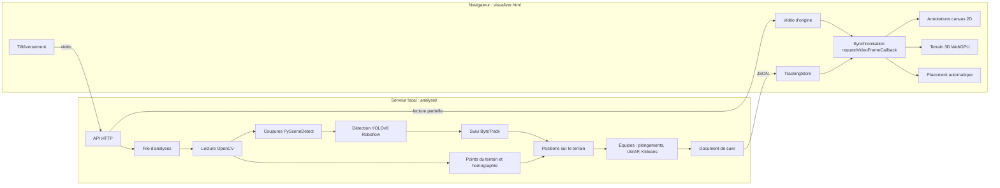

# Visualiseur de match : architecture et validation

Phases B et D du visualiseur de match. La phase A, la recherche des composants libres, est dans [opensource-research.md](opensource-research.md). L'installation et l'utilisation sont dans [analysis/README.md](../analysis/README.md).

**Statut :** prototype sur la branche `feature/visualiseur-match`, pas encore fusionné dans `main`. L'application AR n'est pas modifiée : aucun fichier de sa coquille ne change, et `SHELL_VERSION` reste `0cabdc0abc04da44`.

---

## 1. Ce que fait le prototype

1. L'utilisateur téléverse une vraie vidéo de match dans [visualizer.html](../visualizer.html).
2. Le serveur local l'analyse avec des modèles préentraînés publics :
   - détection des joueurs, des gardiens, des arbitres et du ballon ;
   - suivi image par image ;
   - deux équipes ;
   - calibration de la caméra et position sur le terrain.
3. La vidéo d'origine s'affiche avec ses annotations : une ellipse à la couleur de l'équipe et l'identifiant de suivi.
4. Le terrain 3D de l'application, rendu en WebGPU, est posé dans la vidéo, synchronisé image par image :
   - un panneau déplaçable, redimensionnable, orientable, zoomable, réductible et verrouillable ;
   - placé automatiquement dans la zone la moins encombrée de l'image.
5. Un joueur se sélectionne sur la vidéo ou sur le terrain 3D. Il est mis en évidence aux deux endroits, avec :
   - sa vitesse ;
   - sa distance parcourue ;
   - sa trace et sa flèche de déplacement.

Rien n'est inventé : sans calibration pour une image, aucune position n'est donnée et le terrain 3D reste vide ; sans équipe sûre, le joueur reste gris.

---

## 2. Architecture



| Rôle | Fichiers | Remarque |
| --- | --- | --- |
| Lecture de la vidéo | `pipeline.py` (`probe_video`, `_analyse_frames`) | OpenCV ; échantillonnage à cadence fixe (12,5 images/s), horodatage de la vidéo source |
| Détection et suivi | `detection.py`, `tracking.py` | YOLOv8 (Roboflow Sports) ; ByteTrack (trackers) ; coupures (PySceneDetect) |
| Calibration | `calibration.py` | 32 points du terrain, homographie RANSAC, contrôles, causes d'échec |
| Équipes | `teams.py` | `TeamClassifier` de Roboflow, vote par trajectoire |
| Données | `contract.py`, `metrics.py`, `jobs.py` | Format commun au fichier et au direct ; mesures de qualité ; un dossier par analyse |
| Transport | `server.py` | HTTP, bibliothèque standard ; lecture partielle de la vidéo |
| Rendu et interaction | `src/visualizer/` | Magasin, synchronisation, annotations, terrain 3D, panneau, placement, mesures |

### API du serveur

| Requête | Réponse |
| --- | --- |
| `GET /api/health` | Matériel de calcul, poids manquants, réglages |
| `POST /api/analyses?name=<fichier>` (corps : la vidéo) | 202 et l'état de l'analyse ; 415 si le format n'est pas pris en charge ; 422 si OpenCV ne peut pas lire la vidéo |
| `GET /api/analyses` | Liste des analyses |
| `GET /api/analyses/<id>` | État, progression, et à la fin mesures et limites |
| `GET /api/analyses/<id>/tracking` | Document de suivi ; 409 avant la fin |
| `GET /api/analyses/<id>/video` | Vidéo source, avec `Range` |

Le serveur écoute `127.0.0.1:8765` et ne sert que `visualizer.html`, `src/` et `assets/`. Il ne sert ni `index.html` ni `sw.js` : le Service Worker de l'application AR ne peut donc pas s'installer sur son origine, où il mettrait en cache les réponses de l'API.

---

## 3. Format des données de suivi

Un document de suivi est un JSON. Exemple réduit, tiré de l'analyse réelle de la vidéo de la Bundesliga :

```json
{
  "format": "football-tracking", "version": 1,
  "source": { "kind": "file", "name": "roboflow-dfl-2e57b9_0.mp4", "width": 1920, "height": 1080, "fps": 25.0, "frameCount": 750, "duration": 30.0 },
  "analysis": { "stride": 2, "fps": 12.5, "models": { "players": { "file": "football-player-detection.pt", "sha256": "…" } } },
  "pitch": { "length": 105.0, "width": 68.0, "origin": "centre", "units": "m" },
  "frames": [
    { "index": 200, "time": 8.0, "shot": 0, "cut": false,
      "calibration": { "status": "ok", "keypoints": 13, "inliers": 13, "errorPx": 2.9, "errorM": 0.36, "homography": [9 nombres] },
      "objects": [ { "id": 1, "role": "player", "confidence": 0.91, "box": [x1, y1, x2, y2], "pitch": [15.6, 7.66],
                     "pitchStatus": "ok", "team": 0, "teamConfidence": 1.0 } ],
      "ball": { "confidence": 0.62, "box": [x1, y1, x2, y2], "pitch": [x, y], "pitchStatus": "ok" } }
  ],
  "teams": [ { "id": 0, "color": "#f7f8ed", "tracks": 11 } ],
  "tracks": [ { "id": 1, "role": "player", "team": 0, "teamConfidence": 1.0, "teamVotes": 8, "firstTime": 0.0, "lastTime": 29.92 } ],
  "metrics": { "…": "partie 5" },
  "limitations": [ "Les numéros de maillot ne sont pas lus…" ]
}
```

Règles du format :

- **Temps.** Chaque image analysée garde son numéro et son instant dans la vidéo source, ce qui rend les cadences et les résolutions indifférentes.
- **Boîtes.** Elles sont en pixels de la vidéo source.
- **Positions.** Elles sont en mètres, l'origine au point central :
  - `x` va vers le but de droite de l'image ;
  - `y` va vers la caméra principale.
- **Position absente.** `pitch: null` est toujours accompagné d'une cause :
  - `no-calibration` : l'image n'a pas pu être calibrée ;
  - `outside-pitch` : la position calculée tombe à plus de 5 m des lignes.

  `validate_document` refuse une position dans une image non calibrée.
- **Échec de calibration.** Il porte sa cause (`reason`), parmi `too-few-keypoints`, `too-few-inliers`, `aligned-keypoints`, `mirrored`, `reprojection-error`, `homography-failed` et `no-pitch-detected`.
- **Confiance.** Chaque détection a la sienne ; chaque équipe a sa part des votes (`teamConfidence`). Sous deux tiers des votes, l'équipe reste `null`.

### Même format pour le direct

Le document se découpe en messages, et inversement (`document_to_messages`, `messages_to_document`) :

- un en-tête (`header`) : source, analyse, terrain ;
- une image analysée (`frame`), qui se suffit à elle-même : équipe et confiance y sont recopiées ;
- un résumé (`summary`), qui peut être renvoyé à tout moment.

Côté navigateur, `TrackingStore.ingest` reçoit ces mêmes messages, y compris dans le désordre ; c'est testé.

Le transport du direct n'est pas écrit. Le plus simple serait un WebSocket qui pousse ces messages en JSON, un par image analysée. Le WebRTC ne servirait qu'à transporter l'image elle-même.

Pour un flux, une différence demeure : les équipes demandent une phase d'apprentissage. Les premières secondes resteraient avec `team: null`, puis le résumé et les images suivantes porteraient les équipes.

---

## 4. Réutilisation des modules three.js du projet

| Module | Usage dans le visualiseur |
| --- | --- |
| `webgpu.js` | `createWebGpuRenderer` : WebGPU sans repli, fond transparent (`alpha`) pour laisser voir la vidéo |
| `pitch.js` | Le terrain, tel quel |
| `players.js` | `PlayerFactory` et `TeamMeshes` : une réserve de pions instanciés par équipe ; numéro = identifiant de suivi |
| `ball.js` | Le ballon |
| `tactical-arrows.js` | `buildArrowGeometry` : les flèches de déplacement, en un seul maillage instancié |
| `raycasting.js`, `pointer-input.js` | Sélection d'un joueur au tap dans le terrain 3D |
| `config.js` | Échelle de la maquette (105 × 68 m réels) |
| `events.js` | Événements du panneau flottant |

---

## 5. Cas difficiles

| Situation | Traitement |
| --- | --- |
| Caméra qui suit le jeu, zoom | Une homographie par image analysée, à partir des points du terrain visibles |
| Coupure de plan | PySceneDetect ; suivi remis à zéro, identifiants neufs, numéro de plan dans chaque image ; aucune interpolation à travers une coupure |
| Joueur masqué ou hors champ | Absent de l'image analysée : ni dessiné, ni interpolé. ByteTrack garde sa trajectoire ouverte 1 s (réglage par défaut de trackers : 30 images à 30 images/s), puis l'abandonne |
| Échange d'identifiants | Non corrigé (pas de réidentification) ; mesuré : fragmentation, déplacements invraisemblables. Les votes d'équipe couvrent toute la trajectoire : un échange partage les votes, et l'équipe reste inconnue plutôt que fausse |
| Échec de calibration | Cause enregistrée, aucune position ; le visualiseur l'écrit et laisse le terrain 3D vide |
| Position incertaine | Erreur de reprojection par image ; position hors du terrain écartée ; confiance de détection et d'équipe |
| Cadences et résolutions | Échantillonnage à cadence fixe et horodatage source ; boîtes mises à l'échelle de l'image affichée |
| Synchronisation | `requestVideoFrameCallback` en lecture ; après un déplacement dans la vidéo, `currentTime` ramené au début de l'image affichée ; interpolation linéaire seulement entre deux analyses consécutives d'un même joueur |

---

## 6. Validation

### 6.1 Niveaux de preuve

| Niveau | Contenu |
| --- | --- |
| **Automatisé** | 34 tests Python (sans GPU ni poids), 14 tests unitaires du visualiseur, 14 vérifications de bout en bout dans Chrome avec WebGPU, sur des données synthétiques |
| **Mesuré sur de vraies vidéos** | Analyses de vraies vidéos de match sur la machine de développement (RTX 2050, 4 Go), dont deux téléversements complets par l'interface (CLIP, puis SigLIP par défaut) |
| **Inspecté à l'œil** | Comptage manuel sur deux images en pleine résolution ; images annotées et vue de dessus comparées à la vidéo |

Aucune vérité terrain n'accompagne ces vidéos : les mesures de la partie 6.3 sont des indicateurs, pas des scores de précision. Les scores publiés des modèles sont dans [opensource-research.md](opensource-research.md) (partie 2.1).

### 6.2 Vidéos

Quatre analyses de vraies vidéos de match, le 17 novembre 2026, par `python -m football_analysis analyse … --teams clip`, sur un PC portable avec une RTX 2050 (4 Go) et un Ryzen 7 6800HS :

| Vidéo | Origine | Format | Ce qu'elle teste |
| --- | --- | --- | --- |
| `2e57b9_0` | Exemples de Roboflow Sports (`setup.sh`), tirés du concours Kaggle « DFL – Bundesliga Data Shootout » | 1920 × 1080, 25 images/s, 30 s | Caméra principale de la Bundesliga, qui suit le jeu |
| `0bfacc_0` | Même source | 1920 × 1080, 25 images/s, 30 s | Un autre match (Stuttgart) |
| `121364_0` | Même source | 1920 × 1080, 25 images/s, 30 s | Un troisième match |
| `2e57b9_0` en 720p | Copie de la première, réencodée en local avec ffmpeg | 1280 × 720, 30 images/s, 30 s | Autre résolution et autre cadence, même scène |

Les conditions d'utilisation des vidéos du concours n'ont pas pu être lues (partie 6 de la recherche). Elles sont utilisées en local, ni versionnées ni diffusées. Aucune de ces vidéos ne contient de coupure de plan : la remise à zéro du suivi aux coupures n'est vérifiée que par les tests automatisés.

### 6.3 Résultats

Indicateurs calculés par le prototype sur chaque analyse (`metrics.py`), sans vérité terrain :

| Indicateur | `2e57b9_0` | `0bfacc_0` | `121364_0` | `2e57b9_0` en 720p, 30 images/s |
| --- | ---: | ---: | ---: | ---: |
| Images analysées (pas d'échantillonnage) | 375 (1 sur 2) | 375 (1 sur 2) | 375 (1 sur 2) | 450 (1 sur 2) |
| Joueurs par image | 20,2 | 19,8 | 19,9 | 19,8 |
| Ballon trouvé | 73 % des images | 84 % | 80 % | 72 % |
| Images calibrées | 100 % | 100 % | 100 % | 100 % |
| Repères du terrain par image (médiane) | 13 | 9 | 12 | 13 |
| Erreur de reprojection, médiane (90ᵉ centile) | 3,0 px (4,4) | 2,7 px (3,5) | 3,9 px (5,0) | 2,0 px (3,1) |
| Même erreur, en mètres sur le terrain | 0,37 m (0,60) | 0,35 m (0,59) | 0,49 m (0,62) | 0,41 m (0,63) |
| Trajectoires (dont joueurs) | 31 (24) | 26 (22) | 27 (21) | 31 (22) |
| Durée médiane d'une trajectoire | 29,8 s | 29,8 s | 29,8 s | 29,9 s |
| Indice de fragmentation (1 = idéal) | 1,14 | 1,05 | 1,05 | 1,10 |
| Déplacements de plus de 12 m/s | 4,5 % | 3,8 % | 8,3 % | 8,0 % |
| Vitesse médiane mesurée | 3,5 m/s | 2,8 m/s | 3,2 m/s | 3,6 m/s |
| Observations de joueurs avec une équipe | 100 % | 100 % | 95 % | 90 % |
| Images analysées par seconde | 2,2 | 2,3 | 2,3 | 2,6 |
| Durée totale, rapportée à la vidéo | 8,5 fois | 7,9 fois | 8,1 fois | 8,5 fois |
| Mémoire vive au plus haut, mémoire GPU des modèles YOLO | 2,6 Go, 1,75 Go | 2,6 Go, 1,75 Go | 2,6 Go, 1,75 Go | 2,6 Go, 1,75 Go |

Lecture de ces résultats :

- **Détection.** Compté à la main sur deux images de `2e57b9_0` en pleine résolution :
  - image 400 : 24 personnes sur le terrain, dont 20 joueurs de champ, 1 gardien, 1 arbitre et 2 arbitres assistants, toutes détectées, sans fausse détection ;
  - image 600 : 23 personnes, toutes détectées, et une fausse détection, un entraîneur qui marche le long de la ligne de touche, classé arbitre.

  Les entraîneurs, remplaçants et photographes hors du terrain ne sont pas détectés. Deux images ne font pas un score de précision : ce comptage confirme seulement les scores publiés du modèle (mAP50 de 0,994 pour les joueurs). Sur `0bfacc_0`, le gardien en vert est détecté comme joueur : 0 gardien par image.
- **Suivi.** La plupart des joueurs gardent un seul identifiant pendant toute la vidéo (durée médiane égale à la vidéo, fragmentation de 1,05 à 1,14). Un échange d'identifiants a été vu sur `2e57b9_0` : la trajectoire 15 passe d'un joueur sombre à un joueur blanc. Les déplacements invraisemblables (de 3,8 % à 8,3 %) mêlent ces échanges et le tremblement de la calibration.
- **Calibration.** Toutes les images sont calibrées, avec une erreur médiane de 0,35 à 0,49 m sur les repères du terrain. Les positions, reportées sur une vue de dessus, correspondent à la partie du terrain filmée (contrôle visuel sur quatre images de deux vidéos). Cette erreur est mesurée sur les points qui ont servi à l'estimation : l'erreur sur un joueur, loin de ces points, peut être plus grande.
- **Équipes.** Sur l'image 400 de `2e57b9_0`, 19 joueurs de champ sur 20 sont dans la bonne équipe ; l'exception est la trajectoire 15, échangée. Ce cas a conduit à répartir les images de vote sur toute la trajectoire (commit 0faf219) : la trajectoire 15 passe de 6 votes sur 6 pour la mauvaise équipe à 4 sur 6, et sa part des votes, 67 %, signale le mélange. Sur `0bfacc_0`, les maillots rouges et blancs sont bien séparés.
- **Vitesse et mémoire.** De 2,2 à 2,6 images analysées par seconde, soit de 8 à 8,5 fois la durée de la vidéo, équipes comprises (75 à 84 s par vidéo). Le pipeline tient dans 4 Go de mémoire GPU.
- **Cadence et résolution.** La copie en 720p à 30 images/s donne les mêmes ordres de grandeur que l'original : joueurs par image, calibration, trajectoires. Ses équipes sont un peu moins sûres (90 % des observations contre 100 %).

### 6.4 Interface

**Tests de bout en bout** (`tests/visualizer-tests.mjs`, Chrome avec WebGPU, vidéo synthétique dont chaque image porte son numéro en binaire) :

- 14 vérifications sur 14 réussies le 17 novembre 2026 ;
- **à l'arrêt**, après un déplacement dans la vidéo, l'image affichée et l'image annotée sont la même, aux images 25, 47 et 91 ;
- **en lecture**, selon l'essai, entre 265 et 312 des quelque 318 images peintes sont identiques, et l'écart ne dépasse jamais une image (40 ms) ;
- **aucun contexte WebGL** n'est créé : seulement `webgpu`, et `2d` pour les annotations et les numéros.

**Vraie vidéo, par l'interface.** `2e57b9_0` a été téléversée par la page, sur le serveur lancé avec `--teams clip` :

- 286 s entre le choix du fichier et l'affichage de l'analyse ;
- en lecture, dans Chrome sur le même PC : 144 images peintes par seconde, au plus 10,8 ms pour une image ;
- 23 joueurs posés sur le terrain 3D ;
- aucun écart entre l'instant de l'image présentée et celui des données affichées ;
- aucune erreur dans la console.

Les captures montrent le panneau 3D placé seul au-dessus des tribunes à 16 s, puis en bas à gauche, sur une pelouse vide, à 28 s.

**Réglage par défaut, SigLIP.** `121364_0` a aussi été téléversée sur le serveur lancé sans option, avec SigLIP (Apache-2.0) :

- 256 s jusqu'à l'affichage, dont 67 s pour les équipes (78 s avec CLIP) ;
- la même répartition des équipes qu'avec CLIP : 13 et 10 trajectoires, une inconnue, 95 % des observations avec une équipe ;
- en lecture, 129 images peintes par seconde, au plus 38,9 ms pour une image ;
- aucune erreur.

La capture montre les deux maillots, rouge et vert, à leur couleur, avec des étiquettes lisibles.

**Défauts trouvés par ces essais, et corrigés :**

- un message masqué qui restait au-dessus de la vidéo et bloquait les clics (`[hidden]` contre `display`) ;
- la taille de départ du panneau ;
- l'instant utilisé après un déplacement dans la vidéo : Chrome sans fenêtre ne rappelle pas `requestVideoFrameCallback` à l'arrêt ;
- des étiquettes blanches sur un maillot blanc ;
- la couleur d'un maillot rouge, tirée vers le brun par la pelouse.

**Hors de portée de ces essais :**

- l'usage au doigt sur tablette ;
- un écran de moins de 960 px de large, où les panneaux passent sous la vidéo : la mise en page est prévue, mais non vérifiée ;
- la mesure des images par seconde sur un ordinateur modeste.

---

## 7. Limites et suites

- **Numéros de maillot :** non lus (partie 2.5 de la recherche).
- **Réidentification :** absente. Un joueur sorti du champ revient avec un nouvel identifiant ; deux joueurs croisés peuvent échanger leurs identifiants. Pistes : BoT-SORT avec compensation du mouvement de la caméra, réidentification de BoxMOT (AGPL-3.0).
- **Domaine des modèles :** caméra principale de la Bundesliga. Les vidéos libres de Wikimedia Commons choisies pour tester d'autres prises de vue (tribunes, match amateur) n'ont pas pu être téléchargées : le serveur de fichiers a répondu « 429 Too Many Requests » à chaque essai, le 17 novembre 2026. Ce test reste à faire.
- **Vitesse :** environ 10 fois la durée de la vidéo sur une RTX 2050, donc loin du direct. Pistes : un détecteur plus petit (RF-DETR N ou S, Apache-2.0, à affiner), l'export TensorRT, une cadence d'analyse plus basse.
- **Ballon :** projeté comme s'il était au sol.
- **Terrain :** supposé de 105 × 68 m.
- **Faux positif constaté :** un entraîneur qui marche le long de la ligne de touche, classé arbitre.
- **Licence :** voir la partie 6 de la recherche (AGPL-3.0 des poids, dépôt sans fichier LICENSE).
